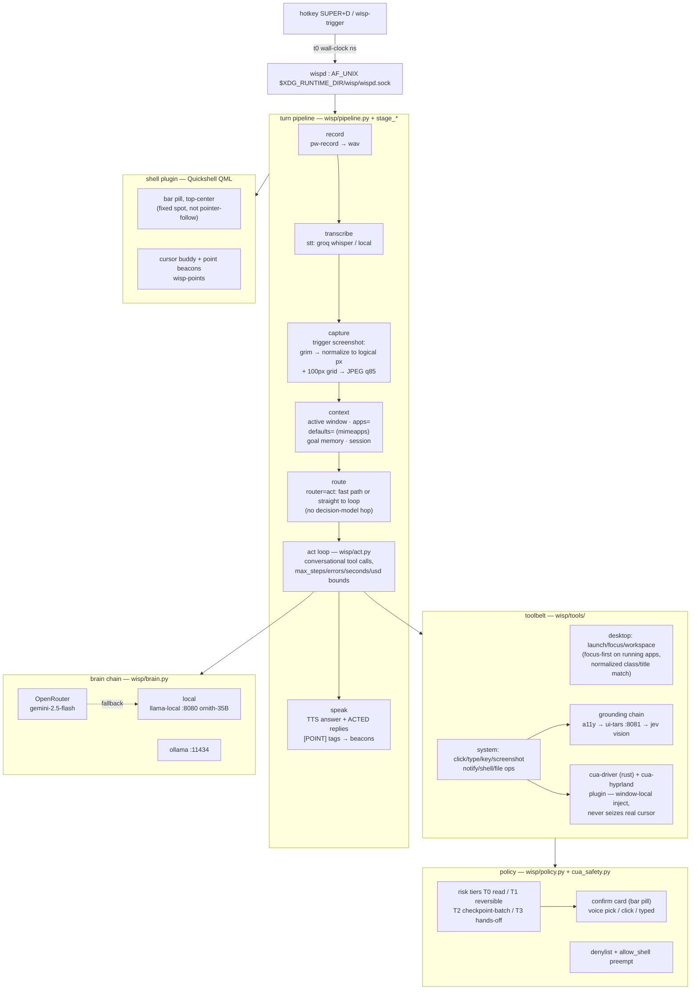

# Architecture

Wisp is a resident desktop companion: push-to-talk (or typed IPC) → a
staged pipeline in `wispd` → a guarded tool/act loop → spoken + on-screen
feedback. Everything below is the current tree, not aspirational.

## Turn anatomy

## Data spine — `~/.local/share/wisp/`

| File | What |
|---|---|
| `trace.jsonl` | debug spine — every stage event per turn: `screen_capture`/`shot_normalize`/`shot_compress`/`llm_call`/`tool_call`/`tool_result`/`ground(_refused)`/spans. `wispd trace --turn <id>` |
| `decisions.jsonl` | one row per turn: route, ms timings, result |
| `trajectories.jsonl` | act-loop step sequences (training data) |
| `usage.jsonl` | model spend ledger (also legacy `spend.jsonl`) |
| `activity.jsonl` | dayflow harness feed (app focus history) |
| `inventory.json` | installed-app catalog + `defaults` from mimeapps |
| `labels.jsonl` | route-intent corrections (right/wrong on decisions) |
| `corrections.jsonl` | dictate "I meant X" pairs |
| `session.jsonl` | conversational session turns |
| `tasks.jsonl` + `tasks/` | background agent runs |
| `recall.db`, `MEMORY.md` | memory + recall store |
| `wispd.log` | daemon operational log |
| `state.json` (RUN_DIR) | live StateBus snapshot the shell renders |

## Key invariants

- **Screenshot pixel space is logical.** `_normalize_shot` resizes to the
  compositor's logical canvas and overlays a labeled grid; clicks map
  1:1 via `points.to_logical` (SHOT_ORIGIN tracks single-output offsets).
  Model transport is JPEG q85; disk stays PNG.
- **The model never asks "which app".** `apps=` + `defaults=` are in the
  env line; `launch` resolves installed apps by normalized name, focuses
  running ones, opens domains in the configured browser.
- **Grounding degrades, never guesses silently.** Chain refuses with
  reasons (`low_confidence`, `all_down`, `not_found`) and each outcome is
  traced.
- **Safety is boundary-based.** Denylist preempts tiers; T2 batches into
  one confirm card; the loop drops user input instantly
  (`realinput` watch) — never fights the human for the cursor.

See `docs/PIPELINE_STAGES.md` for the per-stage contract and
`docs/CUA.md` for the computer-use driver detail.
