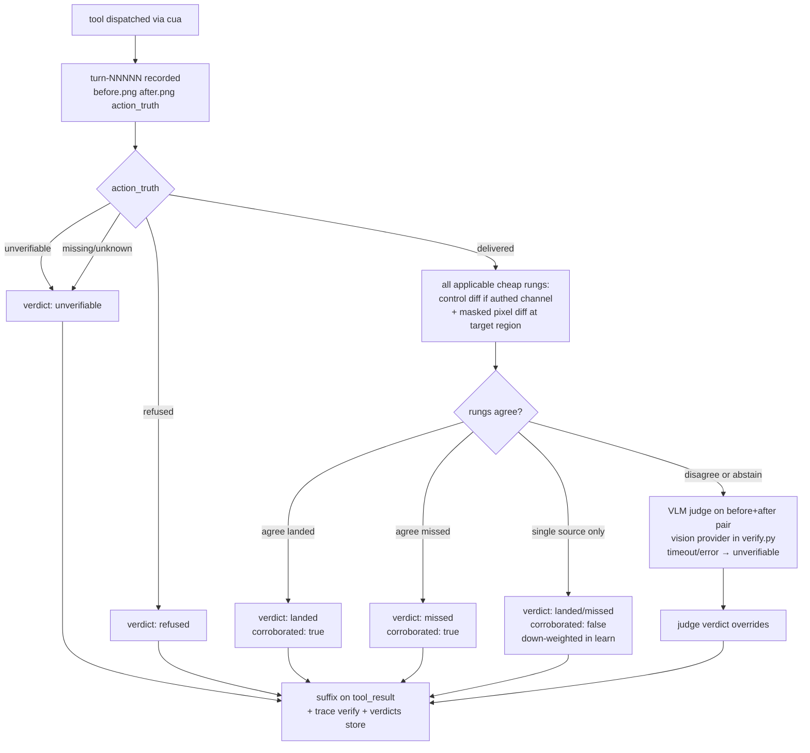
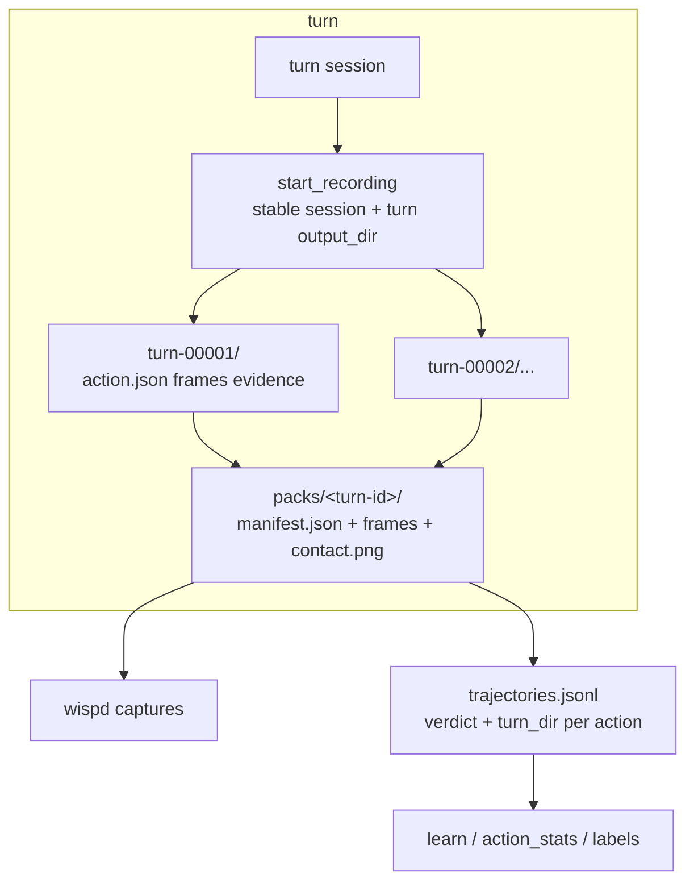

# Event-driven capture packs and action verification

## Goal Capsule

- **Objective:** Every mutating action dispatched through cua produces verified evidence — before/after frames, a structured verdict the loop can react to, and a durable capture pack — so a miss is caught in the same turn and every recorded action becomes scored training data. Mutating tools outside cua's dispatch path (`type_text`/`key`/`scroll` via wtype/ydotool, `launch`/`focus`/`close`/`workspace`/`shell` via hypr, `fill`/`post_send` via DOM) carry an explicit `not_recorded` verdict rather than silent coverage — whether they get rerouted through cua's input tools is a follow-up decision, not assumed here.
- **Means:** Reuse cua-driver's existing recording/`verify_state` machinery rather than a parallel capture system, run a cheap-first verification ladder, and treat per-app control channels (FilmCraft first) as the high-trust corroborating rung (KTD1, KTD2, KTD3).
- **Authority:** this plan; repo conventions in `AGENTS.md`; merged #124 (H1–H9) behavior stays intact.
- **Execution profile:** six units, two dependency chains converging on trajectory integration; U1 unblocks everything.
- **Stop conditions:** verification must never report success it didn't observe (unknown ≠ landed); no deny-interval frame survives the turn — packs contain none, `rec/` copies are deleted at the post-dispatch and pack-write re-checks, and every suppression/quarantine event is itself recorded.

---

## Product Contract

### Summary

Wisp acts but cannot prove it acted. The FilmCraft drill produced `CLICKED(619,620)` — dispatched cleanly, missed the button by ~70px, and nothing in the loop noticed, because the auto re-observe only fires before the next pointer call and `_verify_hint` is prompt text, not a check. Meanwhile cua-driver already implements per-action before/after frames, `action_truth`, `verify_state`, `zoom` crops, and `replay_trajectory` — wisp has simply never called `start_recording`. And FilmCraft itself ships the thing egui apps lack: a JSON-lines control channel exposing every widget's automation id, label, and rect (`ui.elements`), full UI state (`ui.inspect`), and per-panel screenshots — ground truth for both grounding and verification.

This plan wires wisp into all three: turn-scoped recording as the frame substrate, a verification ladder appended to tool results, and a capture pack — frames, manifest, transcript anchors — durable enough for Jev review, replay, and the craft-app training loop.

### Problem Frame

The stakes are training quality, not just per-turn correctness. The user's stated direction is that logs drive training and Jev checks outcomes — but today the log records what wisp *dispatched*, not what *happened*. Unscored actions make bad trajectories; a training set full of "CLICKED" entries that actually missed teaches the wrong lesson. Scrawl (MIT, `github.com/kitlangton/scrawl`) demonstrates the artifact shape that works: numbered, timestamped frames anchored to narration, a manifest, and a sparse→dense re-observe path the agent controls. Verification prior art (VeriGUI TVAE, PUSV's masked-diff ladder, OSWorld state-checks) converges on predict-then-verify with cheap checks first and model judgment only on ambiguity.

### Key Decisions

- **Verification exists to feed training and correction loops, not just turn success** — verdicts must be durable, structured, and consumable by `learn`/`labels`, per the user's standing direction (session-settled: user-directed — Jev verifies outcomes and logs drive training). Governs R2, R5.
- **Craft apps are the proving ground and verification must work vision-only where no control channel exists** — FilmCraft is first; the generic lane cannot depend on AT-SPI or app cooperation (session-settled: user-directed). Governs R2, R4.
- **Repro capture is in scope** — a narrated frame-burst the user can hand to Jev or an external agent reuses the same machinery as automatic action frames (session-settled: user-approved — proposed with the smaller automatic-only alternative shown; user confirmed the broader scope). Governs R6.
- **Cheap checks first, Jev only on ambiguity** — per-mutation model judgment is a deliberate latency/spend cost; the ladder escalates only when cheap evidence disagrees or is absent (session-settled: user-approved — chosen over Jev-verifies-everything for per-click cost). Governs R2.

### Requirements

**Capture**

- R1. Every mutating act-loop action dispatched through the cua backend is recorded — `start_recording`/`stop_recording` with a stable cua session label plus a per-turn `output_dir` (turn isolation lives in the dir, not a separate turn-session filter) — producing before/after frames, `action.json` with `action_truth`, and `evidence.json` per action.
- R9. No deny-interval frame survives the turn: capture is suppressed while a deny-listed surface is on screen — visibility, not focus (credential dialogs and keyring prompts can render unfocused) — and frames written before a post-dispatch dialog spawns are deleted at the re-checks. "On screen" = a mapped client of a deny-listed class on a visible workspace (source list: `cua_safety` `BUILTIN_DENY_APPS` + `[cua] deny`); an unreadable window list suppresses rather than captures. Suppression follows cua's `privacy_suppressed` evidence convention and is itself recorded.
- R10. Recording is bounded: session-scoped (never daemon-wide), frame count and PNG size budgeted per turn, and stale `shots/`/`turn-*` dirs pruned on a policy.

**Verify**

- R2. Each cua-dispatched mutating action's `tool_result` carries a structured verdict — `landed | missed | refused | unverifiable | suppressed | not_recorded` plus evidence pointers — as a structured object (separate `text` and `verdict` fields on the step record, mirrored in `trace.jsonl` and the verdicts store); unknown evidence never resolves to `landed`. Mutating actions outside cua dispatch use `verdict: not_recorded` so validators and `learn` never treat uninstrumented tools as verified or missed.
- R2a. A verdict that feeds learning labels requires corroboration — two independent rungs agree, or the judge confirms when cheap rungs disagree/abstain — applied **symmetrically**: a single unchanged-region pixel diff does not prove a miss (effects routinely land outside the target rect), so lone-source `landed` *and* `missed` are flagged `corroborated: false` and down-weighted in `learn`.
- R3. The final mutation of a turn is verified too — a terminal after-frame closes the re-observe gap that let the FilmCraft miss go unnoticed.
- R4. Where an app exposes a control channel (FilmCraft first), its element registry and state inspect join the grounding chain ahead of vision and run as the high-trust corroborating verify rung — pixel diff remains the independent cheap rung, since corroboration needs two sources.

**Artifact**

- R6. A capture pack is written per turn at `~/.local/share/wisp/packs/<turn-id>/`: a versioned `manifest.json` (turn id, transcript lines with timestamps, actions with verdicts, frame index), the frames, and a contact-sheet montage; `wispd captures` lists/locates packs over IPC, serving metadata by default with transcript lines behind an explicit flag.
- R11. Keyboard-tool args are redacted in pack copies (length + salted hash, matching `cua_safety.py` audit hygiene); `rec/` and `packs/` dirs are `0700` and packs age out by count and age, not count alone.
- R7. Dense re-observe is model-callable — an `observe` tool returning a cropped frame (cua `zoom` or control-panel screenshot) — while sparse event frames stay automatic and free of model involvement.
- R8. Overlay marks are numbered and citeable: the model can emit `pin:N` in a click target and the loop resolves it to the pinned coordinates.

**Learn**

- R5. Each verdict lands in `trajectories.jsonl`/`decisions`/labels alongside the action record and its `turn_dir`, so `learn` and `action_stats` score real outcomes; records carry the rung that produced the verdict (`verify_source`) and the corroboration flag (per R2a).

### Scope Boundaries

**Deferred for later (same product identity, next passes):** Jev/UI-TARS judge escalation implementation beyond the ladder's ambiguity hook; pack export to external agent formats (Scrawl `.scrawl` interop, replay bundles); panel surfaces for browsing packs; `record_video` capture (wf-recorder path exists, off by default — PNG frames are the training signal, video is demo polish); browseros-neo DOM-click recording (outside cua's dispatch path).

**Outside this product's identity:** training the models themselves; changing deny-list/confirm policy beyond frame suppression; narrated-burst UX beyond what the pack format needs (no new hotkey surface in this plan).

**Deferred to follow-up work:** `clicklab`'s browseros-neo path recording (research flagged it falls outside cua dispatch); `parse_visual_regions`/`invoke_menu` cua commands (optional `cua-perception` extension absent on this box); FilmCraft-side control-channel auth (token under `XDG_RUNTIME_DIR` or AF_UNIX peer-uid — KTD3); the decision whether `type_text`/`key`/`scroll` reroute through cua's input tools for recording coverage (real tradeoffs — cua `hotkey` refuses WM chords, background delivery is compositor-focus-only) vs permanently `not_recorded`.

**In scope (retention gate):** `sync-from-dell` must exclude `~/.local/share/wisp/rec/` and `~/.local/share/wisp/packs/` before `packs.keep` / `packs.keep_days` can enforce retention — without those excludes, rsync can resurrect pruned packs on the Dell (same class as the wordink token incident). U4 lands the machine-side exclude alongside pack lifecycle.

**Scope clarification — narrated repro:** packs anchor transcript lines to frames by timestamp, but frames only exist when wisp dispatches actions. A repro where the *user* clicks while narrating produces a transcript-only pack this pass — the narrated-burst capture surface for user-performed demos is the deferred UX above. In scope: narrated act turns producing complete packs.

### Success Criteria

- A FilmCraft modal click that misses is reported `missed` in the same turn — not `CLICKED` — with the element's expected rect cited.
- `wispd captures` returns the turn's pack with manifest, frames, and contact sheet; a Jev review of a pack answers "did it work" without re-running anything.
- `wispd trace --kind verify` shows verdict + evidence source per mutation; `img_kb` stays in the JPEG regime (#126).
- After a drill turn with a deliberate miss, `action_stats`/`learn` reflect landed-vs-missed read back from the stores — corroborated and single-source rows distinguished — not just verdict fields present in `trajectories.jsonl`.
- No deny-interval frame survives the turn — packs contain none, `rec/` copies are deleted, and each suppression/quarantine event is recorded as evidence.

---

## Planning Contract

### Key Technical Decisions

- KTD1. **cua-driver recording is the frame substrate.** `call start_recording{session:"wisp", output_dir:<turn-dir>}` / `stop_recording` wraps the act session (cua's optional `session` filter scopes which daemon calls are recorded; wisp uses one stable label plus a per-turn output dir for isolation — see Assumptions). Per-action `turn-NNNNN/` dirs give before/after PNGs, `action.json` (`action_truth`, route, transport), bounded `before/after_state.json` AT-SPI walks, and `evidence.json` — all live-tested on this box (`docs/research/cua-recording-verify.md`). Chosen over a wisp-side grim/capture loop: the daemon already pays this cost and adds truth annotations wisp would have to rebuild. Limit it to cua-dispatched actions — read-only calls aren't recorded, and non-cua surfaces (browseros-neo DOM clicks) never appear.
- KTD2. **The verify ladder is cheap-first and its verdict rides the tool result.** All applicable cheap rungs run, then reconcile: `action_truth` (`refused` → `refused`; `unverifiable` → `unverifiable`; missing/unknown → `unverifiable`, never `landed`) → control-channel state diff where an **authenticated** channel exists (JSON-lines — likely the cheapest and the designated high-trust rung) → masked pixel/SSIM diff at the target region; a dedicated vision judge in `wisp/verify.py` (VLM on the before/after pair via a configured vision-capable provider — not `ask_jev`, which is text-only, and not `brain.chat`, which has no image path in the act loop today) fires only on disagreement or mutual abstention. **Data boundary:** frames sent to any external VLM endpoint require explicit config (endpoint trust, retention, tenant isolation, user consent); otherwise redact or block transmission. Corroboration is symmetric per R2a — neither a lone "region changed" nor a lone "region unchanged" mints a label-grade verdict. The verdict is a structured object on the step record (`text` + `verdict` + evidence fields — loop-visible, trace-visible, store-visible), not a silent side-channel and not a new decision hop (session-settled: user-approved — cheap-first over Jev-per-mutation for per-click cost; governs R2).
- KTD3. **A control-channel capability lane joins grounding and verification — corroborating, not sole-sourcing.** An app registry (`app → control endpoint`) teaches wisp that FilmCraft's `--control 9876` JSON-lines server exists; `ui.elements` (id/label/rect) becomes a grounding source ahead of vision for that app, and `ui.inspect` + `ui.elements` diffs are a verify rung — but the channel is unauthenticated loopback until FilmCraft ships auth, so a squatting process could serve forged rects/diffs. Until channel auth lands, **control-derived rects and `ui.inspect` evidence are advisory only** — they may corroborate pixel/transport evidence but cannot drive dispatch or establish label-grade `landed`. When auth is present, click-by-id rects are sanity-checked against the app's live window bounds **from the compositor** (`hyprctl clients` / cua `list_windows` — never the channel's own `ui.inspect`) before dispatch; control evidence still cannot sole-source label-grade `landed` (per R2a). Channel auth (token under `XDG_RUNTIME_DIR` or AF_UNIX peer-uid) is a FilmCraft-side ask tracked in follow-up. New craft apps register endpoints as they ship the channel.
- KTD4. **The capture pack is a versioned manifest directory under `0700`.** `~/.local/share/wisp/packs/<turn-id>/` holds `manifest.json` (`wisp-capture-pack/v1`: turn id, session, transcript lines with timestamps, action list with verdicts and turn_dir refs, frame index), the frame PNGs, and a `contact.png` montage via ImageMagick when available (fallback: copy the first before/after pair without montage — pack remains valid). Lookup over IPC (`wispd captures [turn]`), never by scraping directories; the socket is same-UID trust, so `captures` serves metadata + frame paths by default and transcript lines only behind `--full`. Transcript/action text is untrusted data — control characters stripped at write, fields quoted in any judge prompt that consumes them (persistent injection surface otherwise).
- KTD5. **Dense observation is a tool, sparse observation is automatic.** The model gets `observe` (crop/zoom re-look) and `pin:N` cite resolution; the event-frame substrate needs no model involvement. This is the Scrawl sparse→dense model mapped onto cua `zoom` and control `ui.screenshot`.
- KTD6. **Privacy suppresses at capture time and deletes at re-check time.** Deny-listed *visible* surface (gcr-prompter, polkit, 1Password-class — mapped client on a visible workspace, not focus) → no frames written, suppression logged as evidence. A post-dispatch re-check covers the action-spawned case: a click that raises a credential dialog can land the dialog in `after.png`, so the re-checks and pack-write *delete* turn frames captured while a deny surface was on screen — "quarantine" here means secure deletion, not retention under `0700`; the achievable invariant is persistence-scoped (nothing survives the turn), since capture-time-only suppression can't see a dialog that post-dates dispatch. Orphaned `rec/` dirs whose turn never reached pack-write (crash, oomd kill) are discarded on daemon startup, never promoted.
- KTD7. **Replay stays a harness, not a verifier.** cua `replay_trajectory` re-executes tool+args verbatim and is useful for regression (record once, replay on a new build, diff), but blind re-execution is not outcome verification — the plan builds verdicts, not replay plumbing. (Element tokens die across sessions; pixel/keyboard calls replay clean.)

### High-Level Technical Design

The verify ladder — every mutating dispatch flows through it:

The pack — frames flow from recording dirs to the durable artifact to the training stores:

### Assumptions

- cua `start_recording` accepts a session filter and survives one-shot `call` connections — live-tested per `docs/research/cua-recording-verify.md`. **The filter matches a `session` field each dispatched call must carry; no wisp call site sends one today** — `Cua.click`/`move_cursor` and the raw `cua-driver call` argv in `platform.pointer_cmds` both omit it (repo evidence: `wisp/cua.py`, `platform.py` argv branch). Label lifetime: a **stable `wisp` session label** on every cua call + per-turn `output_dir` — preserves the per-session snapshot/cursor context `zoom` and `verify_state` depend on (`zoom` fails `screenshot_context_missing` without a same-session snapshot), while turn isolation lives in the output dir. Sessions idle-expire (~300s sliding TTL per `docs/research/cua-sessions-cursor.md`) — a keepalive or re-mint policy belongs in U1.
- FilmCraft's control channel (`ui.elements`/`ui.inspect`/`ui.screenshot`, docs/control-protocol.md) is up when drills run — the app must be launched with `--control <port>`; the registry records the port, and absent-channel behavior degrades to the generic lane.
- `~/.local/share/wisp/shots/` has no pruning today; the budget policy in R10 is new behavior, sized to the JPEG-era payload norms, not a hard quota on turns.

### System-Wide Impact

- **First durable screen-content store.** `packs/` persists up to 200 turns of frames and manifests — a new data lifecycle with a retention boundary (`packs.keep`) and a privacy invariant (KTD6). `rec/` is transient and pruned after each pack write. `docs/OPS.md` gains both dirs.
- **Agent tool surface grows.** `observe` and `pin:N` cite join the toolbelt — per-turn tool-schema cost the brain pays on every call; keep the tool descriptions tight.
- **IPC surface grows.** `captures` is read-only over the peer-cred'd socket; manifests never carry secrets — transcript lines and verdict strings only.
- **Trace volume grows** ~1–2 events per mutation (`record`, `verify`) on the existing rotation policy.
- **Trajectory schema extends** (`verdict`, `turn_dir`, `pack` fields); readers stay schema-tolerant so old rows parse.
- **Two observation regimes by app:** control-capable apps (craft suite) get ground-truth grounding/verify; everything else gets pixel + thin-AT-SPI fallbacks. Trajectory records must name which regime produced the verdict — mixing them in training data without the source flag would corrupt aim metrics.

### Risks & Dependencies

| Risk | Decision |
|---|---|
| `verify_state` element predicates go `unknown` on thin AT-SPI (foot, egui, chromium-no-a11y) | Mitigated by design: unknown never resolves to `landed`; control lane is the high-trust rung for craft apps; pixel diff covers the rest (KTD2) |
| Focus-based suppression misses unfocused credential surfaces (an overlay rendered without focus) | R9 tightened: suppression keys on *visible deny-listed surfaces*, not focus alone — capture-time check inspects the window list, not just the focused one |
| Frame/Png volume per turn (multi-MB × actions × 200 packs) | Bounded by R10 budget + `packs.keep` + `rec/` prune; JPEG transport for model payloads is unchanged — pack frames stay PNG deliberately |
| cua daemon session staleness mid-turn (observed live: stale session → empty windows, refused clicks) | `record_unavailable` → turn proceeds unrecorded with trace event; no hard-fail |
| FilmCraft not launched with `--control` | Registry lookup misses → generic lane; drills must launch with the flag (`--control 9876`) or via `wisp launch` wrapper that adds it |
| `replay_trajectory` re-executes actions — unsafe as a generic tool | Not exposed to the act loop; drill/dev harness only (KTD7) |
| `packs/` + `rec/` under `~/.local/share/wisp/` ride the home rsync to the Dell (retention bypass + resurrection of pruned packs) | U4 adds `sync-from-dell` excludes for `rec/` and `packs/` before retention policy is trustworthy (Scope Boundaries) |
| Squatting process on `127.0.0.1:9876` serves forged `ui.elements` rects / `ui.inspect` diffs (unauthenticated channel) | Mitigated: rect-vs-window-bounds check before dispatch + control can't sole-source label-grade `landed` (KTD3, R2a); real fix is channel auth, deferred |
| Pack transcript text is persistent injection input to later judge/review calls | Mitigated: control chars stripped at write, fields quoted as untrusted data in judge prompts (KTD4, U2 step 6) |
| Recording adds per-dispatch latency (full-res PNG pair + bounded AT-SPI walks server-side) while `Cua` uses a ~0.8s click timeout — a recorded click can time out after delivery | Mitigated: measure overhead on a real FilmCraft miss drill before fixing timeout/latency budgets; raise the timeout for recorded sessions / treat `E_CUA_TIMEOUT` on recorded calls as unverifiable-not-failed |
| Pack volume in bytes is PNG-scale, not JPEG-scale (multi-MB frames × up to `act_max_steps` × `packs.keep`) | Bounded by R10's MB budget + `packs.keep`/`keep_days`; size the budget from measured per-action PNG bytes in the drill, not JPEG payload norms |
| Judge endpoint down while cheap rungs disagree | Judge timeout/error → `unverifiable`; the loop never auto-accepts. VLM judge carries real per-mutation latency — only ambiguity pays it |
| Other agents hold live sessions on the same cua daemon (r2/r3/itdirect observed) | Session filter isolates wisp's capture; unstudied concurrent-dispatch contention is a named residual |
| Dependency: cua-driver ≥0.33.1 with recording commands live on this box | Verified in `docs/research/cua-recording-verify.md`; `wispd doctor` gains a recording-capability check (U1) |

---

## Implementation Units

### U1. Turn-scoped recording lifecycle

- **Goal:** The act loop starts cua recording at turn start (stable session label + per-turn output dir) and stops it at turn end, linking each mutating dispatch to its `turn-NNNNN/` directory via a unique dispatch id.
- **Requirements:** R1, R10 (session scope + budget surface), R11 (the `rec/` 0700 + cleartext-window half)
- **Dependencies:** none
- **Files:** `wisp/record.py` (new thin client: start/stop/status + session keepalive), `wisp/cua.py` (`Cua.call` gains a `session` field threaded into click/move_cursor/zoom/verify_state), `wisp/platform.py` (`pointer_cmds` cua argv branch gains the same field — it bypasses the `Cua` client today), `wisp/pointer.py` (call sites), `wisp/tools/system.py` (observation calls), `wisp/act.py` (wrap the act session), `wisp/trace.py` (`record`/`record_turn` events), `wispd` (doctor gains a recording-capability check), `tests/test_record.py` (new)
- **Approach:**
  1. Every cua call carries the stable `wisp` session label (Assumptions: label lifetime is stable-session + per-turn `output_dir`, which preserves the snapshot/cursor context `zoom` needs); call `start_recording{session:"wisp", output_dir: ~/.local/share/wisp/rec/<turn-id>}` when the act loop enters, `stop_recording` on exit — including cancellation/error paths. Recording itself is still filtered to this turn by the output dir; keepalive or re-mint covers the ~300s idle TTL on long brain calls.
  2. Each mutating dispatch carries a monotonic `dispatch_id` (UUID or sequence) in the cua call and in the step record; after dispatch, resolve `turn-NNNNN` by matching **`dispatch_id` in `action.json` first**, falling back to tool+args+timestamp only when absent (bounded wait/retry — dirs may lag; recording covers every dispatched tool including `move_cursor`, so newest-dir alone misattributes). Attach `turn_dir` + parsed `action_truth`/route/transport. Mutating tools that never reach cua get `turn_dir: null` + verdict seed `not_recorded` (R2).
  3. Emit `record` trace events: session id, output dir, per-action turn dir, `action_truth`.
  4. Budget: cap recorded actions per turn at `agents.act_max_steps`; warn-and-stop recording (not the turn) on PNG size over a configured MB budget. `rec/` dirs are `0700` (R11). Keyboard-tool args are **redacted at write time in `action.json`** where `action_truth` does not require cleartext (length + salted hash, same hygiene as pack copies); failed turns run synchronous cleanup so crash/pack-write failure does not leave secrets on disk until the next startup sweep. Startup sweep still discards orphan dirs from turns that never reached pack-write (crash/oomd), never promoting them.
- **Patterns to follow:** cua `call` transport already used by `platform.pointer_cmds`; `evidence.json` conventions per `docs/research/cua-recording-verify.md`.
- **Test scenarios:**
  - Turn with two mutating calls produces two `turn-NNNNN` dirs and each step record carries the `turn_dir` whose `action.json` matches its dispatched call — including an interleaved `move_cursor` dir that must not misattribute.
  - Read-only calls (notify/answer) produce no verdict-eligible turn dirs.
  - Cancellation mid-turn still calls `stop_recording` (tempdir assertions on the fake).
  - A second turn gets a fresh output dir on the same session label.
  - Recording unavailable (daemon down) → turn proceeds, steps carry `turn_dir: null`, `record_unavailable` trace event, no exception.
  - Orphan `rec/<turn>` dir present at daemon start → discarded, event logged, never promoted to a pack.
  - A dispatched call's args visibly include the session field (argv-level assertion on the pointer_cmds branch).
- **Execution note:** Fake the cua call boundary in tests — the turn-dir contract is the assertion target, not a live daemon.
- **Verification:** unit suite green; live turn shows `record` events with real turn dirs in `wispd trace --turn`; `wispd doctor` reports recording capability.

### U2. Verify ladder and verdict plumbing

- **Goal:** Every mutating action's `tool_result` carries a structured verdict; the last mutation of a turn gets a terminal after-frame.
- **Requirements:** R2, R3, R9, R5 (verdict content half — store write lands in U6)
- **Dependencies:** U1
- **Files:** `wisp/verify.py` (new: ladder, verdict model, and the image-pair judge call — `wisp/judge.py` stays the per-task grader; the ambiguity rung calls a configured vision-capable provider, not `brain.chat`), `wisp/act.py` (structured verdict on the step record, terminal after-frame at loop exit), `wisp/grounding.py` (target-region rect for masked diff), `tests/test_verify.py` (new)
- **Approach:**
  1. Predict a postcondition at dispatch time: element/window predicate when the target resolved to a rect or AT-SPI element, else the target's pixel region.
  2. Ladder (KTD2): `action_truth` refused → `refused`; unverifiable → `unverifiable`; missing/unknown → `unverifiable`; delivered → **run all applicable cheap rungs** (control-lane diff from U3 when an authenticated channel exists; masked pixel diff at the target region — `before.png` vs `after.png` cropped to predicted rect, ImageMagick compare or PIL where present). Reconcile: two agreeing rungs → `corroborated: true`; one rung only → verdict with `corroborated: false`; disagreement or mutual abstention → VLM judge on the before/after pair with the predicted postcondition as the claim (vision provider in `verify.py` — not `ask_jev`), timeout/error → `unverifiable`.
  3. Verdict shape: structured object `{verdict, source: action_truth|pixel|control|judge, corroborated, evidence: turn_dir, detail}` on the step record (`text` for the model-visible string, `verdict` for stores) plus a `verify` trace event. The loop **surfaces `missed` to the model rather than auto-retrying** — automatic re-dispatch would let a forged negative become an action-repetition primitive.
  4. Terminal after-frame: at loop exit after the final mutation, call a **non-mutating capture API** once (session + output dir inputs) to produce the closing after-frame, link it to the last dispatched action via `dispatch_id` / turn dir / pack frame index, and run the ladder for that step before speak.
  5. Privacy: **immediately after cua writes each after-frame**, check the compositor window list for deny-listed *visible* surfaces (R9) before any ladder rung or downstream frame use — unreadable window list → suppress. On deny-listed surface or post-dispatch dialog, delete affected frames, verdict `suppressed`, skip downstream rungs; pack-write re-check repeats the same deletion.
  6. Judge prompts treat pack/transcript text as quoted untrusted data (KTD4).
- **Patterns to follow:** `_verify_hint` site at `wisp/act.py` (~:491) is the append point; `ground_refused`/`ground` trace shape for the `verify` event; masked-diff ladder per PUSV prior art (research dossier `web.md`).
- **Test scenarios:**
  - Refused action → verdict `refused`, source `action_truth`, no pixel compare invoked.
  - Delivered + region visibly changed (pixel only) → `landed`, `corroborated: false`.
  - Delivered + unchanged region (pixel only) → `missed`, `corroborated: false` — symmetric down-weight, not a confident negative.
  - Pixel + control agree landed → `landed`, `corroborated: true`; pixel says changed but control state unchanged → judge fires on disagreement.
  - Pixel abstains (no predicted rect) + no control channel → judge called with both frames; verdict recorded `source: judge`.
  - Deny-listed surface visible (unfocused) → verdict `suppressed`, zero frame files written.
  - Window list unreadable at capture time → `suppressed` (fail-safe), no frames.
  - Action spawns a deny surface post-dispatch (click raises a mock credential dialog) → the turn's affected frames are deleted at re-check/pack-write, suppression recorded.
  - Final mutation of a turn triggers the terminal capture even with no next pointer call.
  - Judge timeout/error → `unverifiable`, loop continues — never `landed` by default.
- **Execution note:** pixel-diff tolerance thresholds are the tuning surface; start conservative (prefer `unverifiable`→judge over false `landed`).
- **Verification:** tests green; live FilmCraft click drill shows a `verify` event whose verdict matches what actually happened on screen.

### U3. Control-channel capability lane

- **Goal:** Apps exposing a control channel get ground-truth grounding + verification + panel shots; FilmCraft is the first registry entry.
- **Requirements:** R4 (and feeds R2's control rung, R7's panel-crop source)
- **Dependencies:** U1, U2 (U2 lands the pixel/`action_truth` ladder and verdict plumbing first; U3 adds the control rung as an optional provider — U2 unit tests assert pixel-only corroboration; control-corroboration tests land with U3, avoiding a circular dependency)
- **Files:** `wisp/control.py` (new: JSON-lines client + `AppControlRegistry`), `wisp/grounding.py` (control lane in the chain), `wisp/verify.py` (control rung), `wisp/config.py` (registry config key), `tests/test_control.py` (new)
- **Approach:**
  1. `AppControlRegistry`: config `control.<app> = "127.0.0.1:<port>"`; FilmCraft default `9876`. Discovery: registry hit by window class, else absent.
  2. Client speaks the documented protocol — one JSON request per line, `{method, params}` → `{ok, result}`; bounded read timeout, 16-conn server cap respected (per `docs/control-protocol.md` in the filmcraft repo).
  3. Grounding: `ui.elements {prefix?}` → {id, label, rect} joins the chain ahead of vision for that app when the channel is authenticated; until then, control rects are advisory hints only (KTD3). When authenticated, click-by-id resolves rect center to logical coords on the cua dispatch path, with rects sanity-checked against compositor window bounds before dispatch.
  4. Verify rung: `ui.inspect` (+ `ui.elements`) snapshot before vs after → diff tool/workspace/element state against the predicted postcondition; control evidence corroborates but cannot alone produce label-grade `landed` (R2a).
  5. Dense observe source: `ui.screenshot {panel}` for panel-cropped frames.
  6. `ui.click {id}` stays available as a channel-dispatch lane — the app hits its own element with zero grounding error — but **pixel dispatch via cua remains the default even when a rect is known**: training the grounding chain is the settled point, and the FilmCraft ~70px miss is the failure class being measured. Channel-dispatched actions tag evidence `route: control` so `learn` can distinguish behavior-verified rows from grounding-verified rows.
- **Patterns to follow:** filmcraft `docs/control-protocol.md` + `docs/agents.md` method table; grounding-chain provider pattern (a11y → uitars → jev — control becomes a provider, not a fork).
- **Test scenarios:**
  - `ui.elements` response maps to candidate elements with logical-px rects (fixture reply; geometry assertion).
  - Named target ("Audio bin") grounds via control when a11y is empty — provider recorded as `control`.
  - State diff: `ui.inspect` before/after differing on `workspace` → predicted postcondition satisfied → `landed` via `control`.
  - No channel configured → ladder skips the rung silently.
  - Malformed line / server closed → client reconnects once, then rung abstains (never blocks the turn).
- **Verification:** tests green; live drill: wisp grounds a FilmCraft element by name through `ui.elements` and verifies via `ui.inspect` diff.

### U4. Capture pack artifact and IPC

- **Goal:** Every turn writes a durable, agent-consumable pack; `wispd captures` locates it.
- **Requirements:** R6, R10 (stale `shots/`/`turn-*` pruning + pack lifecycle), R11 (redaction, `packs/` 0700, age+count expiry)
- **Dependencies:** U1, U2 (pack consumes verdicts + turn dirs)
- **Files:** `wisp/packs.py` (new: manifest writer + contact sheet), `wisp/ipc.py` (`captures` command), `wispd` (`handle(cmd, peer)` ~:53 dispatch + `wispd captures [turn]` argv path + orphan `rec/` sweep at startup; `wisp/cli/` hosts the reader per the `wisp trace` precedent), `tests/test_packs.py` (new)
- **Approach:**
  1. **Deny-surface re-check before derivatives:** run the compositor visibility check on source frames before creating `contact.png` or any annotated/cropped derivatives; if a deny-listed surface appears, atomically delete the affected source frames and any derivatives already written, then regenerate only from validated frames. At turn end, copy/hardlink validated frames into `packs/<turn-id>/` (before/after/click-annotated), write `manifest.json` (`wisp-capture-pack/v1`: turn id, session, transcript lines w/ timestamps, actions + verdicts + turn_dir refs, frame index), build `contact.png` via `magick montage` when ImageMagick is present (else copy a representative before/after pair). Keyboard-tool args are redacted in pack copies — length + salted hash reusing `cua_safety.py`'s per-process salt. Dirs are `0700` (R11). AT-SPI dumps stay behind the `--full` gate. Add `rec/` and `packs/` to `sync-from-dell` excludes (retention gate — Scope Boundaries).
  2. `wispd captures` → JSON list (turn id, ts, action count, verdict histogram, path); `wispd captures <turn>` → the manifest; transcript lines and state dumps served only behind `--full` (KTD4).
  3. Pruning: keep last N packs (config `packs.keep`, default 200) AND age cap (`packs.keep_days`, default 30); `rec/` intermediates pruned after pack write; stale `shots/` dirs join the same age policy (R10's stale-dir clause). Trajectory rows keep verdicts + `turn_dir` refs after packs age out — the durable training signal is the verdict, the pack is its evidence.
  4. Narrated-burst path (R6's repro half): a turn may attach multiple transcript lines; pack format anchors speech → frames by timestamp. Frames exist only for wisp-dispatched actions — user-performed demos yield a transcript-only pack until the deferred burst surface lands (Scope Boundaries).
- **Patterns to follow:** `wispd trace` IPC precedent; manifest schema versioned like `cua-turn-evidence/v1`.
- **Test scenarios:**
  - Turn with 2 actions → pack dir contains manifest + 4+ frames + `contact.png`; manifest validates against the v1 schema fields.
  - Verdict histogram in `captures` list matches the verdicts written.
  - Prune at `keep=2`: third pack evicts oldest `packs/` dir and its `rec/` intermediates.
  - Missing frames (suppressed turn) → manifest still valid, `privacy_suppressed: true`, no frame entries.
  - `wispd captures` on empty store → `[]`, exit 0.
- **Verification:** tests green; `wispd captures <turn>` returns a complete manifest a Jev review could consume without re-running.

### U5. Dense observe tool and numbered pins

- **Goal:** The model gets an `observe` crop tool and can cite `pin:N`; sparse frames stay automatic.
- **Requirements:** R7, R8, R9 (observe is a capture path — same suppression invariant)
- **Dependencies:** U1 (frame plumbing + session label), U2 (suppression check), U4 (frame-index linkage), U3 optional (panel crops when a channel exists)
- **Files:** `wisp/tools/observe.py` (new tool; `wisp/tools/__init__.py` registry entry ~:230), `wisp/act.py` (pin cite resolution on click targets), `shell-plugin/lib/cursor.js` + `shell-plugin/components/Beacon.qml` (beacons already carry `index` from `step`/position — the work is stability across the turn + `pin:N` resolution, not new numbering), `tests/test_observe.py` (new)
- **Approach:**
  1. `observe{target}` → cropped frame: control `ui.screenshot {panel}` when the app has a channel, else cua `zoom{window_id, x1..y2}` (≤500px JPEG, `from_zoom` coords for follow-up clicks) — mirrors Scrawl's dense-grid re-observe. `zoom` needs a snapshot under the same session label — the stable `wisp` session means the turn's recorded frames satisfy it; an `observe` before any recorded action captures a session snapshot first. **Same R9 check as the ladder runs before any capture** — deny-listed surface visible → `observe` returns a suppressed refusal, writes nothing, records the suppression.
  2. Overlay marks get stable indices for the turn; `click pin:N` / `"the pin N target"` resolves to the mark's logical coords before dispatch.
  3. `observe` results are frames too — linked into the pack's frame index (U4).
- **Patterns to follow:** `zoom` semantics per `docs/research/cua-recording-verify.md` (`from_zoom` coord space); existing beacon rendering in `cursor.js`/`Beacon.qml`.
- **Test scenarios:**
  - `observe{target: "timeline"}` on FilmCraft returns a panel-cropped image under the byte budget.
  - `observe` with no channel → cua `zoom` path; returned dims ≤500px wide; an observe before any recorded dispatch captures its session snapshot first (no `screenshot_context_missing`).
  - Deny-listed surface visible during `observe` → suppressed refusal, no capture, no pack frame entry, suppression recorded.
  - `click pin:2` resolves mark 2's coords and dispatches at them; unknown `pin:9` → grounding refusal, no dispatch.
  - `observe` frames appear in the pack manifest frame index.
- **Verification:** tests green; live: ask wisp to look closer at a FilmCraft panel and click the pinned mark.

### U6. Verdicts into trajectories and drills

- **Goal:** Verdicts + turn dirs land in the learning stores; the clicklab drill harness records sessions.
- **Requirements:** R5
- **Dependencies:** U2, U4
- **Files:** `wisp/trajectories.py`, `wisp/learn.py`, `wisp/action_stats.py`, `scripts/clicklab/run.py`, `wisp/train.py` (the clicklab.jsonl bank fold — `clicklab/train.py` does not exist), `tests/test_trajectory_verdicts.py` (new)
- **Approach:**
  1. Each action record gains `verdict`, `verify_source`, `corroborated`, `turn_dir`, `pack` fields — append-only, schema-tolerant readers; `not_recorded` verdicts mark the uninstrumented mutating surface rather than counting as verified or missed.
  2. `action_stats` scores landed-vs-missed per app/tool instead of dispatched-only; single-source `landed` *and* `missed` (corroborated: false) are reported separately and down-weighted by `learn` (R2a, symmetric).
  3. clicklab: wrap runs in `start_recording{session:"clicklab-<run>"}` per `docs/research/cua-recording-verify.md`'s recipe, storing `turn_dir` on each `clicklab.jsonl` row.
  4. `replay_trajectory` documented as the regression harness (record → rebuild → replay → diff) — no new replay code (KTD7).
- **Patterns to follow:** existing trajectory/decisions schema extension precedent; research recipe for clicklab wiring.
- **Test scenarios:**
  - Verdict fields serialize into `trajectories.jsonl` rows and survive a read-back.
  - `action_stats` reports landed/missed rates per app, not just dispatch counts.
  - clicklab run row carries `turn_dir` pointing at an existing recording dir.
  - Old rows without verdict fields still parse (backward compat).
- **Verification:** drill run → `clicklab.jsonl` rows carry verdicts + turn dirs; under a controlled replay fixture, compare defined outcomes or an explicit trajectory diff (element tokens expire across sessions — replay alone is not exact reproduction).

---

## Verification Contract

| Gate | Command / check | Applies to |
|---|---|---|
| Unit tests | `python3 -m unittest discover -s tests` (unittest harness; no pytest on this box) | all units |
| Focused suites | per-unit `tests/test_record.py`, `test_verify.py`, `test_control.py`, `test_packs.py`, `test_observe.py`, `test_trajectory_verdicts.py` | U1–U6 |
| Trace spine | `wispd trace --turn <id>` shows `record`, `verify`, `llm_call.img_kb` consistent | live turns |
| Pack lookup | `wispd captures` and `wispd captures <turn>` return valid manifests | U4 |
| Live drill | FilmCraft `--control` drill: named-element click grounds via control lane and a deliberate miss reports `missed` | U2, U3 |
| Privacy | battery turn with a credential dialog open → zero frames under `rec/`/`packs/` for that interval; a turn whose action *spawns* the dialog → affected frames deleted at re-check/pack-write; an orphaned `rec/` dir at startup → discarded, never promoted | R9, KTD6 |
| Reinstall | `python3 wispd install` from checkout + `systemctl --user restart wispd` + `status` clean | ship gate |

## Definition of Done

- All six units landed; unit tests green suite-wide; `wispd` reinstalled and running.
- A real miss (not a fixture) is reported `missed` in-turn with evidence — the FilmCraft-drill failure mode is closed.
- `wispd captures <turn>` returns a manifest + frames + contact sheet; verdicts appear in `trajectories.jsonl` with `turn_dir` refs.
- No deny-interval frame survives the turn — capture suppressed on visible surfaces, post-dispatch-spawned surfaces get their frames deleted at re-check, orphan `rec/` dirs discarded at startup; recording never runs daemon-wide; `rec/`/`packs/` are `0700`, keyboard args redacted in packs, `landed`/`missed` in learning stores always carry the corroboration flag and non-cua mutations read `not_recorded`.
- Abandoned-attempt code removed; `docs/OPS.md` gains the `rec/`/`packs/` dirs and `wispd captures` in the runbook.

---

## Sources

- `docs/research/cua-recording-verify.md` — live-tested cua recording/replay/verify/zoom mechanics + clicklab recipe (planning dossier: repo-research).
- `docs/ARCHITECTURE.md` — stage/toolbelt/trace invariants this plan extends.
- Scrawl — `scrawl.kitlangton.com`, `github.com/kitlangton/scrawl` (cloned at `/tmp/scrawl-src`): event-frame triggers, `#N M:SS` badged keyframes, `summary.md`/`scrawl.json` manifest, `scrawl zoom` re-observe (planning dossier: web.md).
- FilmCraft — `../artcraft/filmcraft/docs/control-protocol.md`, `docs/agents.md`: `ui.elements` id/label/rect, `ui.inspect`, `ui.screenshot {panel}`, `ui.click {id}`, `--control 9876`.
- Verification prior art — VeriGUI TVAE predict-postcondition, PUSV masked-diff ladder, EFR evidence-first judging, OSWorld state-checks (planning dossier: web.md).
- FilmCraft click drill (this session) — `CLICKED(619,620)` missed ~70px with no in-loop detection: the motivating failure for R3.
