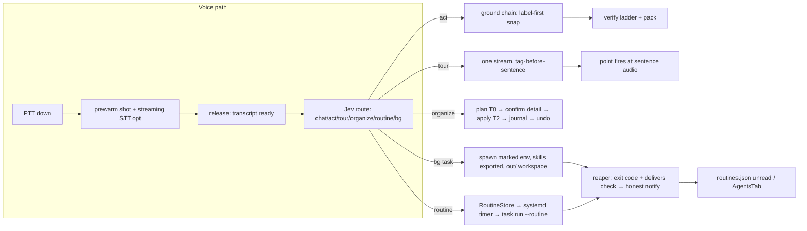

## Goal Capsule

- **Objective:** Wisp gains the mechanics that made Clicky/Clacky useful companions — honest background agents that deliver files, teachable routines that actually run, a reversible organize verb, element-snapped pointing, a tour mode, and lower-latency voice — without giving up model flexibility, the local-first default, or the verification ladder.
- **Means:** adopt Clacky's *mechanics* (delivery-evidence checks, deferred-auth handshake, journaled move-only organize, label-first snap, single-stream tour, streaming seams) onto wisp's existing substrate (agents.py, routines.py, grounding.py, verify.py, policy tiers), per KTD1–KTD8. Port nothing literally; Windows/macOS surfaces translate to AT-SPI/Hyprland/cua.
- **Authority:** this plan > the Oct-16 H1–H9 plan where they overlap; repo conventions (AGENTS.md, docs/IPC_CONTRACT.md) > both.
- **Stop conditions:** any unit that would require a hard dependency on a vendor runtime (Claude, hermes, Deepgram), store wisp-held credentials in a spawned agent's environment, or weaken the deny-list suppression — stop and re-plan.
- **Who finishes:** implementation agents under `ce-work`, per unit; shipping is a separate decision.

---

## Product Contract

### Summary

Mine the two open-source companion repos (Clacky — Python/Windows, Clicky — Swift/macOS) for the delta wisp still lacks, and land it on wisp's half-built substrate. The Oct-16 plan's modules shipped as *libraries* but most are unwired at runtime; this plan finishes the load-bearing ones (routines, pointing, draw) and adds the genuinely new mechanics Clacky proves (delivery honesty, organize, tour, deferred auth).

### Problem Frame

Wisp can see, point, and act — but compared to the reference companions it lacks: background agents whose deliveries are *verified* rather than claimed, routines that exist as more than dead library code, a reversible file-organize verb, pointing that prefers element identity over raw model coordinates, and the latency engineering that makes voice feel instant. Meanwhile the agent surface is widening without a trust boundary: any spawned agent can already self-approve its own confirm cards over the unauthenticated IPC socket.

### Requirements

- **R1 — Honest task outcomes.** `task_finished` reports `done|failed` from the process exit code, and declared deliverables (`delivers`) are verified on disk at reap time. A notification never claims a delivery the filesystem can't back.
- **R2 — Bounded spawned agents.** A process spawned via `agent_spawn` is marked by a registered task scope (systemd cgroup — survives reparenting; env marker + ancestry is the non-systemd fallback) and its subtree gets read-class IPC only: no `choice` (self-approval), no `agent` (recursive spawn), no `config`/`stop`/`interrupt`/`memory`/`label`/`dictate_correct`/`learn`/`harness` mutation, no wisp-held secrets in its env, and the local-only `connect` verb refuses under the scope so OAuth granting stays human-only. Refused-command counts are recorded on the task record and named in the finish notification (failure visible in-band, per R13).
- **R3 — Working routines end-to-end.** `routines.py` becomes reachable: a real CLI target (`task run --routine <id>` or equivalent), daemon-down fallback spawn, outcome recording on `task_finished`, 3-failure auto-pause, and an unread indicator in AgentsTab.
- **R4 — Voice-taught routines.** "Save this as my <name> routine" creates a Routine through the existing confirm broker (T2), with the first-run opt-in gate honored.
- **R5 — `organize` verb.** One composite tool: `plan` (T0, pure dry-run) → confirm card `detail` carries the move manifest → `apply` (T2) executes move-only renames inside allowlisted roots, journaled per file → `undo` reverses the last batch. Protected paths and cross-device moves refuse outright; no un-journaled file-move primitive is exposed to the model.
- **R6 — Element-identity pointing.** A `[POINT:x,y:label]` tag resolves `label` through the a11y/control grounding chain first (≈ms); the model's coordinate is the fallback. Snapping nudges to a control only when it's small enough (≤ container guard) and close enough (≤ ~30 px center distance). LLM-emitted points never override a detector-pinned point in the same turn.
- **R7 — Tour mode.** "Explain my screen" (or per-app tour) runs ONE streaming narration call whose contract is `[POINT:x,y] <one sentence>` per element, tag before its sentence; each segment's TTS starts synthesizing on receipt and the point fires when that sentence's audio begins. A mid-stream death ends the tour early and never replays.
- **R8 — Draw-on-screen renders.** `RING`/`ARROW`/`HL` tags parsed by `extract_drawings` publish to a `drawings` state field and render in a QML layer with TTL fade and clear-on-speech-end. (Finishes H2.)
- **R9 — Voice latency.** Optional streaming-STT provider seam (provider configured → partial transcripts during hold; release-time transcript ready immediately; batch whisper.cpp stays default), screenshot prewarmed on key-down, and sentence splitting that only breaks on `[.!?…]` followed by whitespace. No hard dependency on any paid service.
- **R10 — Per-app conversation memory.** Chat history buckets by focused-app key (bounded, ~20 messages), so context doesn't bleed between apps; `[POINT]`-class tags are stripped before storage.
- **R11 — Needs-connect handshake.** A background agent that hits an unauthenticated connector writes `CONNECT-<app>.txt` into its workspace; on task finish wisp offers a human-gated connect action (allowlisted hosts only if any URL is surfaced). The agent never waits on, drives, or grants OAuth itself.
- **R12 — Skills shared with background runtimes.** The single `SKILLS_DIR` store exports read-only into spawned runtimes via whatever mechanism each runtime honors (flag/env/index file in the task cwd). Never a second mutable store.
- **R13 — Honest abstention preserved.** Any adopted mechanic that could fake success (delivery claims, snap-to-wrong-element, organize without journal) is built so the failure is visible in-band — verdict fields, journal entries, or an explicit refusal — consistent with the existing `unverifiable`-never-promotes rule.

### Key Decisions

- **Mechanics over dependencies (session-settled).** Adopt Clacky's patterns, not its runtime pins — no Claude/hermes/Deepgram coupling; equivalents ride wisp's brain/Jev lanes and optional-provider seams. Governs R5, R7, R9.
- **Trust boundary before capability (planning decision).** The IPC read/mutate split (R2) ships before or alongside any widened agent capability; a self-approving agent is harm nobody catches in time. Governs R2, R11, R12.
- **Composite, not primitives, for destructive-adjacent verbs (planning decision).** `organize` is one journaled tool, mirroring the existing `agent_spawn`-vs-`task *` split. Governs R5.
- **Element identity over coordinates (planning decision).** Label-first resolution follows clacky's UIA→fallback design; wisp's existing `control → a11y → uitars → jev` chain is the resolver set. Governs R6, R7.

### Scope Boundaries

**Now:** R1–R13. **Deferred to Follow-Up Work:** wiring the unwired Oct-16 units not covered here — H1 walkthrough step-machine trigger/route (tour in U8 reuses its surfaces but is not the step machine), H6 suggest-policy activation (blocked on sense.py lacking call/fullscreen detection), H7 conversation-scoped grants vs session grants (product decision), H9 lane split (needs per-lane model config). **Later:** connectors mounted inside background agents (read-tier servers only, after R2 is live); mid-run question channel to a running agent (interim = finish → notify → new spawn); checkpoint/resume via runtime session ids; macOS launchd routine path; pre-baked ack clip on slow routes (was U12 approach step 4 — no requirement cited it; re-propose with an R if wanted). **Never:** Composio-style bulk connector auto-grants into unattended agents; agent-side lowering of safety config (`agent.allow_shell`, autonomy, `cua.*`) regardless of how `config set` is reached; agent-granted OAuth; auto-unpause/self-extending routines; PostHog-class analytics carrying full transcripts (clicky does this — we don't); Windows/macOS-only machinery (COM icon sort, CGEvent taps, ScreenCaptureKit).

### Acceptance Examples

- **AE1 (R1):** A spawned task declares `delivers: [out/summary.md]` and exits 0 without writing it → `task_finished{delivered:false}`; notification says "claims summary.md — not on disk," not "done."
- **AE2 (R2):** A spawned agent sends `{"cmd":"choice", ...}` racing a pending confirm → refused; `{"cmd":"task_status"}` → answered.
- **AE3 (R5):** `organize ~/Downloads` dry-run lists 12 moves → user confirms → 12 files move inside the root, journal records each src/dst → `organize undo` restores all 12 incl. a name-collision ` (1)` rename.
- **AE4 (R6):** Model emits `[POINT:812,404,"Save"]` while an AT-SPI "Save" button sits at 620,390 → the beacon/cursor lands on the AT-SPI element, not the model's pixels.
- **AE5 (R7):** "Tour me through Godot" → one model call streams 4 tagged segments; the ghost/point lands on each element as its sentence starts playing, not after all text arrives.

---

## Planning Contract

### Key Technical Decisions

- **KTD1 — Mechanics over dependencies.** Every adopted mechanic lands on wisp lanes: routing authority stays Jev; the organizer's LLM call uses the configured provider chain with a heuristic/extension-map fallback (mirroring `clacky/providers/heuristic.py`); streaming STT is a provider seam, not a switch to Deepgram.
- **KTD2 — Trust boundary at IPC + local verbs.** Extend the existing `SO_PEERCRED` capture into `_dispatch`: commands classify read vs mutating, deny-by-default for anything unlisted, and marked peers get read-class only. Marking is a registered task scope (systemd cgroup via `systemd-run --user --scope`; env `WISP_TASK_ID` + ancestry walk remains the non-systemd fallback with its reparenting limitation documented) — immune to double-fork/`env -i` escapes. The local-only `connect` verb refuses under a marked scope so OAuth stays human-only. Safety-lowering keys refuse marked peers outright.
- **KTD3 — Delivery honesty by evidence.** Verification = filesystem/tool evidence: `delivers` files must exist with mtime inside the run window; surfaced links must appear verbatim in tool evidence (adapting clacky's LINK: filter, `clacky/shell/harness.py:194-201`). The model's prose is never the proof.
- **KTD4 — Organize is journal-first.** Plan→confirm(`detail`=manifest)→apply→undo; move-only, same-filesystem, per-file journal records, crash-resumable by construction; allowlisted roots; no raw move primitive in REGISTRY.
- **KTD5 — Label-first snap.** `find_target(label)` runs the existing grounding provider chain before trusting tag coordinates; nudge-snap applies a container guard (max element size + max center offset, clacky `tour.py:54-83` shape); detector-pinned points suppress LLM points for the turn.
- **KTD6 — Single-stream tour.** Pointer timing derives from tag position in the streamed text channel — a multi-turn tool loop is structurally one step late (clacky `tour.py:4-9`). Segment-finalize = next tag; per-segment synth overlaps playback.
- **KTD7 — Reuse policy tiers unchanged.** New capabilities map onto T0–T3 + `HARD_STOP_KINDS` + confirm broker: organize-apply T2, organize-plan T0, routine create/mutate T2, `agent_spawn` stays T1 with `task_cancel` undo. Additionally adopt clacky's *default-deny*, scoped to model-chosen mutating targets: "resolved" means an element identity from the control/a11y lanes — a coordinate returned by uitars/jev does not satisfy it. A model-chosen mutating dispatch whose target resolves to no element refuses rather than clicking raw coords; user-dictated coordinates and T2-confirmed dispatches keep the coord fallback (canvas/game/a11y-poor surfaces would otherwise regress to guaranteed refusal). Adapt `agent/permission.py:115-119` ("danger is a property of the target").
- **KTD8 — Agents' secrets hygiene.** Spawn env scrubs wisp-held credentials and token-bearing vars (adapting `_KEEP_PRIVATE`, `clacky/shell/actions.py:37-42`); spawned runtimes use the user's ambient config only.

### High-Level Technical Design

### Assumptions

- `wispd-rs` parity-tracking status is unresolved; units touching IPC contract flag the dual-implementation cost rather than assume (Open Question 2).
- Task workspaces live at `TASK_LOGS/<name>/out/` (inside DATA_DIR, swept with logs); a user-visible `~/wisp-out/` is the rejected alternative for Now (retention ambiguity).
- Organize undo is single-level (reverse last batch) — clacky's semantics; a journal stack is Later.
- `agent_spawn` stays flat T1; a Jev risk pre-score for externally-mutating tasks is deferred (recorded, not built).

---

## Implementation Units

| U | Title | Key files | Depends on |
|---|---|---|---|
| U1 | IPC read/mutate split + marked-peer refusal | wisp/ipc.py, wispd, wisp/agents.py | — |
| U2 | Task lifecycle truth: exit codes + deliverable verification | wisp/agents.py, wispd, docs/IPC_CONTRACT.md | U1 |
| U3 | Routines end-to-end (CLI target, fallback, outcome, unread) | wisp/routines.py, wisp/cli/agents.py, wispd | U2 |
| U4 | Voice-taught routine creation | wisp/routines.py, stage_execute/route | U3 |
| U5 | `organize` composite tool + journal + undo | wisp/organize.py (new), wisp/tools/ | — |
| U6 | Spawn hygiene: env scrub + workspace + CONNECT handshake | wisp/agents.py | U2 |
| U7 | Skills export into spawned runtimes | wisp/skills.py, wisp/agents.py | U2 |
| U8 | Label-first element snap + nudge guard | wisp/grounding.py, wisp/points.py | — |
| U9 | Tour mode: single-stream sentence-synced points | wisp/tour.py (new), stage_speak.py | U8 |
| U10 | Draw-on-screen render path | wisp/points.py, wispd, DrawLayer.qml | — |
| U11 | Per-app conversation memory + tag-stripped history | wisp/session.py/memory.py, stage_speak.py | — |
| U12 | Voice latency pack: streaming-STT seam + prewarm + safe splits | stage_capture.py, speech.py, vocab.py | — |

### Phase A — agent substrate (trust first)

#### U1. IPC read/mutate split + marked-peer refusal

**Goal:** Agent subtrees spawned via `agent_spawn` get read-class IPC only — `choice` self-approval, recursive spawn, and config/stop/interrupt/memory mutation from inside a spawned agent become impossible; unmarked same-uid processes are unchanged (arbitrary local processes remain outside this boundary by design — stated residual).
**Requirements:** R2, R13
**Dependencies:** none
**Files:** `wisp/ipc.py`, `wispd`, `wisp/agents.py`, `docs/IPC_CONTRACT.md`, `tests/test_ipc_authz.py`
**Approach:**
1. Classify commands against the IPC_CONTRACT table: read = `status`, `task_status`, `context`, `subscribe`, `captures`, `suggestions`; mutating = `agent`, `task_cancel`, `choice`, `config`, `memory`, `stop`, `interrupt`, `listen`, `label`, `dictate_correct`, `learn`, `harness`. **Deny-by-default**: any command not on the read list — including commands added later — is refused for marked peers.
2. Pass `peer` (already captured via SO_PEERCRED) into `_dispatch`; refuse mutating cmds from marked peers.
3. Pin task membership at spawn so it survives reparenting: each `agent_spawn` runs under a dedicated systemd scope/cgroup (`systemd-run --user --scope`); `_dispatch` treats a peer as marked when its pid's cgroup path is under a registered task scope. Env `WISP_TASK_ID` + ppid ancestry walk is the non-systemd fallback only — a double-fork/`env -i`/`systemd-run` helper escapes ancestry marking; IPC_CONTRACT.md documents that limitation.
4. `config set` on safety keys (`agent.allow_shell`, autonomy, `cua.*`, spend caps) refuses marked peers regardless.
5. Bound the non-IPC mutation path: the local-only `connect` verb (OAuth via BrowserOS Strata, no daemon round-trip — IPC_CONTRACT.md:77) refuses when invoked under a marked task scope. Direct writes to config.toml/routines.json/memory files are outside the IPC split — state that as an explicit residual in R2/IPC_CONTRACT.md, not an enforced boundary.
**Patterns to follow:** `ipc.py:45-58` cred capture; `wispd:60-63` logging use.
**Test scenarios:**
- Marked peer sends each mutating cmd → refused with a distinct error code; read cmds succeed.
- Unmarked peer (normal CLI) → all cmds pass (no regression).
- Child-of-marked-process (depth≥1) → still refused; reparented helper (double-fork, `env -i`, `systemd-run` subprocess) → still refused under cgroup marking.
- `config set agent.allow_shell=true` from marked peer → refused; `config set theme` → refused (mutating class), documented behavior.
- Spoof attempt: process sets `WISP_TASK_ID` itself but isn't in the task registry → refused (marker verified against registry, not env alone).
**Verification:** new test file green; `captures` read still works for CLI.

#### U2. Task lifecycle truth: exit codes + deliverable verification

**Goal:** `done` means exited-0; declared deliverables are checked on disk; agents get a workspace convention.
**Requirements:** R1, R13
**Dependencies:** U1
**Files:** `wisp/agents.py`, `wispd` (`_agent_done`), `wisp/cli/agents.py` (`task output`/`task artifacts` verbs), `docs/IPC_CONTRACT.md`, `tests/test_agents_reaper.py` (extend), `tests/test_task_delivery.py` (new)
**Approach:**
1. Task record gains `exit_code`, `delivers[]`, `spawned_by`, `depth`, `out_dir` (= `TASK_LOGS/<name>/out/`).
2. Reaper captures `Popen.poll()`/wait status at reap → `done` only on 0; signal/kill → `failed`. Every spawn path — daemon child, U3's daemon-down fallback, tasks surviving a daemon restart — wraps argv in a status shim that writes the child's exit code into the task's log dir, so `done|failed` is evidence-backed even where the daemon never held the Popen handle.
3. On `task_finished`, verify each `delivers` path exists, non-empty, mtime within the run window → `delivered|missing` per item; `_agent_done` notification states facts ("claims X — not on disk") and offers `open` action for delivered files — `open` only for regular files whose symlink-resolved path stays inside `out_dir` and which aren't executable/`.desktop`. When non-zero, the notification also names the count of IPC commands refused under the marked-peer boundary ("finished — 3 commands refused (mutation blocked)").
4. Add `task output` and `task artifacts` IPC/CLI reads.
**Test scenarios:**
- exit 0 + file present → `done`, `delivered:true`, notification names file.
- exit 0 + file absent → `done`, `delivered:false`, "claims … not on disk."
- SIGKILL/exit 1 → `failed`, not ambiguous.
- `delivers` path outside `out_dir` → recorded but flagged, never opened by notification action.
- mtime older than run start → `missing` (pre-existing file doesn't satisfy).
- tasks.jsonl additive change → existing readers/tests unaffected.
**Verification:** reaper tests extended; IPC_CONTRACT bumped.

#### U3. Routines end-to-end

**Goal:** The shipped `routines.py` library becomes reachable: timers fire a command that exists, outcomes land back in the store, and the UI shows unread results.
**Requirements:** R3, R13
**Dependencies:** U2
**Files:** `wisp/routines.py`, `wisp/cli/agents.py`, `wispd`, `shell-plugin/components/AgentsTab.qml`, `tests/test_routines_wire.py`
**Approach:**
1. Add an `agents run <routine-id>` CLI verb matching what `generate_systemd_units` already emits (`ExecStart=... agents run {rid}`, routines.py:159) — the timer side exists, so the CLI verb is the missing half. Loads the routine, spawns via agents.py with `routine_id` provenance.
2. Daemon-down fallback: direct spawn + file-registry write (precedent: `label set` local fallback); registry reconciles on next daemon start.
3. `task_finished` carrying `routine_id` → `record_routine_outcome` → unread flag / auto-pause at 3 failures / exactly one notification.
4. AgentsTab renders unread dot from `tasks`/`routines` state.
**Test scenarios:**
- Timer-equivalent CLI call with daemon up → task spawns, routine_id recorded.
- Daemon down → direct spawn still records; next daemon start reconciles row.
- 3 consecutive failures → routine paused + exactly one notification.
- Success → `unread=True`, no spoken announcement.
**Verification:** unit tests for store+record path; CLI smoke under stubbed spawn.

#### U4. Voice-taught routine creation

**Goal:** "Save this as my <name> routine" creates a Routine from the current goal/context via the confirm broker.
**Requirements:** R4, R13
**Dependencies:** U3
**Files:** `wisp/routines.py`, `wisp/stage_execute.py` or `stage_route.py` (route), `wisp/confirm.py` (reuse), `tests/test_routines_wire.py` (extend)
**Approach:**
1. Route a teach intent (Jev decision kind or tool call) to `RoutineStore.create` with `confirm_fn` = existing broker (T2).
2. First-run opt-in gate (`require_first_opt_ingate`) honored before any timer is installed.
3. Schedule parse stays conservative: explicit "every day at 9"/"every hour" patterns; ambiguous → ask once via confirm card.
**Test scenarios:**
- Teach intent with explicit schedule → confirm card shows name+schedule+task text → yes creates routine + units.
- First-ever routine → opt-in gate fires before create.
- Ambiguous schedule → clarification card, no routine persisted.
**Verification:** route-level test with stubbed broker.

### Phase B — clacky mechanics (the new surface)

#### U5. `organize` composite tool + journal + undo

**Goal:** One journaled, move-only organize verb with dry-run preview and reversible undo.
**Requirements:** R5, R13
**Dependencies:** none
**Files:** `wisp/organize.py` (new), `wisp/tools/__init__.py`, `wisp/cli/` verb, `docs/CONFIG.md` (`[organize]` keys), `tests/test_organize.py`
**Approach:**
1. `organize plan <dir>` (T0): enumerate entries (name/ext/size/peek ≤600B for text types) → configured provider `complete()` call (brain lane, not a new vendor) → `{"moves":[{name,folder,reason}]}`; tolerant JSON extraction; hallucinated names dropped. Heuristic extension-map fallback on provider failure.
2. `organize apply` (T2): confirm card `detail` renders the manifest (broker caps `detail` ~4000 chars — large manifests show count + first N entries, full list in the journal); apply = rename-only inside the allowlisted root (default `~/Desktop`, `~/Downloads` + explicit arg). Manifest `name`/`folder` are untrusted input: reject absolute paths, `..` components, and any resolved dst escaping the allowlisted root; refused entries are journaled as refused, never moved. Per-file journal records `{src,dst}`; collision → ` (n)`; same-filesystem enforced (no cross-device copy+delete).
3. `organize undo`: replay last batch journal in reverse; refuse if journal absent.
4. Protected: `.git`, `.config`, `.local`, system paths, dotfiles by default, sensitive-name hints; MAX_BATCH bound.
**Test scenarios:**
- Dry-run writes nothing, returns manifest covering every file (moves or explicit skip).
- Confirm→apply moves all files; journal entries match 1:1.
- Undo restores everything incl. collision renames.
- Kill mid-apply → remaining journal allows resume or clean rollback state.
- Args pointing at `/etc`, `~/.config` → refuse outright.
- Provider returns garbage JSON → tolerant parse fails → heuristic fallback or legible error, never partial silent apply.
**Verification:** test file green incl. FakeProvider-style stub; no network.

#### U6. Spawn hygiene: env scrub + workspace + CONNECT handshake

**Goal:** Spawned agents inherit a scrubbed env, write into a known workspace, and can signal a needed connector without waiting or granting.
**Requirements:** R2, R11, R13
**Dependencies:** U2
**Files:** `wisp/agents.py`, `tests/test_spawn_hygiene.py`
**Approach:**
1. Env scrub at spawn: drop wisp-held creds, token-bearing vars, and session sockets not needed (adapts `_KEEP_PRIVATE`); allowlist pass-through documented in code.
2. Task prompt contract gains: outputs as files under `out/`; if a needed connector isn't granted, write `CONNECT-<app>.txt` and finish — never wait.
3. On `task_finished`, scan workspace for `CONNECT-*.txt` → surface a connect offer notification/card. Validate the `<app>` component against the connector alias table (`mcpauth._ALIASES`) — unknown names render as plain text only, never a connect action (an injected agent can write `CONNECT-bank.txt`). URL fields open only when the host passes the `[connect] allowed_hosts` config key (new key; default = known connector domains — update docs/CONFIG.md + settings_schema.py in the same diff); non-allowlisted → text only.
**Test scenarios:**
- Spawned env lacks each scrubbed var; retains PATH/ambient runtime config.
- `CONNECT-foo.txt` present at finish → one offer surfaced, naming the app.
- `CONNECT-x.txt` containing `file:///etc/passwd` or arbitrary host → not auto-opened; shown as text only.
- No CONNECT file → no offer.
**Verification:** stubbed runtime writes files; assertions on env + surfaced offer.

#### U7. Skills export into spawned runtimes

**Goal:** The one `SKILLS_DIR` store reaches background runtimes read-only.
**Requirements:** R12
**Dependencies:** U2
**Files:** `wisp/skills.py`, `wisp/agents.py`, `tests/test_skills_export.py`
**Approach:**
1. Per-runtime export map in `AGENT_RUNTIMES`: flag (`--add-dir`-style), env var, or generated `skills-index.md` dropped in task `out_dir`/cwd.
2. Export is a snapshot/index copy into the task workspace — never a writable mount of the store (follows `import_dir` snapshot convention).
3. App-keyed `match_app_skill` body inclusion stays the foreground path's job; export carries frontmatter index + full bodies for matches declared at spawn.
**Test scenarios:**
- Each runtime entry resolves to its declared mechanism; unknown runtime → index-file fallback.
- Spawned dir contains read-only copies; source store untouched.
- `tool:`-bearing skills still floor at their tier (no export-based escalation).
**Verification:** tests with fake runtime entries.

### Phase C — pointing, overlay, voice

#### U8. Label-first element snap + nudge guard

**Goal:** `[POINT]` tags prefer element identity over model coordinates.
**Requirements:** R6, R13
**Dependencies:** none
**Files:** `wisp/grounding.py`, `wisp/points.py`, `tests/test_grounding_snap.py`
**Approach:**
1. On a tagged point with a label, resolve the label through the element-identity lanes only — `ground_target(label, providers=("control","a11y"))` with no capture dependency. uitars/jev are pixel-model network calls returning coordinates, not elements; joining them violates R6's ≈ms contract, and `ground_target`'s required fresh capture can raise `no_capture` before a11y runs. Success → element center/rect; failure → fall back to tag coords.
2. Nudge-snap: even detector-free coords snap only to controls ≤ guard size whose center is ≤ ~30 px away (container guard — never jump to a big panel).
3. Adopt default-deny scoped to model-chosen mutating targets (KTD7): "resolved" = element identity from the control/a11y lanes only. A model-chosen mutating dispatch resolving to no element refuses rather than clicking raw coords; user-dictated coordinates and T2-confirmed dispatches keep the coord fallback. Policy check on the click path, not a new tier.
4. Per-turn label dedup; a detector-pinned point sets suppress so a later LLM `[POINT]` can't override it.
**Test scenarios:**
- Label matches AT-SPI element → beacon lands on element center, not tag coords.
- Label unresolvable → falls back to coords (non-mutating point) or refuses (mutating dispatch).
- Coord near small control → snaps; coord near big window → doesn't.
- Two same-label tags in one turn → one point.
- Detector-pinned then LLM point same turn → pinned wins.
**Verification:** oracle tests mirroring `test_heyclicky_delta.py` style; grounding fakes per provider.

#### U9. Tour mode: single-stream sentence-synced points

**Goal:** "Explain/tour my screen" runs one streaming narration with points firing at sentence audio start.
**Requirements:** R7, R13
**Dependencies:** U8
**Files:** `wisp/tour.py` (new), `wisp/stage_speak.py`, `wisp/points.py`, `tests/test_tour.py`
**Approach:**
1. Route tour intent → one `chat_stream` call with the tour contract prompt (`[POINT:x,y] <one sentence>` ×3-4, tag before sentence; DETECTED ELEMENT context line when the cursor is already on the target).
2. Segment completes when the next tag arrives (or stream ends); per-segment TTS synth pipelines ahead of playback; point fires as its sentence's audio starts.
3. Mid-stream death ends early, never replays; batch fallback only if stream yields nothing. User `stop`/`interrupt` mid-tour takes the same early-end path — cancel the in-flight stream, drop queued segment synth, clear pending point state. A second tour request while one is active interrupts-and-restarts (consistent with `listen`'s barge-in on a new turn).
4. Model coords pass through U8 snap; walkthrough.py's beacon/ghost surfaces are reused — the H1 step machine itself stays Oct-16-plan scope.
**Test scenarios:**
- Stream of 4 tagged segments → 4 point events in order, each tied to its segment, not dumped at end.
- Stream dies after segment 2 → tour ends; no replay; partial state clean.
- Empty stream → batch fallback path returns something speakable or a legible refusal.
- Unclosed `[POINT…` tag at stream boundary → never leaks into spoken/displayed text.
**Verification:** fake stream iterators; timing asserted via event order, not wall clock.

#### U10. Draw-on-screen render path

**Goal:** Parsed RING/ARROW/HL tags actually render (finishes H2).
**Requirements:** R8
**Dependencies:** none
**Files:** `wisp/points.py` (wire `extract_drawings` into speak path), `wispd` (state publish), `shell-plugin/components/DrawLayer.qml` (new), `shell-plugin/components/OverlayLayer.qml`, `docs/IPC_CONTRACT.md`, `tests/test_drawings_render.py`
**Approach:**
1. `stage_speak` publishes a `drawings` state field beside `points` (contract bump, additive).
2. DrawLayer renders ring/arrow/highlight primitives with TTL (clacky: 8 s, fade in last 25%); clear on speech end and on `points/clear`.
3. `strip_drawing_tags` already keeps tags out of spoken text — keep that order: strip before TTS, publish before strip.
**Test scenarios:**
- Response with `[HL]`+`[ARROW]` → state carries both primitives with mapped logical coords (multi-monitor scale covered by existing `_map_drawing_to_logical` tests).
- TTL expiry → drawings cleared from state/layer model.
- Speech end → cleared.
- Over-cap tags → capped at MAX_DRAWINGS, extras dropped with count noted.
**Verification:** state-shape unit tests + QML render smoke if a headless pattern exists in the repo (else model-only assertions).

#### U11. Per-app conversation memory + tag-stripped history

**Goal:** Chat context keyed by focused app; tags never enter stored history.
**Requirements:** R10
**Dependencies:** none
**Files:** `wisp/session.py` (or `wisp/memory.py` — pick where the tail is assembled), `wisp/stage_speak.py`, `tests/test_app_memory.py`
**Approach:**
1. Add `_app_memory`-style bucket: `app_key(focused window)` → bounded deque (~20 messages), injected for chat/act replies in that app; global `session.jsonl` tail stays as-is for cross-app recency.
2. Strip `[POINT]`/`POINTS`/drawing tags before storage (clacky does this at `CompanionManager.swift:684-694`).
3. Never retain screenshots in context — text-only, matching existing behavior.
**Test scenarios:**
- Two apps alternated → each reply gets only its app's recent history plus global tail.
- Bucket at cap → oldest evicted.
- Response containing tags → stored history clean.
**Verification:** unit tests on the bucket + injection seam.

#### U12. Voice latency pack

**Goal:** Streaming-STT seam (optional), prewarmed capture, whitespace-safe sentence splitting — the felt-instant upgrades.
**Requirements:** R9
**Dependencies:** none
**Files:** `wisp/stage_capture.py`, `wisp/speech.py`, `wisp/vocab.py` (keyterm parity for streaming), `wisp/config.py`/`settings_schema.py` + `docs/CONFIG.md` (`[stt] streaming`, `[capture] prewarm`), `tests/test_stt_streaming.py`, `tests/test_sentence_split.py`
**Approach:**
1. `[stt] streaming = off|deepgram|openai` seam: when configured, PCM chunks feed a streaming session during hold; release → finalize → transcript ≈ instant; batch whisper.cpp remains the default and fallback on any stream failure.
2. Prewarm screenshot on key-down (short TTL) so the frame exists before the model call.
3. Sentence splitting for streamed TTS: break only on `[.!?…]` followed by whitespace — never at buffer end. `SentenceSpeaker`'s current regex `(.+?[.!?]["')\]]*)\s+` (speech.py) already avoids mid-token chops but lacks the `…` char R9 requires — extend it, don't just audit.
**Test scenarios:**
- Streaming provider configured + session feeding chunks → release returns transcript without a second batch call; stream error mid-hold → batch fallback still produces the transcript.
- Provider unset → current batch path unchanged (regression).
- "Set it to 3.5 then save" split at chunk boundary → not chopped mid-token.
- Prewarmed frame older than TTL → recaptured, not served stale.
**Verification:** fake streaming session + fake transport; no network.

---

## Verification Contract

- `pytest tests/` — full suite must stay green (2250+ baseline on this branch); every unit lands its named test file(s).
- Feature-bearing units run platform-independent tests (fakes for AT-SPI/control/providers) — no Hyprland dependency in the new tests; where a live path matters, note it as an `Execution note`, not a test requirement.
- Contract changes (`tasks` fields, `drawings` state, IPC cmd classes) update `docs/IPC_CONTRACT.md` in the same diff; if `rs/wispd` is parity-live, mirror there or the plan defers explicitly.
- `docs/CONFIG.md` + `settings_schema.py` updated for every new config key in the same unit.

## Risks & Dependencies

- **Two-implementation tax.** Every IPC/state change doubles under `wispd-rs` if it's still parity-tracking — flagged per unit; unresolved (Open Questions).
- **Provider-lane drift.** U5/U9 route through the brain/lane abstraction — if those accept only chat-shaped calls, a `complete()`-style helper may be needed (implementation-time discovery).
- **Scope realism.** 12 units is a program, not a PR — sequencing ships trust (Phase A) before capability (B/C); each unit is an atomic land.
- **Streaming STT** is the only unit introducing a new external dependency *option*; everything else is local-first.

## Open Questions

1. Is `wispd-rs` still parity-tracking? If yes, U1/U2/U3/U10 double; if frozen, say so in IPC_CONTRACT.md.
2. Should `hermes` join `AGENT_RUNTIMES` as an optional runtime (mechanics already absorbed)? Default answer: yes as config-gated entry, no as dependency.
3. `agent_spawn` risk pre-score for externally-mutating tasks (T2 for "post this") — deferred; revisit if abuse observed.
4. Routine timers on non-systemd hosts — declared Linux/systemd-only for Now.
5. U11 `app_key` derivation (WM class vs app_id vs title) and merge behavior for transient/unknown keys — browsers/terminals can fragment buckets, and silent bucket misses read as the agent forgetting. Also: should the bucket a reply drew from be user-visible (R13 honesty posture)?
6. U3 unread-indicator clear rule in AgentsTab (open-tab vs expand-row vs explicit dismiss) — match whatever `tasks` state already does for unread results.
7. Does cgroup task-scope marking cover every `AGENT_RUNTIMES` entry and the U3 daemon-down fallback spawn, or does the fallback need the documented env+ancestry limitation instead?
8. Read-class IPC still exposes `captures`/`context` (screenshot content, window map) to marked peers — accept, or restrict to less sensitive reads?
9. R1 honesty covers only *declared* `delivers` — an agent declaring nothing exits `done`; should `agent_spawn` require the field or accept the opt-in gap?
10. U9 tour `[POINT]` tags carry no label, so tour points can't use U8's label-first resolution (nudge-guard only) — accept, or add an optional label to the tour contract?

## Sources

- Clacky teardown — `docs/research/2026-10-25-clacky-teardown.md` (per-section file:line evidence; MIT)
- Clicky verification — `docs/research/2026-10-25-clicky-verify.md` (teardown drift: two-stage detector is dead code; skills/tours/routines absent from OSS tree)
- Wisp baseline — `docs/research/2026-10-25-wisp-state.md` (H1–H9 ship status: only H8 wired end-to-end)
- Agent-native assessment — `docs/research/2026-10-25-agent-native.md` (IPC-authz evidence + Now/Later/Never)
- Prior plan — `docs/plans/2026-10-16-001-feat-heyclicky-teardown-delta-plan.md`

## Definition of Done

- Each unit lands green with its named tests; full `pytest tests/` green at each merge point.
- Every adopted mechanic carries its honesty property: no delivered-claim without evidence (R1/R11), no unsafe mutation without grounding (R6), no move without journal (R5).
- Contract docs (`IPC_CONTRACT.md`, `CONFIG.md`) updated in the same diffs they describe.
- Phase A merged before Phase B/C units begin landing.
- Cleanup: abandoned-attempt code removed — no half-wired seams left for a future reader to trip on (the exact failure this plan documents in H1–H9).
