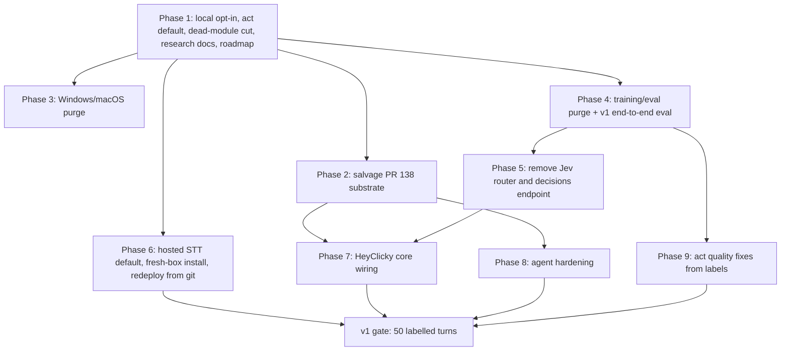

# Wisp HeyClicky-for-Linux Roadmap - Plan

## Goal Capsule

- **Objective:** On a Linux (Hyprland/Omarchy) desktop with only an OpenRouter key, a user holds the hotkey, speaks, and Wisp answers by voice while pointing and drawing on screen, walks them through multi-step tasks, and runs background agents and routines — with no local model servers and no dormant code claiming features that do not run.
- **Means:** Cut Wisp down to the HeyClicky core plus agents (KTD1–KTD5), then wire the core features using patterns verified in clicky and clacky (KTD6). Phase 1 ships in this plan's units; Phases 2–9 are sequenced follow-up PRs, each planned from this roadmap.
- **Authority:** This plan supersedes `docs/plans/2026-10-05-001-feat-wisp-full-roadmap-plan.md` as the roadmap of record and ranks above `docs/plans/2026-10-16-001-feat-heyclicky-teardown-delta-plan.md`, `docs/plans/2026-10-25-0151-feat-heyclicky-gap-closure-plan.md` and `docs/plans/2026-10-25-0215-feat-clicky-clacky-delta-plan.md` wherever they conflict.
- **Execution profile:** Phase 1 (U1–U4) is implemented in this run on branch `feat/local-models-opt-in`; the full Python suite must stay green.
- **Stop conditions:** Stop and report if flipping the router default breaks act-path behaviour that fixtures cannot pin, or if any Phase 1 deletion has a production importer.
- **Who finishes:** Phase 1 by this run's PR; Phases 2–9 by follow-up runs, one PR each.

---

## Product Contract

### Summary

Wisp becomes HeyClicky for Linux: a push-to-talk voice companion that answers about what is on screen, points and draws at it, walks the user through tasks, and runs background agents and routines. The roadmap removes what does not serve that — local model servers, the training/eval stack, the Jev decision router, Windows/macOS port work, and unwired libraries — and then wires the HeyClicky features that exist only as unconnected modules today.

### Problem Frame

Wisp has grown faster than it works. The 2026-10-25 state audit (`docs/research/2026-10-25-wisp-state.md`) found the HeyClicky delta units H1–H9 merged as libraries with no production caller, and the Phase A agent substrate (IPC authz, delivery truth, routines) closed unmerged as PR #138. The shipped defaults still assume local models: speech-to-text defaults to local whisper.cpp and grounding tries a loopback UI-TARS server. The router also defaults to the Jev decision hop, a hosted extra call the owner's config already bypasses. The owner's live config already runs Groq STT, `router = "act"` and grounding without UI-TARS, which is evidence the defaults are wrong rather than the config. Hand labels show 14 correct, 22 incorrect and 8 corrected-by-retry out of 44 turns, so the product does not yet do its core job reliably.

Clacky (`docs/research/2026-10-25-clacky-teardown.md`) is not a viable base: its shell is Windows-bound (vendored clicky-windows, UI Automation, pynput), has zero automated tests, and its computer-use loop and narrator are unwired scaffolds. Its value is in specific patterns, which KTD6 adopts.

### Key Decisions

- **Product target is HeyClicky core plus agents.** Voice answers with pointing and drawing, walkthroughs, and background agents/routines are first-class; autonomous act/cua stays but is secondary. Governs R1, R9–R14. (session-settled: user-directed — chosen over "HeyClicky core only" and "keep full autonomy first": the user wants HeyClicky for Linux with agents, not a computer-use product.)
- **Local model servers are opt-in and off.** OpenRouter (plus a hosted STT provider) is the only default backend. Governs R2, R3. (session-settled: user-directed — chosen over keeping the local/OpenRouter toggle: the user will never use local models.)
- **Linux only.** Windows/macOS port work is dropped. Governs R6. (session-settled: user-directed — chosen over "Linux first, keep seams": the seams cost upkeep for platforms nobody runs.)
- **Training/eval stack is deleted; one end-to-end eval remains as the v1 gate.** Governs R5, R8. (session-settled: user-directed — chosen over archiving it on a branch or keeping it: per-route training gates do not measure whether a turn worked.)
- **The Rust core `rs/` is frozen, not deleted.** It stays in the tree with no parity requirement. Governs R7. (session-settled: user-directed — chosen over deleting it and over keeping parity.)

### Requirements

**Backend and defaults**

- R1. With only an OpenRouter key (and a hosted STT key), a fresh install answers a spoken question about the screen end to end.
- R2. No default code path contacts a loopback model server; local servers run only when `[local] enabled = "true"`.
- R3. The default router sends turns straight to the act loop; the Jev decision hop is not on the default path and is later removed.

**Removal**

- R4. Modules with no production caller are either wired into a user-visible feature or deleted; nothing is described as shipped unless a production path reaches it.
- R5. The training/eval stack (clicklab, arena, CubeVM hammer, label distillation, decision replay/shadow, route A/B, learning-loop proposals) is deleted, keeping the pieces the act loop and spend caps still use.
- R6. Windows- and macOS-only code, tests, CI targets and docs are removed; the platform layer keeps only what Linux needs.
- R7. `rs/` is excluded from parity obligations; CI keeps passing without Rust changes.

**Quality gate**

- R8. One end-to-end eval scores each replayed or labelled turn correct/incorrect by turn kind, and the v1 gate is defined on it instead of per-route labels.

**HeyClicky core**

- R9. Answers that point do so in sync with speech: each point fires when its sentence starts playing.
- R10. Wisp draws rings, arrows and highlights on screen from the answer stream and clears them when speech ends.
- R11. A walkthrough speaks a step, points at the target, detects the user's action, and advances.
- R12. Pointing snaps to the labelled UI element (control channel or accessibility tree) before falling back to pixels.
- R13. Chat context is kept per app and screenshots are suppressed for sensitive windows.

**Agents**

- R14. Background agents report truthful outcomes, run with a scrubbed environment, and cannot mutate Wisp through IPC; routines run on schedule and pause after repeated failure.

### Success Criteria

- The v1 gate (R8) passes: at least 50 labelled end-to-end turns on this machine with an OpenRouter-only config, at a correct rate the owner signs off.
- `wispd onboard` and `wispd doctor` pass on a clean Omarchy box with no local services and no `~/src/whisper.cpp`.
- Every module under `wisp/` has a production importer or is gone.

### Scope Boundaries

**Deferred to Follow-Up Work** (each a separate PR, in the order of the Phased Delivery section): salvage of PR #138, Windows/macOS purge, training/eval purge, Jev router removal, hosted STT default and fresh-box install, HeyClicky core wiring, agent hardening, act quality fixes from labels.

**Outside this product's identity**

- Local-first operation, local model ladders, and `wisp-backend`-style toggles.
- Model training, distillation and per-route soak tooling.
- Cross-platform ports.
- Rebasing onto clacky's codebase.

**Considered and not built**

- A compatibility shim that keeps `router = "jev"` working after Jev removal: the owner's config already uses `act`, and a shim would keep the removed stack's tests alive. Revisit only if another user's config depends on it.
- Archiving the training stack on a named branch: git history already preserves it.

### Outstanding Questions

- Q1 (deferred, Phase 5). Removing the Jev router also removes the `jev` grounding fallback, which posts to the same decisions endpoint (`wisp/grounding.py`). Decide in Phase 5 whether to replace it with a vision-model point call through OpenRouter (H3's two-stage design) or drop it.
- Q2 (deferred, Phase 6). Which hosted STT provider is the shipped default — Groq (live today) or an OpenAI-compatible endpoint behind OpenRouter. The seam already supports `provider = "openai"` with any base URL.
- Q3 (deferred, Phase 7). How `app_key` is derived for per-app chat history (`docs/plans/2026-10-25-0215-feat-clicky-clacky-delta-plan.md`, open questions).

### Sources

- `docs/research/2026-10-25-wisp-state.md` — module-by-module wiring audit; H1–H9 status.
- `docs/research/2026-10-25-clacky-teardown.md`, `docs/research/2026-10-25-clicky-verify.md`, `docs/research/heyclicky-features.md` — competitor behaviour and the patterns KTD6 adopts.
- `docs/research/2026-10-25-agent-native.md` — IPC trust gaps closed by the PR #138 substrate.
- `wisp/stage_route.py` (router dispatch on `[brain] router`), `wisp/settings_schema.py` (router choices omit `act`), `tests/fixtures/turns/router_act.json` (only fixture on the act router).

---

## Planning Contract

### Key Technical Decisions

- KTD1. **Local opt-in is one config switch, `[local] enabled`, default off.** Onboarding skips the loopback ladder, grounding drops `uitars`, and both install paths (`wispd install` and `wispd install --units`) skip the llama/jev-shim units when it is off; brain sections stay inert unless referenced. Instantiates the local-models Key Decision (R2).
- KTD2. **Flip the router default to `act` before removing Jev.** The flip is one default plus schema and docs; removal is a later, larger PR (Phase 5) that also has to replace the suggestion gate and the dictation/launch routes. Replay fixtures that script the Jev endpoint pin `router = "jev"` explicitly until Phase 5 rewrites them.
- KTD3. **Delete `wisp/lanes.py` and `wisp/conversation_grants.py`; wire, don't delete, `walkthrough.py`, `routines.py` and `suggest_policy.py`.** The first two have no importer but `tests/test_heyclicky_delta.py`, and nothing on the roadmap needs them; the barge-in controller inside `lanes.py` is recoverable from git history when Phase 7 builds the barge-in generation counter. The others are HeyClicky core (R4, R11, R14).
- KTD4. **Salvage PR #138 by cherry-pick, not merge.** Its branch carries 30 commits, most duplicating #133 after squash. Only the four substrate commits and the review fix move onto a fresh branch from master (Phase 2); the research-doc commit `72c0419` already lands in Phase 1 (KTD7, U4).
- KTD5. **Freeze `rs/` by contract, not by deletion.** The only shared artifact is `tests/fixtures/ipc_commands.jsonl`, replayed by `rs/wispd/tests/parity.rs`; the Python side stops adding to it, so the Rust CI job keeps passing. Instantiates the Rust Key Decision (R7).
- KTD6. **Adopt clicky/clacky patterns, not code.** Single-stream tour with points fired at sentence-audio start, label-first element snap with a container guard, spawn-env secret scrub, journaled move-only organize with voice undo, streaming STT during hold, per-app chat history, and sensitive-window screenshot suppression. Each lands in Wisp's existing seams (`stage_speak`, `grounding`, `agents`, `stage_capture`, `session`).
- KTD7. **Bring the 2026-10-25 research docs onto master in Phase 1.** This plan cites them; today they exist only on the closed #138 branch (commit `72c0419`).

### High-Level Technical Design

Phase order. Each box is one PR; arrows are hard dependencies.

### Phased Delivery

| Phase | Delivers | Requirements | Size |
|---|---|---|---|
| 1 | U1–U4 below | R2, R3, R4 | S |
| 2 | Cherry-pick #138 substrate (IPC read/mutate split, exit-code and deliverable truth, CLI routine execution, voice-taught routines) onto master; fix macOS-only test edits out | R14 | M |
| 3 | Remove Windows/macOS: `docs/MACOS.md`, `docs/WINDOWS.md`, per-OS branches in `wisp/platform.py`, Windows job objects in `wisp/cancel.py`, IPC TCP mode, non-Linux default apps, macOS CI matrix and release targets; keep `platform.current()` as a shim | R6 | M (≈ −1k lines) |
| 4 | Remove `scripts/clicklab/`, `wisp/train.py`, `judge.py`, `review.py`, `evalroute.py`, `batch.py` and their CLI groups, tests and help goldens; keep `ledger.py`, the `learn.py` labelling helpers, trajectories and action stats; build the v1 eval on `tests/harness` scoring turns correct/incorrect. Decision replay and the shadow decider stay until Phase 5 removes them with the router | R5, R8 | L (≈ −8k lines) |
| 5 | Remove the Jev router: `route.decide`, heuristic, shadow decider, decisions replay; give `suggest.py` its count gate; route dictation/launch through act; rewrite the 27 Jev-scripted fixtures; resolve Q1 | R3 | L (≈ −1.7k lines) |
| 6 | Hosted STT as the shipped default (resolve Q2); onboarding requires the keys it needs and fails soft on key lookup; `wispd install` redeploys `~/.local/opt/wisp` from a git ref; clean-box install ≤ 10 min | R1 | M |
| 7 | Wire walkthrough + overlay, draw layer renderer, single-stream tour, label-first snap, per-app history, sensitive-window suppression, streaming STT, barge-in generation counter | R9–R13 | L |
| 8 | Spawn-env scrub, deferred-auth handshake, journaled organize + undo, skills export | R14 | M |
| 9 | Act quality fixes driven by the labelled failures and Phase 4's per-turn-kind breakdown: default-app resolution (the "open my email" case), wrong-coordinate clicks, launch-instead-of-navigate | R8 | M |

Phase 7 carries the unwired H-units forward: H1 walkthrough (R11), H2 drawing (R10), H6 suggestion etiquette (via `suggest_policy.py`), and the 0151 gap-closure units that harden them (pixel-settle, screen-diff advance). Units from the three source plans not listed here are dropped: H3 two-stage grounding stays bench-gated under Q1; H7 conversation grants and H9 lanes are deleted (KTD3); 0151's Windows units are out of identity.

### Assumptions

- The act loop handles bare launch and answer turns acceptably once Jev is off the default path; the owner's live config has run this way since before 2026-10-25.
- The four #138 substrate commits apply to master without textual conflicts (a `merge-tree` dry run produced a clean tree); help-golden and line-budget conflicts are expected and are Phase 2's to fix. If the IPC authz split changes a response replayed from `tests/fixtures/ipc_commands.jsonl`, Phase 2 must leave the existing fixture lines unchanged so the frozen Rust parity job (KTD5) keeps passing.
- Accepted risk for U2: with act as the default, bare launch and dictation turns run through the full act loop with a screenshot, which costs more per turn than the Jev hop and is not covered by replay fixtures. The owner's config has run this way; Phase 4's eval is where a regression would show.

---

## Implementation Units

### U1. Local model servers opt-in

- **Goal:** Make every local-model code path opt-in behind `[local] enabled`, default off.
- **Requirements:** R2; KTD1.
- **Dependencies:** none.
- **Files:** `wisp/config.py`, `wisp/onboard.py`, `wisp/grounding.py`, `wisp/svc.py`, `wisp/cli/core.py`, `wispd`, `docs/CONFIG.md`, `tests/test_onboard.py`, `tests/test_ground_chain.py`, `tests/test_svc.py`.
- **Approach:**
  1. Add a `[local]` section to the default config text and dict, and a `local_enabled(cfg)` helper.
  2. Onboarding's models step passes without probing when local is off and names the configured brain.
  3. Grounding drops `uitars` from the provider list when local is off, including from an explicit list.
  4. Unit install skips the llama/jev-shim units with a reason when local is off. Both callers pass the setting from the loaded config: `wispd install --units` (`wisp/cli/core.py`) and the full `wispd install` path (`install_files` in `wispd`).
- **Patterns to follow:** existing string-valued booleans read from `cfg` sections (`[health] enabled`); `install_units` skip records.
- **Test scenarios:**
  - Onboarding with an empty config probes no URL and reports "local models off".
  - Onboarding with `[local] enabled = "true"` probes the full ladder (existing tests, now opting in).
  - Grounding settings with an empty config yield `control, a11y, jev`.
  - Grounding settings with `providers = "uitars,jev"` and local off yield `jev`.
  - Grounding settings with local on keep `uitars`.
  - Unit install with `local=False` skips every llama/jev-shim unit with a `[local]` reason and still installs `wispd`.
  - The full `wispd install` path with an empty config installs no llama/jev-shim unit.
- **Verification:** Full suite green; `docs/CONFIG.md` documents `[local] enabled` so the docs lint passes.

### U2. Act router as the default

- **Goal:** New installs route turns straight to the act loop.
- **Requirements:** R3; KTD2.
- **Dependencies:** U1.
- **Files:** `wisp/config.py`, `wisp/stage_route.py`, `wisp/settings_schema.py`, `shell-plugin/lib/settings_schema.js` (regenerated with `scripts/assets/gen_settings.py`), `shells/debug/shell.qml` (router hint text), `docs/CONFIG.md`, `tests/golden/cli_help/config_set.txt`, `tests/harness/runner.py`, `tests/fixtures/turns/` (one new default-router fixture), `tests/test_turn_replay.py`, `tests/test_settings_schema.py`.
- **Approach:**
  1. Change the `[brain] router` default to `act` in the config text, the default dict and the `stage_route` fallback.
  2. Add `act` to the settings-schema router choices so the settings UI can pick it, and correct the stale comment that calls `[agent]` the router section.
  3. Document `act` as the default in `docs/CONFIG.md`.
  4. In the replay runner, inject `router = "jev"` only for fixtures that script Jev endpoint traffic and set no router, so their behaviour is unchanged until Phase 5.
  5. Add one fixture, a copy of the act-router fixture with the router key omitted, as the true-default case.
- **Execution note:** Run the turn-replay suite first to see which fixtures depend on the old default before changing the harness.
- **Patterns to follow:** `tests/fixtures/turns/router_act.json` for an act-routed fixture.
- **Test scenarios:**
  - A turn with no router configured takes the act path and makes no Jev call.
  - A turn with `router = "jev"` still calls the Jev endpoint (existing fixtures).
  - The settings schema accepts `act` and rejects an unknown router value.
  - A "wisp agent …" prefixed turn still routes to act under every router value.
- **Verification:** Full suite green, including `tests/test_turn_replay.py`, `tests/test_replay.py`, `tests/test_scenarios.py` and the generated-settings check; the new default-router fixture routes to act.

### U3. Delete unwired lane and grant modules

- **Goal:** Remove two libraries that no production path reaches and the roadmap does not need.
- **Requirements:** R4; KTD3.
- **Dependencies:** none.
- **Files:** `wisp/lanes.py`, `wisp/conversation_grants.py`, `tests/test_heyclicky_delta.py`, `INDEX.md`, `docs/ARCHITECTURE.md` (only if they list these modules).
- **Approach:**
  1. Confirm no importer outside `tests/test_heyclicky_delta.py`.
  2. Delete both modules, the `TestConversationGrants` and `TestLanes` classes, the grant and lane test methods inside `TestReviewRegressions`, and both imports; keep the clicky-oracle tests that cover points and grounding.
  3. Remove mentions from index and architecture docs.
- **Test expectation:** none -- pure deletion; the remaining heyclicky-delta tests and the full suite must stay green.
- **Verification:** No reference to either module remains in `wisp/`, `wispd`, `tests/`, `INDEX.md` or top-level `docs/*.md` (dated research and plan docs are historical and exempt); suite green.

### U4. Research docs on master and roadmap of record

- **Goal:** Make this plan's sources available on master and point the repo's roadmap at this plan.
- **Requirements:** R4; KTD7.
- **Dependencies:** none.
- **Files:** `docs/research/2026-10-25-wisp-state.md`, `docs/research/2026-10-25-clacky-teardown.md`, `docs/research/2026-10-25-clicky-verify.md`, `docs/research/2026-10-25-agent-native.md`, `docs/plans/2026-10-25-0215-feat-clicky-clacky-delta-plan.md`, `ROADMAP.md`, `docs/ROADMAP.md`.
- **Approach:**
  1. Bring the five files from commit `72c0419` onto this branch unchanged.
  2. Rewrite the top of `ROADMAP.md` to name this plan as the plan of record, state the product target, list Phases 1–9, and restate the v1 gate per R8; remove local-first items and stale "in flight" PR lists.
  3. Point `docs/ROADMAP.md` at this plan and drop its UI-TARS reliability item.
- **Test expectation:** none -- documentation; the docs lint test must stay green.
- **Verification:** Every path this plan cites exists on the branch; docs lint passes.

---

## Verification Contract

| Gate | Command | Applies to |
|---|---|---|
| Python suite | `python3 -m unittest discover -s tests` (CI: `.github/workflows/test.yml`) | U1–U4 |
| Docs lint | included in the suite (`tests/test_docs_lint.py`) | U1, U2, U4 |
| Turn replay | included in the suite (`tests/test_turn_replay.py`) | U2 |
| Rust parity | CI `rust` job; no local run needed because `tests/fixtures/ipc_commands.jsonl` is untouched | all |

---

## Definition of Done

- U1–U4 are implemented, and the full Python suite passes with no new skips.
- A default config routes to act, its brain, grounding and install paths contact or install no local model server, and both install paths skip the local units. The local whisper.cpp STT default remains until Phase 6 closes it.
- `wisp/lanes.py` and `wisp/conversation_grants.py` are gone with no dangling references.
- `ROADMAP.md` names this plan as the plan of record, and every file this plan cites exists on the branch.
- No experimental or abandoned code is left in the diff.
