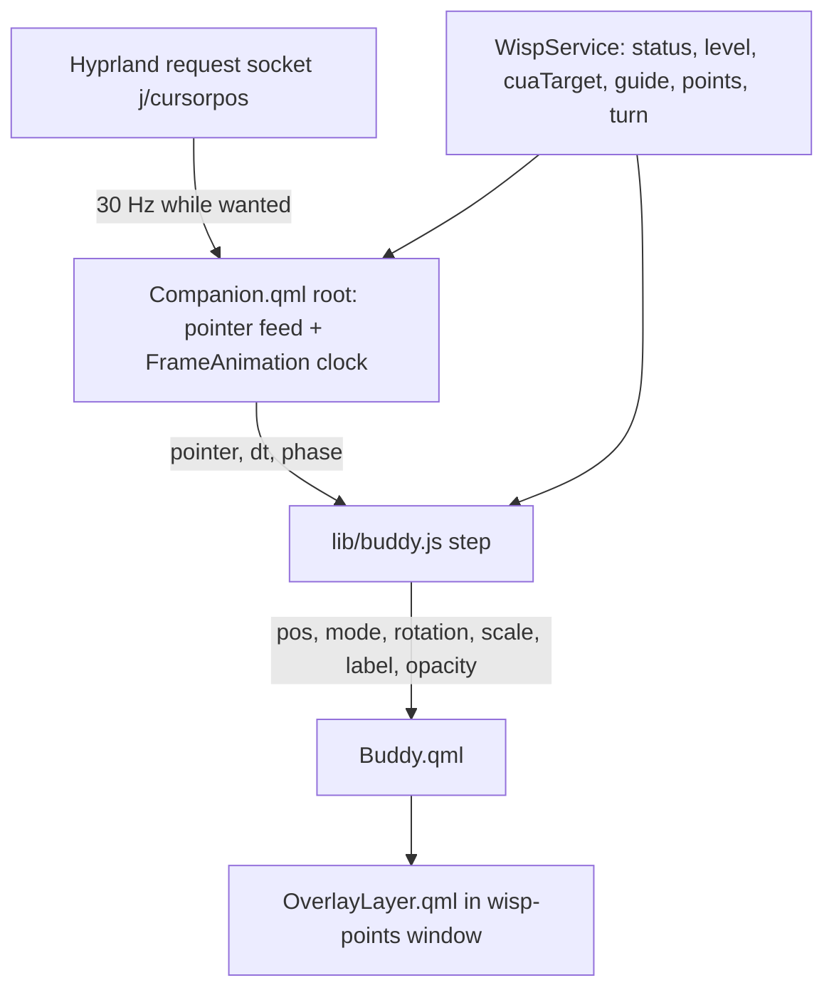
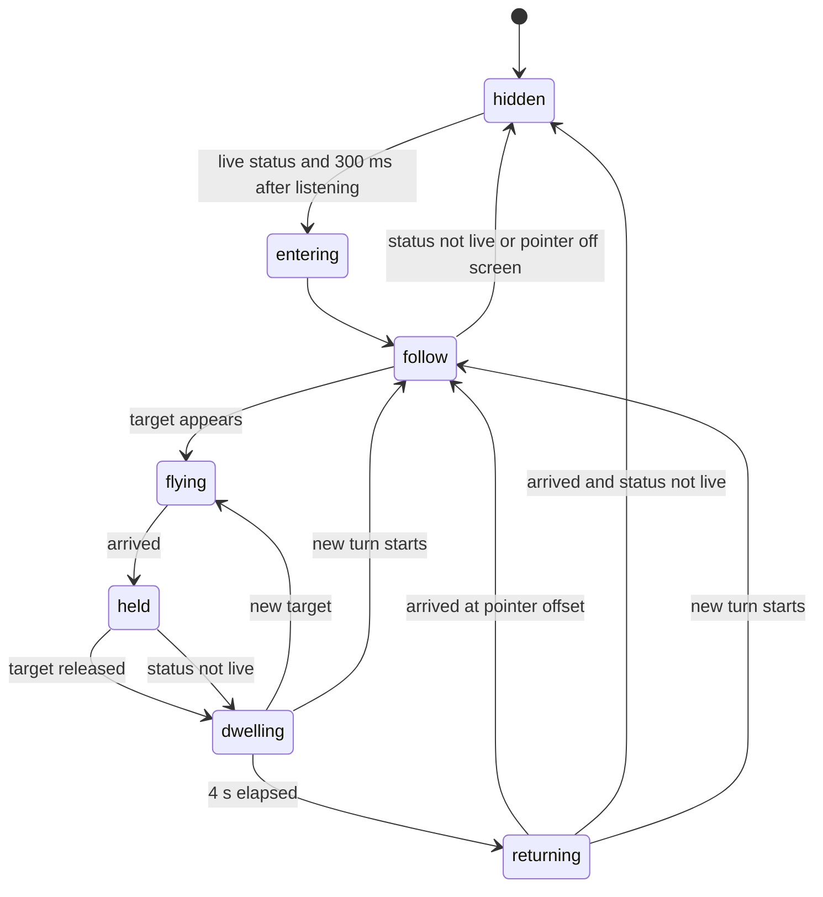

# Clacky Cursor Buddy in the Wisp Overlay - Plan

## Goal Capsule

- **Objective:** During a turn, the owner sees Wisp beside their own pointer, in Clacky's form. It shows bars while it listens, a spinner while it thinks, and a triangle while it speaks. When it points, it flies to the target, labels it, and flies back. Between turns nothing of Wisp sits on screen once that flight back ends.
- **Means:** A pure buddy model in `shell-plugin/lib/buddy.js` (KTD2), a pointer feed and frame clock at the plugin root (KTD3, KTD4), and a `Buddy.qml` component that replaces `GhostCursor.qml` inside the existing `wisp-points` overlay (KTD1).
- **Authority:** This plan reshapes Phase 7 (HeyClicky surfaces) of `docs/plans/2026-10-26-0031-feat-wisp-v1-roadmap-plan.md`. It amends DESIGN-v2 section A5 (KTD5). Tracker: Tallyline Wisp project, Phase 7 issue.
- **Execution profile:** U1, then U2 (it opens with the socket spike), then U3, then U4, then U5. Run the full Python suite with no API keys in the environment, and keep the snapshot goldens current.
- **Stop conditions:**
  - Stop if any change would touch `rs/` or `tests/fixtures/ipc_commands.jsonl`.
  - Stop if the pointer position can only be read by spawning a process per poll (KTD3).
  - Never edit `/usr/share/omarchy/`.
- **Who finishes:** this run's PR. The owner merges.

---

## Product Contract

### Summary

Wisp's overlay gains a cursor buddy modelled on Clacky 0.2.0. It is a small triangle in the theme's ember color with a soft glow. It springs after the real pointer at an offset while a turn is live. It turns into a five-bar mic meter while listening and an arc spinner while working. On a target it flies along an arc, shows the target's label in a pill, holds, and returns. The buddy takes over the ghost cursor's job, and the answer bubble, confirm card, listening pill and beacons stay as they are.

### Problem Frame

The overlay only appears for the pill, the answer bubble, and the ghost cursor when an action targets something (`shell-plugin/Companion.qml`). Between those, the owner has no sign near their eyes that Wisp heard them or is working. HeyClicky and Clacky solve this with a companion that rides the pointer. The owner chose Clacky's look for wisp on 2026-10-26.

### Requirements

**Presence**

- R1. While a turn is live (status `listening`, `transcribing`, `deciding`, `acting`, `awaiting_choice` or `speaking`), the buddy follows the real pointer at a +35, +25 px offset with an underdamped spring. At `idle`, `done`, `error` or any unknown status it hides immediately, unless it is away from the pointer on a target: then it finishes the R6 dwell and return (at most 5.4 s) and hides on arrival. A new turn cancels that tail and the buddy goes straight back to following.
- R2. The buddy's look depends on status:
  - five-bar waveform driven by `level` while `listening`;
  - arc spinner while `transcribing`, `deciding` or `acting`;
  - triangle while `speaking`;
  - triangle with the `needsYou` color while `awaiting_choice`.
- R3. The buddy's first appearance in a turn waits until after the press-time screenshot window, so the speculative press-time screenshot never contains it (KTD6).
- R4. When the pointer leaves the screen the overlay window is on, the buddy hides. It reappears when the pointer returns.

**Pointing**

- R5. When a target appears, the buddy flies from where it is to that target along an upward arc, rotating along the path and growing up to 1.25x mid-flight. A target is a `cua.target` aim, a `guide`, or a new point in `points[]` while `speaking`. On arrival it shows the target's label in a pill beside it. The pill stays fully on the overlay's screen: it flips to the left of the target near the right edge and above it near the bottom edge.
- R6. The buddy holds on the target while the target stays live: `guide` present, `cua.target` not `done`, or status `speaking` for a point. After release it dwells 4 s, then flies back to the pointer offset over 1.4 s. A `cua.target` `click` phase plays the existing 220 ms ripple at the target.
- R7. Numbered beacons for multi-point answers, the listening pill, the answer bubble and the confirm card keep their current behavior and look.

**Motion and theme**

- R8. Motion runs at the same real-time speed on 60 Hz and 120 Hz outputs. Reduced motion snaps follow and flight, and stops the spinner and waveform wobble. Off shows the static mode glyph.
- R9. All buddy colors come from theme tokens and follow the Omarchy theme in dark and light.

**Attribution**

- R10. Every file whose behavior is derived from Clacky carries a header naming its source. The repo and the installed plugin ship `THIRD_PARTY_NOTICES.md` with the MIT notices of Clacky (Raynan Wuyep), clicky-windows (Shashank Singh) and farzaa/clicky.

### Key Decisions

- **Clacky's look, rebuilt in QML inside the existing Quickshell layer-shell overlay.** Governs R1, R5, R7. (session-settled: user-directed — chosen over porting Clacky's PyQt6 UI: PyQt6 cannot create a layer-shell surface here and would sit under fullscreen apps.)
- **Omarchy target first.** Governs R4, R10. (session-settled: user-directed — chosen over shipping a standalone Quickshell launcher for other Linux desktops in the same change: owner wants the Omarchy option first.)
- **Linux only, `rs/` frozen, `tests/fixtures/ipc_commands.jsonl` byte-identical.** Governs R1, R4. (session-settled: user-directed — chosen over cross-platform seams and Rust parity: owner direction for v1.)
- **The buddy shows only during a live turn.** Governs R1. It keeps the 2026-10-07 decision that no persistent Wisp surface sits over user content (`docs/plans/2026-10-07-001-feat-bar-pill-drop-orb-plan.md`).
- **The buddy is the Wisp's on-screen form and replaces the ghost cursor.** Governs R5, R6. DESIGN-v2 says the Wisp is the ghost cursor (one character). Clacky's triangle takes that role instead of being added beside an arrow-and-wick ghost.

### Scope Boundaries

- Out: a standalone Quickshell launcher for Hyprland, Sway, KDE or GNOME. It is the follow-up after this lands.
- Out: restyling the answer bubble, confirm card, pill, panel, bar and beacons. They already use the theme tokens, and Clacky has no counterpart for them.
- Out: Clacky's whiteboard annotations (arrow, circle, underline). Wisp emits nothing for them yet; roadmap R6 owns that feed.
- Out: timing points to the sentence being spoken (roadmap R5). The buddy flies when a point arrives.
- Considered and not built: a speaking animation from TTS loudness. Clacky's speaking glyph is static too. Revisit if the owner asks for one.
- Considered and not built: an overlay window per monitor. R4 hides the buddy off-screen instead. Revisit when the owner reports the buddy missing on the ultrawide while the laptop panel is on.
- Considered and not built: a pointer field in wispd state. It would change the IPC contract and `rs/` parity for data only the overlay needs.

#### Deferred to Follow-Up Work

- Standalone launcher for other Linux desktops (owner-stated next step).
- Per-monitor overlay windows (`Variants` over screens), together with per-screen points and guide.

### Open Questions

- The plugin manifest says `"license": "MIT"` (`shell-plugin/manifest.json`) while `pyproject.toml` says `AGPL-3.0-only`. This plan does not resolve that; the owner decides which license the plugin folder claims. Deferred, not blocking: the MIT notices are required under either answer.

---

## Planning Contract

### Key Technical Decisions

- KTD1. **`Buddy.qml` replaces `GhostCursor.qml`.** It renders every ghost state (traveling, clicking, parked, returning) plus follow and the three status glyphs. Keeping both would put two Wisp characters on screen. `lib/cursor.js` `ghostView` keeps deciding the target phase; the buddy model consumes it. Instantiates the "buddy replaces the ghost cursor" decision (R5, R6).
- KTD2. **All buddy behavior lives in a pure `lib/buddy.js`.** The library (`.pragma library`, no colors, no Quickshell) holds:
  - the follow spring;
  - flight geometry;
  - the follow, flying, dwelling and returning phases;
  - the mode for each status;
  - waveform bar heights and spinner angle;
  - the entry delay.

  `Buddy.qml` is a pure function of the model's output. The repo already tests components this way (`lib/cursor.js` and `tst_cursor.qml`), and `tests/test_components.py` bans timers, sockets and processes in `components/`.
- KTD3. **Pointer position comes from a Quickshell `Socket` at the plugin root.** It queries Hyprland's request socket with `j/cursorpos` at 30 Hz, and only while the buddy is wanted. Quickshell's Hyprland module has no cursor API in this install (quickshell-git 0.3.2), and the request socket answers in about 0.035 ms. A process per poll is ruled out by the DESIGN-v2 budget, and the stop condition holds. If the spike in U2 shows a `Socket` cannot re-request on the one-shot socket, the feed becomes one long-lived helper started by Quickshell `Process` from the plugin root, which streams positions. That is still one process per session, not per poll. Same contract as the unbuilt Ember U13 rider (`docs/plans/2026-10-02-2315-feat-wisp-ember-redesign-plan.md`, KTD5), at the plugin root instead of `components/`.
- KTD4. **One frame clock at the plugin root drives all buddy motion, time-based.** A `FrameAnimation` in `Companion.qml` runs only while the buddy is shown and motion is `full`. It hands `dt` and an accumulated phase to the model. Clacky steps once per 16 ms tick (spring 0.28/0.62, phase +0.10, spin +0.14 per tick). The model converts these to per-second rates against a 60 Hz reference, so 120 Hz eDP-1 moves at the same speed. The spinner runs at Clacky's documented 0.8 s per revolution, not the 0.374 s its code produces. The faster rate is close to DESIGN-v2's 3 Hz flash limit.
- KTD5. **Clacky's palette maps to tokens.** The buddy and its glow use `ember`, with glow discs in `emberHalo`. The label pill keeps Clacky's shape and motion but uses the overlay's existing tag colors: `raised` fill, `ink` text, `ember` keyline. Clacky's filled pill (`canvas` text on `ember`) reaches only 4.34:1 in the catppuccin-latte fixture, and `ink` on `ember` is no better there. The DESIGN-v2 rules "glow only on the creature" and "ember only for the Wisp, ghost cursor and mic meter" still hold, because the buddy is the Wisp. DESIGN-v2 section A5 (ghost silhouette) gets a dated amendment naming the Clacky triangle. Hex values such as #3380FF never enter components (`test_tokens_only`).
- KTD6. **Press-time capture is protected by an entry delay.** The buddy starts its fade-in 300 ms after the turn's first `listening` state. That covers the speculative press-time screenshot (`wisp/stage_capture.py` `speculative_context`), which runs when the key goes down. Once shown, it stays through the turn. Later captures are not protected; Risks names them. A daemon-side "capture done" signal would change the frozen IPC contract.
- KTD7. **Reimplement from Clacky's constants; copy no code.** Clacky 0.2.0 is read only, never run. Constants and geometry come from `clacky/shell/ui/overlay.py`. R10 credits the source, as the Clicky/Clacky delta plan's "port nothing literally" stance asks (`docs/plans/2026-10-25-0215-feat-clicky-clacky-delta-plan.md`).

### High-Level Technical Design

Data flow, one direction:

Buddy phases (the model owns this machine; the glyph depends on the R2 mode):

Clacky constants the model reproduces, all from `clacky/shell/ui/overlay.py`:

| Element | Value |
|---|---|
| Follow offset | +35, +25 px |
| Follow spring (per 16 ms tick) | vel = vel x 0.62 + (target - pos) x 0.28 |
| Triangle | side 16, rotated -35 degrees at rest; vertices (0, -9.24), (-8, 4.62), (8, 4.62) |
| Glow discs | radii 17.6, 12.8, 9.2 at alpha 35, 55, 85 of 255 |
| Flight | quadratic Bezier, control = midpoint minus (0, min(0.22 d, 90)); duration clamp(0.35 + d/700, 0.35, 0.7) s; smoothstep; rotation follows tangent; scale 1 + 0.25 sin(pi t) |
| Dwell / return | 4.0 s dwell; return 1.4 s |
| Waveform | 5 bars, width 2, gap 2, profile 0.4 0.7 1.0 0.7 0.4; h = 3 + level x 10 x profile + (sin(phase x 1.8 + 0.35 i) + 1) / 2 x 1.5 |
| Spinner | diameter 14, pen 2.5 round cap, arc 252 degrees, 0.8 s per rev (KTD4) |
| Label pill | padding 8 x 4, radius 6, left edge at +10 px, centered 18 px below; scale 0.5 to 1 on arrival |

`level` is used as wispd sends it: already normalized 0..1 at about 10 Hz. Clacky's RMS easing is not applied. The model smooths it with Clacky's 0.55/0.45 blend.

### Assumptions

- Pointing at a `points[]` entry flies the buddy only while `speaking`. Beacons still mark every point.
- When `awaiting_choice` has a `guide`, the buddy parks there. Otherwise it follows the pointer showing the `needsYou` triangle.
- Breadcrumb dots behind the ghost go away with `GhostCursor.qml`; Clacky has none.
- `points`, `guide` and `cua.target` keep their current coordinate handling in `OverlayLayer.qml`. The pointer is global layout coordinates, so it is shifted by `originX`/`originY` the same way as `cua.target`.

### Risks

- The `Socket` against Hyprland's one-shot request socket has never been tried in QML. U2 opens with that spike, and KTD3 names the fallback.
- An always-mapped overlay during a turn costs a 30 Hz poll and a frame clock. Both stop at idle, so cost is zero between turns, and the Ember R19 idle budget holds.
- The cua driver draws its own `cua-agent-cursor` layer (`docs/research/cua-sessions-cursor.md`). The buddy flies to the same target during act turns. That is the same overlap the ghost has today, so this is no new risk.
- Screenshots after press time can contain the buddy, which the vision model then sees near the pointer. This is accepted for v1. Two cases:
  - When the speculative capture is missing or older than its 5 s TTL (`SPECULATIVE_TTL_S`), `turn_screenshot` captures inline during `deciding`, with the spinner showing.
  - Act-loop and answer-route captures show the buddy beside the pointer for the whole act turn, where the ghost appeared only at a target.

  If labelled act turns show the glyph hurting grounding, hide the buddy while status is `acting` and no target is live.

### Sources

- Clacky constants: `clacky/shell/ui/overlay.py` in the Clacky 0.2.0 source drop (outside the repo), summarized in `docs/research/2026-10-25-clacky-teardown.md`.
- Current overlay: `shell-plugin/Companion.qml`, `shell-plugin/components/OverlayLayer.qml`, `shell-plugin/components/GhostCursor.qml`, `shell-plugin/lib/cursor.js`, `shell-plugin/lib/motion.js`.
- Component rules: `tests/test_components.py`; copy rules: `tests/test_copy_lint.py`; goldens: `scripts/ui/snap.py`, `tests/test_snap.py`.
- Hyprland socket client to mirror: `wisp/hypr.py` (`query("cursorpos")`, socket path and stale-signature handling).
- Design rules: `DESIGN-v2.md` sections 4.3-4.4 (reference lock, role rules), A5 (ghost), 5.5 (motion), 6.5 (rider).

---

## Implementation Units

### U1. Buddy model library

- **Goal:** One pure library computes everything the buddy draws, frame by frame.
- **Requirements:** R1, R2, R3, R5, R6, R8; KTD2, KTD4, KTD6, KTD7.
- **Dependencies:** none.
- **Files:** `shell-plugin/lib/buddy.js` (new), `tests/qml/lib/tst_buddy.qml` (new), `tests/test_qml_lib.py` (register the new test if it is listed explicitly).
- **Approach:**
  1. Export a `step(model, input, dt)` that returns the next model, and a `view(model, tokens-free inputs)` that returns position, rotation, scale, mode, label, label scale and opacity. Input is the pointer, status, level, the `ghostView` target from `lib/cursor.js` and the motion mode.
  2. Convert Clacky's per-tick constants to time-based rates against a 60 Hz reference (KTD4).
  3. Encode the phase machine in the HTD diagram, the R2 mode table and the KTD6 entry delay.
  4. Provide pure helpers for waveform bar heights and spinner start angle from phase and level.
- **Execution note:** Write `tst_buddy.qml` first. Each scenario below fails before the library exists.
- **Patterns to follow:** `shell-plugin/lib/cursor.js` and `tests/qml/lib/tst_cursor.qml` (pure library with a QML test); `shell-plugin/lib/motion.js` for motion-mode resolution.
- **Test scenarios:**
  - Follow converges: from (0,0), with the pointer at (100,100) and full motion, after 0.5 s of 60 Hz steps the position is within 1 px of (135,125). It overshoots that point at least once on the way.
  - Rate independence: the same 0.5 s stepped at 120 Hz lands within 1 px of the 60 Hz result.
  - Reduced motion: one step puts the buddy exactly at the pointer offset.
  - Flight duration: d = 100 px gives 0.493 s; d = 1000 px gives 0.7 s; d = 0 gives 0.35 s.
  - Flight path: at t = 0.5 the point is above the straight-line midpoint by min(0.22 d, 90) / 2 (the quadratic Bezier reaches half the control offset), and the scale is 1.25.
  - Hold: with a held target, after 10 s the buddy is still on the target.
  - Release: 4 s after release the phase becomes returning, and 1.4 s later it is back in follow.
  - New target during dwell flies straight to the new target without returning first.
  - Turn ends on a target: status goes `speaking` to `done` while the buddy is held. It dwells 4 s, returns over 1.4 s, then hides. No frame shows it hidden before it reaches the pointer.
  - New turn during that tail: status goes to `listening` mid-dwell, and the buddy is back in follow on the next step.
  - Label placement: a target 10 px from the right edge puts the pill's right edge inside the screen, to the left of the target. A target 10 px from the bottom puts the pill above the target.
  - Mode map: `listening` gives waveform, `deciding` gives spinner, `speaking` gives triangle, `awaiting_choice` gives triangle-needs-you, and `idle` and `"bogus"` give hidden.
  - Entry delay: 0.2 s after the first `listening` the opacity is 0; at 0.35 s the buddy is fading in.
  - Pointer null (feed not yet answering): the buddy stays hidden.
  - Waveform: level 0 at phase 0 gives heights within 3 to 4.5 px; level 1 makes the middle bar the tallest at no more than 14.5 px.
  - Spinner: one revolution takes 0.8 s of phase at full motion; reduced and off give a fixed angle.
- **Verification:** `tst_buddy.qml` passes under `qmltestrunner`, and `tests/test_components.py` library rules (no hex, no Quickshell) hold for the new file.

### U2. Pointer feed and frame clock at the plugin root

- **Goal:** `Companion.qml` gives the overlay a live pointer position and a frame clock, only while the buddy is wanted.
- **Requirements:** R1, R4, R8; KTD3, KTD4.
- **Dependencies:** U1.
- **Files:** `shell-plugin/Companion.qml`, `shell-plugin/lib/buddy.js` (pure parse and screen-membership helpers), `tests/qml/lib/tst_buddy.qml`, `tests/test_components.py` (only if a new root-level file must be registered), `tests/test_copy_lint.py` (same condition).
- **Approach:**
  1. Spike first, in a scratch Quickshell run outside the repo tree. Check whether a `Quickshell.Io` `Socket` can send `j/cursorpos`, read the reply, and reconnect for the next request. Record the result in the PR. If it can't, apply KTD3's fallback.
  2. Resolve the socket path the way `wisp/hypr.py` does: `$XDG_RUNTIME_DIR/hypr/<signature>/.socket.sock`, preferring the newest on a stale signature.
  3. Poll at 30 Hz while a live status holds (R1). Stop polling and drop the pointer at idle.
  4. Add a `FrameAnimation` that runs while the buddy is shown and motion is `full`. It feeds `dt` and phase to `lib/buddy.js` `step`. At reduced or off motion, the model steps on each pointer update instead.
  5. Translate global pointer coordinates by the window's screen origin. Mark the pointer off-screen when it falls outside that screen (R4).
- **Execution note:** The spike decides the mechanism. Commit nothing from the spike.
- **Patterns to follow:** `shell-plugin/WispService.qml` `Socket` usage for `wispd.sock`; `Companion.qml` `refreshOf` for per-screen data; `wisp/hypr.py` for the socket path.
- **Test scenarios:**
  - Parse: the reply `{"x":505,"y":863}` gives (505, 863). An empty or garbled reply gives null, and the buddy stays as it was.
  - Off-screen: a pointer at (2000, 500) with a screen of origin (0,0) and size 1728x1080 is off-screen. With origin (1728,0) and size 3440x1440 it is on-screen at layer (272, 500).
  - Integration (manual, recorded in the PR): with wispd running, press the talk key and move the pointer. The buddy follows within one frame of visible lag and disappears within one frame after `done`. `hyprctl` shows no new process per poll.
- **Verification:** At idle, no socket polls run and the frame clock is stopped. During a turn the buddy follows the pointer smoothly on eDP-1 (120 Hz) and DP-3.

### U3. Buddy component

- **Goal:** `Buddy.qml` draws the triangle, glow, waveform, spinner and label pill from the model's view.
- **Requirements:** R2, R5, R6, R8, R9; KTD1, KTD5.
- **Dependencies:** U1.
- **Files:** `shell-plugin/components/Buddy.qml` (new), `shell-plugin/components/GhostCursor.qml` (delete), `tests/test_components.py` (`EXPECTED`), `tests/qml/harness/scenes.json`, `tests/qml/harness/FixtureService.qml` (only if Buddy reads a service member it lacks), `tests/qml/snapshots/**/Buddy__*.png` (new goldens), `tests/qml/snapshots/**/GhostCursor__*.png` (delete).
- **Approach:**
  1. Draw with `Shape` paths and plain `Rectangle`s at the U1 sizes. Colors come from `service.tokens` per KTD5.
  2. Make the waveform and spinner pure functions of the phase input. Nothing in the component loops or animates on its own, which keeps `test_looping_animation_only_in_creature_and_gated` true.
  3. Port the click ripple from `GhostCursor.qml`: 220 ms, gated by `motionMode` like today.
  4. Register `Buddy` in `EXPECTED` and give it scene variants: follow-triangle, waveform at levels 0 and 1, spinner, needs-you, flying mid-arc, parked with label, label flipped at the right edge, label in light theme, and motion off.
- **Patterns to follow:** `GhostCursor.qml` (header comment, `placed` convention, `motionMode` resolution, label chip); `Beacon.qml` for token use.
- **Test scenarios:**
  - The snapshot goldens for each variant above, in dark and light at 1x, and dark at 2x for parked-with-label.
  - The parked-with-label variant renders the label from `service.ui` copy, not a literal (copy lint).
  - Contrast: the label pill's `ink` text on its `raised` fill is at least 4.5:1 in every `tests/fixtures/themes/*/expected.json`.
  - The component rule suite passes: header comment, no forbidden items, tokens only, motion gated.
- **Verification:** `scripts/ui/snap.py check --only Buddy` passes with the new goldens, and no GhostCursor goldens or scenes remain.

### U4. Overlay wiring

- **Goal:** The overlay shows the buddy during live turns and routes targets to it in place of the ghost.
- **Requirements:** R1, R3, R4, R5, R6, R7; KTD1, KTD6.
- **Dependencies:** U2, U3.
- **Files:** `shell-plugin/components/OverlayLayer.qml`, `shell-plugin/Companion.qml`, `shell-plugin/lib/companion.js` (if visibility helpers live there), `tests/qml/harness/CompanionStage.qml`, `tests/qml/harness/scenes.json`, `tests/qml/lib/tst_buddy.qml`, `tests/qml/snapshots/**/Companion__*.png`.
- **Approach:**
  1. Replace the `GhostCursor` instance with `Buddy`. Feed it the U2 pointer and clock and the current `ghostView` target. Add the speaking-point target rule from R5.
  2. Add `buddyShown` to the overlay's `shown` expression. It is true from the model, so the window stays mapped through the whole live turn and through any R1 dwell-and-return tail. Leave the input mask over the pill and bubble only, so the buddy stays click-through.
  3. Keep beacons, pill, bubble and confirm card unchanged (R7).
- **Patterns to follow:** existing `ghostShown` wiring and `originX`/`originY` shifts in `OverlayLayer.qml`.
- **Test scenarios:**
  - Covers R1. Fixture `listening` with a pointer set renders the buddy waveform near the pointer. Fixture `idle` renders no buddy, and the window's `shown` is false when nothing else is shown.
  - Covers R5. Fixture `acting` with a `cua.target` aim renders the buddy at the target with its label. The previous ghost scene's target position is unchanged.
  - Covers R7. Fixtures `answer` and `confirm` render the bubble and card pixel-identical to their current goldens, apart from the buddy.
  - `speaking` with two points, the second added later: the model's target becomes the second point (tst_buddy).
  - Turn change mid-flight: the model returns to follow at the pointer, and the old label is gone (tst_buddy).
- **Verification:** Regenerated Companion goldens differ from the current ones only where the buddy replaces the ghost or appears in a live state. The input mask still covers only the pill and bubble.

### U5. Design amendment, notices and docs

- **Goal:** The repo records the new look and credits its source.
- **Requirements:** R10; KTD5, KTD7.
- **Dependencies:** U3.
- **Files:**
  - `DESIGN-v2.md` (dated A5 amendment);
  - `THIRD_PARTY_NOTICES.md` (new, repo root);
  - `shell-plugin/THIRD_PARTY_NOTICES.md` (new copy so it installs with the plugin; no symlink);
  - `docs/plans/2026-10-26-0031-feat-wisp-v1-roadmap-plan.md` (Phase 7 row notes the buddy);
  - `README.md` and `scripts/ui/readme_media.py` outputs, only if README media show the ghost;
  - `tests/test_plugin_manifest.py` or a small docs test asserting that both notice files exist and are identical.
- **Approach:**
  1. Copy the Clacky and clicky-windows notices verbatim from their LICENSE files.
  2. Fetch farzaa/clicky's license text from its GitHub repository. If it can't be fetched, name the project and URL and record the gap in the PR body.
  3. Add a header line to `lib/buddy.js` and `Buddy.qml` naming the Clacky source file.
- **Test scenarios:**
  - The two notice files exist and are identical.
  - Each of `lib/buddy.js` and `Buddy.qml` has a header naming `clacky/shell/ui/overlay.py`.
- **Verification:** `wispd install` copies `THIRD_PARTY_NOTICES.md` into the plugin folder, and `omarchy-plugin-validate` still passes.

---

## Verification Contract

| Gate | Command | Applies to |
|---|---|---|
| Python suite (keyless, as CI) | `env -u OPENROUTER_API_KEY -u GROQ_API_KEY HOME=$(mktemp -d) python3 -m unittest discover -s tests` | all |
| QML library tests | `tests/test_qml_lib.py` (part of the suite; `qmltestrunner` present on this machine) | U1, U2, U4 |
| Snapshot goldens | `python3 scripts/ui/snap.py check`; regenerate deliberately with `snap.py update --only Buddy` and `--only Companion` | U3, U4 |
| Generated assets | `python3 scripts/assets/gen_settings.py --check`, `python3 scripts/assets/gen_copy.py --check`, plus `build_icons.py` and `bake_shaders.sh --check` if icons or shaders change | U3, U5 |
| Parity | `git diff --quiet origin/master -- rs tests/fixtures/ipc_commands.jsonl` | all |
| Live check | `wispd install --ref <branch>`, restart omarchy-shell, run one spoken turn and one act turn | U2, U4 |

---

## Definition of Done

- R1 to R10 hold, each covered by a U1 to U5 test scenario or the live check.
- Live check on this machine:
  - the buddy follows the pointer while listening (bars), thinking (spinner) and speaking (triangle);
  - it flies to an act target and back;
  - nothing of Wisp is on screen at idle;
  - the speculative press-time screenshot of the turn does not contain the buddy;
  - a turn held past 5 s is run once and its screenshot inspected, and what it shows is recorded in the PR.
- `GhostCursor.qml`, its scenes and its goldens are gone. No experimental spike code is left in the diff.
- The suite passes with no API keys; parity is untouched; the manifest license question is in the PR body.
