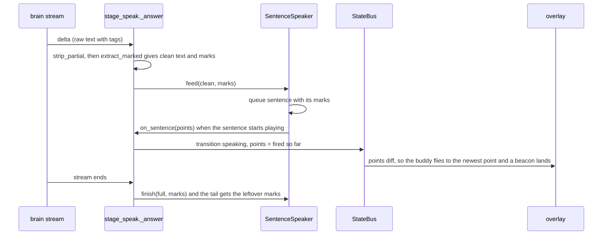

# Points Timed to Speech - Plan

## Goal Capsule

- **Objective:** When Wisp answers "where is X" out loud, each point shows up as Wisp starts saying the sentence about it, so the owner's eye follows the voice. Today every point appears at once, before any sentence plays.
- **Means:**
  - The model places each point tag inside the sentence it belongs to (KTD1).
  - The parser keeps each tag's position in the spoken text (KTD2).
  - The sentence speaker fires a sentence's points when that sentence starts playing (KTD3).
  - The stage grows the existing `points` list as those sentences start (KTD4).
- **Authority:** Roadmap R5 in `docs/plans/2026-10-26-0031-feat-wisp-v1-roadmap-plan.md` (Phase 7). This is the second Phase 7 slice; #148 shipped the cursor buddy. Prior design: `docs/plans/2026-10-25-0215-feat-clicky-clacky-delta-plan.md` KTD6 (single-stream tour). Tracker: Tallyline TLY-202.
- **Execution profile:** U1, then U2, then U3, then U4 and U5. Run the full Python suite with no API keys in the environment, and keep the goldens unchanged.
- **Stop conditions:**
  - Stop if the change would touch `rs/` or `tests/fixtures/ipc_commands.jsonl`.
  - Stop if R5 can only be met with a new state field. In that case report the parity question rather than adding one.
- **Who finishes:** this run's PR. The owner merges.

---

## Product Contract

### Summary

The answer prompt asks the model to put each `[POINT:x,y:label]` tag right after the words it points at, inside that sentence. The parser records where each tag sat in the spoken text. The sentence speaker carries each sentence's points and hands them over the moment it starts that sentence. The stage appends them to the `points` list it already publishes, so the cursor buddy flies to each new point as its sentence starts and the beacons build up one by one.

### Problem Frame

`wisp/stage_speak.py` pulls every point out of the finished reply and publishes them in one `speaking` transition. That transition fires as the answer stream ends, while the first sentences are already playing or still queued. The buddy flies to the last point, and all beacons appear together. A multi-step answer such as "first open Settings, then click Display" therefore shows its last step before Wisp has said its first. HeyClicky and Clacky time each point to its sentence; R5 asks for the same behavior here.

### Requirements

**Timing**

- R1. With voice on and a streamed answer, each point appears in `points` when the sentence containing its tag starts playing. It never appears earlier.
- R2. A point whose tag comes after the last sentence fires when the remaining text is handed to the speaker. This covers a trailing `[POINTS:[...]]` list or a tag at the very end.
- R3. With voice off, or a non-streamed reply, all points appear at once, as today.
- R4. A sentence whose TTS process fails to start still fires its points.
- R5. An interrupt or barge-in stops further points from appearing. Points already shown follow today's clearing rule: they clear when the status leaves `speaking`.

**Text hygiene**

- R6. Streaming text never shows or speaks a partial point tag. That includes a partial `[POINTS:[{...}]` that already contains an inner `]`, which leaks raw JSON today.

**Overlay**

- R7. A point arriving later does not replay the landing animation of beacons already on screen.

**Contract**

- R8. No new state field or event. `points` keeps its shape and simply grows during `speaking`. `docs/IPC_CONTRACT.md` says so.

### Key Decisions

- **Reuse the `points` field and grow it.** Governs R8. `StateBus` already publishes a changed list as a whole-key diff, and the parity tests check key sets, not list contents. A per-point timestamp or a new `point` event would add contract surface that no consumer needs.
- **`rs/` frozen, `tests/fixtures/ipc_commands.jsonl` byte-identical.** Governs R8. (session-settled: user-directed — chosen over Rust parity work: owner direction for v1.)
- **Voice off keeps today's behavior.** Governs R3. With no speech there is no sentence start to anchor to, and delaying points by an estimated reading time would be a guess.

### Scope Boundaries

- Out: act-result speech (`_speak_result`). It speaks the whole payload at once with no sentence streaming, so its points keep arriving together.
- Out: drawing rings and arrows (R6 of the roadmap) and walkthroughs (R7 of the roadmap).
- Out: raising the overlay's eight-beacon cap. The core allows 32; points past the eighth stay untargeted, as today.
- Considered and not built: timing points from a speech-rate estimate when voice is off. There is no sentence start to anchor to. Revisit if voice-off users ask for paced points.
- Considered and not built: a per-point `at` timestamp in state. Nothing consumes it, and it would widen the contract.

---

## Planning Contract

### Key Technical Decisions

- KTD1. **Inline tags, placed inside the sentence before its final punctuation.**
  - The prompt (`stage_speak.ask_chat`, the screenshot branch) asks for each `[POINT:x,y:label]` right after the words it refers to, for example "Click Save [POINT:812,40:Save] to keep it." `[POINTS:[...]]` stays accepted.
  - The reason: `_SENTENCE` closes a sentence at its punctuation plus whitespace. A tag after the full stop would land in the next sentence and fire one sentence late.
- KTD2. **`points.extract` gains offsets; existing callers are unchanged.** A new `points.extract_marked(text)` returns `(clean_text, [(offset, point_px)])`. Each offset is the tag's character position in the clean text. `extract` keeps its signature and calls it. A `points.strip_partial(text)` helper hides any unclosed trailing `[POINT…` or `[POINTS…` tag (R6) and replaces the bracket regex in `_delta`.
- KTD3. **The speaker carries points per sentence and fires on start.**
  - `SentenceSpeaker.feed(text, marks=())` assigns each new mark to the sentence whose clean-text span contains its offset. An offset at a sentence's end belongs to that sentence. A mark whose sentence is still queued rides with it. A mark whose sentence was already dequeued (the usual case for a tag the model put after the full stop) fires at once, so no mark is ever dropped. Marks past the last queued sentence wait for the next sentence or for `finish()`.
  - The worker calls an `on_sentence(points)` callback when it dequeues a sentence for playback, before spawning TTS, so a failed spawn still fires the points (R4). It checks its own stopped flag first and skips the callback after `stop()`.
  - `finish(full, on_done, marks=())` attaches every still-unfired mark to the tail. If there is no tail, they fire immediately (R2).
  - `stop()` drops the queue, so its points never fire (R5).
- KTD4. **The stage owns the published list.**
  - `_answer` converts each fired point to logical coordinates with one `monitors()` lookup per turn.
  - It appends the points and publishes under one lock, so two publishes can never land out of order and shrink the list. The publish sends `points` only, with no status, through the turn-scoped bus path `_publish_delta` uses. It is skipped unless the turn is still current and the status is still `speaking` (the same guard `_end_speaking` uses), so a late callback can never revive a finished or newer turn.
  - Routing follows `speaker.enabled`, not `speaker.started`. With voice on, the reply always goes through `speaker.finish(reply, on_done, marks)`, even when it arrived in one chunk, and the final `speaking` transition publishes the fired list (read under the same lock). With voice off it publishes every point, as today (R3). The `points` trace event still carries the full list once per turn.
- KTD5. **Beacons are keyed so existing items persist.** The beacon `Repeater` in `OverlayLayer.qml` is fed from a `ListModel` that the host syncs by appending new points and clearing on reset. A replaced JS array would recreate every delegate (R7).

### High-Level Technical Design

### Assumptions

- Models follow the inline placement often enough. A tag the model puts after the full stop arrives once its sentence is already playing, so it fires at once (KTD3). That is up to one sentence late, which is harmless, and it is never dropped. If models keep appending every tag at the end, all points fire with the tail and the change is worth less. The live check is where that shows.
- The screenshot branch of the prompt is the only one that asks for points, and this plan does not change when points are requested.

### Risks

- **Tail desync.** `finish()` keeps the tail only when the final text starts with the text already queued. Tag stripping must produce identical clean text when streaming and at the end. U1 tests that `extract_marked` agrees on a prefix and on the whole text.
- **Callback threads.** `on_sentence` runs on the speaker's worker thread. `state.transition` is already called from TTS exit threads (`_end_speaking`), so this is an existing pattern, but the fired list needs its lock.

### Sources

- `wisp/stage_speak.py`:
  - the answer prompt (screenshot branch);
  - `_answer` and its `_delta`;
  - `_speak_result`.
- `wisp/speech.py`: `SentenceSpeaker`.
- `wisp/points.py`: `extract`, `canvas_to_logical`, `to_logical`.
- `wisp/state.py`: the `points` clearing rule in `transition` and the whole-key diffs in `StateBus.publish`.
- `shell-plugin/components/OverlayLayer.qml`: the beacon `Repeater`.
- `shell-plugin/lib/cursor.js`: `beacons`.
- `shell-plugin/lib/companion.js`: `buddyTarget`.
- Replay harness: `tests/harness/_child.py`, `tests/harness/fakes.py` (`chunks`, `chunk_delay_ms`), `tests/fixtures/turns/`.

---

## Implementation Units

### U1. Point offsets and partial-tag stripping

- **Goal:** The parser reports where each tag sat in the spoken text, and a partial tag never shows.
- **Requirements:** R1, R6; KTD2.
- **Dependencies:** none.
- **Files:** `wisp/points.py`, `tests/test_points.py`.
- **Approach:**
  1. Add `extract_marked(text)`, which returns clean text plus `(offset, point_px)` per tag. Expand a `[POINTS:[...]]` list into several marks at one offset.
  2. Reimplement `extract` on top of it.
  3. Add `strip_partial(text)`, which cuts from the last unclosed `[POINT` or `[POINTS` to the end.
- **Execution note:** Test first.
- **Patterns to follow:** existing `extract` tests in `tests/test_points.py`.
- **Test scenarios:**
  - "Click Save [POINT:10,20:Save] to keep it." gives the clean text "Click Save to keep it." (spacing per today's `extract`), with one mark at the offset after "Save".
  - Two inline tags in two sentences give two marks, each inside its own sentence's span.
  - A trailing `[POINTS:[{"x":1,"y":2,"label":"a"},{"x":3,"y":4,"label":"b"}]]` gives two marks at the end offset.
  - `extract(text)` returns the same `(clean, points)` as before for every existing test input.
  - `strip_partial("Open it [POINTS:[{\"x\":1,\"y\":2}]")` gives "Open it " with no `{`.
  - `strip_partial("Open it [POI")` gives "Open it ".
  - Text with no partial tag is unchanged.
  - Prefix agreement: the clean text of `extract_marked(prefix)` is a prefix of the clean text of `extract_marked(full)` whenever the prefix ends outside a tag.
- **Verification:** `tests/test_points.py` passes, and existing callers are unchanged.

### U2. Sentence speaker fires points on sentence start

- **Goal:** Each sentence's points fire when the speaker starts that sentence.
- **Requirements:** R1, R2, R4, R5; KTD3.
- **Dependencies:** U1.
- **Files:** `wisp/speech.py`, `tests/test_speech.py`.
- **Approach:**
  1. Extend the queue items to `(kind, sentence, points)`.
  2. `feed(text, marks=())` assigns marks to sentences by span.
  3. Add a constructor argument `on_sentence=None`, which the worker calls before spawning each sentence.
  4. `finish(full, on_done, marks=())` attaches leftover marks to the tail, or fires them at once when there is no tail.
  5. `stop()` drops queued points.
- **Execution note:** Test first, using the fake TTS argv the existing `test_speech.py` cases use.
- **Patterns to follow:** the existing `SentenceSpeaker` tests in `tests/test_speech.py`.
- **Test scenarios:**
  - For "One here. Two there." with a mark in each sentence, `on_sentence` receives the first sentence's point before the second's, and each call happens as its sentence is dequeued.
  - A mark at a sentence's closing offset belongs to that sentence, not the next.
  - With a TTS argv that fails to spawn, `on_sentence` still receives the point.
  - Marks after the last sentence fire from `finish()` with the tail. With no tail they fire before `on_done`.
  - After `stop()`, no further `on_sentence` calls happen for queued sentences, including one already dequeued when `stop()` lands.
  - A mark fed after its sentence was dequeued fires immediately and is not lost.
  - Every mark fed during a turn fires exactly once, whether with its sentence, late, or from `finish()`.
  - With voice disabled (`enabled` false), `on_sentence` is never called. The stage owns that fallback.
- **Verification:** `tests/test_speech.py` passes, including the existing cases unchanged.

### U3. Stage wiring, prompt, and voice-off fallback

- **Goal:** The answer route grows `points` as sentences start and keeps today's behavior when there is no speech.
- **Requirements:** R1, R2, R3, R5, R6, R8; KTD1, KTD4.
- **Dependencies:** U1, U2.
- **Files:** `wisp/stage_speak.py`, `docs/IPC_CONTRACT.md`, `tests/test_stage_speak.py` (new, or the closest existing stage test module; follow the repo convention found at implementation).
- **Approach:**
  1. In the prompt's screenshot branch, ask for inline tags placed before the sentence's final punctuation, and keep `[POINTS:...]` for sequences.
  2. In `_delta`:
     - replace the bracket regex with `points.strip_partial`;
     - pass `extract_marked(partial)` to `speaker.feed(clean, marks)`.
  3. Build the speaker with an `on_sentence` callback (KTD4):
     - it converts the points to logical coordinates;
     - under the fired-list lock, it appends them and publishes `points` only through the turn-scoped bus;
     - it skips the publish when the token is cancelled, the turn is no longer current, or the status has left `speaking`.
  4. Final transition and fallback, routed on `speaker.enabled`:
     - with voice on, the final transition publishes the fired list (read under the lock), and `speaker.finish(reply, on_done, marks)` carries the rest, even for a single-chunk reply;
     - with voice off, it publishes every point and speaks via `speech.speak`, as today.
  5. Update the `points` text in `IPC_CONTRACT.md` to say that it grows during `speaking` as sentences start, and that it clears when the status leaves `speaking`.
- **Patterns to follow:** `_end_speaking` for state calls off the stage thread; the existing `_answer` structure.
- **Test scenarios:**
  - **Streaming with voice on, using a fake TTS that records starts:**
    - the first `speaking` publish with a non-empty `points` holds only sentence one's point;
    - it is followed by a publish holding both points after sentence two starts.
  - **Voice off:** a single `speaking` transition carries all points (unchanged).
  - **Trailing list:** a `[POINTS:[...]]` list after the last sentence makes its points appear before `done`.
  - **Cancelled turn:** `token.cancelled` mid-answer means no `points` publish after the cancel.
  - **Partial tag in the stream:** a streamed partial `[POINTS:[{` never reaches `_publish_delta`'s text or the speaker.
  - **Single chunk with voice on:** a two-sentence reply that arrives in one delta still publishes its points one sentence at a time.
  - **Late callback:** an `on_sentence` that runs after the status went to `done` publishes nothing and does not revive `speaking`.
  - **Concurrent publishes:** with `on_sentence` racing the final transition, the published `points` length never decreases.
- **Verification:**
  - The tests above pass.
  - `test_contract.py`, `test_state_reader.py` and `test_trace.py` pass unchanged.
  - Parity holds.

### U4. Beacons persist across appended points

- **Goal:** A new point lands its own beacon without replaying the others.
- **Requirements:** R7; KTD5.
- **Dependencies:** none.
- **Files:**
  - `shell-plugin/components/OverlayLayer.qml`, or the plugin-root file that owns the `ListModel` sync. Respect `tests/test_components.py`, which bans timers and sockets in components but not `ListModel`.
  - `tests/qml/lib/tst_cursor.qml` or a new `tst_*.qml`.
  - Companion and Beacon goldens, only if pixels change (they should not).
- **Approach:**
  1. Sync a `ListModel` from `Cursor.beacons(points)`:
     - append the entries past the current count;
     - rebuild only when the new list is not an extension of the old one (a new turn, or a cleared list).
  2. Feed the `Repeater` from that model.
- **Test scenarios:**
  - A list growing from 1 to 2 entries creates exactly one new delegate; count `Component.onCompleted` or use a pure sync helper's append/reset decision.
  - A list that changes non-incrementally, such as a new turn, rebuilds.
  - A list emptied to `[]` clears all beacons.
- **Verification:** The new test passes, and `snap.py check` shows 0 diffs.

### U5. Replay fixture for timed points

- **Goal:** One end-to-end replay proves that points arrive with their sentences.
- **Requirements:** R1, R3.
- **Dependencies:** U3.
- **Files:**
  - `tests/harness/_child.py` (record `points` in per-event records);
  - `tests/harness/runner.py` (an `expect` key for point timing);
  - `tests/fixtures/turns/answer_points_timed.json` (new);
  - `docs/SCENARIOS.md` (a row).
- **Approach:**
  1. Run the fixture with `voice.enabled` true and a fake TTS command that exits quickly.
  2. Stream an answer with two inline tags in two sentences using `chunks`.
  3. Assert that the recorded event sequence shows `points` lengths 1 then 2 while `speaking`, with no event carrying both points before the second sentence starts.
- **Patterns to follow:** the `act_open_mail` fixture and its `launch_results` harness key (#147).
- **Test scenarios:**
  - The fixture passes. With U3 reverted, it fails because both points arrive in the first `speaking` event.
  - Existing fixtures are unchanged.
- **Verification:** `tests/test_turn_replay.py` and `tests/test_scenarios.py` pass.

---

## Verification Contract

| Gate | Command | Applies to |
|---|---|---|
| Python suite (keyless, as CI) | `env -u OPENROUTER_API_KEY -u GROQ_API_KEY HOME=$(mktemp -d) python3 -m unittest discover -s tests` | all |
| QML library tests | `tests/test_qml_lib.py` (in the suite) | U4 |
| Snapshot goldens | `python3 scripts/ui/snap.py check`, with 0 diffs expected | U4 |
| Generators | `python3 scripts/assets/gen_settings.py --check`, `python3 scripts/assets/gen_copy.py --check` | all |
| Parity | `git diff --quiet origin/master -- rs tests/fixtures/ipc_commands.jsonl` | all |
| Live check | after deploy, ask a "where is X then Y" question with a screenshot and voice on; the buddy flies to each point as its sentence starts | U3 |

---

## Definition of Done

- R1 to R8 are covered by U1 to U5 tests, plus the live check.
- No new state field, and parity is untouched.
- The suite passes with no keys, and the goldens are unchanged.
- No leftover experiment code remains.
