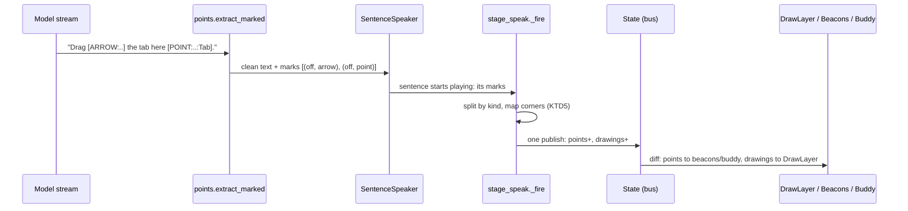
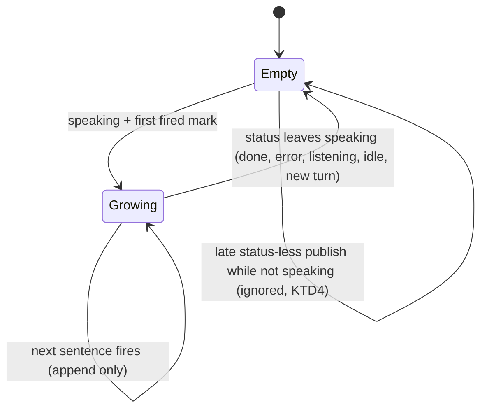

# Draw on Screen - Plan

## Goal Capsule

- **Objective:** When Wisp answers a question about the screen, it can circle, point an arrow at, or highlight what it is talking about, each drawing appearing as the sentence about it starts playing and all of them gone once Wisp stops speaking.
- **Means:**
  - The model writes `[RING]`, `[ARROW]` and `[HL]` tags inside the sentence they belong to, beside the existing `[POINT]` tags (KTD1).
  - One parser yields points and drawings as a single ordered mark list (KTD2).
  - The stage publishes drawings to a new `drawings` state field that lives exactly as long as `points` (KTD3, KTD4).
  - A new `DrawLayer` in the existing overlay renders them (KTD5).
- **Authority:** Roadmap R6 in `docs/plans/2026-10-26-0031-feat-wisp-v1-roadmap-plan.md` (Phase 7, third slice). Builds on R5 (#150, `docs/plans/2026-10-27-0015-feat-points-timed-to-speech-plan.md`). Prior design: `docs/plans/2026-10-25-0215-feat-clicky-clacky-delta-plan.md` U10. Tracker: Tallyline TLY-202.
- **Stop conditions:** Stop and report if a requirement needs an `rs/` edit, a change to `tests/fixtures/ipc_commands.jsonl`, or a `contract_version` bump.
- **Execution profile:** Python daemon (`wisp/`) plus Quickshell QML overlay (`shell-plugin/`). Tests run keyless.
- **Finish and ship:** `ce-work` implements and verifies; the calling `lfg` run reviews, opens the PR, and leaves the merge to the owner.

---

## Product Contract

### Summary

Wisp gains three on-screen drawings: a ring around a spot, an arrow from one spot to another, and a highlight box. The model asks for them with inline tags the way it asks for points. Each drawing appears when its sentence starts playing, and every drawing clears as soon as the status leaves `speaking` (done, error, barge-in, walkthrough cancel, or a new turn). The cursor buddy and numbered beacons keep following points only.

### Problem Frame

Since #150, Wisp's points arrive in time with speech, but a point is a single dot. Explaining "this whole panel" or "drag from here to there" needs a shape. The parser for these shapes shipped in #124 with tests but nothing calls it, it uses a second coordinate mapper, and the live streaming parser does not know the tags. If the prompt asked for drawings today, the tags would be read aloud.

### Requirements

- R1. With a screenshot attached, the model may emit `[RING:x,y,r]`, `[ARROW:x1,y1,x2,y2]` and `[HL:x,y,w,h]` in screenshot pixels, placed inside the sentence they illustrate; the prompt asks for at most three per answer.
- R2. No drawing tag, whole or partial, ever reaches the answer bubble, spoken audio, act-result speech, or stored session text.
- R3. With voice on, each drawing appears when the sentence holding its tag starts playing, together with that sentence's points. With voice off, drawings publish with the `speaking` transition and clear with points at `done`, so they are not visible; a voice-off dwell is follow-up work shared with points.
- R4. Drawings use Hyprland logical coordinates: positions and sizes are mapped from screenshot pixels the same way points are.
- R5. Drawings clear whenever the status leaves `speaking`: done, error, barge-in, walkthrough cancel, or a new turn. A drawing never appears after the status has left `speaking`.
- R6. The overlay draws rings, arrows and highlights in theme colors, follows the motion setting (full, reduced, off), and does not replay a shape that is already shown when the list grows.
- R7. The cursor buddy and numbered beacons ignore drawings.
- R8. Older shells keep working: a missing `drawings` field reads as an empty list, and the IPC contract documents the field.

### Key Decisions

- **Drawings live as long as speech, with no timer.** Governs R5. The roadmap says "clears when speech ends"; Clacky's 8 s TTL and the parser's HL 2 s fade are dropped.
- **Clacky's look rebuilt in QML in the existing Quickshell overlay.** Governs R6. (session-settled: user-directed — chosen over porting Clacky's PyQt6 overlay: PyQt6 cannot create a layer-shell surface here.)
- **`rs/` stays frozen.** Governs R8. (session-settled: user-directed — chosen over keeping Rust parity: owner direction for v1.)

### Scope Boundaries

- Out: Clacky's `[CIRCLE]`, `[UNDERLINE]` and `[LABEL]` tags, and hand-drawn styling. Wisp's grammar stays RING/ARROW/HL.
- Out: drawings on act turns (`cua.target`, guide). Act-result speech strips the tags and publishes none.
- Out: per-monitor overlay windows. The draw layer shares the beacons' single-output assumption.
- Out: an eval label for "drew the right thing". The `points` trace event carries drawings so a later eval can read them.
- Considered, not built: a render cap separate from the state cap. One per-turn cap of 16 (KTD2) plus the prompt's "at most three" bounds the overlay. Revisit if a labelled turn shows the overlay stalling.

#### Deferred to Follow-Up Work

- A visible dwell for voice-off answers. Today points and drawings both publish with `speaking` and clear at `done` in the same instant when voice is off; one dwell rule should cover both (R3).

---

## Planning Contract

### Key Technical Decisions

- KTD1. **Inline tags, same placement rule as points.** The image-turn prompt in `wisp/stage_speak.py` extends the wording added by the points-timing plan (`docs/plans/2026-10-27-0015-feat-points-timed-to-speech-plan.md`, its R5): put each drawing tag inside its sentence, before the final punctuation, coordinates in screenshot pixels, at most three. Instantiates R1. Clacky's arrow grammar (`x1,y1->x2,y2`) is not adopted; Wisp's existing `[ARROW:x1,y1,x2,y2]` keeps one comma style across tags.
- KTD2. **One grammar, one ordered mark list.** `extract_marked` and `strip_partial` in `wisp/points.py` learn RING, ARROW and HL. A *mark* is a point or a drawing at a text offset. Every accepted tag yields one mark, and each drawing payload carries a `kind` (`ring`, `arrow`, `hl`); point payloads stay as they are. `SentenceSpeaker._ingest` indexes `marks[self._seen:]`, so drawings must share the points' list or that index breaks (`wisp/speech.py`). Caps are per turn: points 32 (`MAX_POINTS`), and drawings 16 across ring, arrow and HL combined (`MAX_DRAWINGS`, kept and lowered from 64). A rejected tag is still stripped and never shifts earlier marks. `extract` returns points only but strips every tag kind, which closes the act-result leak. The dead `extract_drawings`, `strip_drawing_tags` and `_map_drawing_to_logical` are removed (the monitor-scale lookup inside them is kept for KTD5), and their tests in `tests/test_heyclicky_delta.py` move onto the live parser. Coordinates are integers with optional spaces. A malformed tag, a float, or a non-positive size drops the mark but still strips the tag. An unclosed tag at final extraction stays visible, the same rule as `[POINT`.
- KTD3. **A new top-level `drawings` field, not a key inside each point.** A per-point key would make rings numbered beacons and steer the buddy (`shell-plugin/lib/cursor.js` beacons, `shell-plugin/lib/companion.js` buddyTarget). The field is additive under `contract_version` 2. Nothing in `rs/` or `ipc_commands.jsonl` compares state fields (`tests/test_contract.py` checks a required subset), so parity is untouched. Instantiates R7, R8.
- KTD4. **Drawings follow the points lifecycle in `State`, plus one guard.** `_apply_locked` clears `drawings` beside `points` when the status leaves `speaking`. It also ignores `points` and `drawings` in a publish that carries no status while the current status is not `speaking`. Interrupts publish with no turn id, so the turn guard does not stop a late `_fire`; this guard closes that hole for both fields. The stage publishes a sentence's points and drawings in one `bus.publish`, so a ring never shows a frame before its beacon. Instantiates R3, R5.
- KTD5. **Anchors map like points; sizes divide by the anchor's monitor scale.** A new helper sends each drawing's anchor points through the same `canvas_to_logical` or `to_logical` call points use: the ring center, both arrow ends, and the HL top-left. On the `to_logical` path, ring r and HL w and h divide by the scale of the monitor holding the anchor (rounded, at least 1); on the `canvas_to_logical` path sizes stay as they are, since the image is already logical. Mapping a far corner instead breaks at monitor edges, where `to_logical` passes an outside point through unscaled. Mapping runs once per turn against the turn's monitor list, like points. Instantiates R4.
- KTD6. **`DrawLayer.qml` is a pure renderer synced by prefix.** It sits in `components/OverlayLayer.qml` under the beacons and the buddy, with no timers or sockets (`tests/test_components.py`). A `drawSync(prev, next)` helper in `shell-plugin/lib/cursor.js`, mirroring `beaconSync`, appends only new shapes so earlier ones never replay their draw-on. Full motion: the stroke draws on over about 300 ms. Reduced: a fade. Off: static. On clear, shapes leave at once because state is the source of truth. Ring and arrow strokes use the `ember` token and HL uses an ember fill at low alpha with a stroke; there are no hex literals. Geometry follows Clacky's overlay: about 3 px strokes, an arrowhead about 14 px long at 30 degrees, HL fill alpha about 0.18. Shapes draw as mapped and the overlay window clips them; nothing is clamped. Origin convention matches the beacons, with no `screenRect` shift. Instantiates R6. (session-settled: user-directed — chosen over porting Clacky's PyQt6 overlay: PyQt6 cannot create a layer-shell surface here.)

### High-Level Technical Design

Data flow for one answer with voice on:

Drawing lifecycle in state:

### Assumptions

- HL no longer fades on its own after 2 s. It lives as long as speech, like rings and arrows (Key Decisions).
- Voice-off answers do not visibly show drawings, matching how points behave today (R3).
- At most three drawings per answer is enough guidance. The state cap of 16 is a backstop, not a target.
- Coordinates mapped at turn start stay valid for the answer. A monitor hot-plug mid-answer can misplace drawings, as it already can for points.

### Risks

- The model may ignore or misuse the new tags. The prompt change is small and image-turn only, and the `points` trace event records what it emitted for later labelling.
- Removing the dead parser changes test expectations in `tests/test_heyclicky_delta.py`. Those tests move to the live parser; their coverage (non-tags like `[POINTER]`, `[HLS]`, `[RINGS]`) stays.

### Sources

- Repo research dossier (planning-time): `wisp/points.py` dead drawing parser; `wisp/state.py` `_apply_locked` points clear; `wisp/speech.py` `_ingest` mark indexing; `shell-plugin/lib/cursor.js` `beaconSync`; `shell-plugin/components/OverlayLayer.qml` beacon origin.
- Clacky source: `tour.py` tag grammar; `ui/overlay.py` draw TTL and colors. Port notes: `~/.local/share/clacky-src/notes/2026-10-26-port-research.md`.

---

## Implementation Units

### U1. One parser for points and drawings

**Goal:** `extract_marked`, `strip_partial` and `extract` handle RING, ARROW and HL; the dead drawing parser is gone.
**Requirements:** R1, R2; KTD2.
**Dependencies:** none.
**Files:** `wisp/points.py`, `tests/test_points.py`, `tests/test_heyclicky_delta.py`.
**Approach:**
1. Extend the scanner: a tag starts at `[POINT`, `[RING`, `[ARROW` or `[HL`, and is a tag only when the next character is `:` (keep `[POINT`'s existing `" ]S"` cases).
2. Drawing marks carry `kind` and raw screenshot-pixel fields; enforce the per-kind caps.
3. `strip_partial` holds back a trailing prefix of any tag opener and any open drawing tag.
4. `extract` filters drawing marks out of its points but strips all tags.
5. Delete `extract_drawings`, `strip_drawing_tags`, `_map_drawing_to_logical` and `_DRAW_TAG_RE`; keep `MAX_DRAWINGS` as the per-turn drawing cap of 16; port their tests.
**Patterns to follow:** existing `[POINT` branch and `test_prefix_agreement`-style prefix tests in `tests/test_points.py`.
**Test scenarios:**
- "Circle it [RING:100,200,30] now." gives clean text "Circle it  now." stripped as today and one ring mark at the tag's offset.
- One sentence with `[ARROW:1,2,3,4]` and `[POINT:5,6:Tab]` gives two marks in text order, and the point payload has no `kind`.
- `[RING:10, 20, 30]` with spaces parses; `[RING:10.5,20,30]`, `[RING:1,2,0]` and `[HL:1,2,-3,4]` are stripped with no mark.
- `[POINTER]`, `[HLS]`, `[RINGS]`, `[ARROWS]` and "[HL7 spec]" pass through as text.
- Every prefix of a reply holding each tag kind: `strip_partial` output is prefix-stable and never contains `[R`, `[A`, `[H` openers mid-tag, and the mark list of each prefix is a prefix of the final list.
- 20 rings in one reply give 16 ring marks; points after them still get their marks.
- `extract("Click [HL:1,2,3,4] here [POINT:5,6:x]")` returns clean text without either tag and only the point.
- An unclosed `[RING:1,2` at final extraction stays in the text.
**Verification:** parser tests pass; none of the removed functions remain in the repo.

### U2. `drawings` state field and lifecycle guard

**Goal:** State carries `drawings`, clears it with `points`, and drops late status-less publishes of either.
**Requirements:** R5, R8; KTD3, KTD4.
**Dependencies:** none.
**Files:** `wisp/state.py`, `docs/IPC_CONTRACT.md`, `tests/test_state_bus.py`, `tests/test_contract.py`.
**Approach:**
1. Add the `drawings` attribute, snapshot key and clear rule beside `points`.
2. Add the KTD4 guard in `_apply_locked`.
3. Document the field in the `state.json` block and the points prose: shapes, logical coordinates, append-only growth, absent on older cores reads as `[]`.
**Patterns to follow:** the `points` clear rule and its tests.
**Test scenarios:**
- Status `speaking` with drawings, then each of `done`, `error`, `listening`, `idle`, and a new turn's first status: drawings and points are empty after each.
- While `listening`, a publish with only `drawings=[...]` and no status leaves drawings empty; the same for `points`.
- While `speaking`, a status-less publish of a longer drawings list applies.
- The snapshot and `state.json` both carry `drawings`, and `contract_version` stays 2.
**Verification:** state tests pass; the contract doc lists the field.

### U3. Stage wiring, mapping, and prompt

**Goal:** Fired marks split into points and drawings, map to logical coordinates, and publish together; the prompt asks for drawings.
**Requirements:** R1, R2, R3, R4; KTD1, KTD4, KTD5.
**Dependencies:** U1, U2.
**Files:** `wisp/stage_speak.py`, `wisp/points.py`, `tests/test_stage_speak.py`, `tests/test_points.py`.
**Approach:**
1. Add the drawing-mapping helper to `wisp/points.py` (KTD5).
2. `_fire` splits by `kind`, maps both, and `_publish_points` becomes one publish of `points` and `drawings`.
3. The voice-on `speaking` transition and the voice-off path pass `drawings` with `points`.
4. The `points` trace event carries `drawings`.
5. Extend the image-turn prompt (KTD1).
6. Pass `_publish_paper` the reply with all tags stripped, in both the answer and act-result paths, so paper notes never store a tag (R2).
**Patterns to follow:** `_fire`, `_publish_points`, and the R5 stage tests' fake speaker and real-TTS-script harness in `tests/test_stage_speak.py`.
**Test scenarios:**
- Voice on, two sentences each with one ring: drawings grow 1 then 2, and the second arrives only after sentence one started playing.
- A sentence with a point and an arrow publishes both in one points-and-drawings publish.
- Voice off: the `speaking` transition carries all drawings and points at once, and both are empty after `done`.
- Reply made only of tags, voice on and off: drawings publish and the turn still reaches `done` with drawings cleared.
- A trailing tag after the last sentence fires with the tail.
- Mapping with a scale-2 monitor through `to_logical`: ring r halves, HL w and h halve, arrow ends map like points; through `canvas_to_logical` sizes stay and positions shift by the shot origin.
- An HL whose far corner sits exactly on the right and bottom edge of a scale-2 monitor still gets halved w and h.
- A reply with paper markup and drawing tags writes a note with no `[RING`, `[ARROW`, `[HL` or `[POINT` text.
- Fire after cancel, after a stale turn, or after status left `speaking`: nothing publishes.
- Act-result speech with drawing tags speaks clean text and publishes no drawings.
- The image-turn system prompt mentions RING, ARROW and HL; the no-image prompt does not.
**Verification:** stage tests pass under the keyless suite.

### U4. Overlay draw layer

**Goal:** The overlay renders drawings from state, synced by prefix, in theme colors and all motion modes.
**Requirements:** R6, R7, R8; KTD6.
**Dependencies:** U2.
**Files:** `shell-plugin/components/DrawLayer.qml` (new), `shell-plugin/components/OverlayLayer.qml`, `shell-plugin/lib/cursor.js`, `shell-plugin/lib/state.js`, `shell-plugin/WispService.qml`, `tests/qml/harness/FixtureService.qml`, `tests/qml/lib/tst_state.qml`, `tests/qml/lib/tst_beacon_sync.qml` or a new `tests/qml/lib/tst_draw_sync.qml`, `tests/test_components.py`, the scenes file and goldens used by `scripts/ui/snap.py`, a speaking-with-drawings state fixture.
**Approach:**
1. `lib/state.js` reads `drawings` with an empty-list default; both services expose it.
2. Add `drawSync` beside `beaconSync`.
3. `DrawLayer.qml` renders ring, arrow (line plus head) and HL from the synced model; it carries a source header naming Clacky's overlay and the `motionMode` gating.
4. Mount it in `OverlayLayer.qml` under beacons and buddy; the buddy and beacons keep reading `points` only.
5. Register the component in `EXPECTED`, add one scene, and regenerate goldens with the repo generator.
**Patterns to follow:** `Beacon` and `beaconSync`, `Buddy.qml` token use, `tests/qml/lib/tst_beacon_sync.qml`.
**Test scenarios:**
- `drawSync([], [a])` adds a; `drawSync([a], [a, b])` adds only b; `drawSync([a, b], [])` clears all.
- State parsing: a snapshot without `drawings` yields `[]`; one with two shapes yields both.
- Golden: speaking fixture with one ring, one arrow and one highlight renders in dark and light themes.
- Golden: the same fixture with motion off renders static shapes.
- Component rules: no timers, no hex colors, `motionMode` present, header present.
- With drawings in state and the same points, the buddy target and the beacon list equal those of the state without drawings (R7).
**Verification:** QML lib tests and `snap.py check` pass, with only the new goldens added.

### U5. Replay fixture for timed drawings

**Goal:** A turn replay proves drawings grow with sentences and clear at done.
**Requirements:** R2, R3, R5.
**Dependencies:** U3.
**Files:** `tests/fixtures/turns/answer_draw_timed.json` (new), `docs/SCENARIOS.md`, the turn-replay runner's expectation check, `tests/test_scenarios.py`.
**Approach:** mirror `answer_points_timed`: two sentences, the first with a ring, the second with a point and an arrow; add a `drawings` growth expectation and an answer-is-tag-free check.
**Patterns to follow:** `answer_points_timed` and its runner branch.
**Test scenarios:**
- Drawings grow 1 then 2 while speaking; points grow 0 then 1; the second publish comes after sentence one plays.
- The final answer and spoken text contain no `[`.
- After `done`, drawings and points are empty.
**Verification:** the scenario runs green in the suite and the SCENARIOS row exists.

---

## Verification Contract

| Gate | Command | Applies to |
|---|---|---|
| Python suite (keyless, as CI) | `env -u OPENROUTER_API_KEY -u GROQ_API_KEY HOME=$(mktemp -d) python3 -m unittest discover -s tests` | all |
| QML library tests | `tests/test_qml_lib.py` (in the suite) | U4 |
| Snapshot goldens | `python3 scripts/ui/snap.py check`; only the new DrawLayer goldens added | U4 |
| Generators | `python3 scripts/assets/gen_settings.py --check`, `python3 scripts/assets/gen_copy.py --check` | all |
| Parity | `git diff --quiet origin/master -- rs tests/fixtures/ipc_commands.jsonl` | all |
| Live check | after deploy, ask with a screenshot and voice on "how do I move this tab to the other window"; an arrow and ring appear with their sentences and vanish when Wisp stops | U3, U4 |

Known flake: `tests/test_snap.py` under full-suite load; rerun it alone.

---

## Definition of Done

- R1 to R8 are covered by U1 to U5 tests, plus the live check.
- `rs/` and `tests/fixtures/ipc_commands.jsonl` are unchanged and `contract_version` stays 2.
- The suite passes with no keys; goldens change only by the new DrawLayer additions.
- The old drawing parser and any abandoned experiment code are gone.
