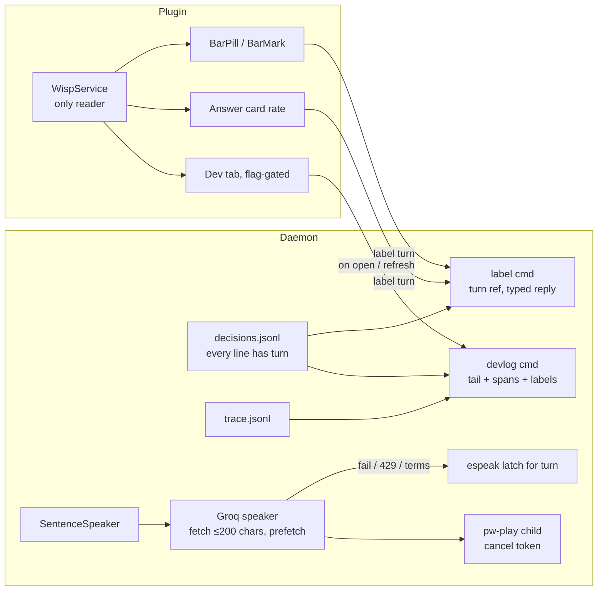

# feat: Bar pill, one-tap feedback, local dev tab and Groq talk-back

## Goal Capsule

- **Objective:** The owner can see what Wisp is doing from the top bar at a
  glance, rate any turn in one tap so the v1 eval gate fills from normal use,
  watch turn-by-turn health in a local dev tab, and hear answers in a natural
  voice instead of silence or espeak.
- **Means:** Redesign the existing bar pill (KTD2), make labels name their
  turn (KTD3), add one read-only daemon command feeding a flag-gated Panel
  tab (KTD4), and add a Groq Orpheus speaker behind the existing speech path
  with espeak as the fallback (KTD5).
- **Authority:** The owner's review of the mockup is the gate before any
  code. This plan adds to `docs/plans/2026-10-26-0031-feat-wisp-v1-roadmap-plan.md`;
  where it overlaps, the roadmap's order and settled decisions win.
- **Stop conditions:** Stop a unit if it needs to edit `rs/` or
  `tests/fixtures/ipc_commands.jsonl`, touch act or route code (another
  session owns Phase 5/9 there), edit `/usr/share/omarchy/`, or ship a
  local model.
- **Who finishes:** `ce-work`, one PR per phase (A–D below). The owner merges.

---

## Product Contract

### Summary

Four owner-visible changes in the Omarchy plugin and the daemon: a status pill
in the top bar that shows state at a glance, thumbs up/down on every finished
turn (answer card, bar and a hotkey) that writes eval labels against the right
turn, a dev tab shown only on the owner's machine, and hosted talk-back through
Groq's Orpheus voice, on by default when a Groq key exists.

### Problem Frame

The bar mark is a 14 px glyph beside the clock; state, health and spend hide in
a tooltip. Labelling a turn means typing `wispd label incorrect` in a terminal,
so the eval gate (60% over 50+ labelled turns) sits at 23 turns and 30%. The
existing good/wrong chips on the answer card are easy to miss, and a label always
lands on the last line of `decisions.jsonl`, which is the wrong turn after a
cancel or during the next turn. There is no in-product view of per-turn latency
or misses. Talk-back is espeak only and is off in the owner's config, so Wisp
answers in silence, the biggest felt gap against HeyClicky.

### Requirements

**Bar pill**
- R1. The bar shows one of these states at a glance: idle, listening, thinking, speaking, acting (with step count), needs you, error, offline. Color is never the only signal; a word repeats the state.
- R2. At idle the bar shows only the mark, with no animation and no polling. Motion follows `motionMode` and reduced motion.
- R3. Today's spend, turn count, health and the voice in use show in the hover card only.
- R4. Click talks, middle click stops, right click opens the panel, as today.
- R5. An error state stays until the next turn starts. Clicking an errored pill clears it and starts talking, as any click does (R4).

**Feedback**
- R6. Every finished turn can be rated good or wrong in one tap from the answer card and, for 8 s after it ends, from the bar pill (the "done" rating window, which then collapses to idle; hovering pauses it). Rating a turn again replaces its earlier rating; `wispd eval` already counts the latest label per turn.
- R7. Rating wrong offers an optional one-line note, typed in the panel's Now tab (the overlay takes no keyboard focus); good is one tap with no prompt.
- R8. A hotkey (default Super+Shift+D) rates the last finished turn wrong and opens the panel's Now tab with the note focused.
- R9. A rating always lands on the turn it was given for, including after a cancel or while a newer turn runs. Cancelled and errored turns cannot be rated.

**Dev tab**
- R10. A Dev tab appears in the panel only when `[dev] panel = true`; it is off by default and never on for other users.
- R11. It shows the v1 gate progress, the last N turns (transcript, route, outcome, label, per-stage time as a stacked bar), a selected turn's stage breakdown, and the top misses.
- R12. Its data comes from one read-only daemon command; QML reads no files for it.

**Talk-back**
- R13. When a Groq key resolves, answers are spoken with Groq Orpheus by default; espeak or `[voice] cmd` speaks when Groq cannot.
- R14. Points and drawings still start with the sentence that names them, timed to the real audio.
- R15. Talking over Wisp or pressing stop silences it at once, including while audio is still downloading.
- R16. Muted speakers and calls behave as today, and no audio is fetched while muted.
- R17. A turn keeps one voice: if Groq fails mid-answer the rest of that answer is espeak. The next turn retries Groq, except after a rate limit (wait for `retry-after`) or a terms error (retry after a timed backoff).
- R18. A first-time failure the user can fix (model terms not accepted, rate limit) is explained once, with what to do.
- R19. Groq talk-back counts toward today's spend and stops at the daily spend cap like any paid model call, falling back to espeak.

### Key Decisions

- Keep the Clacky mouse follower unchanged (session-settled: user-directed — chosen over redesigning it: the owner likes it as is). Governs R1–R5 scope.
- Groq for talk-back (session-settled: user-directed — chosen over OpenAI TTS, ElevenLabs and "not now": one key and provider for both directions). Governs R13.
- Talk-back on by default when a Groq key exists (session-settled: user-directed — chosen over off-until-enabled: "on by default, bring the people in"). Governs R13. Conflict call-out: Groq's published Orpheus limits are about 100 requests and 3.6K tokens per day on the free tier (roughly four minutes of speech), so a free-tier key will hit rate limits within a day; R17/R18 and KTD5 make that a normal, explained fallback rather than a failure.
- Spend on hover only (session-settled: user-directed — chosen over always showing spend in the pill). Governs R3.
- A new daemon command for the dev tab (session-settled: user-directed — chosen over reusing published state only). Governs R12.
- Plan and mockup before code (session-settled: user-directed — chosen over building straight to PRs). Governs the review gate in the Goal Capsule.
- Omarchy first; other desktops get the daemon-side pieces (labels, dev command, voice) unchanged and their own shell later (session-settled: user-directed — chosen over distro branches).

### Scope Boundaries

- In: the bar pill, rate controls and hotkey, label-by-turn, the dev command and tab, the Groq speaker with spend accounting, the doctor row and notice for voice.
- Out: the mouse follower, act and route code, the management app and TUI, other desktops' shells, streaming STT changes, local TTS.
- Considered and not built:
  - Category chips on a wrong rating (ChatGPT-style). A free note is enough for 1 user; revisit if notes prove too sparse to act on.
  - Applying `[voice] speed` to Orpheus audio by resampling. Orpheus documents no speed field; speed keeps working for espeak. Revisit if Groq documents one.
  - A cached eval tally for the dev command. The tab asks only on open and refresh; revisit if a measured call is slow.
  - A first-run card line for voice setup. The notice and doctor row cover it; revisit if new users miss it.
  - A live-updating dev tab. It refreshes on open and on a button; a poll would break R2's no-idle-work rule.

### Deferred to Follow-Up Work

- Arabic Orpheus voice for `ar` turns (Groq offers `canopylabs/orpheus-arabic-saudi`).
- A standalone launcher and tray for GNOME/KDE that reuses the daemon pieces here.

### Success Criteria

- The owner labels at least 27 more turns within a week of PR A merging, reaching the 50-turn floor of the gate. The dev tab shows the share of finished turns that were rated, so a gate rate built mostly from annoyed taps is visible.
- Spoken answers start within 1.5 s of the answer's first sentence on the owner's machine (the P6 span, with its own Groq budget; see KTD5), and a stop silences audio within 150 ms.

### Sources

- Mockup: https://claude.ai/artifact/U2qe57BFuvkzGeDXZg6QJb (bar pill states, rate flow, dev tab).
- Groq Orpheus: console.groq.com/docs/text-to-speech/orpheus, /docs/deprecations (PlayAI shut down 2025-12-31), /docs/rate-limits.
- Prior art: Superwhisper status dot by state; ChatGPT per-message thumbs with a note on thumbs-down; Pipecat per-turn latency breakdown; LiveKit agent insights turn list.

---

## Planning Contract

### Key Technical Decisions

- **KTD1. Ship in four PRs, in dependency order.** A: label by turn plus feedback UI (U1, U2). B: bar pill (U3). C: dev command and tab (U4, U5). D: Groq speaker plus doctor/onboard (U6, U7). A before B because the pill's rate buttons use U1's turn ref. C depends on A (U4 needs U1's turn ids on every line). D is independent of A, B and C.
- **KTD2. Redesign the existing pill, do not add a new surface.** `shell-plugin/components/BarPill.qml` already collapses to zero width at idle and tints by outcome; `BarMark.qml` already maps states. Extend both to the mockup's states; keep `WispService.qml` the only state reader and add no timer outside it. The 8 s rating window is one one-shot timer in `WispService.qml`, armed on the done edge, paused while the pill is hovered and stopped when it fires, so idle stays timer-free.
- **KTD3. Labels name their turn.** Every `decisions.jsonl` line carries `turn`; the `label` IPC command and `wispd label` gain an optional `turn` that wins over "last line". Replies are typed: `ok`, `not_found`, `not_ratable` (cancelled or errored turn). The command is additive, so `rs/` and the fixture stay untouched (the fixture holds no `label` line).
- **KTD4. One read-only `devlog` command.** Added like `ask` and `captures` were: `wispd` dispatch, `READ_CMDS` in `wisp/ipc.py`, an `IPC_CONTRACT.md` row, a `wispd dev turns` CLI verb and the CLI help goldens. It tail-reads the last N decisions, joins their trace spans and labels, and caps the reply size, so a large trace never blocks the daemon. The tally and misses are recomputed per call; the tab only asks on open and refresh.
- **KTD5. Groq speaker as a backend of the existing speech path.** `SentenceSpeaker` keeps owning sentence order and point timing. A new speaker fetches one WAV per chunk of at most 200 characters from `/audio/speech` with `canopylabs/orpheus-v1-english`, through `cancel.urlopen`, prefetching the next chunk while the current one plays. Playback is a `pw-play`/`paplay`/`aplay` child registered with the cancel token. Points fire at playback start using the WAV header's real duration. Any failure latches espeak for the rest of the turn; a 429 trips a process-wide backoff using `retry-after`; a terms error trips a timed backoff (one hour) that re-probes by itself. Mute, call and spend-cap checks run before any fetch, and every request writes a `usage.jsonl` row priced per character (R19). P6 gets a per-backend budget: espeak keeps 150 ms; Groq gets 1500 ms in `docs/CONFIG.md` and `tests/test_budgets.py`.
- **KTD6. Voice on by default is a config default, not a migration.** `[voice] enabled` gains `auto` as its default (on when a Groq key resolves, else espeak if installed). Every reader of `[voice] enabled` (today `wisp/speech.py` twice, `wisp/voice_polish.py`, `wisp/notify.py`; grep for more) goes through one helper. Existing explicit values are respected; the owner's `enabled = false` line is changed by hand at rollout (see Operational Notes).
- **KTD7. Thumb icons are owned SVGs.** Emoji are banned by `tests/copylint.py`, so thumbs are new icons through `scripts/assets/build_icons.py`, and `tests/test_icons.py`'s icon list grows by two.

### High-Level Technical Design

### Sequencing

U1 → U2 → U3. U4 → U5. U6 → U7. Phase D can start at once; B and C start after A merges; U3 and U5 both touch `WispService.qml` and `tests/qml/harness/FixtureService.qml`, so they integrate serially.

### Assumptions

- Groq's Orpheus terms error is a 400 with code `model_terms_required` (third-party sources; verify in U6 with one live call before coding the classifier).
- `pw-play` exists on Omarchy; `paplay` and `aplay` are fallbacks.
- The owner's Groq org will accept the Orpheus terms once in the Groq console.

---

## Implementation Units

### U1. Labels land on the right turn

**Goal:** A rating names its turn and cannot hit a cancelled, errored or newer turn.
**Requirements:** R9. **Dependencies:** none.
**Files:** `wisp/learn.py`, `wisp/cli/agents.py`, `wispd` (label dispatch), the code that appends `decisions.jsonl` lines (find every writer), `docs/IPC_CONTRACT.md`, `tests/test_learn.py`, `tests/test_wispd.py` (or the existing label IPC test home), CLI help goldens if `--turn` changes `wispd label --help`.
**Approach:**
1. Make every `decisions.jsonl` writer include `turn` (cancelled and error lines too, with their outcome).
2. `label` accepts optional `turn`; with it, find that line; without it, keep today's last-line behavior but skip cancelled/error lines.
3. Return `not_found` / `not_ratable` instead of writing.
**Execution note:** Start with a failing test that labels during a newer turn.
**Test scenarios:**
- Label with `turn` of an earlier finished turn writes `ref` for that turn even when a newer line exists.
- Label with no `turn` after a cancelled turn rates the last finished turn, not the cancel.
- Label with the `turn` of a cancelled turn returns `not_ratable` and writes nothing.
- Label with an unknown `turn` returns `not_found`.
- `wispd eval` tallies the new label lines unchanged.
**Verification:** Labels in the scenarios above land on the intended `ref`; the IPC fixture and `rs/` are unchanged.

### U2. One-tap rating on the answer card, the panel and a hotkey

**Goal:** Good is one tap; wrong opens an optional note; a hotkey rates the last turn wrong.
**Requirements:** R6 (answer card), R7, R8, R9. **Dependencies:** U1.
**Files:** `shell-plugin/components/OverlayLayer.qml` (replace the good/wrong chips), `shell-plugin/components/NowTab.qml` (note field), `shell-plugin/Panel.qml` (open on Now with focus), a new note component under `shell-plugin/components/`, `shell-plugin/WispService.qml` (`label(turn, label, note)`), `tests/qml/harness/FixtureService.qml`, `assets/` thumb icons via `scripts/assets/build_icons.py`, `tests/test_icons.py`, copy strings via `scripts/assets/gen_copy.py`, the bind writer used by `wispd install` (alongside the Super+D bind), `tests/test_components.py`, snapshot scenes and goldens.
**Approach:**
1. Two owned thumb icons (KTD7).
2. Rate buttons on the finished answer card, hidden for cancelled/errored turns, with accessible names. Good saves at once and shows a short receipt with the gate count. Wrong saves the label at once and opens the panel's Now tab with a one-line note field focused (Enter saves, Esc skips); the overlay never takes keyboard focus.
3. The hotkey runs `wispd label incorrect` (no `--turn`, so the last finished turn) and asks the plugin to open the same note; a second press while the note is open skips it.
4. A `not_found` or `not_ratable` reply shows a short muted line instead of the receipt.
**Patterns to follow:** the existing chips in `OverlayLayer.qml` and `NowTab.qml` calling `WispService.label()`; the Super+D bind writer in `wispd install`.
**Test scenarios:**
- Answer card for a finished turn shows both buttons; for a cancelled turn shows none (QML test and golden).
- Tapping good calls `label` once with that card's turn and shows the receipt.
- Tapping wrong labels at once and opens the Now tab note with focus; Esc sends no note; Enter sends the typed note.
- Rating the same turn twice leaves one effective label (the latest).
- A `not_ratable` reply shows the muted line, not the receipt.
- `wispd install` writes the rate bind once, idempotently, beside Super+D.
- copylint passes with no emoji in strings.
**Verification:** New goldens only for the changed answer card and note; `gen_copy --check` clean.

### U3. Bar pill redesign

**Goal:** State at a glance, spend on hover, rate buttons for 8 s after a turn, nothing at idle.
**Requirements:** R1–R5, R6 (bar). **Dependencies:** U1, U2's icons.
**Files:** `shell-plugin/components/BarPill.qml`, `shell-plugin/components/BarMark.qml`, `shell-plugin/components/BarActions.qml`, `shell-plugin/lib/bar.js`, `shell-plugin/BarWidget.qml`, `shell-plugin/WispService.qml`, `tests/qml/harness/FixtureService.qml`, `tests/qml/tst_bar*.qml` (or the existing bar test), snapshot scenes and goldens.
**Approach:**
1. Map daemon status to the mockup's eight states in `lib/bar.js` (pure, tested).
2. Pill shows glyph plus word, plus step count for acting; idle and offline collapse to the mark (offline dashed). The voice in use appears only in the hover card (R3).
3. Hover card lists health, today's spend and turns, voice, and the mouse map.
4. After a finished turn the pill shows the done rating window with rate buttons for 8 s (KTD2's one-shot timer, paused on hover); error persists until the next turn, and a click on it clears it and talks; rate hidden while offline.
**Test scenarios:**
- Each daemon status maps to the expected state, word and color token (pure JS test).
- Idle renders mark only and the service runs no timer (existing idle-work test extended).
- After `done`, rate buttons show; firing the service's rating-window timer collapses the pill; hovering pauses it.
- Error stays past 2.8 s and clears on the next `listening` or on a click.
- Reduced motion renders the thinking arc static.
**Verification:** Goldens for each state and the done window at 1x in dark and light; no timer in `components/`, and no repeating or idle-running timer anywhere.

### U4. `devlog` read-only command

**Goal:** One daemon call returns everything the dev tab shows.
**Requirements:** R11, R12. **Dependencies:** U1 (turn ids on every line).
**Files:** a new `wisp/devlog.py`, `wispd` dispatch, `wisp/ipc.py` (`READ_CMDS`), `wisp/cli/` (a `dev turns` verb), `docs/IPC_CONTRACT.md`, `tests/test_devlog.py`, `tests/test_ipc_authz.py` if it enumerates read commands, CLI help and completion goldens.
**Approach:**
1. Tail-read the last N (default 20, max 50) decisions; join each turn's trace spans and its latest label.
2. Add the eval tally, gate progress, the share of finished turns rated, and the top misses, reusing `wispd eval`'s functions.
3. Cap the reply size; truncate transcripts.
**Test scenarios:**
- With fixture logs, returns N turns newest first with stage spans summing to their total.
- A turn with no trace spans returns empty stages, not an error.
- A 50 MB trace file returns within the budget by reading only the tail.
- The command is in `READ_CMDS` and refused nowhere a read is allowed.
**Verification:** `IPC_CONTRACT.md` row added; `rs/` and the fixture unchanged.

### U5. Dev tab, local only

**Goal:** The mockup's Dev tab, shown only behind `[dev] panel`.
**Requirements:** R10, R11, R12. **Dependencies:** U4.
**Files:** `wisp/config.py` and the settings schema via `scripts/assets/gen_settings.py` (`[dev] panel = false`), `shell-plugin/Panel.qml` (tab index 4 when the flag is on), a new `shell-plugin/components/DevTab.qml`, `shell-plugin/WispService.qml` (one-shot `devlog` process on open and refresh), `tests/qml/harness/FixtureService.qml`, `tests/test_components.py` (`test_four_tabs` becomes four-or-five), snapshot scenes and goldens.
**Approach:**
1. Settings flag, generated.
2. Tab appended last so Settings stays index 3.
3. Gate bar, turn list with stacked stage bars, selected-turn breakdown (newest turn selected by default), misses; loading and error states; "open trace" opens the trace file in the editor via the existing open path.
**Test scenarios:**
- Flag off: four tabs, and no `devlog` call is made.
- Flag on: five tabs, Dev last; data loads on open and on the refresh button, never on a timer.
- Empty history renders an empty state.
- Daemon offline renders the offline empty state.
**Verification:** Goldens for the Dev tab with fixture data and empty state; `gen_settings --check` clean.

### U6. Groq speaker

**Goal:** Natural talk-back through Groq Orpheus with espeak as the fallback.
**Requirements:** R13–R17. **Dependencies:** none.
**Files:** a new `wisp/tts_groq.py`, `wisp/speech.py`, `wisp/stage_speak.py`, `wisp/voice_polish.py`, `wisp/notify.py`, `wisp/ledger.py` (usage row and cap check), `docs/CONFIG.md` and `tests/test_budgets.py` (P6 per backend), `wisp/platform.py` (player detection), `wisp/lang.py` (English only for Orpheus), `wisp/config.py` and generated settings (`[voice] enabled = "auto"`, `provider`, `tts_model`, `tts_voice` default `hannah`), `tests/test_tts_groq.py`, `tests/test_speech.py`, replay fixtures under `tests/fixtures/turns/` for a spoken answer with points.
**Approach:** per KTD5.
1. One shared `voice_on()`/`voice_backend()` helper replacing every `[voice] enabled` read (KTD6); the Groq key check is cached.
2. Chunk sentences longer than 200 characters at clause boundaries.
3. Fetch through `cancel.urlopen`; drop prefetched audio on stop.
4. Fire points and drawings at playback start with the WAV duration.
5. Latches: per-turn espeak on any failure; process backoff on 429 and on a terms error (KTD5).
6. A `usage.jsonl` row per request and a spend-cap check before each fetch (R19).
**Execution note:** Before coding the error classifier, make one live call with the owner's key to record the real terms-error body, WAV header size and whether `speed` is rejected; keep the recorded shapes as test fixtures (no key in the repo).
**Test scenarios:**
- A two-sentence answer fetches two WAVs, plays them in order, and fires the second sentence's point when its audio starts.
- A 450-character sentence becomes three requests of at most 200 characters.
- Stop during a fetch cancels the request and never spawns the player.
- Barge-in during playback kills the player within 150 ms (fake player).
- A 429 mid-answer finishes the answer in espeak and skips Groq until `retry-after` passes.
- A terms error speaks in espeak, records the one-time notice, and retries Groq after the backoff.
- At the daily spend cap, no request is made and espeak speaks.
- Each request writes one usage row priced by characters.
- `speech`, `notify` and `voice_polish` agree on voice on/off for `true`, `false` and `auto`.
- Muted speakers make no request.
- A Spanish turn uses espeak.
- No key: espeak, as today.
**Verification:** Keyless suite passes (Groq calls stubbed); replay fixture shows points timed to the stub WAV durations.

### U7. Voice in doctor and a one-time notice

**Goal:** A user learns once how to turn the voice fully on.
**Requirements:** R18. **Dependencies:** U6.
**Files:** `wisp/doctor.py` (or the doctor module), the `wisp/notify.py` path for the one-time notice, `tests/test_doctor.py`.
**Approach:**
1. Doctor row "voice": backend in use, the last Groq error class, and when Groq is retried next.
2. One-time notice per error class; the terms notice links the Groq console page for the model.
**Test scenarios:**
- Terms error: doctor shows the fix and the console link; the notice fires once.
- Rate-limited: doctor shows the backoff end time.
- Notice fires once per class, not per turn.
**Verification:** Doctor output golden updated.

---

## Verification Contract

- Keyless suite: `env -u OPENROUTER_API_KEY -u GROQ_API_KEY HOME=$(mktemp -d) PYTHONPATH=tests python3 -m unittest discover -s tests`. `test_snap` can flake under load; rerun it alone. `WhatsNewCard__headline` fails locally on master and passes in CI.
- Generators: `python3 scripts/assets/gen_settings.py --check`, `python3 scripts/assets/gen_copy.py --check`, and `scripts/assets/build_icons.py` for U2's icons.
- Snapshots: `python3 scripts/ui/snap.py check`; only goldens for changed or new components may change.
- Contract: `rs/` and `tests/fixtures/ipc_commands.jsonl` byte-identical to master.
- Live (owner): after each PR, `wispd install --ref <branch>`, restart `wispd` and the shell, then the mockup's states and one spoken answer.

## Definition of Done

- Every unit's verification holds and its PR's CI is green.
- The live bar matches the reviewed mockup in all eight states and the done rating window.
- A rating from the card, the bar and the hotkey each appears in `labels.jsonl` against the right turn.
- The Dev tab shows only with `[dev] panel = true`.
- A spoken answer with a point plays in the Orpheus voice with the point on time, and stop silences it.
- No abandoned-attempt code, debug prints or unused helpers remain in the diffs.

## Operational Notes

- The owner's `~/.config/wisp/config.toml` has `[voice] enabled = false`; change it to `auto` (or delete the line) after PR D.
- The owner's Groq org must accept the Orpheus terms once at the Groq console playground for `canopylabs/orpheus-v1-english`.
- `~/.config/hypr/bindings.lua` is stash-canonical on the owner's machine: `sync-watch` reverts it from `~/.local/share/machine/lukekimball/bindings.lua`. Add the rate hotkey to the stash copy too, or it reverts.
- Free-tier Groq limits (about 100 TTS requests a day) make daily talk-back need the paid Developer tier; the espeak fallback covers the gap.
