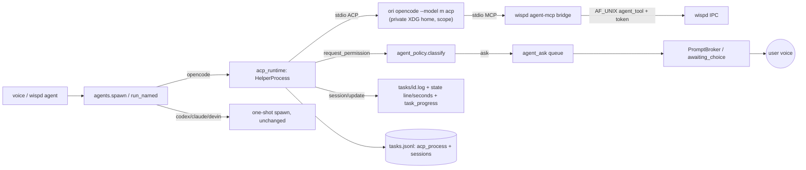

# Wisp Background Agents over ACP - Plan

---

## Goal Capsule

- **Objective:** A person who installs Wisp from the release download can finish `wispd onboard` and then say "Wisp, agent, …" or "tell Scout to …". A cheap-model background agent then does the work. They can watch it progress in the bar, the Agents tab and `wispd task list`. They answer its questions and risky-action asks by voice, send it follow-ups, and cancel it. They never have to install or sign in to anything by hand, and they don't need omaseal.
- **Means:** an ACP client over `ori opencode acp` on pinned OpenCode 2.x with a Wisp-owned OpenCode home (KTD1, KTD4), installed and signed in by onboarding from pinned, checksummed downloads (KTD7, KTD8), with keys in the desktop Secret Service (KTD9).
- **Authority:** Product Contract R-IDs win on behavior; KTDs win on mechanism; units override neither.
- **Stop conditions:** stop and report if the U4 spike shows `ori` cannot launch OpenCode 2.x ACP under a Wisp-owned config home without loading the user's global or project OpenCode config, plugins or `auth.json` (KTD1, KTD4). Whether OpenCode asks the client for every `ask`-ruled action cannot be observed without a model call; when it is observed not to, the run stops. When it cannot be checked, it is recorded in the PR and docs/TRUST.md, and `wispd doctor` says the check was not run live (Open Questions).
- **Execution profile:** Python stdlib daemon (`wispd`, `wisp/`), unittest, QML shell plugin. Every test runs offline: a fake ACP agent and fake binaries, never a live model, never a real download.
- **Finish and ship:** `lfg` implements, reviews and opens a PR from `feat/acp-agents`. Merging stays with Luke.

---

## Product Contract

### Summary

The OpenCode runtime stops being a fire-and-forget `ori opencode run` whose log Wisp tails. It becomes a live ACP session that Wisp drives. Wisp sets a cheap model and its own OpenCode config, sees each tool call as it happens, relays questions and risky-permission asks to the user by voice, feeds follow-ups into the same session, and cancels cleanly. Onboarding gains an "agents" step that downloads pinned, checksummed `ori` and OpenCode 2.x and signs `ori` in to OpenRouter. The OpenRouter key lives in the desktop keyring, with a private-file fallback.

### Problem Frame

The README promises that agents report `PROGRESS:` lines, speak a first-sentence summary, and ask questions over the voice backchannel. None of that exists in code. Spawned agents get `stdin=/dev/null`, and the done toast is the last line of a log. The Agents tab reads `line`/`seconds` fields Python never emits. A user also has to install `ori` and OpenCode themselves and sign in from a terminal, and OpenCode 1.x and 2.x behave differently. The 2.x session Wisp would launch loads the user's whole global command and plugin set and defaults to a premium model. Today the only key store besides a plaintext `.env` is omaseal, which other users don't have.

### Requirements

**Install and sign-in**

- R1. Onboarding offers an optional "agents" step. It downloads pinned versions of `ori` and OpenCode 2.x for the machine's architecture into a Wisp-owned user-scope directory, with no sudo. It installs nothing whose SHA-256 differs from the hash embedded in Wisp.
- R2. The step signs `ori` in to OpenRouter. It uses the key Wisp already holds when there is one. Otherwise it opens the OpenRouter browser sign-in and waits for it. A re-run when already installed and signed in changes nothing.
- R3. Wisp refuses to drive OpenCode 1.x and says so in plain words, naming the fix. An existing user install of 2.x is not reused; Wisp always runs its pinned copy.
- R4. The OpenRouter key can live in the desktop Secret Service (GNOME Keyring, KWallet, or omaseal where it owns that service), or in a 0600 file when no keyring is running. Wisp needs omaseal for nothing. Existing `omaseal://` key references keep working.

**Running an agent**

- R5. Every OpenCode agent session runs on a model Wisp chose from a cheap list, with Wisp's own agent prompt, permissions and tools. It never uses the user's global OpenCode commands, plugins or config. When no configured model is offered by the session, the task does not start and says why. It never falls back to the session's default model.
- R6. While an agent works, the bar, the Agents tab and `wispd task list` show its current step (the latest tool call or progress line) and how long it has run.
- R7. A question from the agent, or a permission request Wisp's policy marks risky, reaches the user as a spoken ask with choices. The answer goes back to the agent. If no answer arrives in time, or the user says no, or the ask can't be delivered, the request is refused and the agent is told so.
- R8. Permission requests the policy marks safe are approved without asking. Requests the policy forbids are refused without asking. The policy follows `[agent] autonomy`: `guided` asks more, `always_ask` asks for everything.
- R9. A follow-up ("tell Scout to also …") or a helper's inbox message goes into the helper's existing session as the next prompt. If the helper is mid-turn it waits its turn and is never dropped.
- R10. Cancelling an agent stops its current turn and leaves no stray processes. A cancelled task reads as cancelled, not failed.
- R11. The spoken and notified result is the agent's text after its last tool call. The task's status still comes from the session's stop reason and verified deliverables, never from what the text claims.
- R12. A named helper keeps one running OpenCode process across its tasks while active. That process is shut down after it idles. When Wisp restarts mid-task, the interrupted task says so and can be resumed on request. It is never replayed automatically.

**Agent access to Wisp**

- R13. The agent can read Wisp memory, skills, and its own tasks' status and output, and can ask the user a question, through a tool server Wisp provides. It cannot change Wisp's state, spawn or cancel agents, answer Wisp's own confirm cards, run Wisp's shell or MCP connectors, move the pointer or type, read transcripts, or see credentials. Refused attempts show up in its task's refusal count.

**Compatibility and docs**

- R14. The codex, claude and devin runtimes keep today's one-shot behavior unchanged.
- R15. The docs match the code: `agent_runtime` defaults to `"auto"`, and the install, config, IPC, trust, privacy and cost docs describe the new step, keys, events and data flows.

### Key Decisions

- **OpenCode is the agent runtime.** (session-settled: user-directed — chosen over Hermes and Codex: the chosen runtime.) Governs R5.
- **Launch through `ori` for OpenRouter billing.** (session-settled: user-directed — chosen over plain `opencode` or a Codex subscription: one OpenRouter bill and cheap-model control.) Governs R2, R5.
- **ACP, not one-shot run plus log tail.** (session-settled: user-directed — chosen over keeping `ori opencode run`: live progress, questions, follow-ups and cancel need a protocol.) Governs R6, R7, R9, R10, R11.
- **No custom OpenCode plugin in v1.** (session-settled: user-directed — chosen over writing one up front: only if ACP cannot carry a need.) Governs R5–R13.
- **OpenCode 2.x only; refuse 1.x.** (session-settled: user-directed — chosen over supporting both: 1.x passes model and flags differently.) Governs R3.
- **One long-lived ACP process per named helper.** (session-settled: user-approved — chosen over a process per task: helper continuity.) Governs R9, R12.
- **Auto-approve inside a fixed policy; voice-ask only risky actions.** (session-settled: user-approved — chosen over asking for everything or approving everything: background agents must not nag and must stay safe.) Governs R7, R8.
- **Wisp tools and memory reach the agent over MCP.** (session-settled: user-approved — chosen over no tool access: agents need Wisp context.) Governs R13.
- **codex/claude/devin stay one-shot; no Hermes adapter now.** (session-settled: user-approved — chosen over adapting every runtime: scope.) Governs R14.
- **Onboarding installs and signs in for the user.** (session-settled: user-directed — chosen over manual setup docs: "1 click download then onboarding".) Governs R1, R2.
- **Wisp works without omaseal.** (session-settled: user-directed — chosen over omaseal-only key storage: end users don't have omaseal.) Governs R4.

### Scope Boundaries

- Not built: a Wisp-run OpenCode plugin, a Hermes ACP adapter, or ACP for codex/claude/devin.
- Not built: screenshot, observe or ground over MCP, agent-to-agent spawning, or a "point at" primitive for helpers. Each widens what a cheap remote model sees or does; revisit with an explicit opt-in.
- Not built: automatic replay of an interrupted prompt after restart. Replay can redo side effects; resume stays on request (R12).
- Not built: per-session spend metering. Spend stays bounded by the cheap-model list and OpenRouter account limits; revisit when OpenCode reports usage over ACP.
- Not built: the ACP Python SDK. It needs pydantic and churns each release; the stdlib client is small (KTD2).
- Not built: "allow always" or any standing grant. Wisp only selects once-allow and once-reject; there are no session or persistent grants and no rules are written into the user's project.
- Not built: a respawn lockout after repeated helper crashes (each crash already fails its session with the last line, and a respawn only happens on the next task), and a mid-session watch for agent-pushed model changes (the model is set and verified before every prompt). Revisit if crash loops or model drift are observed.

---

## Planning Contract

### Key Technical Decisions

- KTD1. **Launch line:** `<wisp-runtime>/ori opencode acp` (no `--model`) with `ORI_NO_UPDATE_CHECK=1`, ori telemetry off, `OPENCODE_BIN`/PATH pointing at Wisp's pinned OpenCode, and `XDG_CONFIG_HOME`, `XDG_DATA_HOME`, `XDG_STATE_HOME` and `XDG_CACHE_HOME` pointed at a Wisp-owned home (`$DATA_DIR/agent-runtime/home/`). `HOME` is unchanged, so ori's own credentials under `~/.ori` still resolve. The child keeps `scrub_env`, `start_new_session`, the exit shim and the systemd scope, so it stays a marked peer. `--standalone` is appended if the U4 spike shows `acp` otherwise attaches to the user's shared OpenCode service. The model is set only per session (KTD5); no `session/prompt` is sent before that succeeds. Runtime detection (`resolve_runtime`/`detect_runtimes`) counts `opencode` present when the pinned install is `ready` (U2 probe), never from `which ori`, and the manager launches only the pinned binaries.
- KTD2. **Hand-rolled stdlib ACP client** (`wisp/acp.py`): newline-framed JSON-RPC 2.0 over the child's pipes, one reader thread, one stderr-drain thread, request ids correlated with `threading.Event` futures, server-to-client requests dispatched to handlers. No line-length cap beyond a 16 MiB guard that fails the session. It advertises no `fs` or `terminal` capabilities, so OpenCode uses its own tools under its own permission rules. Protocol version 1 only.
- KTD3. **Registry: one process record plus session records**, both in `tasks.jsonl`. A refusal from a peer inside the process scope is attributed to that process's running session(s) so it shows on the visible task. The process record (`kind: "acp_process"`, id `acp-<helper>`, or `acp-<task>` for an unnamed task) carries `pid`, `pstart` and `scope` (`wisp-task-acp-<helper>.scope`). Session records keep today's task shape plus `acp_process`, `session_id`, `model`, `stop_reason` and `cwd`. `classify_peer` resolves a session through its process record. `max_concurrent` counts running sessions. On daemon start an orphan sweep kills live ACP processes from a previous daemon (pstart-verified, scope kill) and marks their running sessions `interrupted`.
- KTD4. **Private OpenCode home and scoped config.** Project-level `opencode.json` and `.opencode/` in the session cwd must not load (disabled at launch if OpenCode supports it; otherwise writes to them are ask-class in KTD6 and the spike doc records the exposure). Wisp writes `opencode.json` into the private home. It defines a primary agent `wisp` (`system` = the `agent_home.CONTRACT` worker prompt, `permissions` mirroring KTD6 with `ask` for everything Wisp might refuse) and sets `default_agent: "wisp"`. The MCP entry is the stdio bridge (KTD10). No `tools` key (V2 has none). The model goes in the session per KTD5, never here.
- KTD5. **Model per session, validated.** After `session/new`, Wisp reads the `model`-category config option's allowed values. It picks the first entry of `[agents] acp_models` (comma list, default `openrouter/deepseek/deepseek-v4-flash`) that is offered, then sets it with `session/set_config_option` and checks the returned list. If none is offered, the session is closed and the task fails with "none of the configured cheap models is available". The shipped default list is chosen from the model ids the U4 spike observes in `session/new`.
- KTD6. **Permission policy** (`wisp/agent_policy.py`): `classify(tool_call, cwd, out_dir, autonomy) -> "allow" | "ask" | "refuse"`.
  - **Allow:** reads, globs and greps inside the session cwd, edits inside cwd or out_dir, and a fixed list of build and test commands that parse cleanly.
  - **Ask:** writes outside cwd, publishing or history-rewriting git, package install and remove, sending network calls, recursive deletes, anything the shell matcher can't parse, dotfiles, and external MCP tools.
  - **Refuse:** `tools.SHELL_DENYLIST`, credential paths (`auth.json`, `.env`, `~/.config/wisp/.env`, `~/.ori/`, `~/.local/share/keyrings/`), the `secret-tool` and `omaseal` binaries, Wisp's state dir outside out_dir, and login flows.
  - **Edited build files:** once the session has edited a file that build or test commands execute (`conftest.py`, `package.json`, `Makefile`, `pyproject.toml`, `setup.py`/`setup.cfg`, `tox.ini`, `noxfile.py`, shell scripts, `.git/hooks/`, `opencode.json`, `.opencode/`), the allow-listed build and test commands become ask for the rest of the session. Edits to ordinary source and test files keep them allowed; that residual (running code the agent just wrote) is stated in docs/TRUST.md.
  - `guided` turns allow-class edits into ask. `always_ask` asks for everything. Unknown kinds go to ask.
  - It fails closed: on parse error, timeout, a refused or undeliverable ask, or no user present, the answer is reject.
  - Only `allow_once` and `reject_once` options are ever selected.
- KTD7. **Pins as a Python module** (`wisp/agent_pins.py`): version, per-arch URL and SHA-256 for `ori` 0.16.1 (`OpenRouterLabs/ori-releases`, tag `cli-0.16.1-91f9f29`, assets `ori-linux-{arm64,x64}`) and OpenCode 2.2.0 (`anomalyco/opencode`, tag `v2.2.0`, `opencode-linux-{arm64,x64}.tar.gz`). It ships in the release tarball because `wisp/` does (unlike `scripts/cua/`). Exact hashes are recorded in U2 from the release `SHA256SUMS` and checked against a local download; the plan does not invent them.
- KTD8. **Installer in Python** (`wisp/agent_install.py`):
  - Downloads with `urllib` to a temp dir and compares SHA-256 to the pin before anything is written.
  - Tar extraction refuses absolute, `..` and link members, mirroring `scripts/cua/install.sh` `check_members`.
  - Installs into `$DATA_DIR/agent-runtime/<tool>/<version>/` behind a `current` symlink, atomically.
  - Gates on the version: OpenCode `--version` must report major 2 and equal the pin; `ori --version` must equal the pin.
  - Never runs `ori`'s `install.sh`, `ori update` or `ori doctor --fix`.
  - `wispd install --agents` and the onboarding step share it.
- KTD9. **Keyring key source** `keyring://<service>/<account>` in `config.load_env_key`, resolved with `secret-tool lookup service <s> account <a>` (3 s timeout; absent tool or locked keyring means move on to the next source). `onboard._store_key` writes `secret-tool store` when a Secret Service answers, else the 0600 `~/.config/wisp/.env`. It keeps writing `omaseal` when the configured ref is `omaseal://`. The default `key_env` becomes `"keyring://wisp/openrouter,OPENROUTER_API_KEY"`. Keys travel only on stdin, never argv.
- KTD10. **MCP over a stdio bridge, not HTTP.** ACP requires agents to support stdio MCP servers, and stdio keeps Wisp free of a TCP listener. Each `session/new` passes `mcpServers: [{name:"wisp", command:<wispd>, args:["agent-mcp"], env:[{WISP_MCP_TOKEN}]}]`.
  - OpenCode spawns the bridge inside the helper's scope. The bridge speaks MCP stdio to OpenCode and calls wispd over the AF_UNIX socket with a new `agent_tool` IPC command.
  - wispd authorizes a call only when `SO_PEERCRED` classifies the caller as the marked peer of that token's session and the token is live. The token is bound to `{process, session_id, task}` and revoked on close, cancel or exit.
  - The allowlist (KTD11) is the authority, not secrecy.
- KTD11. **MCP allowlist** (`ask_user` takes `{question, choices?}`; without choices the user answers in free speech): `recall`, `memory_read` (new read-only view of USER.md/MEMORY.md), `skill_list`, `skill_view`, `task_status`/`task_output`/`task_artifacts` limited to the caller's own helper, and `ask_user` (routes to KTD12, rate-limited to one pending ask per helper).
  - Every other name is refused and recorded with `agents.record_refusal`.
  - A parity test asserts the allowlist equals `{READ_CMDS-equivalent reads} ∪ {ask_user}` and that no registry tool of tier ≥ T1 is exposed.
  - `[agents] mcp_memory` defaults to `true` (R13 grants memory reads); the onboarding agents step says memory reads go to OpenRouter-routed models and docs/PRIVACY.md documents the switch. `false` withholds the memory tools.
  - The private `opencode.json` sets the wisp MCP server's tool-call timeout above `ask_timeout_s` so `ask_user` can wait for an answer.
- KTD12. **Daemon-level ask queue** (`wisp/agent_ask.py`): agent questions and risky permission asks enter a FIFO of at most one pending item per helper.
  - An item is offered to the existing `cancel.PromptBroker` only when no turn holds it (state not `awaiting_choice`).
  - It is published as `awaiting_choice` with a `prompt_id` and `source: "agent:<name>"`, spoken through the normal speech path, and answered with the existing `choice` IPC.
  - A turn that starts while an agent ask is pending keeps priority: the agent ask is re-queued, not lost.
  - Each item has a deadline (`[agents] ask_timeout_s`, default 120). Expiry resolves permissions to reject and questions to "no answer"; both emit `task_question` with the outcome.
- KTD13. **Progress surface:** every `session/update` becomes a readable line appended to `tasks/<id>.log` (tool call titles with kind and status, `PROGRESS:` lines from agent text, plan entries). `agents.tasks()` emits additive `line` (latest such line) and `seconds` (elapsed) fields for running sessions, which `AgentsTab.qml` already reads. It also emits `task_progress` (throttled to one per 2 s per task) and `task_question` events on the existing `tasks` topic. The answer is the concatenated `agent_message_chunk` text after the last `tool_call` of the final turn.
- KTD14. **Session lifecycle:**
  - A prompt queue per session runs one at a time and never drops a prompt.
  - A session older than `[agent] task_timeout_s` is cancelled through this path and recorded `timed_out`; `_reap_expired` never signals an ACP process pid directly.
  - Cancel sends `session/cancel`, answers pending permission requests `cancelled`, waits `[agents] cancel_grace_s` (default 10) for `stopReason: cancelled`, then kills the scope.
  - A helper process idles out after `[agents] acp_idle_s` (default 900).
  - A process crash marks running sessions `failed` with the last line; the next task starts a fresh process.
  - Resume after restart uses `session/load` with the stored session id, only on an explicit "continue".

### High-Level Technical Design



```mermaid
sequenceDiagram
  participant W as Wisp (acp_runtime)
  participant A as ori/OpenCode 2.x
  W->>A: initialize(protocolVersion 1, no fs/terminal)
  A-->>W: capabilities (loadSession, mcp stdio)
  W->>A: session/new(cwd, mcpServers=[wisp bridge])
  A-->>W: sessionId, configOptions(model select)
  W->>A: session/set_config_option(model = first offered acp_models)
  W->>A: session/prompt(helper prompt + task)
  A-->>W: session/update tool_call / message chunks (stream)
  A->>W: session/request_permission
  W-->>A: allow_once | reject_once (policy or voice answer)
  A-->>W: prompt result stopReason
  Note over W: status = stopReason + verify_deliverables; answer = text after last tool_call
```

### Assumptions

- `ori` reads its own credentials from `~/.ori` regardless of `XDG_*`, so a private XDG home doesn't sign it out. The U4 spike checks this without a model call (`ori auth --json` under the private env).
- OpenCode 2.x honors `XDG_CONFIG_HOME` for its global config on Linux. The U4 spike verifies it, and `opencode debug config` (or equivalent read-only output) shows no user commands or plugins.
- OpenCode sends `session/request_permission` for every `ask`-ruled action. U4's spike and the fake-agent contract test pin the client side; a live check without a model call is attempted with a scripted permission-triggering slash command if OpenCode offers one, else the gap is recorded under Open Questions.
- `secret-tool` (libsecret) is present on supported desktops; where absent, the file fallback applies (R4).

### Open Questions

- Deferred to implementation: exact SHA-256 values and whether the OpenCode `-musl` asset is needed for any supported distro (U2 records them from `SHA256SUMS` plus a local check).
- Deferred to implementation: whether `--standalone` is required on `acp` (U4 spike decides; KTD1 already allows it).
- Whether OpenCode asks the client for every `ask`-ruled action can't be checked without a model call. If it is observed not to, the run stops (Goal Capsule). If it stays unchecked, R7/R8 for that path rely on the OpenCode-side `permissions` mirror; record it in the PR and docs/TRUST.md, and `wispd doctor` notes the check was not run live.

---

## Implementation Units

### Unit Index

| U-ID | Title | Key files | Depends on |
|---|---|---|---|
| U1 | Keyring key source and store | `wisp/config.py`, `wisp/onboard.py` | — |
| U2 | Pinned runtime installer and probe | `wisp/agent_pins.py`, `wisp/agent_install.py`, `wisp/probes_agents.py` | — |
| U3 | ACP client core and fake agent | `wisp/acp.py`, `tests/fakes/acp_agent.py` | — |
| U4 | Private OpenCode home, scoped config, spike | `wisp/agent_ochome.py` | U2, U3 |
| U5 | Registry: process and session records | `wisp/agents.py` | — |
| U6 | Permission policy | `wisp/agent_policy.py` | — |
| U7 | Daemon-level ask queue | `wisp/agent_ask.py`, `wispd` | — |
| U8 | MCP stdio bridge and allowlist | `wisp/agent_mcp.py`, `wisp/ipc.py`, `wispd` | U5, U7 |
| U9 | ACP runtime integration | `wisp/acp_runtime.py`, `wisp/agents.py` | U3, U4, U5, U6, U7, U8 |
| U10 | Onboarding "agents" step, install flag, doctor | `wisp/onboard.py`, `wisp/cli/*.py` | U1, U2, U3, U4 |
| U11 | Docs, config drift, release notes | `docs/*`, `README.md` | U1–U10 |

### U1. Keyring key source and store

- **Goal:** Wisp reads and stores the OpenRouter key in the desktop Secret Service, with a 0600 file fallback and no omaseal dependency.
- **Requirements:** R4; KTD9.
- **Dependencies:** none.
- **Files:** `wisp/config.py` (`load_env_key`, `[brain.openrouter] key_env` default and any other `key_env` defaults that use `omaseal://`), `wisp/onboard.py` (`_store_key`, `Probes.store_key`/`secret`), `wisp/cli/diagnose.py` (doctor shows which source resolved, never the value), `tests/test_config_keys.py` (new), `tests/test_onboard.py`.
- **Approach:**
  1. Add a `keyring://svc/acct` branch in `load_env_key` that runs `secret-tool lookup` with argv only and a 3 s timeout, stripping the trailing newline. A missing binary, non-zero exit or empty output falls through to the next source.
  2. `_store_key` prefers `secret-tool store --label "Wisp <acct>" service <s> account <a>` with the value on stdin when a `keyring://` ref is configured and the store succeeds. It writes omaseal only for an `omaseal://` ref, else the 0600 `.env`. The return string names where the key went.
  3. The default `key_env` lists `keyring://wisp/openrouter` before the plain env name.
- **Patterns to follow:** the existing `omaseal://` branch and its timeout handling; `note._atomic_write_text` for the file fallback.
- **Test scenarios:**
  - `keyring://wisp/openrouter` with a fake `secret-tool` printing `sk-or-v1-x\n` resolves to `sk-or-v1-x`.
  - With `secret-tool` absent, a comma list `keyring://wisp/openrouter,OPENROUTER_API_KEY` resolves from the env var.
  - A `secret-tool` that exits 1 (locked keyring) falls through without raising.
  - `_store_key` with a working fake `secret-tool` passes the value on stdin only (argv log has no value) and reports "desktop keyring".
  - `_store_key` with no keyring writes `.env` with mode 0600 and reports the path.
  - An `omaseal://` ref still stores through `omaseal set` (regression).
- **Verification:** key tests pass; doctor prints the resolved source name.

### U2. Pinned runtime installer and probe

- **Goal:** Wisp can install the pinned `ori` and OpenCode 2.x into a user-scope directory from checksummed downloads and report their state.
- **Requirements:** R1, R3; KTD7, KTD8.
- **Dependencies:** none.
- **Files:** `wisp/agent_pins.py` (new), `wisp/agent_install.py` (new), `wisp/probes_agents.py` (new), `tests/test_agent_install.py` (new), `tests/test_probes_agents.py` (new).
- **Approach:**
  1. Pins hold version, tag, per-arch asset URL and SHA-256 for both tools, plus `opencode_major = 2`. Record real hashes from each tag's `SHA256SUMS`, cross-checked by a local download during implementation.
  2. `install(tool, arch, fetch=…, dest_root=…)` follows KTD8 and returns a typed result `{installed|already|failed, reason}`.
  3. `AgentsProbe.check()` returns `absent`, `installed`, `wrong_version`, `opencode_v1`, `not_signed_in` (via `ori auth --json` exit status and source field, never its secret) or `ready`. It has a `_FIX` table like `CuaProbe`.
- **Patterns to follow:** `scripts/cua/install.sh` and `tests/test_cua_install.py` (verify-before-write, member checks, `Rig` style fake HOME); `wisp/probes_cua.py` states and fixes; `wisp/update.py` SHA-256 handling.
- **Execution note:** Implement the verify-before-write path test-first against a locally built tarball fixture.
- **Test scenarios:**
  - A served file whose SHA-256 matches installs to `<root>/opencode/2.2.0/` and flips `current` atomically.
  - A digest mismatch writes nothing under `<root>` and returns `failed` naming the tool.
  - A tarball with an absolute member, a `..` member or a symlink member is refused.
  - A fake `opencode --version` printing `1.19.5` after install yields `opencode_v1` and the probe fix names the step.
  - A second install of the same version returns `already` without fetching.
  - The probe maps `ori auth --json` exit 0 with a key source to `ready`, and non-zero to `not_signed_in`.
  - An unsupported arch returns `failed` with "no build for <arch>".
- **Verification:** installer and probe tests pass with no network access (the fetch is injected).

### U3. ACP client core and fake agent

- **Goal:** A stdlib ACP client can drive any ACP agent over stdio, and tests have a scripted fake agent.
- **Requirements:** R6, R7, R9, R10, R11 (transport); KTD2.
- **Dependencies:** none.
- **Files:** `wisp/acp.py` (new), `tests/fakes/acp_agent.py` (new, stdlib script run via `sys.executable`), `tests/test_acp.py` (new).
- **Approach:**
  - `AcpConnection(argv, env, cwd)` starts the child.
  - Methods: `initialize`, `new_session`, `set_config_option`, `prompt` (returns a handle whose `wait()` gives the stop reason), `cancel`, `load_session` and `close`.
  - Callbacks for `session/update` and `session/request_permission` run on the reader thread and must not block. The permission callback receives a reply function so the answer can come later, from the ask queue.
  - On EOF or malformed framing, every pending future fails with `AcpClosed` and the connection is marked dead.
  - The fake agent reads a JSON script (sequences of updates, permission requests, stop reasons, crash points, delays, a `protocolVersion` override, an offered model list) from a path in its env.
- **Patterns to follow:** daemon-thread plus `threading.Event` idiom from `agents.start_reaper`; `tests/fakes/bins.py` `BinDir` to install the fake as `ori`.
- **Test scenarios:**
  - Handshake: `initialize` against the fake returns protocol 1 and capabilities. A fake advertising version 2 makes `initialize` raise `AcpVersionError`.
  - A prompt yields ordered updates (message chunk, tool_call, tool_call_update completed, message chunk) and stop reason `end_turn`.
  - A permission request is answered later via the reply function, and the fake receives `allow_once`.
  - Cancel mid-prompt: `session/cancel` sent, the pending permission is answered `cancelled`, and the stop reason is `cancelled`.
  - The fake writing 2 MiB of stderr does not block the session (stderr drained).
  - The fake exiting mid-turn fails the prompt handle with `AcpClosed`.
  - A single 20 MiB line fails the session with a framing error rather than hanging.
- **Verification:** `tests/test_acp.py` passes; no thread leaks after `close()` (thread count returns to baseline).

### U4. Private OpenCode home, scoped config, and the launch spike

- **Goal:** Wisp launches OpenCode 2.x ACP with only its own config, and the assumptions behind KTD1 and KTD4 are verified without model calls.
- **Requirements:** R5; KTD1, KTD4, KTD5.
- **Dependencies:** U2, U3.
- **Files:** `wisp/agent_ochome.py` (new: builds the home dirs, writes `opencode.json`, returns the launch env and argv), `tests/test_agent_ochome.py` (new), `docs/research/2026-10-28-acp-launch-spike.md` (new; spike findings).
- **Approach:**
  1. **Spike first, read-only and with no model calls**, using the pinned binaries:
     - Check `ori auth --json` under the private XDG env.
     - Check that `opencode` with the private `XDG_CONFIG_HOME` lists no user-origin commands, agents or plugins in whatever read-only config dump it offers. ori's own injected config (`OPENCODE_CONFIG_CONTENT`, and its credential plugin when signed in by OIDC) is allowed and recorded.
     - Put a throwaway `opencode.json` and `.opencode/command/x.md` in a temp cwd and check they are not loaded.
     - Record the model ids offered by the `model` config option in `session/new`.
     - Run an ACP `initialize` plus `session/new` handshake and confirm the advertised commands, the `wisp` default agent, and whether the shared service was touched (`~/.local/state/opencode/service.json` mtime unchanged).
     - Try both with and without `--standalone`.
     - Never send `session/prompt`. Record results in the spike doc.
  2. Build `opencode.json` from KTD4 and KTD6 (permission rules) and KTD10 (MCP entry template; token filled per session).
  3. Return the argv and env for KTD1 with the spike's `--standalone` choice baked in.
- **Execution note:** The spike's outcome can trigger the Goal Capsule stop condition. Do it before U9.
- **Test scenarios:**
  - The generated `opencode.json` has `default_agent: "wisp"`, an `agents.wisp` with `system` equal to the formatted contract, a `permissions` list containing `ask` for `shell`, `external_directory` and `*.env`, and no `tools` key.
  - The launch env sets all four `XDG_*` to paths under the Wisp home, keeps `HOME`, sets `ORI_NO_UPDATE_CHECK=1`, and contains no Wisp key names (scrub applied).
  - The argv is `[<ori>, "opencode", "acp"]` (plus `--standalone` when configured), with no model flag.
  - The wisp MCP server entry's timeout exceeds `ask_timeout_s`.
- **Verification:** the spike doc exists with each check's observed result; tests pass.

### U5. Registry: process and session records

- **Goal:** The registry models one long-lived ACP process holding many sessions without breaking marked-peer refusal, liveness, the reaper or `wispd task list`.
- **Requirements:** R10, R12, R13 (marking and refusal attribution); KTD3.
- **Dependencies:** none.
- **Files:** `wisp/agents.py` (`_latest`, `classify_peer`, `_running`, `_tick`, `tasks`, new `record_process`/`record_session`/`sweep_orphans`), `tests/test_agents_acp_registry.py` (new), `tests/test_ipc_authz.py`.
- **Approach:**
  - Process records carry `kind: "acp_process"`. Session records carry `kind: "session"` and `acp_process: <id>`.
  - `classify_peer` maps a pid or scope to the process record, and accepts `WISP_TASK_ID` equal to a session id whose process record is running.
  - `_tick` skips liveness checks for sessions; their status is written by the runtime (U9), but a session whose process record is dead and still `running` becomes `failed` (`process exited`).
  - `sweep_orphans` (called from `start_reaper` startup) runs for ACP process records whose pid is alive with a matching pstart from a previous daemon. It sends SIGTERM to the scope, waits the grace, then SIGKILLs, and marks their running sessions `interrupted`.
  - `tasks()` hides process records and shows sessions.
- **Patterns to follow:** existing append-plus-overlay records, `_pstart` pinning, `_signal` refusal on pid reuse.
- **Test scenarios:**
  - A pid inside a running ACP process's scope classifies as a marked peer for that process. A session id in `WISP_TASK_ID` is accepted while its process is running and `spoofed` after the process record closes.
  - `max_concurrent=2` with two running sessions in one process makes a third spawn return `SKIP`.
  - An orphan process record from a previous daemon (live pid, matching pstart) is killed, and its two running sessions become `interrupted`. A record whose pid now belongs to another process (pstart mismatch) is not signalled.
  - `tasks()` lists sessions with today's fields and no `acp_process` entries.
  - A process record marked dead flips its `running` session to `failed`.
  - A refused IPC call from a pid inside the process scope increments `refused_count` on the running session's record.
- **Verification:** registry and authz tests pass; existing `test_agents*.py` still pass.

### U6. Permission policy

- **Goal:** Each ACP permission request gets a deterministic allow, ask or refuse from one policy that follows `[agent] autonomy`.
- **Requirements:** R7, R8; KTD6.
- **Dependencies:** none.
- **Files:** `wisp/agent_policy.py` (new), `tests/test_agent_policy.py` (new).
- **Approach:** classify from the ACP tool call's `kind`, `title`, `rawInput` (command or path) and `locations`. The shell matcher accepts a single simple command with no pipes, redirects to outside cwd, `$(...)`, backticks, `;`, `&&`, `||` or `sudo`; anything else is ask. Reuse `tools.SHELL_DENYLIST` and `policy.mode_of`.
- **Patterns to follow:** `wisp/policy.py` `decide`/`preempted` vocabulary.
- **Test scenarios (table test, one row each):**
  - Read of `src/x.py` inside cwd → allow.
  - Edit of `../other/x.py` → ask.
  - `pytest -q` → allow.
  - `git push` → ask.
  - `rm -rf /` → refuse.
  - Read of `~/.local/share/opencode/auth.json` → refuse.
  - `curl -X POST …` → ask.
  - `ls | sh` → ask.
  - Unknown `kind` → ask.
  - An external MCP tool `browseros_navigate` → ask.
  - Edit inside cwd with `autonomy=guided` → ask.
  - Read with `always_ask` → ask.
  - `secret-tool lookup service wisp account openrouter` → refuse.
  - `cat ~/.ori/credentials.json` → refuse.
  - Edit `package.json`, then `npm test` → ask; edit `src/a.py`, then `pytest -q` → allow.
  - Edit `.opencode/command/x.md` → ask.
  - Malformed `rawInput` → ask, never allow.
- **Verification:** the policy table test passes.

### U7. Daemon-level ask queue

- **Goal:** Background agents can ask the user by voice without a turn, without stealing a live turn's prompt, and fail closed.
- **Requirements:** R7; KTD12.
- **Dependencies:** none.
- **Files:** `wisp/agent_ask.py` (new), `wispd` (`_wait_for_choice` / broker wiring, `choice` handling of `agent:` prompts), `wisp/state.py` (`awaiting_choice` `source` field), `tests/test_agent_ask.py` (new), `tests/test_confirm.py`.
- **Approach:**
  - `AskQueue.submit(helper, kind, text, choices, deadline, on_answer)`.
  - A pump thread offers the head item when the broker is free and state is not `awaiting_choice`, then publishes state with `prompt_id` and `source` and speaks the text through the existing speech path. `choice` resolves it.
  - A turn starting while an agent ask is published gets the broker: the ask is withdrawn and re-queued at the head.
  - On expiry: permission → reject, question → `None`. Each outcome emits `task_question`.
  - Spoken template: helper name, then a one-line summary (permission: kind plus truncated path or command; question: the agent's text), then the choices. Permissions offer "Allow" / "No". Questions use the agent's `choices`, defaulting to "Yes" / "No"; a question without choices accepts a dictated free-text answer.
  - One pending item per helper; a second ask from the same helper waits behind it.
- **Patterns to follow:** `confirm.make_ask` copy and choice shapes; `cancel.PromptBroker` offer and wait.
- **Test scenarios:**
  - Idle daemon: the ask publishes `awaiting_choice` with `source: "agent:scout"`, and `choice(prompt_id, "Allow")` calls `on_answer("Allow")`.
  - A turn holds the broker: the ask waits and is published after the turn's prompt resolves.
  - A turn starts while the ask is published: the ask is withdrawn, the turn's prompt is shown, and the ask is re-offered afterwards with the same text.
  - Deadline passes: the permission resolves to reject and a `task_question` event says `timed_out`.
  - Two asks from the same helper are offered one after the other, never together.
  - Speech failure (fake TTS raises): the ask stays answerable via the panel and still expires to reject.
  - A permission ask for `git push` is spoken as "Scout wants to run git push. Allow or no?" (template).
- **Verification:** ask-queue tests pass; existing confirm and ask tests unchanged.

### U8. MCP stdio bridge and allowlist

- **Goal:** The agent reaches a small, read-mostly set of Wisp tools through MCP, with identity from the socket and a session token.
- **Requirements:** R13; KTD10, KTD11.
- **Dependencies:** U5, U7.
- **Files:** `wisp/agent_mcp.py` (new: MCP stdio server loop plus the allowlist), `wispd` (`agent-mcp` hidden subcommand; `agent_tool` IPC handler), `wisp/ipc.py` (`agent_tool` classified as the one command a marked peer may send, gated on token), `wisp/tools/__init__.py` (new `memory_read`, `skill_list` read entries if missing), `docs/IPC_CONTRACT.md` row, `tests/fixtures/ipc_commands.jsonl` plus `rs/wispd` stub handler only if parity requires it, `tests/test_agent_mcp.py` (new).
- **Approach:**
  - The bridge answers `initialize`, `tools/list` (the allowlist only) and `tools/call`, forwarding each call as `agent_tool {token, name, args}`.
  - wispd checks that the token maps to a live session, that the peer classifies as the marked peer of that session's process, and that the name is allowlisted. It then runs the read (scoped to the caller's helper for task tools), or for `ask_user` submits to the U7 queue and blocks up to its deadline.
  - Refusals return an MCP error and call `record_refusal(session, name)`.
  - Tokens are minted per session (32 random bytes, urlsafe), stored in memory only, and revoked on session end. They are redacted from logs.
- **Patterns to follow:** `wisp/tools/mcpclient.py` stdio framing (server side mirrored); `ipc.check_peer_authz`.
- **Test scenarios:**
  - `tools/list` returns exactly the allowlist.
  - `tools/call recall` with a valid token from the marked peer returns results.
  - Each of `memory`, `skill_manage`, `agent_spawn`, `task_cancel`, `choice`, `config`, `shell`, `mcp_call`, `click`, `type_text` is refused, and `refused_count` increments.
  - A wrong token, another session's token, a revoked token, or no token is rejected.
  - A valid token sent from a process that is not the marked peer is rejected.
  - `task_output` for another helper's task is refused.
  - `ask_user` returns the user's answer through a fake U7 queue, and "no answer" on timeout.
  - Parity: no registry tool of tier ≥ T1 is in the allowlist; adding one without updating the test fails.
  - A peer sending `config set agent.allow_shell=true` over the socket is still `marked_peer_refused`.
- **Verification:** MCP and authz tests pass; `cargo test` in `rs/wispd` still passes.

### U9. ACP runtime integration

- **Goal:** The `opencode` runtime runs through ACP end to end: spawn, progress, asks, follow-ups, cancel, outcome and resume.
- **Requirements:** R3, R5, R6, R7, R9, R10, R11, R12, R14; KTD1, KTD3, KTD5, KTD13, KTD14.
- **Dependencies:** U3, U4, U5, U6, U7, U8.
- **Files:** `wisp/acp_runtime.py` (new: `HelperProcess`, `SessionRun`, manager), `wisp/agents.py` (`spawn`/`run_named`/`cancel`/`tasks` route opencode to the manager; `resolve_runtime`/`detect_runtimes` use the pinned-install probe; `_reap_expired` skips ACP pids; `build_done_notification` uses the answer), `shell-plugin/components/AgentsTab.qml` (distinct `interrupted` state with a say-"continue" hint, and a "waiting for your answer" marker while a `task_question` is pending), `tests/qml` tasks scene, `wisp/agent_home.py` (contract wording unchanged except where the spoken first sentence now comes from the answer), `wispd` (manager start and stop, `continue` resume route), `wisp/config.py` (`[agents] acp_models`, `acp_idle_s`, `ask_timeout_s`, `cancel_grace_s`, `mcp_memory` defaults), `tests/test_acp_runtime.py` (new), `tests/test_agents.py`, `tests/test_task_delivery.py`, `tests/test_agent_home.py`.
- **Approach:**
  1. The manager owns `HelperProcess` per helper (and per unnamed task). Starting one goes through `agent_ochome` launch args, `wrap_systemd_scope` and the shim, writes the process record, and runs `initialize`, which refuses protocol ≠ 1 and checks the OpenCode version via the probe (R3).
  2. Each task opens a session with the bridge MCP entry and token, picks and sets the model (KTD5), writes the session record, and queues the prompt (`agent_home.prompt` for helpers, the task text for unnamed tasks).
  3. Update handler: appends log lines, keeps `line`/`seconds`, throttles `task_progress`, and tracks the answer (KTD13).
  4. Permission handler: runs `agent_policy.classify`, answers allow and refuse immediately, and sends ask to U7 with a reply on answer.
  5. Stop reason mapping: `end_turn` → `done`/`failed` via `verify_deliverables`; `cancelled` → `cancelled`; `max_tokens`/`max_turn_requests`/`refusal` → `failed` with the reason; process death → `failed`.
  6. `run_named tell` on a busy helper queues into its live session instead of `leave_message`. An idle live session takes the prompt directly. Without a live process the existing inbox path stays.
  7. Cancel per KTD14. Idle reaping per KTD14. Daemon stop closes sessions, then kills scopes.
  8. A "continue" on an `interrupted` session starts a new process and calls `session/load`. If load isn't supported, it says so and stays interrupted.
- **Execution note:** Drive this unit with end-to-end tests against the fake agent installed as `ori` through `BinDir`; no live models.
- **Test scenarios:**
  - Happy path: voice spawn → fake agent emits tool calls and a final message → task `running` with `line` updated → stop `end_turn` → `done`, notification text equals the post-last-tool-call message, and `task_finished` is emitted once.
  - The fake offers only `openrouter/x/premium` → the task fails before prompting with the "no configured cheap model" reason, and no `session/prompt` is sent.
  - The fake reports OpenCode 1.x (probe) → spawn returns `SKIP` with the 1.x refusal text.
  - Permission `git push` → U7 ask published; answering "No" sends `reject_once`, and the fake records the rejection.
  - Permission read in cwd → `allow_once` with no ask.
  - Follow-up `tell scout to also …` while scout is mid-turn → queued, sent after `end_turn`, same `session_id`.
  - Cancel mid-turn → `session/cancel` sent, status `cancelled`. A fake that ignores cancel is killed after the grace, with no leftover pid.
  - The fake crashes mid-turn → `failed` with the last line, and the next spawn starts a fresh process.
  - A session running past `task_timeout_s` is cancelled and recorded `timed_out`.
  - PATH has no `ori`, the pinned install is ready, `agent_runtime = "auto"` → resolves to `opencode` and launches the pinned binary; a PATH `ori` is never executed.
  - A delivered file claimed in text but absent → `delivered: false` regardless of answer text.
  - Daemon restart with a running session → `interrupted`; "continue" sends `session/load` with the stored id.
  - Idle timeout → process exits and its record closes. The next task starts a fresh process.
  - `agent_runtime = "codex"` → the one-shot path runs unchanged (R14).
  - The `tasks()` state entry for a running session has `status`, `task`, `line`, `seconds` and `tail`, and the Agents tab fixture renders it (`tests/qml` tasks scene).
- **Verification:** runtime tests pass; the existing agent, delivery and reaper tests pass; the QML tasks scene is updated if its fixture asserts fields.

### U10. Onboarding "agents" step, install flag and doctor

- **Goal:** `wispd onboard` and `wispd install --agents` install, sign in and smoke-test the runtime, and `wispd doctor` reports it.
- **Requirements:** R1, R2, R3, R4; KTD7, KTD8, KTD9.
- **Dependencies:** U1, U2, U3, U4.
- **Files:** `wisp/onboard.py` (`Step("agents", "background agents", optional=True)`, `_check_agents`, run action, `Probes` additions: `agents`, `ori_login_key`, `ori_login_browser`, `acp_smoke`), `wisp/cli/diagnose.py` (step id in `--step` help; doctor agent block reads `AgentsProbe`), `wisp/cli/core.py` (`--agents` flag), `wispd` legacy doctor duplicate (if still present), `shell-plugin/lib/copy.js` and `shell-plugin/lib/onboard.js` (only if the step needs an action button), `tests/golden/cli_help/onboard.txt`, `tests/golden/cli_help/daemon_install.txt`, `tests/golden/cli_help/doctor.txt`, `tests/test_onboard.py`, `tests/test_install.py`.
- **Approach:** The run action:
  1. Install both tools (U2).
  2. If not signed in, feed the stored OpenRouter key (U1) to `ori login --with-key` on stdin. If no key is stored, run `ori login --no-browser`, read the printed URL, open it with the existing open-URL helper, and wait up to 5 minutes.
  3. Run an ACP `initialize`-only smoke test through U4's launch args.
  4. Write the scoped config (U4).
  Each stage reports its own detail. Skipping writes nothing.
- **Patterns to follow:** the `cua` step and `_install_cua`; the `clibrain` stance on never reading another tool's credentials.
- **Test scenarios:**
  - All probes ready → state `ok`, run is a no-op.
  - Absent → run installs (fake fetch), logs in with the key via stdin (fake `ori` records stdin, argv has no key), and the smoke test passes → `ok`.
  - No stored key → browser path: the fake `ori` prints a URL, Wisp's opener is called with it, the fake exits 0 → `ok`.
  - Browser path times out → `todo` with "sign-in did not finish", nothing marked done.
  - Fake OpenCode 1.x on PATH only → the step still installs the pinned 2.x and never runs the PATH one.
  - The step's detail discloses that memory reads go to OpenRouter-routed models.
  - The doctor agent block reports when the live permission-gate check was not run.
  - Golden help for onboard, install and doctor updated with `WISP_UPDATE_GOLDEN=1`.
- **Verification:** onboard and install tests pass; goldens match.

### U11. Docs, config drift and release notes

- **Goal:** Docs describe the shipped behavior and pass docs lint.
- **Requirements:** R15.
- **Dependencies:** U1–U10.
- **Files:**
  - `docs/CONFIG.md`: `agent_runtime` default `"auto"`; new `[agents]` keys; `key_env` keyring form.
  - `docs/IPC_CONTRACT.md`: `agent_tool`; task fields `line`/`seconds`/`interrupted`; `task_progress`/`task_question` events; `awaiting_choice.source`; agent reaper paragraph.
  - `docs/INSTALL.md`: onboarding agents step, `--agents`, uninstall paths.
  - `README.md`: Agent and Goal-memory bullets made true; prerequisites no longer require a manual `ori`.
  - `docs/TRUST.md` and `docs/PRIVACY.md`: MCP surface, memory sent to OpenRouter-routed models, `mcp_memory` switch, permission policy, the OpenCode-side permission caveat if U4 records one.
  - `docs/COSTS.md`: cheap-model list, OpenRouter billing via ori.
  - `THIRD_PARTY_NOTICES.md`: ori (Apache-2.0) and OpenCode (MIT), downloaded at onboarding.
  - `CHANGELOG.md`.
- **Approach:** Write each section through the repo's copy rules; every `wispd …` command and `[section] key` named must exist (docs lint).
- **Test expectation:** none beyond `tests/test_docs_lint.py`, `tests/test_copy_lint.py` and `tests/test_settings_schema.py` passing. This unit has no behavior.
- **Verification:** the docs-lint, copy-lint and settings-schema tests pass.

---

## Verification Contract

- `python -m unittest discover -s tests -v` (CI runs py 3.11 and 3.13), plus CI's `py_compile` step. Add the new top-level `wisp/*.py` modules; they are covered by the existing glob.
- Golden CLI help regenerated only for commands this plan changes (`WISP_UPDATE_GOLDEN=1`), and the diff reviewed.
- `cargo build --locked && cargo test` in `rs/wispd` (parity) when `tests/fixtures/ipc_commands.jsonl` changes.
- `scripts/plugin_mirror.py --lint` and the QML tests when shell-plugin files change.
- No test may reach the network or a live model. Downloads and `ori` are fakes, and the ACP agent is `tests/fakes/acp_agent.py`.
- The U4 spike document records every check, run against the pinned binaries without `session/prompt`.

## Definition of Done

- R1–R15 hold, each covered by the unit tests named in U1–U10 and the docs checks in U11.
- The U4 spike passed its stop conditions, or the run stopped and reported them.
- CI passes on the PR.
- No request in code or tests sends a prompt to a live model, and no code path reads OpenCode's `auth.json`, ori's credential files or `.env` contents other than through `load_env_key`.
- No dead-end or experimental code remains in the diff; the spike's findings live in the spike doc, not in commented code.
