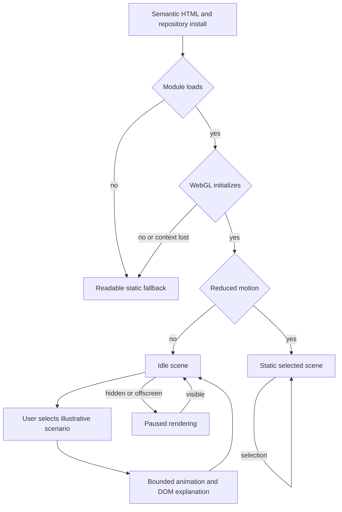
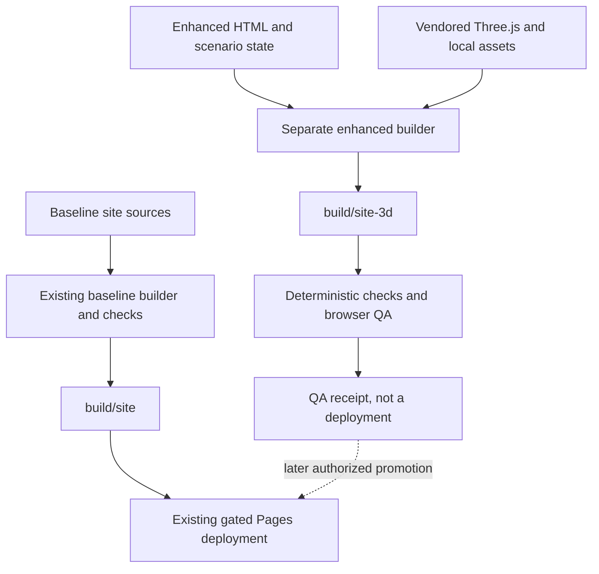
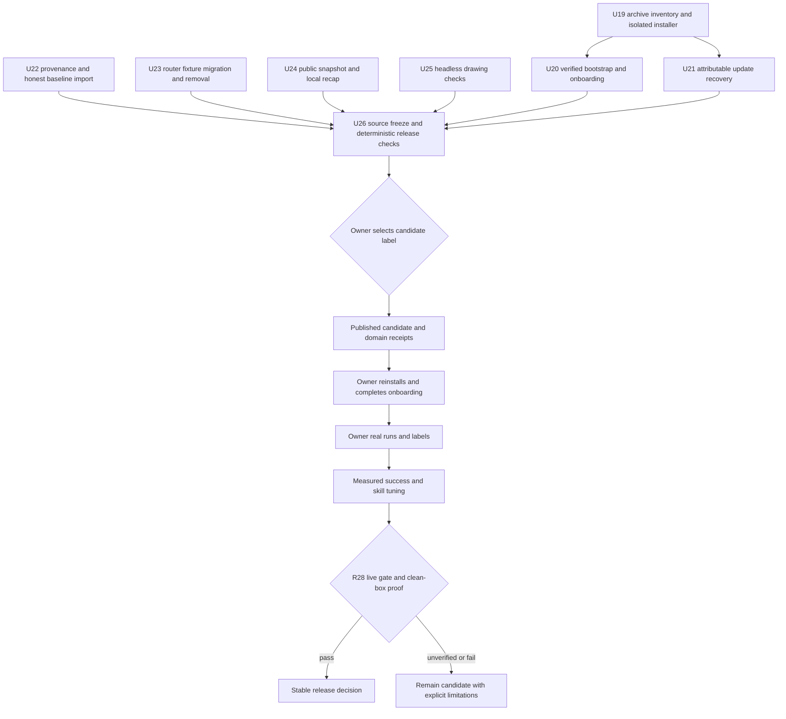
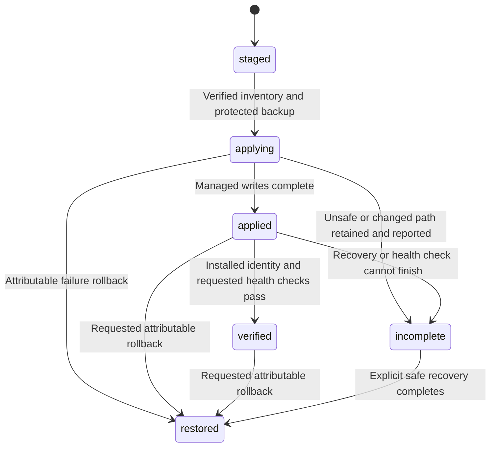
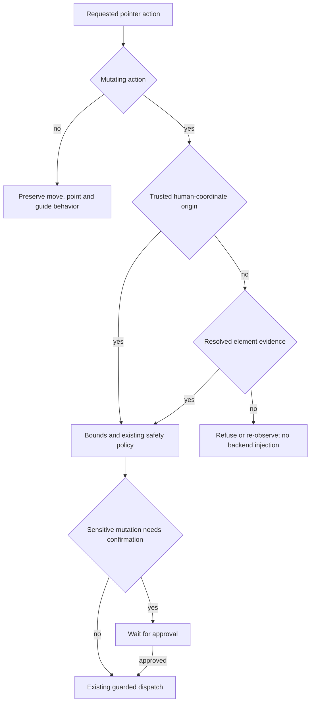
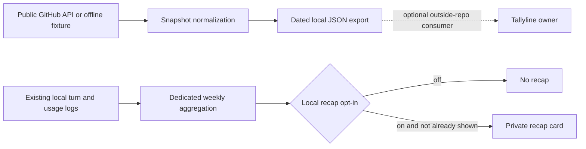

# Wisp Unified Alignment and Shipping Completion - Plan

## Goal Capsule

- **Objective:** Khan can reinstall a release candidate, complete straightforward onboarding, and use the Linux app—including screen drawing—for real work before judging success or tuning skills.
- **Means:** Preserve U1–U18 contracts; finish archive installation, authenticated bootstrap, recovery, remaining B3/B31/router work and release evidence through U19–U26 (KTD6–KTD12).
- **Authority:** The expanded release request governs R20–R28 and the updated R1/R6 boundaries; R2–R5 and R7–R19 retain their intent.
- **Execution profile:** Bounded continuation, not a replacement architecture; use git to determine existing work rather than plan checkboxes.
- **Finish and ship:** Parent integrates owners, reviews the frozen candidate, publishes only under the owner's selected release label, and records artifact/domain evidence; owner real runs and stable-v1 promotion follow R28.
- **Stop conditions:** Stop for a product-scope conflict, an owner-overlap conflict, a required live permission that is unavailable, or a claim that cannot be substantiated.

---

## Product Contract

### Summary

Finish the bounded Linux app-release path: real installable archives, one-line installation with an explicit trust root, easy onboarding, update recovery, remaining roadmap mechanisms and native drawing checks.
Retain runtime regression coverage and the separate interactive explanation in `site-3d/`.
Keep the no-script `site/` baseline independent, present Linux as the primary full application, and describe cloud/local/safe presets and experimental macOS/Windows probes without promising unsupported parity.
Use `wisp.observer` for the intended primary domain and authenticated bootstrap; keep repository instructions until publication and verification satisfy R19/R21.
Sequence delivery as installable app candidate → one-line install/onboarding → owner real runs → measured success/skill tuning; actual RL training comes later.

**Product Contract preservation:** U1–U18 IDs preserved; R1 now removes rather than retains the retired decision call, and R6 requires capture-safe timing evidence; R20–R28 bring previously deferred release, B3/B31 and router work into authorized scope.

### Historical Runtime Problem

The following overview records the original U1–U10 motivation, not a fresh diagnosis of HEAD or evidence that those problems remain.
The implementations are visible in commits [`c90de4a`](https://github.com/duketopceo/wisp/commit/c90de4a), [`1614d51`](https://github.com/duketopceo/wisp/commit/1614d51), and [`86555f9`](https://github.com/duketopceo/wisp/commit/86555f9); commit presence does not establish passing tests or live verification.

Wisp (`duketopceo/wisp`) already contains a 7-stage voice-to-desktop pipeline (`capture -> transcribe -> context -> route -> execute -> speak -> judge`), an `act` loop (`wisp/act.py`), a grounding cascade (`wisp/grounding.py`), a policy engine (`wisp/policy.py`), and a Quickshell companion (`shell-plugin/`). However, end-to-end execution currently breaks down across six seams when compared against HeyClicky (`duketopceo/clicky`) and Clacky:

1. **Grounding Latency & Dead Jev Endpoint**: When `control` and `a11y` miss on web canvases or custom UI, `grounding._jev` slices the screenshot into 40 PNG patches and POSTs them to `https://openrouter.ai/api/alpha/decisions` (`typesafe/jev-1.13`). Meanwhile, `pick_pointing_resolution()` (`1024x768`, `1280x800`, `1366x768`) and `scale_point_from_resolution()` were implemented in `wisp/grounding.py` (lines 146–199) for HeyClicky parity, but **no provider in `wisp/grounding.py` ever calls them**. Furthermore, `suggest._worth_mining()` still calls `pipeline.ask_jev` unconditionally even when `[brain] router = "act"`.
2. **Pointer Execution Stall (`auto` Mode Ignored)**: Even though `wisp/config.py` and `tests/test_pointer.py` specify `auto = drive when a backend exists, guide otherwise`, `wisp/tools/system.py` (`_pointer`), `wisp/delivery.py` (`planned`), `wisp/cua_safety.py` (`Guard.applies`), and `wisp/realinput.py` (`begin`) only check `mode == "drive"`. As a result, `pointer.mode = "auto"` never injects real clicks.
3. **Utterance & Routing Misalignment**:
   - `"check my email"`, `"check my Stripe"`, and `"debug this"` fall through `route.heuristic` to `default_answer` because `check`, `inspect`, `review`, `debug`, and `fix` are missing from `_ACT`.
   - `"open up this setting"` is hijacked by `stage_route.fuzzy_app` (`"settings"` substring match in `"thissetting"`) and launches the OS Settings app instead of clicking the on-screen setting.
   - `"show me what's wrong here"` is matched by `_OPEN_VERB` (`show me`) as an app launch instead of an on-screen visual question.
   - Background OpenCode spawns (`"debug this in the background"`, `"have opencode fix this"`) start in `out_dir` instead of inferring the active project working directory from the focused window/terminal/editor.
4. **Web Services & Tab-First Navigation (`email`, `Stripe`, `Linear`)**:
   - `config.WEB_DEFAULTS` only defines `mail` and `calendar`. Spoken requests like `"check my email"`, `"go to my Stripe"`, or `"go to my Linear"` fail to resolve `"my email"`, `"my stripe"`, or `"my linear"` to existing browser tabs or default web URLs (`dashboard.stripe.com`, `linear.app`, `github.com`, `notion.so`, `slack.com`).
   - `act._unsupported_done()` rejects `launch` calls when the focused browser window class (`chromium`) does not match the spoken service word (`stripe` or `email`).
5. **Sensitive Surface Policy (Stripe Read-Through vs. Mutation Gate)**:
   - On financial/billing surfaces like Stripe (`dashboard.stripe.com`), Wisp must **not** go blind (`capture_blocked` is reserved for password managers/polkit/sudo). Instead, Wisp must freely observe, read balances/webhooks/errors, move the guide cursor, and switch tabs (`T0`/`T1`), while promoting mutating actions (`click`, `type_text`, `key`, `fill`) to `T2` confirmation and refusing raw live secret keys (`sk_live_`, `rk_live_`, `whsec_`).
6. **UI/UX & Voice-Cursor Cohesion**:
   - `stage_capture.py` sleeps `0.25s` before every press-time screenshot even when `ask_chips` are not armed, and `buddy.js` waits `0.30s` (`ENTRY_DELAY_S`) before showing the cursor buddy.
   - `companion.js` hides the bottom pill during `deciding` and `acting` (`PILL_STATUSES = ["listening", "transcribing", "awaiting_choice"]`), creating dead visual air between hotkey release and the first spoken/acted output.

### Problem Frame

Khan needs Wisp to act immediately and reliably on natural voice commands:
- *"Check my email"* -> switches to an open Gmail/mail tab or opens mail immediately.
- *"Go to my Stripe"* -> switches to an open Stripe tab or opens `https://dashboard.stripe.com`, treats Stripe as a sensitive surface (read/inspect/point freely; confirm before clicking or typing mutations; block live secret key injection).
- *"Go to my Linear"* -> switches to an open Linear tab or opens `https://linear.app`.
- *"Open up this setting"* -> grounds the on-screen setting via fast control/a11y/VLM pointing and clicks it (instead of launching the OS Settings binary).
- *"Tell me what this does"* / *"Tell me what's wrong here"* / *"Show me what's wrong here"* -> routes to screen-grounded `answer` with `[POINT:x,y:label]` cursor choreography.
- *"Debug this"* / *"Have OpenCode debug this in the background"* -> routes to `act` or spawns OpenCode in the active project repo directory.

### Requirements

**Runtime alignment (original requirements)**

- **R1 (Drop Jev Bottleneck & Wire Aspect-Matched VLM Pointing)**: Preserve aspect-matched single-image VLM pointing and grounding-chain contracts, while removing retired decision-model calls from suggestion/routing paths under R25; a separately named grounding provider is not itself a routing dependency.
- **R2 (Real Click Execution in `auto` / `act` Mode)**: Make `pointer.mode = "auto"` resolve and drive the detected pointer backend (`cua`, `ydotool`, `wlrctl`) across `wisp/tools/system.py`, `wisp/delivery.py`, `wisp/cua_safety.py`, `wisp/realinput.py`, and `wisp/act.py`, and upgrade unconfigured default pointer mode in live `stage_execute._run_act` turns when a backend is available.
- **R3 (Deictic UI Actions, Screen Questions & Background OpenCode Routing)**: Prevent `stage_route.fuzzy_app` and `route._catalog_app` from hijacking deictic phrases (`this`, `that`, `these`, `those`, `here`, e.g. `"open up this setting"`). Route `"check ..."`, `"inspect ..."`, `"debug ..."`, `"fix ..."` to `act` (or `agent` when background/OpenCode is named). Route `"show me what's wrong here"` to `answer`. Infer repo `cwd` in `agents.spawn()` when not explicitly provided.
- **R4 (Web Services & Tab-First Resolution for Email, Stripe, Linear, GitHub, Notion, Slack)**: Normalize spoken possessive/service aliases (`"my email"`, `"my stripe"`, `"my linear"`), check open CDP browser tabs first (`SWITCHED tab ...`), fall back to opening the service URL (`WEB_DEFAULTS`), and teach `act._unsupported_done` that switching/opening a service in a browser satisfies a service navigation task.
- **R5 (Sensitive Surface Policy for Stripe & Financial Apps)**: Add `BUILTIN_SENSITIVE_SURFACES` and `cua_safety.sensitive_surface()`. Keep screen capture and read/navigation tools (`screenshot`, `observe`, `ground`, `move`, `scroll`, `tab`, `launch`, `focus`) unblocked on Stripe, promote mutating input tools (`click`, `type_text`, `key`, `fill`) to `T2` confirmation on sensitive surfaces, and preempt typing live secret keys (`sk_live_`, `rk_live_`, `whsec_`).
- **R6 (Capture-Safe Continuous Companion Feedback)**: Preserve conditional chips capture and deciding/acting continuity; show the buddy earlier only after an explicit capture-clear signal or measured hardware-safe clearance ordering, never by blindly lowering a delay constant.
- **R7 (Particle AI `particle-ai/particle-1` & OpenRouter Provider Routing)**: Promote `openrouter/particle-ai/particle-1` (Particle AI's post-trained DeepSeek V4.1 Flash agentic model) to the primary default in `acp_runtime.DEFAULT_MODELS` and `[agents] acp_models`, add `"Particle AI"` to the Whisper vocabulary prompt, and support `provider_order` / `provider_sort` in `brain.py` for OpenRouter calls.
- **R8 (Multi-Browser Profile `Personal` vs. `Work` & Tab Intelligence)**: Detect `Personal` vs `Work` browser profiles from the spoken utterance (`"for work"`, `"on personal"`) or fall back to the currently focused browser window (`active_browser_profile()`), scan all active CDP ports (`9100`, `9222`, `9223`), boost matching profile tabs in `_tab_score()`, focus the matching profile browser window in `_focus_browser()`, and inject `profile=personal|work` into `context.snapshot()`.
- **R9 (Talkback Confirmations & Panel Voice Controls)**: Ensure direct tool actions (`SWITCHED tab`, `OPENED`, `LAUNCHED`, `FOCUSED`, `WORKSPACE`) speak concise natural confirmations aloud in `stage_speak._spoken_payload()` and render clean copy in `copy.RESULT_RULES`; expose `voice.enabled`, `voice.tts_voice`, and `voice.captions` in `settings_schema.py` (`panel=True`).
- **R10 (Omarchy Quickshell Settings & StatusLine UX Redesign)**: Group `SettingsTab.qml` into clean, scannable surface cards (`voice and talkback`, `dictation`, `pointer` + `agent`, `cua safety`, `budget`, `connectors`), render `on`/`off` labels on boolean chips, and add a quick `talk`/`stop` action chip to `StatusLine.qml`.

**Existing continuation intent**

- R11. Preserve dev tuning and per-model TTFT/latency reporting as diagnostic capabilities, not published performance results.
- R12. Preserve provenance-checked app-skill ingestion and context injection.
- R13. Preserve cloud/local/safe configuration presets and macOS/Windows telemetry/action adapter seams without expanding into full desktop ports.

**Shipping completion**

- R14. Bare media commands must use the existing media lane with truthful outcomes, and listening-time speaker ducking must restore owned audio state on every capture exit, including failure and cancellation.
- R15. Provide an interactive Three.js explanatory landing in `site-3d/`, clearly labelled as a scripted illustration that neither listens to a microphone nor controls or reads the visitor's desktop.
- R16. The enhanced page must load its JavaScript and visual assets from its own published artifact, operate without third-party requests after the initial local/site load, and retain readable content and controls under reduced motion, disabled JavaScript, unavailable WebGL and renderer failure.
- R17. All public copy must distinguish implemented capabilities from verified outcomes and future work; omit invented timings, fabricated terminal runs, unsupported privacy absolutes, unverified prices, test counts and competitor assertions.
- R18. Keep Linux/Omarchy/Hyprland as the primary full app, cloud/local/safe as available presets, and macOS/Windows as experimental probes; do not claim that a preset alone makes every data path local.
- R19. Treat `wisp.observer` as the intended primary domain, not a proven deployment; until DNS, HTTPS, published assets and any bootstrap verification have been evidenced, offer only the repository clone/install instructions and install runbook.

**App release and remaining roadmap**

- R20. Publish complete, version/commit-bound Linux archives whose extracted payload can run the actual installer outside the checkout; inventory mandatory inputs and reject incomplete or unsafe archives before managed installation writes.
- R21. Provide a version-pinned one-line bootstrap that authenticates the selected release against an independently established trust root before payload execution; disclose the bootstrap entrypoint's own trust boundary and fail closed to repository/manual installation when verification is unavailable.
- R22. Make first-run setup skippable, resumable and explicit about microphone/key/bind/service consent; show blocked/degraded/ready states truthfully and return the documented nonzero preview status on hard preflight blockers.
- R23. Extend attributable update recovery across managed core, plugin and unit files without overwriting user edits or marketplace-owned plugin state; identify exclusions and incomplete recovery rather than claiming full rollback.
- R24. Complete B3's element-backed mutating-click provenance and baseline-import/report mechanism; historical per-kind numbers, worst-kind rankings and before/after success claims require the original source export and real labels, never reconstructed summaries.
- R25. Migrate decision-dependent replay fixtures before removing legacy Jev routing, advertised settings and harness pinning; preserve fast-path/act/answer, generic clarification/confirmation, outage and cancellation coverage.
- R26. Complete B31's dated public GitHub snapshot and off-by-default local weekly recap, with unknown traffic distinct from zero, no secret output, no recap network calls and no automatic outreach.
- R27. Include declarative screen drawing and scribble-to-ask in release checks, including native offscreen QML rendering, speech synchronization, reduced motion and capture exclusion; intentional scribble compositing is separate from accidental overlay pixels, and offscreen results do not prove real Omarchy behavior.
- R28. Release candidate first is recommended so reinstall/onboarding precedes owner real runs; stable `v1.0.0` still requires at least 50 owner-labelled turns, the configured 60% first-time-correct gate, and clean Omarchy onboard/doctor evidence, all currently UNVERIFIED in this plan. ([Canonical live gate](../../ROADMAP.md))

### Scope Boundaries

- Preserve CLI/config compatibility and test intent while intentionally retiring the legacy router choice under R25; do not use historical test-count estimates as current quality claims.
- Do not break `tests/test_ground_chain.py`, `tests/test_settings_schema.py`, `tests/test_delivery.py`, `tests/test_pointer.py`, or `tests/test_policy.py`.
- Keep the no-script baseline's rules intact; enhanced JavaScript is allowed only in the separate `site-3d/` lane (KTD1).
- This plan-editing pass owns only this document; parent owns `ROADMAP.md` and QA receipts, while generator/trust changes stay with assigned owners.
- Release archives/bootstrap/onboarding, plugin/unit recovery, B3 provenance/import mechanism, B31 and legacy-router migration are in scope; lack of original clicklab data blocks historical accuracy claims, not candidate implementation.
- Freeze `rs/` source and supported-platform boundaries; use the existing Rust build/lockfile when packaging without inventing a new daemon or port.

### Deferred to Follow-Up Work

- Owner-labelled real runs, before/after success/skill tuning and stable-v1 promotion follow candidate installation under R28; the release checklist includes their evidence boundaries but cannot manufacture completion.
- Clicklab historical import/rankings wait for the original export; ship and test an honest unavailable-source state meanwhile.
- Actual RL training/distillation, score reconstruction, automatic local-model promotion and a trial proxy are not release prerequisites.
- Full macOS/Windows ports, native cross-OS companions and post-v1 wishlist overlays remain outside this release.
- First-install general rollback/cleanup UI and automated community outreach are not added by “full release”; retain explicit manual cleanup limits.

### Considered and Not Built

- No website-to-daemon bridge, browser CDP access, microphone permission, provider keys or live agent execution: the requested page is an explanation, not another control surface.
- No SPA framework, backend, service worker or runtime package CDN: a static module and vendored Three.js satisfy the bounded page without a new application architecture.
- No synthetic benchmark generator or generalized documentation synchronization service: direct source checks and small regression fixtures suffice.

### Key Decisions

- **Release before tuning** (session-settled: user-directed — chosen over training-first work: the owner wants an installable app and easy onboarding before many real runs, success/skill tuning and actual RL later). Governs R20–R22, R27–R28.

### Acceptance Examples

- AE1. Covers R14. With media playing, start and finish a voice capture: volume is reduced only when enabled and restored on completion, interruption or startup failure; a failed tool never receives a success confirmation.
- AE2. Covers R15–R17. Selecting the Stripe example changes the illustrated workspace and explanatory text, but visibly remains a simulation and never submits a real payment or pretends the visitor's Stripe account was opened.
- AE3. Covers R16. With third-party requests blocked, reduced motion enabled, or WebGL unavailable, installation and capability text remain usable; the fallback is intentional rather than a blank canvas.
- AE4. Covers R18–R19, R21. Before deployment verification, a mobile visitor sees Linux repository installation and experimental-probe qualifications, not a hosted bootstrap or asserted live domain; U26 may expose the verified channel later without inventing cross-OS downloads.
- AE5. Covers R20–R23. Extract the published candidate outside the checkout: preflight/preview and actual user-scoped installation work without source-path leakage; failed plugin/unit update restores only attributable managed files and reports exclusions.
- AE6. Covers R21–R22. The one-line entry authenticates a pinned candidate before running payload code; invalid signature, unsupported host or declined permission leaves a truthful blocked/degraded result without exposing keys.
- AE7. Covers R24. A model's on-monitor numeric click without resolved element evidence is refused; an explicit human-coordinate request carries independent provenance and does not bypass sensitive-surface confirmation.
- AE8. Covers R26–R27. A local recap remains private and off unless enabled; drawing checks show valid marks and capture exclusion without labelling headless output as a live-desktop result.
- AE9. Covers R28. A candidate can be delivered for owner reinstall while the release card states live labels, clean-box checks and the 60% gate as UNVERIFIED; no synthetic judge score promotes it to stable.

---

## Planning Contract

### Key Technical Decisions

- KTD1. **Two independent static lanes.** Keep `scripts/site/build.py` and `tests/test_site.py` strict for the no-script baseline; use a small separate `scripts/site/build_3d.py` and `tests/test_site_3d.py` for the enhanced artifact, emitted separately as `build/site-3d/`. The baseline currently rejects scripts, imports and external asset loads, so weakening its checker to admit the new page would erase an existing contract. ([Baseline builder](../../scripts/site/build.py), [baseline checks](../../tests/test_site.py))
- KTD2. **Vendor the existing Three.js choice.** Retain the draft's explicit `0.170.0` pin rather than selecting another engine; vendor the required distribution and upstream license, record provenance and digest, and use relative module imports. Replace the draft's CDN import and remote font dependencies with local assets or system fonts. The exact asset digest is an implementation-time receipt, not an invented planning value. ([Current enhanced draft](../../site-3d/index.html))
- KTD3. **DOM-first, finite illustrative state.** Put installation, platform limits and scenario descriptions in semantic HTML; a small deterministic scenario model drives both text and the scene. Start idle with no invented live metrics; user selection produces a bounded illustration and returns to rest. Reduced motion renders static states without continuous animation; module/load failure leaves the HTML, and WebGL/context failure switches to a labelled static visual. Pause rendering offscreen/when hidden and dispose resources on teardown. This is a page-local lifecycle, not a new runtime architecture.
- KTD4. **Claims follow owning code, not the draft.** Verify descriptions against the config, preset, policy, media and diagnostic implementations; use neutral pending text when no measurement exists. In particular, `local` currently changes only a subset of keys, and Omarchy's media backend exposes play/pause as a toggle, so neither universal offline privacy nor idempotent pause/resume can be inferred from their labels. ([Preset implementation](../../wisp/cli/settings.py), [media backend](../../wisp/tools/media.py))
- KTD5. **Build/review before deploy.** Preserve gated Pages publication and independent baseline output; U26 may promote the selected enhanced artifact only after U18 checks and deployment authorization. Publication must depend on both baseline and enhanced checks, not merely upload an unchecked enhanced directory. ([Pages workflow](../../.github/workflows/pages.yml))
- KTD6. **One release-input inventory, actual installer.** Extend `scripts/release/build.py` and `scripts/release/verify.py` rather than creating a competing packaging script; validate both architecture artifacts, mandatory desktop/unit resources, version/commit metadata and the installed files they produce. Source-checkout fixtures alone do not satisfy R20. ([Release builder](../../scripts/release/build.py), [release workflow](../../.github/workflows/release.yml))
- KTD7. **Authenticated manifest before apply.** Use a detached signed release manifest binding version, commit, architecture and artifact digest; use Ed25519 with a pinned verifier, independent owner-established public-key fingerprint, rotation instructions and no private signing material in the repository. Verify the entry script against an independently authenticated pinned digest before execution; do not advertise blind `curl | sh`. The owner must provide real signing/publishing configuration before a live bootstrap claim, not before deterministic verifier implementation.
- KTD8. **Ownership-limited recovery.** Reuse the existing transaction manifest and explicit plugin/unit namespaces, preserving content hashes, modes and prior service state; restore attributable writes only, never arbitrary HOME paths. Inventory desktop/icon/bind/launcher exclusions explicitly unless tests establish their inclusion. Capturing prior service state does not authorize an unconsented restart or promise restoration of service-manager state. ([Update transaction](../../wisp/update.py))
- KTD9. **Provenance, not numeric-string inference.** Carry grounding source/bounds and a human-coordinate origin flag from trusted request context to mutation dispatch; a model cannot grant itself the coordinate exception. Reuse label/eval/replay machinery and import clicklab read-only; do not reconstruct source data or build a training service. ([Grounding](../../wisp/grounding.py), [pointer dispatch](../../wisp/tools/system.py), [existing eval](../../wisp/learn.py))
- KTD10. **Migrate coverage before deleting routing.** Classify decision-dependent fixtures by user behavior, convert them to current fast/act/brain lanes, then remove only retired router machinery. Saved `router=jev` migrates to `act` with a clear compatibility warning; invalid values follow existing config validation. Keep generic act questions and the general replay utility. ([Harness pinning](../../tests/harness/runner.py), [replay utility](../../scripts/replay_turn.py))
- KTD11. **Public snapshot versus private recap.** Reuse the public snapshot fixture and weekly telemetry code where present; keep a dated JSON export contract separate from local recap rendering. A recap reads existing logs locally, with explicit measured/estimated spend and once-per-week delivery; Tallyline consumption is an optional outside-repo handoff, not a new Wisp dashboard. ([B31 contract](2026-10-27-feat-wisp-beat-competitors-plan.md#b31-growth-scoreboard-from-public-signals-and-a-retention-loop), [telemetry](../../wisp/telemetry.py))
- KTD12. **Two release labels, distinct evidence.** Recommend an installable prerelease/candidate under R28; exact tag and release-card wording remain an owner decision. Candidate notes enumerate unavailable live/source evidence instead of silently weakening gates. Governs R20–R22, R27–R28. (session-settled: user-directed — chosen over training-first work: release mechanics must support reinstall before owner runs and tuning.)

### Evidence and Single-Pass Trace

- U14's implementation is already present in [`7c864df`](https://github.com/duketopceo/wisp/commit/7c864df): `media_fast_arg` feeds the fast-route result into `ctx.detail`, capture stores `ducked_vol`, `_record_finish` attempts restoration, and talkback recognizes `MEDIA`.
- Capture cleanup, fallback media truth and website claims remain regression contracts; inspect the current implementation and existing tests before adding fixes, rather than treating the earlier problem descriptions as fresh defects. ([Capture lifecycle](../../wisp/stage_capture.py), [media regressions](../../tests/test_media_fast_path.py), [site checks](../../tests/test_site_3d.py))
- Release inventory and transaction manifests are the implementation seams for U19/U21, not published-install or recovery receipts. ([Release inventory](../../scripts/release/build.py), [update transaction](../../wisp/update.py))
- The B3 contract requires source-matched accuracy data and element-backed mutation, while the B31 contract separates public counts from a private recap; neither authorizes invented history or automatic outreach. ([B3 contract](2026-10-27-feat-wisp-beat-competitors-plan.md#b3-accuracy-loop-on-the-clicklab-baseline), [B31 contract](2026-10-27-feat-wisp-beat-competitors-plan.md#b31-growth-scoreboard-from-public-signals-and-a-retention-loop))
- QML tests run an offscreen platform and may skip when `qmltestrunner` is missing; release validation must distinguish executed native tests from skipped coverage. ([QML runner](../../tests/test_qml_lib.py))
- Generated trust documentation must remain generated, and host names used only for app-skill matching must remain distinguishable from real network requests. ([Trust tests](../../tests/test_trust.py), [trust generator](../../scripts/gen_trust.py))

### Assumptions, Sequencing and Ownership

- Resume in place and preserve U1–U18 IDs; contracts are not progress checklists and already adequate implementation must not be rebuilt.
- Use bounded inline repository inspection for this continuation; no additional architecture or external option selection is needed.
- U14 coverage/hardening and U15 content/scenario work can proceed independently; U16 follows U15; U17 consumes owner-aligned docs/trust changes; U18 follows U14–U17.
- U19 archive validation comes first; U20 authenticated bootstrap/onboarding and U21 recovery share one installation owner. U22/B3, U23/router and U24/B31 can proceed on disjoint files; parent serializes shared config/schema/golden integration.
- U25 headless drawing checks can proceed independently; changing buddy entry timing requires its real capture-clear evidence. U26 freezes the integrated source and selects/publishes the release artifact only after applicable deterministic gates.
- Parent owns roadmap and final QA/release-card edits; each implementation owner returns evidence rather than competing edits to those files.
- Original clicklab source is unavailable in current input; historical B3 numbers/rankings and source-derived worst-three fixes stay blocked until an approved export arrives.
- Signing trust-root material, domain activation, exact candidate label and real Omarchy permissions are external evidence inputs; they do not block unrelated code work or justify fake completion.
- Re-read concurrently owned files before integrating U17, and coordinate discrepancies rather than overwriting other agents' work.
- Three.js browser/API compatibility, final copy, vendored checksums, actual test counts and deployment state require execution-time receipts.

### High-Level Technical Design

**Enhanced page lifecycle**



**Artifact and verification boundaries**



**Release and owner-validation sequence**



**Bootstrap trust protocol**

```mermaid
sequenceDiagram
  participant O as Owner-established trust record
  participant E as One-line entry wrapper
  participant H as Published host
  participant V as Pinned verifier
  participant I as Installer
  O->>E: Pinned entry digest and public-key fingerprint
  E->>H: Fetch pinned entry script
  E->>E: Verify entry digest before running script
  E->>H: Fetch manifest, signature and matching archive
  E->>V: Verify signature, identity and artifact digest
  alt Any verification fails or verifier unavailable
    V-->>E: Stop; offer manual repository method
  else Authenticated and supported
    V->>I: Stage complete verified payload
    I-->>E: Preflight, preview, consent, install and doctor result
  end
```

**Update recovery phases**



**Mutation provenance decision**



**B31 data boundaries**



**Mode and evidence matrix**

| Surface/mode | Required behavior | Evidence boundary |
|---|---|---|
| Website full/reduced/no JS/no WebGL | Same honest content; animation only when permitted | Browser matrix, not app execution |
| Install preview / apply | Preview no mutations; apply requires supported host and consent | Isolated real installer plus owner clean-box check |
| Managed plugin / marketplace `--from-plugin` | Recover owned files / leave external ownership alone | Failure-injection and attribution tests |
| Recap off / on | No card / private deduplicated weekly card | Local-only test; snapshot network is separate |
| Candidate / stable | Explicit pending live evidence / R28 satisfied | Release-card choice and real owner labels |

---

## Implementation Units

| U-ID | Title | Primary files | Depends on |
|---|---|---|---|
| U1 | VLM grounding | `wisp/grounding.py` | — |
| U2 | Pointer alignment | `wisp/realinput.py` | — |
| U3 | Routing and project cwd | `wisp/stage_route.py` | — |
| U4 | Tab-first services | `wisp/tools/desktop.py` | U3 |
| U5 | Sensitive-surface policy | `wisp/policy.py` | U2 |
| U6 | Capture and companion continuity | `wisp/stage_capture.py` | — |
| U7 | Provider routing | `wisp/brain.py` | — |
| U8 | Browser profiles | `wisp/tools/desktop.py` | U4 |
| U9 | Talkback and settings | `wisp/stage_speak.py` | — |
| U10 | Quickshell settings UX | `shell-plugin/components/SettingsTab.qml` | U9 |
| U11 | Dev tuning telemetry | `wisp/devrun.py` | U7 |
| U12 | App-skill provenance | `wisp/skills.py` | U3 |
| U13 | Presets and platform probes | `wisp/cli/settings.py`, `wisp/platform.py` | U10 |
| U14 | Live-run media/audio closure | `wisp/stage_capture.py`, `wisp/stage_route.py` | U3, U6, U9 |
| U15 | Honest interactive landing | `site-3d/index.html`, `site-3d/app.js` | U13 |
| U16 | Self-contained assets and fallbacks | `scripts/site/build_3d.py`, `site-3d/vendor/` | U15 |
| U17 | CI and documentation alignment | `.github/workflows/pages.yml`, `README.md` | U14, U16; owner handoffs |
| U18 | Browser QA and shipping receipts | `tests/browser/site_3d.spec.js`, `docs/qa/` | U14–U17 |
| U19 | Real release archive and isolated install | `scripts/release/build.py`, `scripts/release/verify.py` | Existing installer |
| U20 | Authenticated bootstrap and easy onboarding | `scripts/bootstrap/install.py`, `wisp/onboard.py` | U19 |
| U21 | Plugin/unit update recovery | `wisp/update.py`, `wisp/svc.py` | U19 |
| U22 | B3 element provenance and honest baseline import | `wisp/grounding.py`, `wisp/tools/system.py` | U1, U2, U5 |
| U23 | Legacy Jev fixture migration/removal | `wisp/stage_route.py`, `tests/harness/runner.py` | Preserve U3/U4/U14 behavior |
| U24 | B31 snapshot and private local recap | `scripts/growth_snapshot.py`, `wisp/telemetry.py` | Existing logs/ledger |
| U25 | Headless native QML and screen drawing | `tests/qml/lib/`, `tests/test_qml_lib.py` | U6, U9; hardware for timing |
| U26 | Integrated candidate, domain and release evidence | `.github/workflows/release.yml`, `.github/workflows/pages.yml` | U18–U25 |

### U1. Aspect-Matched VLM Grounding & Jev De-bottlenecking
  - **Goal**: Preserve single-shot aspect-matched VLM pointing (`pick_pointing_resolution` + `scale_point_from_resolution`); U23 removes retired decision-model calls rather than retaining a Jev-router exception.
  - **Requirements**: R1
  - **Files**:
    - `wisp/grounding.py`
    - `wisp/suggest.py`
    - `tests/test_heyclicky_delta.py`
  - **Verification**: `python3 -m unittest tests/test_ground_chain.py tests/test_heyclicky_delta.py tests/test_suggest.py`

### U2. Pointer Execution Alignment (`auto` Mode Drives Backend)
  - **Goal**: Ensure `pointer.mode = "auto"` drives real clicks when a pointer backend exists, and ensure live `act` turns with default config auto-drive when a backend is available.
  - **Requirements**: R2
  - **Files**:
    - `wisp/tools/system.py`
    - `wisp/delivery.py`
    - `wisp/cua_safety.py`
    - `wisp/realinput.py`
    - `wisp/act.py`
    - `wisp/stage_execute.py`
    - `tests/test_pointer.py`
    - `tests/test_delivery.py`
  - **Verification**: `python3 -m unittest tests/test_pointer.py tests/test_pointer_precedence.py tests/test_delivery.py tests/test_act.py`

### U3. Utterance Routing, Deictic Disambiguation & Background OpenCode CWD
  - **Goal**: Fix routing for `"check my email"`, `"go to my Stripe"`, `"go to my Linear"`, `"open up this setting"`, `"tell me what this does"`, `"tell me what's wrong here"`, `"show me what's wrong here"`, and `"debug this"` / `"have opencode debug this"`, plus active repo `cwd` inference for spawned coding agents.
  - **Requirements**: R3
  - **Files**:
    - `wisp/route.py`
    - `wisp/stage_route.py`
    - `wisp/agents.py`
    - `tests/test_route.py` (extend existing stage-routing coverage)
    - `tests/test_agents.py`
  - **Verification**: Routing and agent tests cover the named utterances, deictic behavior and project-cwd inference; U14 adds focused fast-path coverage.

### U4. Web Services (`email`, `Stripe`, `Linear`) & Tab-First Navigation
  - **Goal**: Resolve spoken service aliases (`email`, `stripe`, `linear`, `github`, `notion`, `slack`) in `desktop.launch` and `desktop.tab`, switch to an open browser tab first when CDP is available, open the service URL otherwise, and recognize service navigation in `act._unsupported_done`.
  - **Requirements**: R4
  - **Files**:
    - `wisp/config.py`
    - `wisp/tools/desktop.py`
    - `wisp/act.py`
    - `tests/test_desktop_tools.py`
    - `tests/test_act.py`
  - **Verification**: `python3 -m unittest tests/test_desktop_tools.py tests/test_act.py`

### U5. Sensitive Surface Policy (Stripe Read-Through + Mutation Gate)
  - **Goal**: Detect sensitive financial/billing surfaces (`stripe`, `dashboard.stripe.com`, `billing`, `checkout`, `plaid`, `mercury`, `brex`, `robinhood`, `coinbase`) in `cua_safety.py`, allow screen capture and read/point/navigation (`T0`/`T1`), promote mutations (`click`, `type_text`, `key`, `fill`) to `T2` confirmation in `policy.py`, and refuse live secret key injection (`sk_live_`, `rk_live_`, `whsec_`).
  - **Requirements**: R5
  - **Files**:
    - `wisp/cua_safety.py`
    - `wisp/policy.py`
    - `tests/test_cua_safety.py`
    - `tests/test_policy.py`
  - **Verification**: `python3 -m unittest tests/test_cua_safety.py tests/test_policy.py`

### U6. Low-Latency Capture & Companion Visual Continuity
  - **Goal**: Preserve conditional capture and continuous feedback under R6; U25 owns capture-safe buddy timing proof rather than an unconditional constant reduction.
  - **Requirements**: R6
  - **Files**:
    - `wisp/stage_capture.py`
    - `shell-plugin/lib/buddy.js`
    - `shell-plugin/lib/companion.js`
    - `tests/qml/lib/tst_pill.qml`
  - **Verification**: `python3 -m unittest tests/test_qml_lib.py tests/test_components.py tests/test_pipeline.py`

### U7. Particle AI (`particle-ai/particle-1`) & OpenRouter Provider Routing
  - **Goal**: Set `openrouter/particle-ai/particle-1` as the primary default OpenCode ACP agent model ahead of `deepseek-v4-flash`, add `"Particle AI"` to the STT prompt, and support `provider_order` / `provider_sort` in `wisp/brain.py`.
  - **Requirements**: R7
  - **Files**:
    - `wisp/acp_runtime.py`
    - `wisp/config.py`
    - `wisp/brain.py`
    - `docs/CONFIG.md`
    - `docs/COSTS.md`
  - **Verification**: `python3 -m unittest tests/test_acp_runtime.py tests/test_brain.py`

### U8. Multi-Browser Profile (`Personal` vs. `Work`) & Tab Intelligence
  - **Goal**: Resolve `Personal` vs. `Work` browser profiles from the utterance or focused window, scan all active CDP ports, boost profile-matching tabs, focus the matching browser profile window, and inject `profile=personal|work` into `[focus]`.
  - **Requirements**: R8
  - **Files**:
    - `wisp/tools/desktop.py`
    - `wisp/context.py`
    - `wisp/act.py`
    - `tests/test_tools.py`
    - `tests/test_context.py`
  - **Verification**: `python3 -m unittest tests/test_tools.py tests/test_context.py`

### U9. Talkback Confirmations & Settings Voice Controls
  - **Goal**: Speak concise confirmations aloud for direct desktop/browser actions (`SWITCHED tab`, `OPENED`, `LAUNCHED`, `FOCUSED`, `WORKSPACE`), translate them cleanly in `copy.py`, and expose `voice.enabled`, `voice.tts_voice`, and `voice.captions` in Panel Settings.
  - **Requirements**: R9
  - **Files**:
    - `wisp/stage_speak.py`
    - `wisp/settings_schema.py`
    - `wisp/copy.py`
    - `shell-plugin/lib/copy.js`
    - `shell-plugin/lib/settings_schema.js`
    - `tests/test_stage_speak.py`
    - `tests/test_settings_schema.py`
  - **Verification**: `python3 -m unittest tests/test_stage_speak.py tests/test_settings_schema.py`

### U10. Omarchy Quickshell Settings & StatusLine UX Redesign
  - **Goal**: Organize `SettingsTab.qml` into clean surface cards (`voice and talkback`, `dictation`, `pointer` + `agent`, `cua safety`, `budget`, `connectors`) with `on`/`off` toggle labels, and add a quick `talk`/`stop` action chip to `StatusLine.qml`.
  - **Requirements**: R10
  - **Files**:
    - `shell-plugin/components/SettingsTab.qml`
    - `shell-plugin/components/StatusLine.qml`
    - `ROADMAP.md`
    - `docs/ROADMAP.md`
  - **Verification**: `python3 -m unittest tests/test_components.py tests/test_qml_lib.py`

### U11. Dev Tuning Mode & Per-Model TTFT/Latency Benchmarking
  - **Goal**: Merge `origin/docs/dev-tuning-mode` (`wispd dev on|off|run|runs|review`, deterministic starter tasks, LLM judge, A/B arms, drift detection) and instrument `wisp/brain.py`, `wisp/telemetry.py`, `wisp/devlog.py`, and `wispd latency` with per-call `ttft_ms`, `latency_ms`, and per-model p50/p90 tables.
  - **Requirements**: R11
  - **Files**:
    - `wisp/brain.py`
    - `wisp/telemetry.py`
    - `wisp/devlog.py`
    - `wisp/devrun.py`
    - `wisp/devreport.py`
    - `wisp/ledger.py`
    - `wisp/cli/diagnose.py`
    - `wisp/cli/learning.py`
  - **Verification**: `python3 -m unittest discover -s tests -p "test_dev*.py"`

### U12. App Skill Ingestion, Provenance & Live `[app_skill]` Injection
  - **Goal**: Port `scripts/skill_distill.py` (`--ingest`, `--from-routines`, `--backfill-routing`, `--validate`), provenance-checked frontmatter (`source`, `app_classes`, `url_hosts`, `asks`), and `codebase-graph` + `graphify` seed skills from `origin/spike/lfm-local`, and wire `skills.match_app_skill()` into `context.snapshot("full")` and `memory.context_block()`.
  - **Requirements**: R12
  - **Files**:
    - `wisp/skills.py`
    - `scripts/skill_distill.py`
    - `wisp/context.py`
    - `wisp/memory.py`
    - `wisp/skills_seed/codebase-graph/SKILL.md`
    - `wisp/skills_seed/graphify/SKILL.md`
    - `tests/test_skill_distill.py`
    - `tests/test_skill_provenance.py`
  - **Verification**: `python3 -m unittest tests/test_skill_distill.py tests/test_skill_provenance.py tests/test_skills.py tests/test_context.py`

### U13. Settings Presets (`cloud`, `local`, `safe`) & Cross-OS Telemetry Seams (macOS / Windows)
  - **Goal**: Add `wispd config preset {cloud,local,safe}` for one-command cloud vs. local vs. guided-safe switching, collapse advanced CUA safety sliders behind an `advanced safety & limits` toggle chip in `SettingsTab.qml`, and restore macOS/Windows telemetry & action adapters in `wisp/platform.py` and `wisp/ipc.py` to match `rs/wispd/src/platform.rs`.
  - **Requirements**: R13, R18
  - **Files**:
    - `wisp/cli/settings.py`
    - `shell-plugin/components/SettingsTab.qml`
    - `wisp/copy.py`
    - `wisp/platform.py`
    - `wisp/ipc.py`
    - `docs/MACOS.md`
    - `docs/WINDOWS.md`
    - `tests/test_platform.py`
    - `tests/test_ipc_tcp.py`
  - **Verification**: `python3 -m unittest tests/test_platform.py tests/test_ipc_tcp.py tests/test_cli.py`

### U14. Close Live-Run Media and Speaker-Ducking Regressions

- **Goal:** Characterize and close the remaining safety and truthfulness gaps around the already-committed live-run fixes, not reimplement them.
- **Requirements:** R14, R17; AE1.
- **Dependencies:** U3, U6, U9; implementation reference [`7c864df`](https://github.com/duketopceo/wisp/commit/7c864df), not a verification receipt.
- **Files:** `wisp/stage_route.py`, `wisp/stage_capture.py`, `wisp/voice_polish.py`, `wisp/stage_speak.py`, `wisp/tools/media.py`, `wisp/copy.py`, `shell-plugin/lib/copy.js`; existing `tests/test_route.py`, `tests/test_media_tool.py`, `tests/test_voice_polish.py`, `tests/test_stage_speak.py`; proposed `tests/test_media_fast_path.py`, `tests/test_capture_ducking.py`.
- **Approach:**
  1. Add characterization cases for the media fast lane through route detail, tool dispatch and talkback; preserve compound-command fallback.
  2. Harden capture-owned duck/restore cleanup on failed startup, normal completion, bounded timeout and cancellation without adding an audio subsystem.
  3. Preserve backend toggle semantics in user-facing outcomes per KTD4; do not turn `SKIP`, tool failure or a toggle acknowledgement into verified playback state.
- **Patterns to follow:** Runner injection in `tests/test_voice_polish.py`, mocked media executables in `tests/test_media_tool.py`, and the capture handle's existing lifecycle.
- **Execution note:** Write failing regression cases before changing the committed behavior; fake audio/process interfaces for deterministic tests, then collect a separate Linux live receipt.
- **Test scenarios:**
  - “pause YouTube”, “next track” and “volume down” select the canonical media argument without a model call; disabled fast path and “pause YouTube then open mail” retain normal routing.
  - “unmute” does not falsely claim the sink is unmuted when the backend only toggles; backend failure or absence yields a skip/failure explanation rather than success talkback.
  - Enabled ducking on a readable non-muted sink lowers volume and normal finish restores the saved volume; disabled, already-muted, low-volume and missing-`wpctl` cases do not change it.
  - Malformed/non-finite volume output and failed get/set commands do not crash capture or fabricate successful ducking.
  - Recorder/stream startup failure after ducking, empty audio, timeout and interruption all release owned audio state; finishing an already-cleaned handle does not apply restoration twice.
  - A failed recorder retry cleans up the sampler, and a successful fallback preserves its capture handle for normal restoration.
- **Verification:** Deterministic tests cover all paths above without touching the user's audio; Linux evidence separately shows playback, capture, interruption and truthful talkback. Until both exist, U14 is not verified.

### U15. Finish the Honest Three.js Interactive Landing

- **Goal:** Turn the current HTML draft into a working illustrative page with a real scene, clear controls and accurate install/product copy.
- **Requirements:** R15, R17–R19; AE2, AE4; KTD1, KTD3, KTD4.
- **Dependencies:** U13.
- **Files:** Existing `site-3d/index.html`; proposed `site-3d/style.css`, `site-3d/app.js`, `site-3d/scenarios.js`, `tests/test_site_3d.py`, `tests/js/site_3d_state.test.mjs`.
- **Approach:**
  1. Build one lightweight workspace/ember scene with pointer and keyboard-selectable examples for email/profile navigation, sensitive-surface confirmation and media control.
  2. Drive the canvas and semantic explanation from the same finite scenario state; preserve visible focus, active-state announcements and a manual replay/reset.
  3. Replace draft claims and terminal samples per R17, show actual preset commands with qualifications, and keep repository installation until U26 satisfies R19/R21.
- **Patterns to follow:** Existing baseline job/install/source discipline in `scripts/site/build.py` and `tests/test_site.py`, but not its no-script implementation.
- **Test scenarios:**
  - Initial render says “illustration” and contains no measured TTFT, fake run verdict, desktop permission request or fabricated success.
  - Selecting an email/profile example updates scene state and explanation consistently; reset returns to idle, and repeated selection does not accumulate handlers or animations.
  - The Stripe example distinguishes read/navigation, confirmation-gated mutation and secret refusal instead of treating every sensitive surface identically.
  - The pre-publication fixture shows repository installation only; no copy payload, link or hidden attribute contains an undeployed bootstrap. U26 tests the verified-channel transition separately.
  - Linux full-app and experimental-probe text remains visible on narrow layouts; preset text does not claim guaranteed zero egress or zero total cost.
- **Verification:** Actual Three.js geometry responds to the controls; browser-visible explanations, links and install text agree with the deterministic scenario tests, with no claim of live product execution.

### U16. Vendor Assets and Implement Accessible Fallbacks

- **Goal:** Make the enhanced artifact self-contained and failure-tolerant without weakening the baseline.
- **Requirements:** R16; AE3; KTD1–KTD3.
- **Dependencies:** U15.
- **Files:** `site-3d/app.js`, `site-3d/style.css`, `site-3d/index.html`; proposed `site-3d/vendor/three.module.js`, `site-3d/vendor/LICENSE.three`, `site-3d/vendor/PROVENANCE.md`, `scripts/site/build_3d.py`, `tests/test_site_3d.py`, `tests/js/site_3d_state.test.mjs`.
- **Approach:**
  1. Package relative assets and the pinned dependency with license/provenance; use system fonts instead of requiring font-service calls.
  2. Emit to `build/site-3d/` with an explicit asset allowlist, missing-file/import checks and recorded output byte inventory; do not reuse the baseline's 300 KiB budget as an enhanced-page claim.
  3. Implement KTD3's lifecycle, a renderer-independent DOM state model, and a static visual/text fallback; no service worker or backend.
- **Execution note:** Test pure scenario transitions and asset contracts deterministically before adding browser-only rendering checks.
- **Test scenarios:**
  - Two clean builds from the same inputs produce identical artifact files/digests; every relative module/resource resolves under both root and subpath hosting.
  - An omitted asset, unresolved import or remote script/font/texture URL fails the enhanced build; external citation/repository anchors remain allowed.
  - Reduced-motion mode avoids continuous animation and renders the selected scene statically; changing the preference while open switches cleanly.
  - No JavaScript leaves readable HTML and an honest static illustration; WebGL denial, initialization failure and context loss reveal the fallback without losing install links.
  - Hidden/offscreen scenes stop scheduling frames; rapid scenario changes and teardown do not leak canvases, listeners or render loops.
- **Verification:** The built page needs no third-party runtime asset load and remains useful in all fallback states; document that “offline” here means self-contained assets served locally, not an installed app, cached website promise or offline Wisp inference.

### U17. Align CI, Trust and Roadmap Statements

- **Goal:** Make CI exercise both lanes and reconcile public capability claims with source and owner-reviewed documentation.
- **Requirements:** R17–R19; KTD1, KTD4, KTD5.
- **Dependencies:** U14, U16; consume coordinated roadmap/trust owner changes.
- **Files:** `.github/workflows/pages.yml`, `.github/workflows/test.yml`, `README.md`, `docs/CONFIG.md`, `docs/MACOS.md`, `docs/WINDOWS.md`, `site-3d/index.html`, `tests/test_site.py`, `tests/test_site_3d.py`, `tests/test_docs_lint.py`, `tests/test_trust.py`; proposed `tests/test_shipping_claims.py`.
- **Owner coordination, not competing edits:** `ROADMAP.md`, `scripts/gen_trust.py` and generated `docs/TRUST.md` remain with their assigned owners; keep `docs/ROADMAP.md` as a pointer, not a second roadmap.
- **Approach:**
  1. Add separate enhanced build/state/browser validation and PR path coverage for `site-3d/**` and its new scripts/tests; preserve the baseline build and gated publish target.
  2. Reconcile actual Ubuntu-only CI with experimental platform docs, source-derived defaults and R18; do not add full-port CI as a marketing fix.
  3. Request roadmap reconciliation of U11–U14 commit evidence versus v1 verification, stale hosted-only/local exclusion language, dev-tuning/soak exclusions and the old bootstrap domain.
  4. Integrate trust-owner generator changes and validate reproducibility, unknown-host failures and non-request app-skill hosts; do not hand-edit the generated output to force a pass.
- **Patterns to follow:** Existing source-coupled trust and docs-lint fixtures, with narrow positive/negative claims tests rather than a global prose parser.
- **Test scenarios:**
  - A PR changing only enhanced assets or their tests schedules enhanced validation; baseline tests still reject scripts and external loads in `site/`.
  - Default `master`/`PAGES_ENABLED` gates remain intact; a PR cannot publish or activate a custom domain.
  - Fixtures detect stale platform-support, installer-domain and fake-result claims without banning legitimate descriptions of existing local presets/dev tuning.
  - A fake documentation command is still rejected, while distinct inline config/path spans are not conflated.
  - Trust generation is byte-for-byte current; unknown real request hosts fail, while app-skill matching-only hosts remain classified as non-requests.
- **Verification:** CI results and owner changes demonstrate agreement across README, roadmap pointer/canonical roadmap, platform docs, trust manifest and both page lanes; record failures honestly rather than weakening existing gates.

### U18. Collect Desktop/Mobile Browser QA and Shipping Evidence

- **Goal:** Prove the enhanced artifact is usable and distinguish code-complete, browser-verified and deployed outcomes.
- **Requirements:** R14–R19; AE1–AE4; KTD5.
- **Dependencies:** U14–U17.
- **Files:** Proposed `tests/browser/site_3d.spec.js`, `tests/browser/playwright.config.js`, `tests/browser/package.json`, `tests/browser/package-lock.json`, `docs/qa/wisp-shipping-completion.md`; existing `tests/test_site_3d.py`.
- **Approach:** Use a small isolated, version-pinned browser-test fixture against the built static artifact; no application framework or production dependency follows from the QA runner.
- **Test scenarios:**
  - Desktop Chromium and WebKit at 1440×900: scene draws, scenario/reset/theme/installation controls work, keyboard navigation has visible focus and no trap, and links reach actual repository documents.
  - Mobile Chromium/WebKit at 390×844 and a 320-pixel narrow viewport: portrait/landscape and touch selection remain usable without horizontal page overflow or obscured installation text.
  - Reduced motion, JavaScript disabled, WebGL disabled/context loss, hidden/visible transition and module-load failure each preserve the promised fallback.
  - Block third-party requests and inspect network/console: no CDN/font/API/analytics/localhost bridge or microphone request occurs, and intended fallback failures do not produce uncaught exceptions.
  - Copy succeeds when clipboard permission is available; denial leaves selectable install text and a truthful message.
  - Root and repository-subpath serving both resolve assets; automated deterministic state assertions, not frame-time sleeps or GPU pixel equality, determine pass/fail.
- **Verification:** Save browser/OS versions, viewports, artifact commit, screenshots, network/console results and explicit pass/fail/not-run entries in the QA receipt; do not equate emulation with a physical-device check. Collect the separate Linux AE1 live receipt or retain its not-run limitation.

### U19. Validate Real Release Archives Through the Actual Installer

- **Goal:** Make published Linux bundles sufficient for clean installation and updates without borrowing files from the checkout.
- **Requirements:** R20, R22; AE5; KTD6.
- **Dependencies:** Existing install/preflight/deploy mechanisms; coordinate U20/U21 through one installation owner.
- **Files:** `scripts/release/build.py`, `scripts/release/verify.py`, `.github/workflows/release.yml`, `wispd`, `wisp/cli/core.py`, `wisp/svc.py`, `wisp/desktop.py`, `tests/test_release_packaging.py`, `tests/test_install.py`, `tests/test_update.py`, `docs/INSTALL.md`.
- **Approach:**
  1. Reconcile the existing inventory with every installer read, including desktop template/icons, unit templates, harness builder, changelog and intended runtime/plugin resources; exclude secrets, caches and build trees.
  2. Bind archive metadata and verification output to source commit, exact tag, target architecture and payload digests; preserve locked Rust build inputs without editing `rs/`.
  3. Reject missing mandatory inputs before installation writes; preserve preview's documented blocker exit status and optional-degraded result.
  4. Add extracted-archive installation/update tests with isolated HOME, no repository `PYTHONPATH`, a working directory outside the checkout and fake external desktop/service commands; do not substitute a mirror installer.
- **Execution note:** Start from an actual CI-layout archive fixture and the real launcher/installer; reconcile already adequate code rather than adding a second bundler.
- **Test scenarios:**
  - Covers AE5. A complete target bundle previews and installs through the actual launcher; desktop/icons, trigger, plugin, unit and deployment identity come from the extracted archive, and a second install remains idempotent.
  - Omitting desktop or unit inputs fails before managed HOME writes; unsupported OS/architecture or insufficient space returns the documented blocker status with no service/network actions.
  - Optional unavailable helpers produce explicit degraded preview rather than a hard failure or false ready state.
  - Unsafe traversal/symlink archive entries, wrong architecture/version/commit and modified payload digests fail verification without apply.
  - Updating from the complete archive uses the actual installer and verifies installed identity plus any consented restart/IPC health checks, rather than only copying a synthetic core tree.
- **Verification:** Parent receives archive inventory, exact identity, extracted-install and real-installer update receipts for each tested architecture; source-checkout unit passes do not stand in for those receipts.

### U20. Finish Authenticated One-Line Installation and Easy Onboarding

- **Goal:** Deliver a trustworthy, inspectable entrypoint that gets the owner from a pinned release to a usable app without hidden permissions or paid setup.
- **Requirements:** R19–R22; AE4, AE6; KTD6, KTD7, KTD12.
- **Dependencies:** U19; signing/publication configuration and independently established trust record are prerequisites only for activation.
- **Files:** `scripts/bootstrap/install.py`, proposed `scripts/release/sign.py`, `scripts/release/verify_signature.py`, `.github/workflows/release.yml`, `wisp/onboard.py`, `wisp/preflight.py`, `wisp/cli/core.py`, `docs/INSTALL.md`, `tests/test_bootstrap.py`, `tests/test_onboard.py`, `tests/test_install.py`, proposed `tests/test_release_signature.py`; parent integrates release credentials/trust documentation.
- **Approach:**
  1. Extend the existing bootstrap rather than introduce another install entrypoint; distinguish same-publisher digest integrity from KTD7 authenticity.
  2. Sign the release identity manifest in the gated publication lane; publish public verification material and rotation/revocation instructions without committing private keys or exposing secrets in logs.
  3. Produce the final one-line command only from a real pinned release, entry digest and established public-key trust record; the wrapper checks entry bytes before execution and the bootstrap verifies staged payload before extraction/apply.
  4. Reuse preflight → preview → consent → user-scoped install → onboard/doctor, keeping repository/manual installation available; no sudo, silent service start, key download or model call follows merely from installation.
  5. Keep onboarding skippable/resumable, preserve existing config/keys, explain cloud/local/safe boundaries and offer a simple user-approved first task.
- **Execution note:** Implement verifier and onboarding contracts against offline fixtures before any real signing, publishing, DNS or owner-key action.
- **Test scenarios:**
  - Covers AE6. A valid independently trusted signature for a pinned candidate reaches the actual staged installer; wrong key, entry digest, artifact digest, tag, commit or architecture stops before payload execution.
  - A missing verifier, missing signature, revoked/untrusted key or unavailable network yields a useful failure/manual-install path, never a checksum-only authenticity claim.
  - Version-pinned preview and source inspection perform no network, writes or service actions; publication fixture contains no secret material.
  - Declining microphone/key/bind/service permissions or lacking optional OpenCode/keyring/network leaves a truthful skippable/degraded flow; a hard host blocker prevents apply.
  - Re-entering onboarding preserves keys/preferences and resumes without duplicate bind/service changes; error output never echoes credentials.
- **Verification:** Offline trust/permission cases pass first; activation additionally requires the real signature trust record and an executed published-bootstrap receipt. Until that exists, public installation remains repository-only under R19.

### U21. Recover Attributable Plugin and Unit Updates

- **Goal:** Prevent a failed update from silently leaving mismatched managed core/plugin/unit versions while respecting user and marketplace ownership.
- **Requirements:** R23; AE5; KTD8.
- **Dependencies:** U19 inventory and existing transaction/restart mechanisms; same installation owner as U20.
- **Files:** `wisp/update.py`, `wispd`, `wisp/svc.py`, `wisp/desktop.py`, `wisp/cli/core.py`, `tests/test_update.py`, `tests/test_install.py`, `tests/test_svc.py`, `tests/test_desktop.py`, `docs/INSTALL.md`.
- **Approach:**
  1. Reconcile transaction coverage with the installer inventory, retaining explicit managed roots/relative namespaces and pre/post hashes/modes before writes.
  2. Preserve marketplace `--from-plugin` ownership and the phase-aware distinction between interrupted apply and later user edits.
  3. Cover plugin/unit recovery and health failure paths, reporting retained paths and manual follow-up; keep unproven desktop/icon/bind/launcher/service-manager recovery outside the claim.
  4. Preserve private backup/manifest permissions, explicit restart consent and installed-version verification; do not broaden this into general first-install rollback.
- **Test scenarios:**
  - Covers AE5. Inject failure after plugin copy and after unit rewrite; attributable recovery yields the prior coherent core/plugin/unit set and truthful recovery phase.
  - A changed plugin/unit file is retained and listed; an unchanged newly created managed file is removed safely, while changed/new unowned data remains.
  - Symlinked roots, escaped/tampered manifest paths and unrelated units/config/keys/memory cannot be overwritten or deleted.
  - Marketplace plugin mode never receives a managed-copy overwrite or rollback.
  - No restart occurs without consent; failed post-restart health verification offers recovery without claiming success, and repeated rollback is safe.
- **Verification:** Failure-injection receipts name the recovered inventory, retained edits, restart/health outcome and exclusions; “full rollback” remains prohibited unless every claimed surface is actually proven.

### U22. Complete B3 Provenance and an Honest Baseline Import

- **Goal:** Enforce element-backed model clicks and prepare source-grounded accuracy reporting without inventing unavailable historical data.
- **Requirements:** R1, R2, R5, R24; AE7; KTD9.
- **Dependencies:** Preserve U1/U2/U5 contracts; coordinate new provenance fields with the router owner without editing existing migration fixtures.
- **Files:** `wisp/grounding.py`, `wisp/tools/system.py`, necessary `wisp/act.py` call-context seam, `scripts/accuracy_baseline.py`, `tests/test_ground_chain.py`, `tests/test_grounding.py`, `tests/test_click_provenance.py`, `tests/test_accuracy_baseline.py`, `tests/fixtures/accuracy/synthetic-trials.jsonl`, `tests/fixtures/turns/`, `docs/baselines/`; parent integrates roadmap/source-evidence status.
- **Approach:**
  1. Retain target source/bounds through dispatch and enforce KTD9 before backend mutation; preserve control/a11y priority, guide/move behavior and R5 gates.
  2. Build the read-only importer/report around per-kind trials/acted/aborted/verified rate/median time, source digest and import provenance; rank by abort rate then median time with deterministic tie handling.
  3. Clearly label synthetic fixtures as test-only; an unavailable original export produces no historical table/ranking or implied successful B3 outcome.
  4. Once the actual approved export arrives, verify source-matched metrics and add one failing-before/passing-after fixture for each real worst-three kind; use existing replay/eval/owner labels for before/after evidence.
- **Execution note:** Characterize the provenance exception and synthetic import schema first; do not rebuild existing label/retry/judge tooling or restore a training stack.
- **Test scenarios:**
  - Covers AE7. An on-monitor model numeric target without an element is refused before injection; a model-authored “human coordinates” string cannot grant an exception.
  - Trusted explicit human-coordinate origin survives dispatch while off-screen refusal and sensitive-surface confirmation still apply.
  - A control/a11y candidate outranks disagreeing VLM pixels; non-mutating guide/move requests and replay delivery remain usable.
  - Synthetic import yields exact fixture-derived per-kind metrics and source digest without modifying input; malformed/incomplete source rows produce an explicit invalid/partial result, not fabricated zeros.
  - Missing historical source reports unavailable; no synthetic trials appear as owner labels or historical top-three categories.
- **Verification:** Provenance/import mechanism can be complete independently; historical baseline, real top-three red/green evidence and live improvement remain UNVERIFIED until source and owner data exist.

### U23. Migrate Replay Fixtures, Then Remove Legacy Jev Routing

- **Goal:** Remove the obsolete decision-model branch without deleting the user behaviors its tests once exercised.
- **Requirements:** R1, R3, R4, R14, R25; KTD10.
- **Dependencies:** Preserve U3/U4/U14 behavior; parent serializes config/schema/golden changes with U24.
- **Files:** `wisp/route.py`, `wisp/stage_route.py`, `wisp/pipeline.py`, `wisp/suggest.py`, `wisp/selfknow.py`, `tests/harness/runner.py`, `tests/harness/fakes.py`, decision-dependent `tests/fixtures/turns/`, `tests/test_route.py`, `tests/test_turn_replay.py`, `tests/test_pipeline.py`, affected health/cancel/key-missing/voicepick/learn/self-answer tests; parent-owned integration in `wisp/config.py`, `wisp/settings_schema.py`, generated settings and CLI goldens.
- **Approach:**
  1. Inventory fixture intent and obsolete patch targets; migrate answer/launch/act/ask/confirm/cancel/outage cases to supported lanes before removing implicit Jev harness pinning.
  2. Remove retired decision HTTP/thread/choice-rescue code, re-exports and advertised router setting while retaining generic clarification, confirmation and policy prompts.
  3. Apply KTD10 saved-config compatibility and update documentation/goldens through parent; retain the general replay utility and separately named grounding provider.
- **Execution note:** Compare behavior coverage before/after migration, not test-count totals; do not paper over removed network calls by skipping fixtures.
- **Test scenarios:**
  - A bare catalog launch needs no brain/decision call; a plain question answers, while compound/deictic/unknown navigation reaches the supported act lane.
  - Ask/confirm/cancel and brain-outage cases retain meaningful outcomes without the old decision endpoint or fake Jev response.
  - Saved `router=jev` maps to the documented supported behavior with a warning, and invalid config never silently re-enables the decision branch.
  - Runtime/harness reference checks find no obsolete pin, `ask_jev`, `JEV_QUESTIONS` or `route.decide` callsites, except deliberate historical documentation.
  - B3 replay/provenance and media fast-path regressions still exercise their intended behavior.
- **Verification:** Parent receives the fixture-intent migration map, current supported-router contract and focused/full replay results; no old endpoint is required for supported routing.

### U24. Finish B31 Public Snapshot and Private Weekly Recap

- **Goal:** Expose public growth signals and an opt-in local retention recap without adding telemetry transmission or outreach.
- **Requirements:** R17, R26; AE8; KTD11.
- **Dependencies:** Existing local decision/usage logs; parent integrates shared config/schema and QML card wiring after U23 migration.
- **Files:** `scripts/growth_snapshot.py`, `wisp/growth.py`, `wisp/telemetry.py`, `wisp/ledger.py` only for necessary read reuse, `docs/GROWTH.md`, `tests/test_growth_snapshot.py`, `tests/test_growth_telemetry.py`, `tests/test_growth_recap.py`, `tests/fixtures/growth/`; proposed `shell-plugin/components/WeeklyRecap.qml` and `tests/qml/lib/tst_weekly_recap.qml`; parent integrates the existing service/card surface, settings registry and goldens.
- **Approach:**
  1. Reconcile the snapshot implementation/fixture with stars/forks/downloads/issues/discussions and optional authorized traffic, emitting dated JSON with availability/provenance rather than default-zero missing fields.
  2. Reuse dedicated weekly aggregation over the last completed local calendar week; handle data older than 24 hours without stretching the fixed hourly digest index.
  3. Wire the off-by-default switch and private card into the existing presentation surface, deduplicate weekly delivery and distinguish recorded cost from measured/estimated shares when provenance is absent.
  4. Document JSON consumption for a separate Tallyline owner and an owner outreach guide; make no external community action.
- **Test scenarios:**
  - Offline public fixture produces deterministic dated JSON; missing/denied traffic is unavailable, genuine zero remains zero, and tokens never enter output/errors.
  - Covers AE8. With networking forbidden, the local recap computes days/turns and honest spend from logs; disabling the switch produces no card.
  - A day-five event, local week boundary, DST/timezone shift and malformed/missing logs do not index-crash or fabricate complete totals.
  - Repeated/concurrent display attempts do not show the same week twice; a read-only preview does not consume the week.
  - QML card renders partial/unknown spend honestly and offers an off switch; no path posts, emails, uploads logs or opens a channel.
- **Verification:** Parent receives fixture results, local-only/opt-out proof, actual card integration and documented export contract; missing GitHub traffic permissions or Tallyline integration are explicit external limitations, not zero adoption.

### U25. Prove Native Headless Drawing and Capture-Safe Feedback

- **Goal:** Include screen drawing in the candidate while separating native offscreen regression coverage from real desktop capture/input evidence.
- **Requirements:** R6, R9, R10, R27; AE8; KTD12.
- **Dependencies:** U6/U9 contracts and existing declarative drawing/scribble components; real Omarchy access only for hardware-dependent changes/claims.
- **Files:** `shell-plugin/components/DrawLayer.qml`, `shell-plugin/components/ScribbleLayer.qml`, `shell-plugin/lib/buddy.js` only if evidence justifies timing changes, `shell-plugin/lib/ink.js`, `wisp/ink.py`, `wisp/scribble.py`, `wisp/stage_speak.py`, `wisp/stage_capture.py` only for a necessary capture-clear seam, `tests/test_qml_lib.py`, `tests/test_ink.py`, `tests/test_scribble.py`, `tests/test_stage_speak.py`, `tests/test_components.py`, `tests/qml/lib/tst_draw_pen.qml`, `tests/qml/lib/tst_draw_sync.qml`, `tests/qml/lib/tst_buddy.qml`, `tests/qml/snapshots/`, `scripts/ui/snap.py`, `.github/workflows/test.yml`; parent owns QA receipts.
- **Approach:**
  1. Run real Qt/QML tests and renderer snapshots offscreen with explicit native prerequisites; required CI fails if coverage is missing instead of accepting a skipped runner as proof.
  2. Preserve the declarative mark grammar, token-only styling, luminance contrast, sentence-timed reveal, append/clear stability, finish-now and reduced-motion behavior.
  3. Check scribble normalization/private one-shot compositing separately from excluding buddy/pill/generated-mark pixels from raw capture; keep the existing native UI, not an interactive scratchpad or generated 3D inspector.
  4. Apply R6 only with measured capture-clear ordering or an explicit tested ready signal; otherwise retain safe timing and report hardware work pending.
- **Test scenarios:**
  - Covers AE8. Each supported mark renders in dark/light and intended scale variants; unknown marks draw nothing and never execute arbitrary behavior.
  - A multi-sentence answer starts each mark at its speech boundary, finishes all marks on early speech termination, and schedules zero animation frames in reduced/off motion.
  - Append/clear/reset does not duplicate delegates or move guide/beacon/buddy targets; scribble strokes are bounded, private, consumed once and absent from unrelated turns.
  - Chips tap captures nothing; cancellation/repeat/reduced-motion paths keep coherent visibility, exclude transient overlay pixels from raw capture, and composite only intentional scribble input once.
  - An unavailable native runner produces a failed required-QML gate or explicit local not-run result, never a passing native receipt.
- **Verification:** Save offscreen runner/renderer identity and snapshot results separately; actual clean Omarchy capture/overlay/microphone/pointer/profile/audio checks remain native manual evidence. No constant-only timing change satisfies R6.

### U26. Integrate, Freeze and Deliver a Truthfully Labelled Candidate

- **Goal:** Give the owner a real release/install path and clear reinstall instructions without prematurely declaring stable-v1 success.
- **Requirements:** R14–R28; AE4–AE9; KTD5–KTD12.
- **Dependencies:** U18–U25 integrated; original clicklab/live/hardware inputs block only their respective claims. Exact release tag/card and production credentials remain parent/owner decisions.
- **Files:** `.github/workflows/release.yml`, `.github/workflows/pages.yml`, `.github/workflows/test.yml`, `docs/INSTALL.md`, `README.md`, `CHANGELOG.md`, `site-3d/index.html`, `site/index.html` only for verified-install text if needed, `tests/test_shipping_claims.py`, `tests/test_release_packaging.py`, `tests/test_bootstrap.py`; parent-owned `ROADMAP.md`, `docs/qa/wisp-shipping-completion.md`, coordinated `scripts/gen_trust.py`/`docs/TRUST.md`.
- **Approach:**
  1. Integrate shared config/schema/goldens once, reconcile roadmap and trust facts with source, then freeze one source commit for deterministic checks, archive metadata and release evidence.
  2. Collect focused/full Python, locked Rust, required native offscreen QML, plugin lint/mirror, both sites and desktop/mobile browser results; failures/skips remain visible.
  3. Request the owner-selected release label/card and recommend prerelease under KTD12; publish verified archive bytes with identity/digest/download-back checks, adding KTD7 signature verification for the authenticated channel. Missing signing input prevents that channel, not a truthful repository-install candidate.
  4. Record DNS/HTTPS, selected Pages artifact/commit, fallback assets, publication gates and bootstrap-execution evidence; expose hosted installation only after R19/R21, leaving repository installation available.
  5. Hand over exact installed version/commit, reinstall/onboard/doctor steps, rollback limits and a short owner-run checklist; collect real labels through existing evaluation later, not synthetic replay or judge substitution.
- **Execution note:** Source-freeze checks run after owner integration; stale receipts from another tree or release archive are not transferable.
- **Test scenarios:**
  - A mismatched source commit, architecture or uploaded/downloaded digest prevents candidate publication; invalid/missing signatures additionally prevent the authenticated channel, and CI failure cannot be bypassed by a documentation-only success claim.
  - Pages publication waits for both lanes and browser checks; PRs cannot publish, and the chosen enhanced target does not replace or weaken baseline validation.
  - Covers AE4/AE6. Before activation, public copy contains repository installation only; after verified deployment, the real pinned bootstrap command works from the documented host and its failure path remains safe.
  - Covers AE9. Candidate notes explicitly retain R28 as UNVERIFIED without owner evidence; historical clicklab summaries, offscreen QML and replay/judge scores cannot clear it.
  - Missing signing/DNS/hardware/source data produces scoped pending evidence and usable fallback instructions, not fake links or an assertion that all roadmap outcomes passed.
- **Verification:** Parent's release card names source/asset identity, executed checks, known limitations, actual URL/channel evidence and remaining owner gates; exact candidate label remains pending owner selection. Stable promotion is a later R28 decision after owner reinstall and real runs.

---

## Verification Contract

These are future execution gates, not results of this planning pass.

| Gate | Concrete entry point | Required evidence |
|---|---|---|
| U14 deterministic regressions | `python3 -m unittest tests.test_media_fast_path tests.test_capture_ducking tests.test_media_tool tests.test_voice_polish tests.test_stage_speak` | No real audio/process side effects; success, failure and cleanup coverage |
| Baseline preservation | `python3 -m unittest tests.test_site` and `python3 scripts/site/build.py --out build/site` | Existing no-script/source/size checks remain strict |
| Enhanced asset/content checks | Proposed `python3 -m unittest tests.test_site_3d tests.test_shipping_claims` and `python3 scripts/site/build_3d.py --out build/site-3d` | Complete deterministic artifact and R15–R19 enforcement |
| Pure browser-state model | Proposed `node --test tests/js/site_3d_state.test.mjs` | Stable scenario/reset/fallback transitions without GPU or network |
| Docs/trust | `python3 -m unittest tests.test_docs_lint tests.test_trust` | Current commands, settings and generated trust manifest |
| Full regression | `python3 -m unittest discover -s tests -v` | Current count and results recorded, not presumed from historical counts |
| Existing CI lanes | `.github/workflows/test.yml` | Python 3.11/3.13, plugin mirror lint and locked Rust build/tests retain their actual results |
| Browser matrix | Proposed locked `tests/browser/` Playwright fixture against `build/site-3d/` | U18 matrix, screenshots, runtime/network/console evidence |
| Linux live audio/media | AE1 on the primary desktop | Separate playback/capture/interruption receipt; “not run” is not a pass |
| Real archive/install | `tests/test_release_packaging.py`, archive cases in `tests/test_install.py`/`tests/test_update.py`; native release workflow for both Linux targets | Actual extracted launcher/installer outside checkout, complete inventory, idempotency and pre-write rejection |
| Bootstrap authenticity/onboarding | `tests/test_bootstrap.py`, proposed `tests/test_release_signature.py`, `tests/test_onboard.py` | Offline trust/permission failures plus separate real signing, entry trust-root and published-execution receipt |
| Update recovery | `tests/test_update.py`, `tests/test_svc.py`, `tests/test_install.py` | Core/plugin/unit failure injection, retained user edits, marketplace ownership and exact exclusions |
| B3 mechanism | `tests/test_click_provenance.py`, `tests/test_accuracy_baseline.py`, existing grounding/replay/eval suites | Refused ungrounded model mutations; deterministic synthetic-only importer; no source-free historical claim |
| B3 historical outcome | Approved original export and `scripts/accuracy_baseline.py` | Source digest and matched metrics/top-three fixtures; unavailable source means UNVERIFIED |
| B31 | `tests/test_growth_snapshot.py`, `tests/test_growth_telemetry.py`, `tests/test_growth_recap.py`, QML card tests | Dated offline JSON, unknown traffic, privacy/off switch, weekly boundaries and honest spend |
| Native headless drawing | `tests/test_qml_lib.py`, `tests/test_ink.py`, `tests/test_scribble.py`, `scripts/ui/snap.py` | Executed Qt/QML runner plus actual render snapshots; mandatory CI cannot pass through skips |
| Real Omarchy | Published candidate on clean primary desktop | Onboard/doctor, microphone, drawing/capture exclusion, pointer/profile/cancel/audio checks; offscreen/browser evidence is not a substitute |
| Owner live gate | Existing `wispd eval` on actual installed-candidate owner labels | R28 threshold with release/commit identity; remains UNVERIFIED until real owner receipt |
| Release and domain activation | U26 frozen artifacts, signature, published bytes and DNS/HTTPS/assets | Selected label/card, actual URLs and bootstrap execution before hosted-install claims |

---

## Definition of Done

- R1–R13 intent is preserved with the explicit R1/R6 amendments, and U14's commit is distinguished from deterministic and live verification.
- U15–U16 deliver a genuine interactive Three.js page, working DOM controls and documented fallback behavior; the baseline remains separately buildable and no-script.
- U17's CI, trust and documentation checks pass with their actual receipts, and owner-controlled roadmap contradictions are resolved without erasing v1 soak/install gates.
- U18's browser matrix and screenshots are saved with versions, viewports, commit and limitations; unresolved failures prevent a browser-verified claim.
- No invented benchmarks, fake installer links, unsupported full-port promises, preset-wide privacy guarantees or synthetic run outputs remain.
- U19–U21 prove the real archive installer and attributable recovery; U20's hosted one-line channel is done only with authentic signing/entry trust and published-execution evidence.
- U22/U23 deliver provenance/import machinery and migrated router coverage without fabricated historical data, dropped safety prompts or a replacement training stack.
- U24's public snapshot and private recap are integrated with truthful unknowns and consent; U25's headless drawing checks are executed, with native hardware gaps recorded separately.
- U26 delivers an owner-selected candidate and exact reinstall/onboarding handoff; the shipping report distinguishes code, checks, native Linux, browser, source data and deployment evidence.
- Candidate readiness is not stable-v1 completion: R28 remains UNVERIFIED until real owner labels and clean-box proof exist, and actual RL remains later work.
- Remove abandoned implementation attempts and unused assets before the eventual PR; do not remove other owners' concurrent work.
