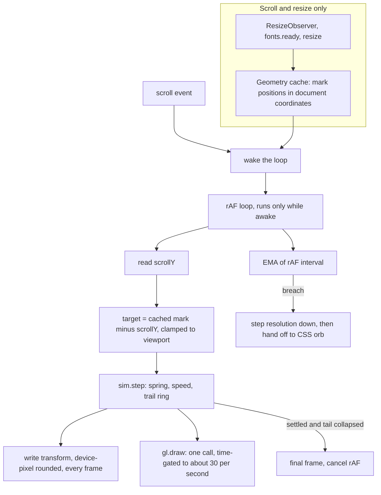
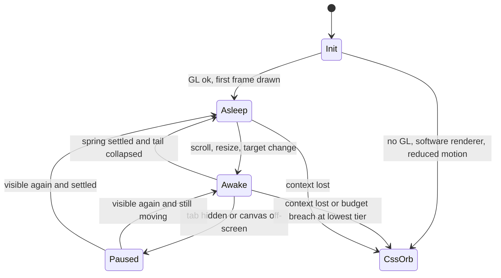

# Wisp light orb on the /light/ preview - Plan

**Target repo:** duketopceo/wisp (branch from `master`; supersedes PR #274).

## Goal Capsule

- **Objective:** A visitor to the `/light/` preview sees one small, live-looking light that guides them down the page, and it never visibly stutters or flickers on a low-end integrated-GPU laptop.
- **Means:** A plain-WebGL orb driven by a small pure-JS motion sim, with a compositor-only CSS fallback (KTD1, KTD2, KTD3).
- **Authority:** Product Contract, then Key Technical Decisions, then units. Session-settled decisions are fixed unless evidence shows they cannot work.
- **Stop conditions:** Stop and report instead of loosening a gate if the frame-time or visual-stability gates cannot be met at the fixed cost in R5. Stop if a session-settled decision proves infeasible.
- **Execution profile:** `code`. Sim math test-first (U2); renderer and page work verified against the browser gates (U5) as they land.
- **Who ships:** `ce-work` implements on a fresh branch and opens a PR to `master`. Luke merges, and closes PR #274 as superseded.

---

## Product Contract

### Summary

Rebuild the guiding-light preview from PR #274 as a lightweight real-time 3D orb: a bright core, a soft wispy tail that trails motion, and a slow breathing glow. It rests beside each section and drifts between them as the page scrolls. The work reuses #274's page, copy and credits, replaces its renderer, and adds measurable no-flicker gates to the existing browser-test path. The page stays at `/light/`; the homepage is untouched. The orb logic lands as importable modules so the homepage demo remake can adopt it later.

### Problem Frame

PR #274 proved the page and the idea, but its renderer cannot be promoted as is. It runs a 4-octave fbm twice per pixel on every frame, redraws on every animation frame even when the light is at rest, reads `getBoundingClientRect` for every section on every frame (a forced-layout source of jitter), blends with non-premultiplied alpha (dark fringes and halos), and allows a device pixel ratio of 2. On an Intel i3-class integrated GPU that is the recipe for dropped frames and visible shimmer. Its CI also fails: `shell-plugin/THIRD_PARTY_NOTICES.md` must stay byte-identical to the top-level notices (`tests/test_plugin_manifest.py`, `tests/test_plugin_mirror.py`), and the PR changed only the top-level file.

"No flicker" is currently an adjective. The existing browser harness (`tests/browser/site_3d.mjs`) checks fallbacks, console errors and overflow, but nothing about frame cost or visual stability.

### Requirements

**The light**

- R1. The light reads as a live 3D orb: a shaded bright core, a soft wispy tail that trails motion and collapses at rest, and a slow breathing glow.
- R2. The page keeps #274's design: wisp `guide` tokens on near-black, self-hosted Newsreader, five stops plus an install block, so the light visits six marks. Copy matches the README and ROADMAP (see Open Questions for the local-models stop).

**Motion**

- R3. The light rests beside each section and drifts between sections without jitter. Section geometry is measured on load, scroll and resize, never per frame.
- R4. No halo: no ring, visible box edge, or dark fringe around the light on the page background.

**Performance**

- R5. Per-frame cost is fixed and small, independent of viewport size: one draw call, bounded geometry, bounded fragment work, device pixel ratio at most 1.5, and a 30 fps cap while moving.
- R6. The light renders only while moving. It sleeps when settled, when the tab is hidden, and when off-screen. The breathing glow costs no main-thread or WebGL work; its only cost is compositor-side, and it pauses when hidden or off-screen.
- R7. On a weak or missing GPU the page shows a CSS orb instead: no WebGL, a software or major-performance-caveat renderer, context loss, a runtime frame-budget breach, and reduced motion. Reduced motion shows one still frame with no drift.
- R8. "No flicker" is a CI gate: a frame-time budget plus visual-stability checks, run under CPU throttling and software rendering (SwiftShader) in the existing browser-test path.

**Shipping rules**

- R9. Site rules hold: script-src 'self' with no inline script, no remote assets, no analytics, claims limited to what the README and ROADMAP support.
- R10. The page ships at `/light/` as a preview. The homepage, `/plain/`, `install.py` and the rc.2 pins do not change.
- R11. ThreeUI Community (MIT, Meng To) and PR #274 are credited, and the notices mirror is byte-identical so CI passes.
- R12. The motion sim and the GL view are importable modules with no dependence on the page, so the homepage demo can reuse them.

### Key Decisions

- The light is a live-rendered 3D wisp, not a plain sphere and not a pre-rendered loop or video. (session-settled: user-directed — chosen over a plain sphere and a pre-rendered video: a live orb with a wispy tail and breathing glow is the intended feel.) Governs R1.
- Lightweight and flicker-free on an Intel i3-class integrated GPU, with a static fallback on weak hardware. (session-settled: user-directed — chosen over a heavier shader-first look: the audience's hardware sets the budget.) Governs R5, R6, R7, R8.
- The light rests beside sections and drifts without jitter or halos, measured on scroll and resize. (session-settled: user-directed — chosen over per-frame measurement: that was #274's jitter source.) Governs R3, R4.
- Ship on the `/light/` preview first. (session-settled: user-approved — chosen over replacing the homepage hero now: that rewrites tests pinning the homepage and the rc.2 installer.) Governs R10.
- A fresh branch from `master` supersedes #274. (session-settled: user-approved — chosen over building on #274's branch: carry the page, copy and credits, and fix the renderer and notices cleanly.) Governs R2, R11.
- Wisp first, demo second. (session-settled: user-directed — chosen over remaking the homepage demo in the same plan: the demo remake, which overlaps PR #273, is a separate later plan.) Governs R12.

### Success Criteria

- The browser gates in U5 pass in CI (Chromium and WebKit) with the thresholds recorded in `tests/browser/light-budget.json`.
- At rest the light costs zero animation frames and zero WebGL draws, and its position does not change between samples. The breathing animation is compositor-only.
- With WebGL stubbed out, with a software renderer, or after context loss, the visitor sees a complete page with a CSS orb and no blank gap.
- A reviewer can open `/light/` locally and confirm by eye that the light drifts, trails, breathes and settles without shimmer. Luke's own check on a real low-end machine remains a manual follow-up (Risks).

### Scope Boundaries

Non-goals:

- A live Wisp session, video, analytics, installer changes, or the homepage demo remake.
- Replacing the homepage hero. Promotion is a later step.
- Closing, commenting on or pushing to PR #274 or `feature/site-guiding-light`. Luke closes it.

Considered and not built:

- A per-frame GPU timer-query probe in production code. Evidence that would change this: the CI proxy passes but a real low-end device still drops frames. The rAF-interval EMA (KTD5) already covers the failure case.
- A WebGL2 path. WebGL1 covers the target hardware and keeps one code path; revisit if a feature needs it.
- A pre-rendered sprite-sheet fallback. The CSS orb is cheaper to ship and tune.

#### Deferred to Follow-Up Work

- Promoting the wisp to the homepage hero and rewriting the tests that pin it.
- Adopting the sim and GL view in the homepage demo, as a three.js adapter or the plain GL view.
- A real-device low-end GPU check and a possible threshold tightening.

### Outstanding Questions

#### Deferred to Implementation

- Exact CI bounds. KTD6 sets the ceilings; U5 records measured medians and any tighter bounds in `tests/browser/light-budget.json` after the first CI run.
- The Chromium launch flags that force SwiftShader in Playwright 1.59 (`--use-angle=swiftshader` with `--enable-unsafe-swiftshader` is the expected pair). Verify against the installed Chromium.
- Tail point count, canvas box size and noise texture size, tuned within the R5 bounds.

#### Non-blocking, for the owner

- Stop 05 copy. #274 says "It can stay on your machine", but ROADMAP says hosted models are the default and local servers are opt-in and off. The plan rewrites the stop to say that. Luke may prefer to drop the stop.
- Reduced motion shows the CSS orb (KTD4), not one rendered GL frame, and re-places it when the active stop changes (as #274 did) rather than holding one position for the whole page. Say so if a single fixed position or a GL still is preferred.

---

## Planning Contract

### Key Technical Decisions

- KTD1. **Plain WebGL1, not the vendored three.js.** `site-3d/vendor/three.module.js` is 691,648 bytes and the light uses none of its scene graph: one program, one static vertex buffer, a handful of uniforms. Loading it on a preview aimed at weak GPUs adds parse cost and a renderer with its own state tracking for no gain. The cost of going plain is roughly 200 lines (context attributes, shader compile and link, loss handling), most of it needed anyway. The homepage already ships three, so the demo adopts the sim and the shader source through a thin `ShaderMaterial` adapter later (R12). The choice is reversible behind the module boundary, so it does not qualify for a bake-off.
- KTD2. **Quads with an analytic sphere, not a per-pixel noise raymarch.** The core is one quad shaded as a sphere impostor: normal from quad coordinates, one directional light, a fresnel rim, and a slow veil read from a 64x64 noise texture generated on the CPU at init (two taps, core pixels only). The tail is `TAIL_N` (about 16) soft billboard quads whose positions come from the sim's trail ring, with z-scaled size for depth and lateral wobble in the vertex shader. Output is premultiplied alpha with `blendFunc(ONE, ONE_MINUS_SRC_ALPHA)`, so order does not matter and there is no depth buffer. Falloff is compact and reaches exactly zero before the box edge, and a small interleaved-gradient dither, multiplied by alpha so transparent pixels stay exactly zero, removes banding on the dark background. Trail offsets are mapped into box space with a fixed maximum radius (about 0.4 of the box half-width), a stylised length driven by `tailLen` rather than the literal path, so the tail never reaches the box edge. This removes #274's fbm, and its halos and box edge by construction (R4).
- KTD3. **Sleep by default; breathing is CSS.** The loop runs only while the sim is awake (moving or tail not yet collapsed). On settle it draws one last frame and cancels animation frames. The slow breathing is a CSS `transform: scale()` and `opacity` animation on a wrapper, which the compositor runs with no JS and no WebGL work (it still costs compositor frames, cheap but not zero). While awake, the transform write happens every display frame (cheap, keeps drift smooth) and the GL draw is gated on elapsed time (at least about 33 ms since the last draw), so the 30 fps cap holds on 60 and 120 Hz displays alike. The breathing animation uses `animation-play-state: paused` when the tab is hidden or the light is off-screen, and is disabled under reduced motion. Hidden tab and off-screen both pause drawing.
- KTD4. **CSS orb is the one fallback.** Radial gradients in the same palette cover no WebGL, a software or caveat renderer (`failIfMajorPerformanceCaveat: true`), context loss, a runtime budget breach, and reduced motion. With reduced motion the light snaps with no drift. Without it (weak GPU), the same CSS orb drifts through a CSS `transition` on `transform`, so a weak device still gets compositor-driven motion with no per-frame JS. This replaces #274's 14 px dot and keeps one visual language. The orb matches the GL core's size and palette, its gradient reaches zero before its edge (the R4 rule), drift uses a roughly 0.9 s ease-out, and with scripts blocked it sits at the hero mark. A hand-off from GL to the CSS orb keeps the head's position and size. Under reduced motion the orb is placed beside the active stop and re-placed, with no transition, breathing or tail, only when the active stop changes; scrolling within a stop moves nothing.
- KTD5. **Cached geometry, exact spring, one runtime budget check.** A `ResizeObserver`, a `resize`/`orientationchange` listener and `document.fonts.ready` refresh a cached list of mark positions in document coordinates. Per frame the loop reads only `scrollY` (no layout) and subtracts. The active stop comes from a binary search on cached midpoints. The head follows a critically damped spring solved in closed form, so it is stable at any frame time and does not overshoot from rest; a retarget with velocity toward the target can overshoot slightly, so the sim bounds it (velocity clamp at retarget). The canvas transform is rounded to device pixels to stop sub-pixel shimmer. The budget signal is an EMA of the rAF-to-rAF interval over awake frames, normalised for the 30 fps cap (a CPU timer around `drawArrays` would only measure command submission, not fill). The first frames after any wake, resume or resize are excluded, and a breach must be sustained across a window before acting. It steps resolution down (scale 1, 0.75, 0.5), never up, and after a sustained breach on the lowest step hands off to the CSS orb. Steps and hand-off never oscillate.
- KTD6. **"No flicker" becomes four measurable gates**, all in the existing Playwright path with no production test hooks (instrumentation is injected with `addInitScript`). The numbers below are hard ceilings: calibration may only tighten them. If the measured SwiftShader result cannot meet a ceiling, the Goal Capsule stop condition fires and the run reports instead of raising a bound.
  - Budget: draws at most 31 per second at any rAF rate; p95 interval between actual draws within 50 ms and at most 5% of draw intervals over 50 ms.
  - Stability: zero blank frames in motion; no overshoot beyond 0.5 device px once the scripted scroll has ended; premultiplied invariant (r, g, b not above alpha plus 1) and fully transparent border pixels in every sampled frame; on rest frames, luminance non-increasing outward within 2/255 along a ray opposite the tail, outside the core radius.
  - Rest: after settle, zero animation frames, zero draws, and an unchanged host transform over 2 seconds.
  - Degradation: resolution step-downs are monotone and at most two, and a hand-off to the CSS orb may follow once as a final separate transition with no blank frame. The forced-GL 1x run must finish with `data-renderer="webgl"` and `data-tier` at the top tier, so it cannot pass vacuously by handing off. CPU throttle slows the main thread only, not SwiftShader raster; the throttled runs validate the JS and tier-logic path, and fill cost rests on the SwiftShader run and the manual real-device check.
- KTD7. **Module layout for reuse.** `site-3d/wisp/sim.mjs` (pure, no DOM or GL, testable in Node), `site-3d/wisp/gl.mjs` (plain WebGL view: init, draw, resize, dispose, loss handling), and `site-3d/light/light.mjs` (page wiring: stops, geometry cache, loop, fallback). Shader source lives in `gl.mjs` as strings the three adapter can reuse. `site-3d/light/` holds the page and its font and CSS assets.
- KTD8. **Credit follows the work.** The new shader is a rewrite, not a copy of ThreeUI's `energy-orb`. The MIT notice stays (the visual reference and palette idea came from it) with wording changed from "adapts the fragment shader" to "design reference; shader rewritten". #274 is credited in the PR description. This is the owner's credit request applied honestly to what ships.
- KTD9. **Notices mirror is a byte copy.** `shell-plugin/THIRD_PARTY_NOTICES.md` is overwritten with the top-level file after the edit. The tests pin byte equality, so the plugin copy carries the website section; that is accepted rather than relaxing the test.

### High-Level Technical Design

Component and data flow. Everything in the left column runs on scroll or resize only; the loop reads `scrollY` and nothing else from layout.



Light lifecycle:



Frame budget while moving, as design targets (the CI gates in KTD6 are the proof, not these numbers):

| Item | Moving | Resting |
| --- | --- | --- |
| rAF callbacks | display rate (transform written every frame; GL draw time-gated to about 30 per second) | 0 |
| GL draws | at most about 30 per second at any display rate, 1 call each | 0 |
| Geometry | about 17 quads, one static buffer | none |
| Fragment work | analytic sphere plus two noise taps on core pixels; no loops | none |
| Canvas | about 400 CSS px box, device pixel ratio at most 1.5, scale tiers 1 / 0.75 / 0.5 | unchanged |
| Layout reads | none in the loop; `scrollY` only | none |

Directional sim sketch (not implementation):

```text
step(dt):
  dt = min(dt, 1/20)
  head, vel = critically_damped(head, vel, target, omega, dt)      # closed form, no overshoot
  speed = |vel|
  if draw_due: push head onto trail ring; age all points
  tailLen = smoothstep(lo, hi, speed)                              # collapses at rest
  settled = |head - target| < eps and speed < eps and tail collapsed
  return {head, trail, tailLen, settled}
```

### Assumptions

These are inferred bets, not confirmed by the owner.

- A 30 fps cap while moving looks smooth enough for a slow drifting light; the transform still updates at display rate.
- Chromium in CI renders WebGL through SwiftShader already, and SwiftShader on a shared runner is a conservative proxy for fill cost on an integrated GPU. It is not a stand-in for a real i3.
- `/light/` is served by the existing Workers asset config with no new route (directory index under `not_found_handling: none`). The `/light/` browser run in U5 confirms it.
- WebKit headless in CI may render the fallback or the GL view; the gates require a valid state either way and measure GL numbers on Chromium only, as the existing harness does.
- The carried page copy was checked against the README by #274's author; U1 re-checks it rather than trusting that.

### Implementation constraints

- No inline script, no remote assets, no analytics; CSP is `site-3d/_headers`.
- `scripts/site/build_3d.py` `FILES` is an allowlist, and its `check()` rejects missing, escaping or remote assets and follows relative `import` specifiers. New files must be listed.
- Reduced motion shows one still frame and no drift (site rule).
- Existing `data-` convention from `site-3d/scene.mjs`: `data-renderer` (`webgl` or `static`), `data-rendered`, `data-rendering` (`running` or `paused`). The light follows it, adding `data-tier`.

---

## Implementation Units

Units land as atomic commits on one branch (suggested name `feat/site-wisp-light`) opened as one PR.

### U1. Carry #274 forward and fix the notices mirror

**Goal:** The branch has #274's page, copy, fonts and credits on current `master`, with CI's notices failure fixed and the one copy claim corrected.

**Requirements:** R2, R9, R10, R11.

**Dependencies:** None.

**Files:**
- Create from `origin/feature/site-guiding-light` (fetch and `git checkout <ref> -- <path>` only; never push to it): `site-3d/light/index.html`, `site-3d/light/light.css`, `site-3d/light/fonts/newsreader-roman-latin.woff2`, `site-3d/light/fonts/newsreader-ital-latin.woff2`, `site-3d/vendor/OFL-Newsreader.txt`, `site-3d/vendor/THREEUI-LICENSE.txt`
- Modify: `THIRD_PARTY_NOTICES.md`, `shell-plugin/THIRD_PARTY_NOTICES.md`, `site-3d/vendor/PROVENANCE.md`, `docs/HOSTING.md`, `scripts/site/build_3d.py`, `tests/test_site_3d.py`

**Approach:**
- Take #274's `THIRD_PARTY_NOTICES.md` section, reword it per KTD8, then overwrite the plugin copy with the top-level file (KTD9).
- Add the new file list to `FILES` (modules from U2 to U4 are added in their own units).
- Port #274's `GuidingLightPreview` tests, keeping the credit assertions on the notices and vendor license files only; the assertion that the module header carries the credit moves to U3.
- Re-check each claim in the page copy against `README.md` and `ROADMAP.md`. Rewrite stop 05 to say hosted models are the default and local servers are opt-in. Replace the em dash in the page title.
- Credit #274 and ThreeUI in `PROVENANCE.md` (ThreeUI) and the PR body (#274).

**Patterns to follow:** `tests/test_site_3d.py` class layout; `site-3d/vendor/PROVENANCE.md` entry style.

**Test scenarios:**
- Covers R11. `shell-plugin/THIRD_PARTY_NOTICES.md` bytes equal the top-level file (existing `TestThirdPartyNotices`).
- Covers R11. `pm.build` mirror validates and neither notices file says "Wisp is MIT licensed" (existing mirror test).
- Covers R9. The page HTML has no inline `<script>` and no remote `src`/`href` to js, css or fonts; the combined html, css and js mention `prefers-reduced-motion`.
- Covers R2. The page contains `docs/INSTALL.md`, the word "experimental", no `\d+ ms` figures, no `wisp.casa`; stop 05 contains "opt-in" and not "stay on your machine".
- Covers R11. The ThreeUI license text with "Copyright (c) 2026 Meng To" is present in the vendor file and the top-level notices.
- `builder.check(out)` returns no problems for a build that includes the new files.

**Verification:** `tests.test_plugin_manifest`, `tests.test_plugin_mirror`, `tests.test_site_3d` pass; a build contains every carried file and `inventory.json` is deterministic.

### U2. Wisp motion sim

**Goal:** A pure, deterministic module that owns head position, speed, the trail ring and the settle decision.

**Requirements:** R3, R6, R12.

**Dependencies:** U1.

**Files:**
- Create: `site-3d/wisp/sim.mjs`
- Modify: `scripts/site/build_3d.py`, `tests/test_site_3d.py`

**Approach:**
- Export a factory that takes tuning (omega, tail points, thresholds) and returns `setTarget`, `step(dt)`, a trail typed array, and a `settled` flag. No DOM, no GL, no globals.
- Critically damped closed-form step (KTD5); clamp `dt`; speed-gated tail length that collapses at rest.
- `settled` requires position error, speed and tail length all under epsilon for a few consecutive steps, so one lucky sample cannot put the loop to sleep.

**Execution note:** Test-first. Follow the existing `DemoState` pattern, which runs `node` against a module.

**Patterns to follow:** `site-3d/model.mjs` (pure module) and `DemoState` in `tests/test_site_3d.py`.

**Test scenarios:**
- Covers R3. From rest, a target 600 px away converges with maximum overshoot at most 0.5 px and velocity that falls monotonically after its peak.
- Covers R3. Stepping with `dt` of 8 ms, 16 ms, 50 ms and 500 ms (clamped) reaches the same resting point; no NaN.
- Covers R6. After the target stops changing, `settled` becomes true and stays true, and the trail length is below epsilon.
- Covers R6. A target change after settle clears `settled` on the next step.
- Covers R3. A mid-flight retarget with velocity toward the new target overshoots by at most 0.5 px.
- Edge: `setTarget` to the current position never wakes the sim.
- Edge: a target change mid-flight keeps position and velocity continuous (no teleport).
- Trail ring: the mapped tail offset never exceeds the fixed maximum radius at peak speed; length is constant, points age monotonically, and all trail offsets collapse to zero at rest.

**Verification:** The node-run sim tests pass; the module has no `document`, `window` or `gl` references.

### U3. Plain-WebGL view

**Goal:** One draw call renders the core, tail and glow with premultiplied alpha at bounded cost, with clean loss and fallback signals.

**Requirements:** R1, R4, R5, R12.

**Dependencies:** U2.

**Files:**
- Create: `site-3d/wisp/gl.mjs`
- Modify: `scripts/site/build_3d.py`, `tests/test_site_3d.py`

**Approach:**
- Context attributes per KTD2 and KTD4: `alpha`, `premultipliedAlpha` true, no antialias, depth or stencil, `powerPreference: "low-power"`, `failIfMajorPerformanceCaveat: true`, no preserved drawing buffer. Return `null` on failure so the page falls back.
- One program, one static buffer of the core quad plus `TAIL_N` tail quads with a per-quad index attribute; trail offsets arrive as a uniform array from the sim.
- Fragment output stays premultiplied, glow reaches zero before the box edge, dither is a few ALU ops. No loops in the fragment shader; at most two texture taps, core only.
- API: `draw(state, time)`, `resize(cssSize, dpr, scale)` that redraws in the same call so a resize never leaves a cleared canvas, `dispose()`, and a loss callback that calls `preventDefault` and hands off (same shape as `site-3d/scene.mjs`).
- Credit comment in the module header per KTD8.

**Technical design:** Directional only: the vertex stage places each tail quad from `uTrail[index]` with size scaled by a z term and a small time-based lateral wobble; the fragment stage branches on quad type (core or tail) and writes `vec4(rgb * a, a)`.

**Patterns to follow:** `site-3d/scene.mjs` for context-loss handling and `dispose`; #274's `light.mjs` for palette values.

**Test scenarios:**
- Covers R11. `site-3d/wisp/gl.mjs` header names ThreeUI Community and `MengTo/threeui`.
- Covers R5. Source tripwires (U6): no `for`/`while` in the fragment shader, at most two texture lookups, device pixel ratio constant at most 1.5.
- Covers R4. In the browser gate (U5), output obeys the premultiplied invariant and border pixels are transparent.
- Covers R5. `draw` issues exactly one `drawArrays` per call (counted in the gate).
- Error: `getContext` returning `null` yields a `null` view, not a throw.
- Error: after `webglcontextlost`, no further draws and the loss callback fires once.
- Edge: `resize` to a new size produces a drawn frame before returning (no blank canvas).
- Covers R4. Dither leaves fully transparent pixels exactly zero (border pixels in the gate).

**Verification:** The view renders a recognisable orb under SwiftShader in the gate run, and the source tripwires pass.

### U4. Page wiring, CSS orb and fallbacks

**Goal:** The page runs the loop per KTD3 and KTD5, picks a tier, and degrades to the CSS orb in every weak case.

**Requirements:** R3, R6, R7, R9.

**Dependencies:** U1, U2, U3.

**Files:**
- Create: `site-3d/light/light.mjs`
- Modify: `site-3d/light/index.html`, `site-3d/light/light.css`, `scripts/site/build_3d.py`, `tests/test_site_3d.py`

**Approach:**
- Geometry cache (KTD5): mark positions in document coordinates, refreshed by `ResizeObserver`, `resize`/`orientationchange` and `document.fonts.ready`. Active stop by binary search on cached midpoints. The loop reads only `scrollY`.
- Loop (KTD3): wake on scroll, resize or target change; transform every frame, rounded to device pixels, and draw time-gated to about 30 per second; sleep when the sim settles; pause on `visibilitychange` and when an `IntersectionObserver` reports the canvas off-screen. Set `data-renderer`, `data-rendering`, `data-rendered` and `data-tier` on the host.
- Budget check (KTD5): EMA of the rAF-to-rAF interval; step the resolution scale down once per sustained breach, then hand off to the CSS orb.
- CSS orb (KTD4): gradients in the `guide` palette on the same host element, CSS `transition` on `transform` for drift, no transition under `prefers-reduced-motion` (snap). Breathing is a CSS animation on a wrapper, disabled under reduced motion.
- Reduced motion (live): `matchMedia` change handler switches to the CSS orb and cancels the loop; switching back is not required.
- Resting geometry: the light rests at each section's mark element, as in #274 (right of the text column on desktop, above the text on narrow viewports), clamped inside the viewport with a margin; the canvas box shrinks on narrow viewports so the core and glow disc never reach the text rectangles.
- Accessibility: the host and canvas stay `aria-hidden="true"`, `pointer-events: none` and unfocusable, so links and the install block remain clickable and keyboard order is unchanged.
- Remove #274's per-frame `getBoundingClientRect` and always-on rAF; add the module imports to `FILES`.

**Patterns to follow:** `site-3d/app.mjs` and `site-3d/scene.mjs` (observer plus `visibilitychange` reconcile, `data-` states, static fallback); `.light.nogl` styling in #274's `light.css`.

**Test scenarios:**
- Covers R3. Scrolling to each of the six marks (five stops and the install block) brings the light to rest at that mark, within a pixel tolerance recorded in `light-budget.json`, and the light's core and glow disc stay clear of the section's text rectangles (browser gate at 390 and 1440 px).
- Covers R3. A resize that reflows text (390 px width) moves rest positions with the layout; no drift to stale positions.
- Covers R6. Settled light: `data-rendering` is `paused`, zero animation frames and draws over 2 seconds.
- Covers R6. Hidden tab: loop cancelled, no draws; visible again resumes and settles.
- Covers R7. Each fallback mode shows the CSS orb with no canvas and no page errors: no JS, no WebGL, `getContext` null under the caveat flag, injected `drawArrays` failure, forced context loss, reduced motion, module load failure.
- Covers R7. With reduced motion the host moves by snap only (no `transition` on `transform`).
- Edge: the page is usable and readable at 320, 390, 1440 widths with no horizontal overflow, and the host has `aria-hidden`, `pointer-events: none` and no tab stop.
- Integration: with the light resting over the install block, a click on its link and a Tab sequence behave as without the light.
- Covers R7. Under reduced motion, scrolling within one stop leaves the transform unchanged; it changes only when the active stop changes.
- Covers R7. A hand-off from GL to the CSS orb keeps the orb's center and size within the recorded tolerance.

**Verification:** U5's gates pass; the page works with scripts blocked (copy and install block readable, CSS orb visible).

### U5. Browser gates for budget and visual stability

**Goal:** CI measures frame cost and visual stability instead of asserting them.

**Requirements:** R5, R6, R7, R8.

**Dependencies:** U4.

**Files:**
- Create: `tests/browser/light.mjs`, `tests/browser/light-budget.json`
- Modify: `tests/browser/package.json` (test script runs both files), `.github/workflows/pages.yml` (job comment only if needed), `tests/test_shipping_claims.py` (pin that the light check stays in the workflow's test path)

**Approach:**
- Reuse the harness conventions from `tests/browser/site_3d.mjs`: `WISP_SITE_URL`, `WISP_BROWSERS`, external-request and page-error capture, the five fallback modes. The page URL is the base plus `light/`.
- Instrumentation is injected with `addInitScript`, never shipped. Timing passes use only a draw counter, rAF timestamps and the original `requestAnimationFrame` captured before the counter wrapper; they never call `gl.finish()` or `readPixels`. Stability passes add `readPixels` after each draw and are not used for timing assertions. The transform sampler is timer-based and reads the host element, not the breathing wrapper, so neither the rAF count at rest nor the identical-transform check is disturbed. The hidden-tab scenario overrides `document.visibilityState` and dispatches `visibilitychange`.
- Chromium runs: default (confirms the caveat flag sends SwiftShader to the CSS orb), then forced-GL under SwiftShader by stripping `failIfMajorPerformanceCaveat` in an init script, then 4x and 6x CPU throttle through a CDP session (`Emulation.setCPUThrottlingRate`). WebKit runs structure, fallback and error checks.
- Scripted scroll through all stops, then rest sampling. Assert the KTD6 gates against `light-budget.json`, which holds the thresholds and the measured medians recorded after the first CI run.
- Save a screenshot per stop to the existing QA output folder for human review.

**Execution note:** Calibrate in two passes. The first run records measured medians; the second commits bounds no looser than the KTD6 ceilings. A bound may only tighten; if a ceiling cannot be met, stop and report. Record the reason for each bound in the JSON.

**Patterns to follow:** `tests/browser/site_3d.mjs`; the `enhanced` job in `.github/workflows/pages.yml` (wrangler dev on port 3000).

**Test scenarios:**
- Covers R8. During a 3-second scripted drift, draws per second at most 31 and p95 draw interval within the KTD6 ceiling at 1x, 4x and 6x throttle, and again with rAF forced to 120 Hz.
- Covers R8. Zero blank frames in motion (center alpha above threshold in every sampled frame).
- Covers R4, R8. In every sampled frame the premultiplied invariant holds and border pixels have alpha at most 1/255; on rest frames the glow profile opposite the tail is non-increasing within 2/255.
- Covers R8. After the scripted scroll ends, position samples show overshoot at most 0.5 device px and no direction reversal toward the static target.
- Covers R6, R8. After settle, 2 seconds of sampling show zero rAF callbacks, zero draws and an identical transform.
- Covers R7, R8. Under 6x throttle, step-downs are monotone and at most two; if the page hands off to the CSS orb it happens once and there is no frame with neither canvas nor orb visible. The forced-GL 1x run ends on `webgl` at the top tier.
- Covers R7. Default Chromium run under SwiftShader lands on the CSS orb with `data-renderer="static"`; forced-GL run lands on `webgl`.
- Resize mid-motion: zero blank frames across the resize.
- Integration: zero external requests and zero CSP violations across all runs.

**Verification:** `npm test` in `tests/browser` passes on Chromium and WebKit locally and in the `enhanced` CI job; the QA artifact shows a screenshot per stop.

### U6. Static cost tripwires

**Goal:** Cheap Python tests fail fast when someone reintroduces a known cost or flicker source.

**Requirements:** R4, R5, R6.

**Dependencies:** U3, U4.

**Files:**
- Modify: `tests/test_site_3d.py`

**Approach:**
- Source-level checks on the light modules, scoped to the specific regressions #274 had. They are tripwires, not proofs; the browser gates remain the proof.

**Test scenarios:**
- Covers R5. `getBoundingClientRect` does not appear in the animation loop function of `light/light.mjs`.
- Covers R4. The GL context requests `premultipliedAlpha: true`; the source does not contain `premultipliedAlpha: false` or `SRC_ALPHA`.
- Covers R5. The device pixel ratio cap constant is at most 1.5; the fragment shader has no `for` or `while`.
- Covers R6. The loop has a sleep path (a `cancelAnimationFrame` call tied to the settled flag) and a `visibilitychange` handler.
- Covers R12. `wisp/sim.mjs` and `wisp/gl.mjs` import nothing from `light/`, and `sim.mjs` references no DOM globals.
- Covers R9. Every module under `site-3d/wisp/` and `site-3d/light/` is listed in `FILES`, and `check()` is clean.

**Verification:** `python3 -m unittest tests.test_site_3d` passes; each tripwire fails when its regression is reintroduced in a scratch edit.

### U7. Design doc and reuse contract

**Goal:** The next person, or the demo plan, can see the budgets, choreography and reuse hook without reading the code.

**Requirements:** R10, R12.

**Dependencies:** U4, U5.

**Files:**
- Create: `site-3d/light/DESIGN.md` (authoring file, not shipped; `build_3d.py` excludes DESIGN.md already)
- Modify: `docs/HOSTING.md`

**Approach:**
- Mirror the shape of `site-3d/DESIGN.md`: direction, choreography, tokens (wisp `guide` palette), budgets from the HTD table, evidence boundary, acceptance, and a short "Reuse" section listing the sim and GL view APIs and how a three.js adapter would consume the shader strings.
- Update the `docs/HOSTING.md` entry to say the preview runs a small WebGL light with a CSS fallback.

**Test expectation:** none -- documentation only; `tests.test_site_3d` already asserts the build excludes authoring files.

**Verification:** The doc's budgets match the thresholds in `tests/browser/light-budget.json`.

---

## System-Wide Impact

- The Workers bundle gains `light/` and `wisp/` files; the homepage, `/plain/`, `install.py` and `_headers` are unchanged.
- `shell-plugin/THIRD_PARTY_NOTICES.md` changes with the top-level notices, which feeds the Omarchy plugin mirror build.
- The browser test script gets longer: the `enhanced` job gains four extra Chromium runs (default, forced software GL, 4x and 6x throttle) plus a WebKit pass.

## Risks & Dependencies

| Risk | Mitigation |
| --- | --- |
| SwiftShader on a CI runner is slower than a real iGPU, so a gate fails for the wrong reason | Gate on structure (draw counts, rest behavior, stability) plus the KTD6 ceilings; throttle covers main-thread cost only, so fill cost rests on the SwiftShader run |
| The proxy passes but a real i3 still drops frames | Fixed-cost design (KTD2), runtime EMA step-down and CSS hand-off (KTD5), and a manual check on a real low-end machine after merge |
| `failIfMajorPerformanceCaveat: true` sends some capable GPUs with blocklisted drivers to the CSS orb | Accepted: the CSS orb is a complete experience, and the choice errs toward no flicker |
| Chromium flag names for SwiftShader differ by version | Verify against the installed Chromium in U5; the default CI Chromium already renders WebGL in software |
| Calibrated thresholds drift as runners change | KTD6 ceilings are fixed; `tests/browser/light-budget.json` holds tighter bounds and measured medians with a reason for each change |
| The carried copy overreaches the README | U1 re-checks each claim; tests pin the corrected stop 05 |
| Firefox is untested | Out of the existing harness (Chromium and WebKit); the CSS fallback is plain CSS |

Dependencies: Node 22 and Playwright 1.59 (already pinned in `tests/browser/package.json`), Wrangler 4.156.0 (root `package.json`). No new runtime dependency.

## Verification Contract

| Check | Command | Applies to |
| --- | --- | --- |
| Python tests | `python3 -m unittest tests.test_site_3d tests.test_site_workers tests.test_site tests.test_shipping_claims tests.test_plugin_manifest tests.test_plugin_mirror` | U1 to U7 |
| Bundle build | `python3 scripts/site/build_3d.py` then `python3 scripts/site/build_workers.py` | U1 to U4 |
| Browser gates | In `tests/browser`: `npm ci`, then with `wrangler dev --config ../../wrangler.json --local --port 3000` running, `WISP_BROWSERS=chromium,webkit WISP_SITE_URL=http://127.0.0.1:3000/ npm test` | U4, U5 |
| CI | The `website` workflow (`.github/workflows/pages.yml`) jobs `build`, `enhanced`, `assets`, plus the `unit` and `plugin` jobs in `test.yml` | All |

Quality gates beyond tests: a screenshot per stop reviewed by eye; no `console` errors or CSP violations in any run.

## Definition of Done

Global:

- All Verification Contract checks pass locally and in CI, including `unit` and `plugin` (the notices mirror failure from #274 is gone).
- `/light/` loads from the Workers bundle with the light drifting, resting, trailing and breathing, and the CSS orb path works with WebGL blocked.
- Gates in U5 pass with thresholds recorded in `tests/browser/light-budget.json` and the reason for each.
- The homepage, `/plain/`, `install.py` and the rc.2 pins are byte-unchanged.
- ThreeUI is credited in notices and provenance, and the PR body credits #274.
- Dead-end and experimental code from abandoned attempts (earlier shader variants, unused tuning flags) is removed from the diff.

Per unit: each unit's Verification passes, and its test scenarios exist as tests (U1 to U6) or as the documented check (U7).

## Sources & Research

- PR #274 (`feature/site-guiding-light`): page, copy, CSS, fonts, credits, and the renderer problems listed in the Problem Frame, read from its files and diff. Its checks: `unit` (3.11, 3.13) failed on the notices mirror; `enhanced` and `plugin` passed.
- `site-3d/scene.mjs`, `site-3d/app.mjs`: observer plus `visibilitychange` reconcile, `data-` render states, context-loss fallback, device pixel ratio cap at 1.5.
- `tests/browser/site_3d.mjs`, `.github/workflows/pages.yml`: the browser harness, fallback modes, and the `enhanced` job this plan extends.
- `scripts/site/build_3d.py`, `tests/test_site_3d.py`, `tests/test_site_workers.py`: the `FILES` allowlist, `check()`, and the node-run `DemoState` pattern reused in U2.
- `tests/test_plugin_manifest.py`, `tests/test_plugin_mirror.py`, `scripts/plugin_mirror.py`: the notices byte-equality contract.
- `README.md`, `ROADMAP.md`: copy claims (Super+D, `guide` mode, runtimes, memory, "Hosted models by default. Local model servers are opt-in and off").
- `site-3d/vendor/PROVENANCE.md`: three.js 0.170.0 at 691,648 bytes, and the style of provenance entries.

Coverage: local research was inline reads of the files above; no research subagents ran because settled decisions and strong local patterns left no external option set open. External research was skipped for the same reason; WebGL attribute behavior is standard, and the one version-specific item (SwiftShader launch flags) is deferred to execution. No `docs/solutions/` entries exist in this repo. No cross-model peer review ran: the owner prohibits paid model calls.
