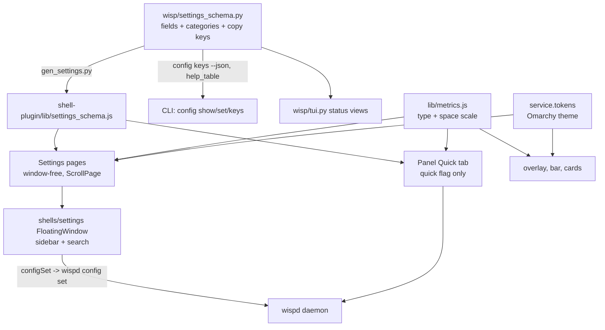

# Wisp GUI and TUI Overhaul - Plan

## Goal Capsule

- **Objective:** Someone setting up or tuning Wisp can find, read, change and verify every setting without clipping, hunting or guessing, on both the laptop panel and the ultrawide, in a window or in a terminal.
- **Means:** A standalone, resizable settings window with a category sidebar, scrolling and search (KTD1). The bar Panel keeps quick status and a few quick toggles. One type scale and spacing rhythm, derived from the active Omarchy theme, is applied to every surface (KTD2). `wispd tui` and the CLI get the same treatment (KTD3).
- **Authority:** Product Contract Requirements win on behavior. KTDs win on mechanism. Units override neither. Session-settled decisions are not reopened.
- **Stop conditions:** Stop and report if a unit needs a daemon or config-schema change beyond UI metadata (Scope Boundaries), if the Rust core `rs/` would change, or if a paid or live model call would be needed to verify.
- **Execution profile:** Code plan, seven PRs in the order under Phased Delivery. Settings window first. Verify with the offscreen QML snapshot harness and the Python goldens, plus the single live window check in U4. No other live-shell verification.

---

## Product Contract

### Summary

Wisp's settings live in a cramped tab inside the bar popup. Content taller than the popup is clipped, the text is 10 to 14 px, and the layout reads like a terminal dump. This plan moves settings into their own window, makes the popup scroll and shrinks it to a quick view, gives every surface one readable type scale and spacing rhythm, and brings `wispd tui` and the CLI output up to the same standard.

### Problem Frame

The owner's complaint is that the settings window has no scrolling, reads like a terminal, is hard to use and read, and has odd spacing. Repository evidence confirms each part.

- `shell-plugin/Panel.qml` sizes the card with `fittedContentHeight(content.implicitHeight)` around a plain `Column`. All five tab bodies sit in that column and switch by `visible`. No `Flickable`, `ScrollView` or `ListView` exists anywhere under `shell-plugin/`, so tall content is clipped (Panel.qml:198-335).
- `SettingsTab.qml` is a fixed 340 px column holding health, six setting cards and connectors. It edits 14 of 47 schema keys with a text input plus a "save" chip or rows of on/off chips.
- `shell-plugin/lib/metrics.js` sets body 12, label 11, caption 10, title 14, spacing 3 to 18. These are plain pixels and are not scaled by the Omarchy `Style` text size.
- Hard-coded layout literals (about 85) and fixed widths (340, 560, 120, 180) fight any rhythm.
- The existing management app `shells/debug/shell.qml` already is a `FloatingWindow` with a sidebar and per-tab `Flickable`. It has two bugs: its restart, stop and task buttons call `svc.run(...)`, which is a read-only object, and its Settings tab saves about 30 keys through `configSet`, which rejects every key outside the 14 Panel fields.
- The terminal side is uneven. `wisp/tui.py` has no scrolling, no resize handling and no `NO_COLOR` check, and pads with `len()`. `wisp/cli/output.py` has good helpers, but `health`, `binds`, `config`, `theme check` and `inventory` still use raw `print`.

### Requirements

**Settings window**

- R1. `wispd settings` opens a normal resizable window (default 960x700, minimum 720x520) that is separate from the bar popup. The bar popup (Panel) has an "Open settings" action in its header on every tab that opens the same window. A direct click binding on the bar mark is not part of this plan.
- R2. The window has a category sidebar: Voice, Pointer, Agents, Models, Budget, Connectors, Advanced, plus Status for the health, spend, audit and binds views.
- R3. Every category page scrolls with a visible scrollbar, wheel and keyboard. No content is ever clipped at any window size at or above the minimum, including at a 1.25 text scale. The window is fully keyboard-operable: Ctrl+F focuses search, Esc clears it, arrow keys move through the sidebar and rows, and the focused control has a visible focus ring.
- R4. A search field filters settings across all categories by label, help text and key, and shows which category each result lives in. Result rows are editable in place, and clicking the category chip jumps to that category.
- R5. Every editable schema key appears on exactly one page, with a plain-language label and one line of help. Controls fit the kind: switch for bool, select for choice, number field with unit and range for int and usd, text field for free text, status-only row for secrets.
- R6. Edits show inline validation before saving and the daemon's rejection reason after. Toggles and selects save on change. Text and number fields commit on Enter or blur only when valid: an invalid draft stays in the field with its error shown and nothing is sent. Each row shows saving, saved and error states and offers reset to default. The window also shows daemon-offline, loading and empty-data states instead of blank pages.
- R7. The Models page exposes the hybrid setup: hosted OpenRouter as the default, small local models (for example Liquid AI LFM vision through Ollama or LM Studio) as a supported option, fallback, and the paid-model guard. It uses only keys the daemon already validates. It never shows a stored secret value.
- R8. The window is reachable without a GUI session: with no display, `wispd settings` prints how to reach the same settings through `wispd config` and `wispd tui` and exits non-zero.

**Bar popup**

- R9. The bar Panel scrolls when content is taller than the card, and first-run, what's-new and recap banners no longer take height away from every tab permanently.
- R10. The Panel's Settings tab becomes a Quick tab (the Panel header carries the Open settings action on every tab): status summary, a handful of quick toggles (voice on or off, captions, pointer mode, agent autonomy) and an "Open settings" action.

**Look and readability**

- R11. Every surface takes colours and font family from the active Omarchy theme through `service.tokens` and `Style`. No hex colours are introduced.
- R12. One type scale and spacing rhythm applies to every QML surface. Body text is at least 14 px, secondary text at least 12 px, and no text is under 12 px except the overlay's non-text glyph labels. Spacing steps come from one 4 px-based scale.
- R13. Interactive controls are at least 32 px tall in the settings window and Panel, and at least 28 px on the overlay and bar.
- R14. Type and spacing follow the Omarchy text-size setting where the host exposes it, so a larger system text size enlarges Wisp.

**Management views**

- R15. The remaining `shells/debug` views (home, activity, memory, agents) move into the settings window, its two bugs are fixed, and `shells/debug` is retired.

**Terminal**

- R16. `wispd tui` keeps its five views and adds scrolling (arrows, j/k, PgUp/PgDn, g/G), resize handling, width-aware alignment, a header and key-hint footer, and consistent colour.
- R17. `NO_COLOR`, `COLORTERM` and non-TTY output are respected by the TUI and every CLI command. Piped output has no escape codes.
- R18. `doctor`, `onboard`, `config`, `health`, `binds`, `theme check` and `inventory` print titled sections with aligned columns through `wisp/cli/output.py`. `wispd config show` groups keys in the same category order as the settings window.
- R19. TUI and QML health and manage logic stay in step: `shell-plugin/lib/health.js` and `lib/manage.js` still produce the same rows as `wisp/tui.py`.

### Success Criteria

- The owner opens `wispd settings`, finds a setting by search in under 10 seconds, changes it, sees it saved, and never meets clipped content at 1728x1080 (scale 2) or 3440x1440 (scale 1).
- Automated checks fail if a surface clips content, uses text under the minimum, or has a control under the minimum hit size.
- `wispd health | cat` and `NO_COLOR=1 wispd tui` emit no escape codes.

### Key Decisions

- **Settings get their own window.** The bar Panel keeps quick status and a few toggles. (session-settled: user-directed — chosen over fixing it inside the bar Panel and over doing both with equal weight: the owner wants a normal app window with a sidebar and scrolling.) Governs R1, R2, R9, R10.
- **Look follows the active Omarchy theme, with more polish.** Colours and fonts come from Omarchy through `service.tokens` and `Style`, on a proper type scale. (session-settled: user-approved — chosen over a separate Wisp-designed palette: keeps Wisp looking installed on every theme.) Governs R11, R12, R14.
- **The terminal side is polished, not retired.** `wispd tui` stays for SSH and no-GUI use. (session-settled: user-approved — chosen over GUI-only and over retiring the TUI.) Governs R16, R17, R18.
- **Everything is in scope, settings first.** One plan, sequenced as PRs. (session-settled: user-approved — chosen over settings-only.) Governs phase order.

### Scope Boundaries

**Deferred to Follow-Up Work**

- A TUI settings editor. R8 sends no-GUI users to `wispd config`. An in-TUI editor is a separate feature.
- Retiring the pre-Panel `StatusLine`-style text copy in favour of icons. The icon set in `DESIGN-v2.md` is not part of this plan.

**Outside this plan**

- New product features, new daemon config keys, the Rust core `rs/`, the website `site/`, and the browser extension.
- A Wisp-designed palette (settled against).
- macOS and Windows companions. The QML shell is the Linux and Omarchy surface.

**Considered and not built**

- A second GUI toolkit (GTK, Qt Widgets, a web page). No other GUI toolkit exists in the repo, and a standalone Quickshell config already ships and works (hosting evidence). Revisit only if Quickshell cannot host the window acceptably on Hyprland.
- A wisp-owned Hyprland window rule. Wisp must not edit user Hyprland config. If the window tiles by default, document an optional rule (U4).
- Server-side schema push over IPC. `wispd config keys --json` plus the generated JS mirror already carry the schema.

### Open Questions

**Deferred to implementation (non-blocking)**

- Whether Hyprland floats or tiles a Quickshell `FloatingWindow` by default, and its window class. Not verifiable without the live shell. U4 records the observed result and the optional rule.
- How the standalone config learns the Omarchy text size (R14). The in-shell plugin can read `Style`. The standalone stand-in `Commons/Style.qml` has only `fontFamily`. U1 picks the source and records it.
- Whether the daemon has a key for the local vision model name (Liquid AI LFM). None exists today. If it does not, R7 shows only the Ollama and LM Studio model keys that exist, and a new key is a daemon follow-up.
- The existing command for entering API keys (omaseal-backed). U3 shows secrets as status rows and links to that command. It never reads or displays values.

### Sources

- `docs/plans/2026-10-02-003-feat-wisp-companion-ux-plan.md` (superseded) lists "do not add a fourth surface". The owner's decision overrides it for settings only. The three overlay surfaces are unchanged.
- `DESIGN-v2.md` sections 2.2 and 2.3 audit the same surfaces. Its S9 (Panel), S10 (management app), S11 (TUI) and S16 (CLI output) verdicts match this plan. Its token commitments are kept: theme colours, `Style.cornerRadius`, no glow on chrome.

---

## Planning Contract

### Key Technical Decisions

- KTD1. **Host the settings window as a standalone Quickshell config (`shells/settings/`), launched by `wispd settings` with `quickshell -n -p`, evolved from `shells/debug`.** (session-settled: user-directed — own window chosen over fixing the Panel; the host choice below is evidence-based.) Rationale: `shells/debug` already is a root `FloatingWindow` with minimum 900x640, launched this way by `wisp.desktop`, and shares the plugin's components and `WispService`. The in-shell alternative needs a `LazyLoader` inside `Companion.qml` or a second plugin id, because adding kind `panel` would displace the overlay entry point. In-shell `FloatingWindow` precedents also document hazards: no re-map after hide, death on every shell restart, remap onto the focused workspace, and a Hyprland 0.56 crash when mapped with no screen. Governs R1, R15.
- KTD2. **Extend `shell-plugin/lib/metrics.js` additively with a type scale, a spacing scale and a text-scale hook, then migrate surfaces.** (session-settled: user-approved — theme-following look over a Wisp palette.) New sizes live under `scale.font` (`caption 12`, `label 13`, `body 14`, `answer 15`, `title 17`, `heading 20`) and `scale.space` (4, 8, 12, 16, 24, 32, 48), beside the untouched old `font` and `spacing` blocks until U8 removes those. Colours stay in `tokens.js`; `metrics.js` stays colour-free (an existing lint). Text scale multiplies font sizes only, never hit targets. Governs R11-R14.
- KTD3. **Terminal polish builds on `wisp/cli/output.py`, not a new library.** (session-settled: user-approved — polish over retire or GUI-only.) `output.py` already provides `display_width`, `pad`, `truncate`, `wrap`, `section`, `table`, `kv`, `use_color` and `truecolor`. The work is adopting them in `wisp/tui.py` and the raw-`print` commands, not rebuilding them. Governs R16-R18.
- KTD4. **`wisp/settings_schema.py` stays the single source and gains UI metadata: category, category order, label, help, unit, and new kinds `text` and `secret`.** Labels and help live in `wisp/copy.py` so copy lint covers them. `panel=True` is replaced by a `quick` flag, and all editable keys become client-validatable fields. Rationale: `Settings.validate` rejects any key outside the 14 Panel fields, which is the root of the management app's refused writes. Governs R5-R7, R10, R18.
- KTD5. **One scroll primitive, `ScrollPage.qml` (a `Flickable` with a themed `ScrollBar`), used by the settings pages, the Panel body and the management views.** The settings pages are window-free components so the existing offscreen harness can render and test them. `Snap.qml` is a plain `Window` and cannot host a `FloatingWindow`. Governs R3, R9.
- KTD6. **Components stay flat under `shell-plugin/components/`.** `tests/test_components.py` globs `components/*.qml` non-recursively, so a subfolder would escape its colour, header and timer lints.
- KTD7. **Settings categories are data, not layout.** A page is the schema fields of one category rendered by one generic `SettingRow` list. Adding a key needs only a schema row and copy, no QML. This keeps GUI, `wispd config show` and search in step.

### High-Level Technical Design

Launch path: the Panel header action and `wispd settings` start or re-address the one `quickshell -p <settings dir>` instance per user, detached from the bar shell.

### Assumptions

- The Omarchy text size is readable from the plugin's `Style` and from the omarchy CLI or a config file for the standalone config. Unverified here (see Open Questions).
- Snapshot harness scale 1 and 2 map to device pixel ratio. Viewport sizes beyond 640x480 can be set per scene. Unverified. U1 confirms before relying on it.
- `wispd config keys --json` already returns every validated key, so the Models page needs no daemon change beyond schema metadata.

### System-Wide Impact

- `lib/settings_schema.js` and `lib/copy.js` are generated. Every schema or copy change regenerates them and runs `tests/test_settings_schema.py`.
- `wispd` gains a registered command (`settings`), so the help golden and the completion golden change.
- The installer's `wisp.desktop` template (`assets/desktop/wisp.desktop`, `wisp/desktop.py`) points at the new settings config. Existing installs update on the next `wispd install`.
- Every new QML file under `components/` must also be listed in `STRICT_QML` in `tests/test_copy_lint.py`.

### Risks and Dependencies

| Risk | Mitigation |
|---|---|
| `FloatingWindow` tiles on Hyprland and looks like a stretched sliver | U4 records behaviour in a live run, sets `minimumSize`, and documents an optional window rule. Wisp does not edit Hyprland config. |
| Larger type scale overflows overlay surfaces sized in fixed pixels (Bubble, Pill, Buddy) | U8 migrates overlay with snapshot review at scale 1 and 2 and keeps overlay maximum widths. |
| Snapshot goldens churn heavily | One regeneration per PR, reviewed as images. Tolerance unchanged. |
| Schema change drifts daemon, CLI and JS | The existing parity test is the gate. Run before every commit of schema work. |
| Standalone config lacks `qs.Commons` | It keeps the `Commons` stand-in. U1 extends the stand-in with the text-scale property. |

---

## Implementation Units

### Unit Index

| ID | Title | Files touched | Depends on |
|---|---|---|---|
| U1 | Readability foundation and checks | `shell-plugin/lib/metrics.js`, `tests/qml/` | none |
| U2 | Schema UI metadata | `wisp/settings_schema.py`, `wisp/copy.py` | none |
| U3 | Settings controls | `shell-plugin/components/` | U1, U2 |
| U4 | Settings window host and launch | `shells/settings/`, `wisp/cli/` | U3 |
| U5 | Settings pages and search | `shells/settings/`, `shell-plugin/components/` | U2, U3, U4 |
| U6 | Panel scroll and Quick tab | `shell-plugin/Panel.qml` | U3, U4 |
| U7 | Management views and retire debug | `shells/` | U5 |
| U8 | Type scale rollout to bar, overlay, cards | `shell-plugin/components/` | U1 |
| U9 | TUI overhaul | `wisp/tui.py`, `wisp/cli/output.py` | none |
| U10 | CLI output pass | `wisp/cli/` | U9 |

### U1. Readability foundation and checks

**Goal:** Add the type and spacing scale and the automated checks every later unit relies on.

**Requirements:** R11-R14.

**Dependencies:** none.

**Files:** `shell-plugin/lib/metrics.js`, `shell-plugin/WispService.qml` (text-scale property), `shells/debug/Commons/Style.qml` (stand-in; moves to `shells/settings` in U4), `tests/qml/harness/scenes.json`, `tests/qml/harness/Snap.qml`, `scripts/ui/snap.py`, `tests/test_components.py`, `tests/qml/lib/tst_metrics.qml` (new).

**Approach:**
- Add `scale.font`, `scale.space` and `textScale` to `metrics.js` per KTD2, leaving the old blocks untouched and keeping the no-colours lint.
- Decide how the standalone config reads text size and record it under Open Questions.
- Add scene viewport support (width and height per scene) and two named viewports: 1728x1080 at scale 2 and 3440x1440 at scale 1.
- Add lints: no `pixelSize` below the minimum in resolved metrics, no `Chip`-class control under its minimum height, and a QtTest helper that fails when a `Flickable`'s `contentHeight` exceeds its height without a visible scrollbar.

**Patterns to follow:** `tests/test_components.py` static rules, `tests/qml/lib/tst_tokens.qml`.

**Test scenarios:**
- `scale.font` resolves every size at or above 12 and body at or above 14.
- A control rendered at `textScale` 1.25 grows its text but keeps its hit target.
- A fixture page taller than its viewport reports a scrollbar. The same page inside no `Flickable` fails the helper.
- Snapshot scene renders at the two named viewports without error.

**Verification:** `tests/test_components.py` and the new QtTest pass. Existing snapshots are unchanged because old names are kept.

### U2. Schema UI metadata

**Goal:** Give every editable key a category, label, help line, unit and kind that the GUI, CLI and TUI can share.

**Requirements:** R5-R7, R18.

**Dependencies:** none.

**Files:** `wisp/settings_schema.py`, `wisp/copy.py`, `scripts/assets/gen_settings.py`, `scripts/assets/gen_copy.py`, `shell-plugin/lib/settings_schema.js` (generated), `shell-plugin/lib/copy.js` (generated), `shell-plugin/lib/settings.js`, `tests/test_settings_schema.py`, `tests/test_config_keys.py`.

**Approach:**
- Add category and category order, `quick`, unit, and kinds `text` and `secret` (status-only, never a value) to `Field` per KTD4. Replace `panel`.
- Add the `[brain]` keys the daemon validates and any other editable key the dossier found missing. Add no new daemon keys.
- Make `Settings.validate` accept every schema key and keep refusing unknown keys.
- Write labels and help in `wisp/copy.py`. Regenerate the JS mirrors.
- Group `wispd config keys --json` and `help_table` by category.

**Patterns to follow:** the existing generated-mirror flow and `TABLE` JS parity in `tests/test_settings_schema.py`.

**Test scenarios:**
- Every field has a category, label and help copy key that exists in `copy.py`.
- A new `text` field accepts a model id and rejects `"`, `\`, `#` and newline.
- The JS validator and the daemon validator agree on every row of the shared table, including the new kinds.
- `Settings.validate("hotkey.talk", ...)` no longer returns `ui.err.unknown`. A made-up key still does.
- `secret` fields serialize with no value.

**Verification:** schema, config-keys and copy-lint tests pass. Regenerated JS is committed with no diff on re-run.

### U3. Settings controls

**Goal:** Build the window-free controls and the scroll primitive.

**Requirements:** R3, R5, R6, R13.

**Dependencies:** U1, U2.

**Files:** `shell-plugin/components/ScrollPage.qml`, `SettingRow.qml`, `ToggleControl.qml`, `SelectControl.qml`, `InputControl.qml`, `SearchControl.qml`, `SectionHeader.qml` (all new), `tests/test_copy_lint.py`, `tests/test_components.py`, `tests/qml/harness/scenes.json`, `tests/qml/lib/tst_settingrow.qml` (new).

**Approach:**
- `ScrollPage`: `Flickable`, themed `ScrollBar`, wheel and Page keys, content margin from `space`.
- `SettingRow`: label, help line, control slot and a state strip (saved, error, differs from default, reset). One layout for every kind.
- Controls take values from `service.tokens`, size from U1 scales, and emit `commit(value)`. They hold no timers or processes (existing lint).
- Add the new files to `STRICT_QML`.

**Patterns to follow:** `Chip.qml` (hover, pressed, disabled states), `SettingsTab.qml` Field (validate before enable).

**Test scenarios:**
- Toggle emits `commit("true")` on click and on Space.
- Number field shows the range error inline for `0` when min is `1`, emits no `commit` on Enter or blur while invalid, and clears the error and commits once valid.
- A row shows a saving state while a write is in flight and returns to saved or error when it ends.
- Tab moves focus through rows in order, and the focused control shows a focus ring.
- At 720 px width and `textScale` 1.25, a row's label, help and control reflow without horizontal clipping.
- Select lists choices with underscores shown as spaces and commits the raw value.
- Row with an error shows the daemon message, and reset restores the schema default.
- `ScrollPage` with content twice its height scrolls by wheel, PageDown and drag.

**Verification:** component lints pass. Snapshots reviewed at scale 1 and 2, dark and light.

### U4. Settings window host and launch

**Goal:** A resizable window that launches from the CLI and the bar.

**Requirements:** R1, R8.

**Dependencies:** U3.

**Files:** `shells/settings/shell.qml`, `shells/settings/` (stand-ins and symlinks as in `shells/debug`), `wisp/cli/settings_window.py` (new), `wisp/cli/registry.py`, `assets/desktop/wisp.desktop`, `wisp/desktop.py`, `docs/LINUX.md`, `tests/golden/cli_help`, `tests/test_desktop.py`, `tests/test_cli.py`.

**Approach:**
- Root `FloatingWindow` titled "Wisp settings", default 960x700, `minimumSize` 720x520, `color` from `tk.canvas`.
- `wispd settings [--category NAME]` starts the window as a detached process (own session) so it never dies with the bar shell and never occupies a service action queue. If an instance already runs, it asks that instance to raise itself and select the category through an `IpcHandler` target in the settings config (`quickshell -p <dir> ipc call settings open <category>`), instead of exiting silently. With no `WAYLAND_DISPLAY` or `DISPLAY` it prints the `wispd config` and `wispd tui` pointers and exits non-zero. It must not collide with `wispd config`.
- Update the desktop entry template to launch the same way.
- Record in `docs/LINUX.md` whether the window floats or tiles on Hyprland, its class, and an optional user window rule.

**Execution note:** Verify live once on the eDP-1 and the ultrawide, because float or tile behaviour, raising from another workspace and per-monitor scale cannot be proven offscreen.

**Test scenarios:**
- `wispd settings` with no display exits non-zero and prints both pointers.
- `wispd settings --category budget` with no running instance builds the detached launch argv with the category passed to the config. With a running instance it builds the `ipc call settings open budget` argv instead.
- Help and completion goldens include `settings`.
- The desktop template renders an `Exec` line that points at the settings config.

**Verification:** CLI golden and desktop tests pass. A live launch opens the window at both scales.

### U5. Settings pages and search

**Goal:** Render every category page from the schema, with sidebar and search.

**Requirements:** R2-R7.

**Dependencies:** U2, U3, U4.

**Files:** `shells/settings/shell.qml`, `shell-plugin/components/SettingsSidebar.qml` (new), `shell-plugin/components/SettingsPage.qml` (new), `shell-plugin/lib/settings.js` (search and grouping helpers), `tests/test_copy_lint.py` (`STRICT_QML`), `tests/qml/lib/tst_settings.qml`, `tests/qml/lib/tst_settings_search.qml` (new), `tests/test_settings_schema.py`.

**Approach:**
- Sidebar from category order. Category membership is the schema `category` of each key (U2). Advanced holds keys with no user-facing category. The window opens on Voice. Status is a sidebar group with sub-pages for health, spend, audit and binds, and U7 adds home, activity, memory and agents under it. `SettingsPage` renders one category's rows inside `ScrollPage`.
- The window shows an offline banner with a retry action when the daemon is unreachable, a loading state while reads are in flight, and an empty state for pages with no data. During a search the sidebar dims and clearing the search (Esc) restores the previous category.
- Sidebar arrow keys move the selection and Ctrl+F focuses search.
- Search is a pure function in `lib/settings.js` over label, help and key, returning rows with their category. Results replace the page and show the category chip.
- Models page: backend choice, fallback, paid guard, per-backend model id, with help text that names hosted OpenRouter as default and small local models as optional. Secrets are status rows.
- Connectors page reuses the existing `wispd connect --list --json` data.
- Writes go through `configSet`. Errors show on the row.

**Test scenarios:**
- Searching "tts" returns the voice field with its category. Searching a key returns the same row.
- An empty query shows the selected category. A query with no match shows an empty-state sentence.
- Every schema category has a sidebar entry and a page, and no key is on two pages.
- Models page never renders a value for a `secret` field.
- Changing a toggle calls `configSet` once with the raw value, and a daemon error appears on that row.
- The page at minimum window size has no horizontally clipped label.
- With the daemon unreachable the window shows the offline banner, and retry reloads the config.
- A search result row can be edited in place, and its category chip selects that category.
- Ctrl+F focuses the search field and Esc clears it and restores the previous category.

**Verification:** QtTest and snapshots at both viewports. Parity test unchanged.

### U6. Panel scroll and Quick tab

**Goal:** Stop the popup clipping and make it a quick view.

**Requirements:** R9, R10.

**Dependencies:** U3, U4.

**Files:** `shell-plugin/Panel.qml`, `shell-plugin/components/SettingsTab.qml` (becomes `QuickTab.qml`), `shell-plugin/components/DevTab.qml`, `shell-plugin/components/AgentsTab.qml`, `shell-plugin/components/FirstRunCard.qml`, `WhatsNewCard.qml`, `WeeklyRecapCard.qml`, `tests/qml/lib/tst_panel.qml` (new), `tests/test_components.py`, `tests/test_copy_lint.py`.

**Approach:**
- Wrap the tab area in `ScrollPage` and keep `fittedContentHeight` as the cap. Tab bodies sit in one `StackLayout` so hidden tabs stop counting.
- Move the three banners into the scroll area on the Now tab, dismissible, so they stop reserving height on other tabs.
- Quick tab keeps the health summary and the `quick` fields. The Panel header carries the Open settings action on every tab. It starts `wispd settings` as a detached process (for example `Quickshell.execDetached`), never through the service's serial `runAction` queue, so an open settings window cannot block trigger, stop, rate or ask.
- DevTab gets `ScrollPage` and loses its fixed 340 width.

**Test scenarios:**
- Panel with a 1200 px tall tab in an 800 px card scrolls and shows a scrollbar.
- Banners render only on Now. Switching to Quick shows none.
- Quick tab shows only `quick` fields and an Open settings action.
- Open settings starts the settings command once, detached, and a trigger or stop action issued while that process is alive still runs immediately.

**Verification:** panel QtTest and snapshots at both viewports.

### U7. Management views and retire debug

**Goal:** Move the remaining management views into the settings window and remove `shells/debug`.

**Requirements:** R15.

**Dependencies:** U5.

**Files:** `shells/settings/shell.qml`, `shells/debug/` (removed), `shell-plugin/components/HealthView.qml`, `SpendView.qml`, `AuditView.qml`, `BindsView.qml`, `shell-plugin/WispService.qml`, `INDEX.md`, `docs/DEV_MODE.md`, `tests/qml/lib/`.

**Approach:**
- Add Status pages (health, spend, audit, binds) and home, activity, memory, agents pages under the Status and Advanced sidebar groups. Reuse the existing view components with width from the page, not 560.
- Fix the `svc.run` calls to use `runAction`.
- Remove `shells/debug` and its references. No shim directory is kept: `wispd install` rewrites the desktop entry (System-Wide Impact), and the changelog notes the move.

**Test scenarios:**
- Restart and stop actions call `runAction` with the expected verbs.
- Audit page with 50 rows scrolls and keeps column alignment at 720 px wide.
- No file or doc references `shells/debug` after removal, except the changelog note about the move.

**Verification:** QtTest, `tests/test_dev_docs.py`, snapshots.

### U8. Type scale rollout to bar, overlay and cards

**Goal:** Apply the new scale and rhythm everywhere else and remove the old names.

**Requirements:** R11-R14.

**Dependencies:** U1.

**Files:** `shell-plugin/components/*.qml` (BarPill, BarMark, StatusLine, NowTab, AgentsTab, MemoryTab, DevTab, HealthSection, RunCard, FirstRunCard, WhatsNewCard, WeeklyRecapCard, RateRow, RateNote, EmptyState, Bubble, Answer, Pill, Transcript, StepRow, AskChips, Card, Chip), `shell-plugin/BarWidget.qml`, `shell-plugin/lib/metrics.js`, `tests/qml/snapshots/`.

**Approach:**
- Replace old font and spacing names with the new scale and replace the roughly 85 layout literals with scale steps or `Layout` fills. Replace fixed 340 and 560 widths with `implicitWidth` from the parent.
- Overlay answer text uses `answer 15` and keeps its maximum widths. Bar text stays inside the bar height from `Style.bar`.
- Remove the old names from `metrics.js` once nothing uses them.
- Do one component group per commit so a snapshot regression bisects cleanly.

**Execution note:** Characterize first. Capture current snapshots, then migrate, then review the diff as images.

**Test scenarios:**
- The static lint finds no old font or spacing name and no numeric `pixelSize`.
- Bubble with a 7-line answer stays inside its maximum width and height at `textScale` 1.25.
- Panel tab labels and Panel-hosted Chips meet 32 px. RateRow thumbs and other overlay and bar controls meet 28 px.
- EmptyState and StepRow render at the panel width with no fixed 300 or 340 width.

**Verification:** lint, snapshots at both viewports and both themes.

### U9. TUI overhaul

**Goal:** Make `wispd tui` readable, scrollable and resize-safe without changing its data or views.

**Requirements:** R16, R17, R19.

**Dependencies:** none.

**Files:** `wisp/tui.py`, `wisp/cli/output.py`, `tests/golden/tui/`, `tests/test_manage.py`, `tests/test_cli_output.py`, `tests/test_tui_layout.py` (new).

**Approach:**
- Use the display-width helpers already in `output.py` (`display_width`, `pad`, `truncate`, `wrap`) in place of the `len()` padding in `wisp/tui.py`.
- Keep the pure `*_lines` functions as the tested surface, but make them return styled spans and a computed width, so the curses layer only paints. Parity data shapes with `lib/health.js` and `lib/manage.js` stay unchanged.
- Add a viewport with a scroll offset, keys for arrows, j/k, PgUp/PgDn, g/G, handle `KEY_RESIZE`, and show a scroll position in the footer.
- Add a title bar with the view tabs and a footer of key hints. Route colour through `use_color` and `truecolor` so `NO_COLOR`, `COLORTERM` and monochrome fallback are honoured.

**Execution note:** Characterize the current golden output first, then change the renderers.

**Test scenarios:**
- A health view of 80 rows in a 24-row window scrolls to the end with `G` and back with `g`.
- A resize from 120 to 60 columns re-truncates every row without exceeding the width.
- A CJK app name aligns columns using display width, not `len()`.
- With `NO_COLOR=1` the painted style map has no colour pairs.
- `TestParity` still passes against the shared JSON fixtures.

**Verification:** TUI goldens regenerated and reviewed, parity test, new layout tests.

### U10. CLI output pass

**Goal:** Consistent sections, aligned columns and colour policy across CLI text output.

**Requirements:** R17, R18.

**Dependencies:** U9.

**Files:** `wisp/cli/output.py`, `wisp/cli/settings.py`, `wisp/cli/` (health, binds, config, theme, inventory, doctor, onboard modules), `tests/cli_golden.py`, `tests/golden/`, `tests/test_cli_output.py`, `tests/test_copy_lint.py`.

**Approach:**
- Move the raw-`print` commands onto the existing `table`, `kv` and `section` helpers in `output.py`.
- `config show` groups by the U2 category order. `doctor` and `onboard` gain titled sections and a one-line summary.
- Colour only on a TTY with `NO_COLOR` unset. Truecolor only when `COLORTERM` says so. JSON output is untouched.

**Test scenarios:**
- `wispd health` piped to a file has no escape codes. On a TTY fixture it has them.
- `NO_COLOR=1` strips colour on a TTY fixture. `COLORTERM=truecolor` selects truecolor.
- `config show` lists categories in schema order with aligned keys and values.
- `--json` output of every command this unit touches is byte-identical to its state after U2.
- Terminal width 40 and 200 both render without wrap damage.

**Verification:** CLI goldens regenerated with `UPDATE_GOLDEN=1` and reviewed. Copy lint passes.

---

## Phased Delivery

| PR | Units | Delivers |
|---|---|---|
| 1 | U1, U2 | Scale, checks, schema metadata. No visible UI change. `config keys --json` and the help table gain category metadata. |
| 2 | U3, U4, U5 | The settings window, `wispd settings`, search. |
| 3 | U6 | Scrolling Panel with Quick tab. |
| 4 | U7 | Management views in the window, `shells/debug` retired. |
| 5 | U8 | Type scale and rhythm on bar, overlay and cards. |
| 6 | U9 | TUI. |
| 7 | U10 | CLI output. |

PR 2 is the owner's first visible result. PRs 6 and 7 do not depend on the QML work and may land in parallel with PRs 3 to 5.

---

## Verification Contract

| Gate | Command or evidence | Applies to |
|---|---|---|
| Schema, CLI and Panel parity | `python -m pytest tests/test_settings_schema.py tests/test_config_keys.py` | U2, U5 |
| Component static rules | `python -m pytest tests/test_components.py tests/test_copy_lint.py` | U3 to U8 |
| QML layout and behaviour | QtTest files under `tests/qml/lib/` | U1, U3, U5, U6, U7, U8 |
| Snapshots | `scripts/ui/snap.py` at 1728x1080 scale 2 and 3440x1440 scale 1, dark and light | U3, U5, U6, U8 |
| TUI and manage parity | `python -m pytest tests/test_manage.py tests/test_cli_output.py tests/test_tui_layout.py` | U9 |
| CLI goldens | `tests/cli_golden.py` with `UPDATE_GOLDEN=1` reviewed, then plain run | U4, U10 |
| Live window check | Open `wispd settings` once on eDP-1 and on the 34 inch panel | U4 |

Scroll and overflow, minimum font size and minimum hit-target checks (U1) run in the QML and component gates above. No gate calls a paid or live model.

`tests/test_manage_parity.py` does not exist. TUI to QML parity is `TestParity` in `tests/test_manage.py`, which runs `wisp/tui.py` and the JS libraries through node over shared JSON fixtures.

## Definition of Done

- Global: R1 to R19 hold. Every gate above passes. Screenshots at both viewports are attached to PRs 2, 3 and 5.
- Per unit: each unit's Verification is met and its Test scenarios exist as tests.
- Cleanup: no abandoned experiment code, no leftover `shells/debug` references, no unused old metric names after U8.

---

## Appendix

### Surface inventory

Every surface, what it shows or does, and its fate in this plan. Line evidence is in the QML and TUI research notes summarised here.

| Surface | Shows or does | Fate |
|---|---|---|
| `BarWidget.qml` | Bar mark and pill, tooltip, hosts the Panel loader | U8 scale. Tooltip text unchanged. |
| `BarPill`, `BarMark`, `BarActions`, `Mark`, `Icon` | State pill, mark with needs-you dot, click map, glyphs | U8 scale and target sizes. |
| `Panel.qml` | Host popup card, five tabs in one column | U6 scroll, Quick tab. |
| `StatusLine`, `PanelTab`, `EmptyState` | Status word, tab label, empty sentence | U8 scale. |
| `NowTab`, `RunCard`, `StepRow`, `RateRow`, `RateNote`, `StopControl` | Current run, steps, rating, stop | U8 scale. NowTab hosts banners (U6). |
| `AgentsTab`, `AgentRow` | Background tasks | U6 scroll, U8 scale. Unbounded list now scrolls. |
| `MemoryTab` | Skills and recent decisions, 8 each | U8 scale. Full lists move to the window (U7). |
| `SettingsTab` | Fixed 340 px, 14 fields | U6 becomes Quick tab. U5 replaces the full editor. |
| `DevTab` | Local dev telemetry, 697 lines | U6 scroll, U8 scale. |
| `HealthSection`, `HealthView`, `SpendView`, `AuditView`, `BindsView` | Health, spend, audit, binds | U7 Status pages in the window. U8 scale. |
| `ModelCard` | Clickable 3D model | U8 only if it overlaps new tokens. |
| `OverlayLayer`, `Pill`, `Bubble`, `Card`, `Answer`, `Transcript`, `AskChips` | Listening pill, answer bubble, picture card, suggestions | U8 scale, widths kept. |
| `Buddy`, `Creature`, `Beacon`, `DrawLayer`, `ScribbleLayer` | Cursor buddy, creature, pins, drawn marks, pen layer | Unchanged except tokens and the text scale where they carry labels. |
| `FirstRunCard`, `WhatsNewCard`, `WeeklyRecapCard` | Onboarding, release notes, recap | U6 move into scroll area. U8 scale. |
| `Companion.qml` | Overlay window host, click-through | Unchanged. |
| `WispService.qml` | Socket client, view model, tokens, `configSet` | U7 fixes `run` misuse. Gains text-scale property (U1). |
| `lib/settings.js`, `lib/settings_schema.js`, `wisp/settings_schema.py`, `wisp/cli/settings.py` | Schema, validators, `config` CLI | U2 and U5. |
| `shells/debug` | Nine-tab management window, two bugs | U7 absorbed into `shells/settings`, then removed. |
| `wisp/tui.py` | Curses status, health, spend, audit, binds | U9. |
| `wisp/cli/output.py`, `doctor`, `onboard`, `config` | CLI text | U9 helpers, U10 pass. |

### Coverage

- Document review ran non-interactively with four sonnet reviewers (coherence, feasibility, design-lens, scope-guardian). Product-lens, adversarial and security-lens were not activated: product positions are settled by the owner, and the plan handles no new secrets. No cross-model peer review was run because the owner prohibits paid calls.
- Review corrections applied: namespace for the new type scale, hit-target thresholds, detached and re-addressable window launch, save model, offline and keyboard states, file lists, and reuse of the helpers already in `wisp/cli/output.py`. A repository check confirmed those helpers exist.
- Advisory, not applied: per-row reset-to-default and differs-from-default (R6) could be cut as unrequested, and `SectionHeader.qml` has no second consumer yet. Both are cheap to drop during U3.
- Research was static: repository reads and installed-package inspection. Hyprland float or tile behaviour, window class and per-monitor scale were not observable from the research sandbox. They are deferred to U4 with a live check.
- Per-component entries for about 40 QML components in the inventory come from headers and targeted reads, not full reads. U8 re-reads each file as it migrates it.
