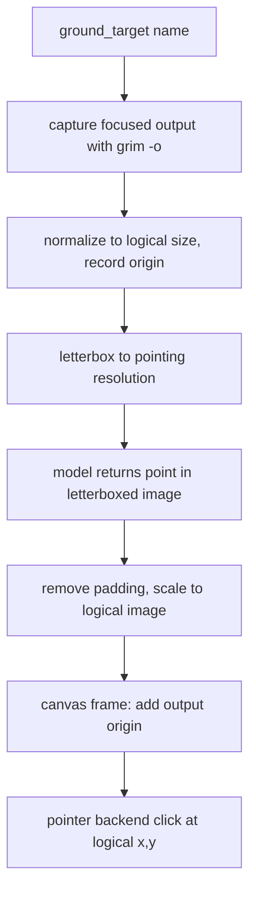
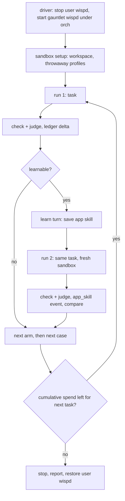

# Wisp gauntlet to v1.0.0 - Plan

**Target repo:** duketopceo/wisp (branch from `master` at 4db4c51).

---

## Goal Capsule

- **Objective:** Wisp clicks where it means to on Luke's two-monitor Omarchy desktop, completes a fixed battery of real app tasks under both the hybrid and the all-OpenRouter configuration, gets better on a second try because it saved and reused an app skill, and has the evidence to call v1.0.0 stable.
- **Means:** fix the click coordinate path first against a deterministic harness (KTD1-KTD3), then drive a cost-capped live gauntlet built on dev tuning mode (KTD5-KTD9), and fix what it finds in a loop (U8).
- **Authority:** Product Contract requirements win on behaviour; Key Technical Decisions win on mechanism; units carry only local detail.
- **Execution profile:** U1-U3 are offline and test-first. U4-U7 add gauntlet machinery with offline tests. U8 is the only unit that runs live paid calls on the real desktop, inside R12-R15.
- **Stop conditions:** stop and ask Luke when total gauntlet spend reaches the cap (R13), when a fix would need re-enabling a retired local unit or pulling a new model (R10), when a run would need a denied action (R15), or when the eval gate can only pass by counting non-owner labels (R20).
- **Who finishes:** agents implement U1-U8 and open PRs; Luke merges, reviews gauntlet turns for owner labels, does the real microphone and reinstall checks, and tags `v1.0.0`.

---

## Product Contract

### Summary

Fix the click path, then run wisp through a live gauntlet of real tasks in sandboxed apps under two configurations, with per-run and total spend caps, a skill-save-then-reuse check per task, and a fix loop, until the v1.0 gate in `ROADMAP.md` can be met.

### Problem Frame

Luke reports wisp's clicks are "way off", and he wants wisp done. Research found a concrete cause: `stage_capture.capture_screen` shrinks every screenshot to logical size (`tools/system.py:_normalize_shot`, active because `magick` is installed), but `grounding.convert` still treats a `frame="shot"` point as a raw grim canvas and divides by the highest monitor scale. On this layout (eDP-1 3456x2160 at scale 2, DP-3 3440x1440 at scale 1), every click aimed by naming a target lands near half the intended coordinates. The tests never run a normalized shot through `convert`, so they pass. Two further faults compound it: the code holds three different models of the grim canvas on mixed-scale layouts, and grounding squeezes the whole-layout image (about 3.6:1) into a 16:9 or 16:10 box before the model sees it.

Beyond clicks, there is no way today to answer "does wisp work?" with evidence. Dev tuning mode runs tasks and judges them, but it cannot type, cannot save or reuse skills, compares only one config key at a time, and its labels do not count toward the v1 eval gate. The v1 gate needs 50 owner-labelled turns at 60% or better, and the historical tally is 30%.

### Key Decisions

- **Hybrid is Luke's configuration; all-OpenRouter is the shipped user default.** Both are first-class and both run every gauntlet case. Governs R8, R9. (session-settled: user-directed — chosen over OpenRouter-only: local small models showed latency and accuracy wins.)
- **Live paid model calls are allowed for the gauntlet, inside the caps.** CI stays offline. Governs R12, R13, R14. (session-settled: user-directed — chosen over no live calls: Luke asked for the gauntlet and to "watch cost".)
- **Eval spend bills the dedicated eval key through `orch`, never the default key.** Governs R14. (session-settled: user-directed — standing rule, chosen over the default OpenRouter key.)
- **Hybrid local models run on the Ollama service already running.** Retired llama.cpp units stay retired unless Luke says otherwise. Governs R10. (session-settled: user-approved — chosen over re-enabling the retired llama.cpp Vulkan units: no retired units come back without asking.)
- **Typing is allowed only inside the gauntlet sandbox.** Send, submit, purchase and delete stay blocked. Governs R15, R16. (session-settled: user-approved — chosen over a click-only gauntlet: search and address-bar tasks need typing.)
- **App set: Omarchy default apps with throwaway profiles and no signed-in accounts.** Governs R17. (session-settled: user-approved — chosen over Luke's real accounts and messaging apps.)
- **Total gauntlet spend cap $10 across both configs, with a per-run stop.** Governs R13. (session-settled: user-approved — chosen over an uncapped run; the eval key has a $50/month cap.)
- **A skill counts only if the second run reuses it and does better.** Governs R18. (session-settled: user-approved — chosen over counting a saved skill alone.)

### Requirements

**Click accuracy**

- R1. A click aimed by naming a target lands on that target's logical coordinates on both monitors, with zero math error for a known model answer.
- R2. Every screenshot-to-logical mapping in wisp agrees on the same mixed-scale layout.
- R3. The image a grounding model sees keeps its aspect ratio, and a target on either monitor can be grounded without squashing the other monitor into the same image.
- R4. A deterministic offline harness proves R1-R3 on the real layout geometry and runs in CI.
- R5. A live click probe measures model grounding error per monitor and per configuration, separately from math error, using targets whose positions are known.

**Gauntlet**

- R6. A battery of real tasks runs unattended on the real desktop and records, per task and per configuration, success, steps, time, spend and the judge's verdict.
- R7. Success is decided by a deterministic check wherever the task allows one, with the vision judge as the fallback.
- R8. Every case runs under the hybrid configuration: local Ollama vision for grounding, OpenRouter for reasoning.
- R9. Every case runs under the all-OpenRouter configuration.
- R10. The hybrid configuration uses only the running Ollama service and models already pulled, unless Luke approves a pull or a retired unit.
- R11. Results produce a ranked list of failures with enough evidence (trace, screenshots, steps) to reproduce each one.

**Cost**

- R12. Each task has a spend stop; a task that hits it ends as stopped and the run continues.
- R13. The gauntlet stops before total spend passes $10, counted across every gauntlet, rerun and live click-probe invocation and including judge calls.
- R14. All gauntlet model spend bills the eval key, and the report shows spend per configuration and per provider from the ledger.

**Safety**

- R15. The gauntlet never sends, submits, purchases, deletes, posts, or acts outside the sandbox workspace; every such gate answers no.
- R16. Typing and key presses are allowed only into a sandbox window.
- R17. Sandbox apps run with throwaway profiles, data, HOME and environment, and gauntlet runs never write Luke's own wisp config, data, skills or labels; the only path into his data is an import he runs himself (R20).

**Skills**

- R18. For each learnable case, the first run saves an app skill and the second run visibly reuses it. A skill win is counted only when run 2 reuses the skill and improves on run 1 (success where run 1 failed, or fewer steps); a case whose run 1 already succeeded in its minimal step count has no headroom and is left out of the skill-win tally. Case pass or fail is decided by run 1's check alone.

**Release**

- R19. Gauntlet failures are fixed in a loop until each configuration passes at least 60% of the held-out cases, or a case is written up as out of scope with a reason.
- R20. Gauntlet turns reach the v1 eval gate only through Luke's own review labels, never through the judge: Luke labels gauntlet turns in the gauntlet data directory, then runs an import that copies only owner-labelled turns and their labels into his own data.
- R21. `ROADMAP.md` records gauntlet results and keeps the stable-release gate wording that `tests/test_shipping_claims.py` pins.

### Success Criteria

- The offline harness shows zero logical-pixel error for a known model answer on both monitors and both capture paths (normalized and raw).
- The live probe's median miss distance falls after U1-U3 compared with the baseline run on master, on both monitors.
- Each configuration passes at least 60% of the held-out cases, and at least half of the learnable cases with headroom count as skill wins.
- Total spend stays under $10, and the report breaks it down per configuration.

### Scope Boundaries

- Other operating systems and the Rust core stay parked (see the multi-OS notes in `docs/research/`).
- No new settings UI; the UI overhaul plan owns that.
- Luke's real accounts, email, messaging and payment flows are not gauntlet targets.
- The judge never writes owner labels.
- Considered and not built: a separate gauntlet daemon alongside Luke's (only one `wispd` may hold the lock, and two would both answer hotkeys); evidence that would change this is an instance-isolation feature landing.
- Considered and not built: automatic post-task skill distillation for normal use. The gauntlet asks for the skill explicitly; making it automatic is a product change to decide after the data.

#### Deferred to Follow-Up Work

- Pulling a Liquid AI LFM vision model into Ollama and adding it as a third hybrid candidate, once Luke approves the download.
- ROADMAP Q3 (replace or drop the `jev` grounding provider): the gauntlet profiles leave `jev` out, and the results inform Q3, but removing the code is its own PR.
- The act-lane per-language TTS voice follow-up from #286.

### Outstanding Questions

- Deferred: which Ollama vision model wins for hybrid grounding (qwen2.5vl:3b or SmolVLM2-2.2B) is settled by running the U3 probe once per candidate model, not now. The hybrid profile starts with qwen2.5vl:3b.
- Deferred: the exact per-task stop (KTD8 starts it at $0.25) may be tuned after the first live run.

---

## Planning Contract

### Key Technical Decisions

- KTD1. **Normalized shots map through the canvas frame.** When `_normalize_shot` ran, a grounding candidate is in logical image space with the shot's origin in `points.SHOT_ORIGIN`, so `ground_target` converts it as `canvas` (origin offset, no scale division) instead of `shot`. The shot carries a flag saying whether it was normalized, so a raw grim capture (no `magick`) keeps the existing scale path. Governs R1.
- KTD2. **One canvas model, owned by `points`.** grim composites every output at the highest scale, so the raw-canvas model is uniform max-scale, as `grounding.convert` already assumes. `points.to_logical` and `verify._frame_rect` move to that same helper, and the per-monitor variant goes. The U1 harness checks the model against a real `grim` capture where one is available. Governs R2.
- KTD3. **Ground one output at a time, letterboxed.** Grounding first captures the output that holds the focused window (falling back to the cursor's output), normalizes it, and pads it to the nearest pointing resolution instead of stretching; mapping back subtracts the padding before scaling. When that output yields no confident candidate, grounding tries each remaining output the same way before refusing, so a target on the other monitor is still reachable. A per-output capture is mapped with that output's own scale and origin (the existing `output` branch of `convert`), never the whole-layout max-scale model, in both the normalized and the raw (no `magick`) path. Governs R3.
- KTD4. **A grounding-only brain override.** A new `[ground] vlm_brain` key lets `_vlm_locate` use a different brain from the act loop, through a config copy whose default is that brain and whose `[brain] fallback` is empty, so a down or slow grounding model raises `ProviderDown` instead of silently falling back to another model. Hybrid sets it to an Ollama vision model with vision enabled; all-OpenRouter sets it to a cheap OpenRouter vision model. A new provider class was considered and rejected because `_vlm_locate` already has the prompt, parser and confidence rule. Governs R8, R9, R10.
- KTD5. **Arm profiles replace the single `--vs` key for gauntlet runs.** A profile is a TOML file of section.key overrides applied by `devrun.run_config` and named in the report (`hybrid`, `openrouter`). Profiles may set safety keys the `--vs` filter refuses (`agents.act_max_usd`, `cua.*`) because they come from a checked-in file, not an IPC peer. Governs R8, R9, R12.
- KTD6. **Gauntlet mode is a dev-run mode, not a new runner.** It reuses the task loop, trace steps, judge and report, and adds three allowances only when the run is a gauntlet run: `type_text` and `key` into sandbox windows (KTD12), `skill_manage` create and edit, and trajectories on. The dev-run deny list and `wait_for_choice=None` (every gate answers no) stay. Governs R15, R16, R18.
- KTD7. **The gauntlet borrows the one daemon slot.** The driver stops Luke's `wispd.service` user unit, starts a gauntlet `wispd` under `orch` with `XDG_DATA_HOME` and `XDG_CONFIG_HOME` pointed at a throwaway directory seeded with a minimal `config.toml`, and restarts Luke's service on every exit path. `platform.dirs()` hardcodes `~/.config/wisp` today, so it learns to honour `XDG_CONFIG_HOME`; without that the gauntlet daemon would read Luke's real config and `.env`. `XDG_RUNTIME_DIR` stays, because Hyprland's socket lives there. Governs R14, R17.
- KTD8. **Spend: per-task stops plus a persistent cumulative cap.** Each profile sets `agents.act_max_usd` (start at $0.25) and `agents.act_max_seconds` (the hybrid arm gets more time for CPU-only grounding) as per-task stops. A spend file in the gauntlet directory accumulates task, judge and click-probe spend across every invocation, and each invocation stops before a task whose stop would cross the remaining $10. Arms interleave per case, so a cap stop leaves both arms equally measured. The judge's key list gains `OPENROUTER_API_KEY` after the omaseal ref, and profiles set `[brain.openrouter] key_env` to `OPENROUTER_API_KEY` only, so the eval key wins over the keyring. Governs R12, R13, R14.
- KTD9. **Cases are JSONL with deterministic checks and a held-out slice.** Each case names its app, sandbox setup, goal, a check (window title regex, file exists in the sandbox, URL host), whether it is learnable, and whether it is held out. Unchecked cases fall back to the judge. Failure ranking for the fix loop uses only the tuning cases; the release pass rate uses only the held-out cases. Governs R6, R7, R11, R19.
- KTD10. **Skill reuse is a trace event.** `context.snapshot` emits an `app_skill` trace event (skill name, how it matched, characters injected) whenever it injects an `[app_skill]` block, so run 2 reuse is observable. Governs R18.
- KTD11. **Owner labels stay owner labels.** Luke labels gauntlet turns with `wispd dev review` run against the gauntlet data directory. A separate import command, run only by Luke, copies owner-labelled gauntlet decisions and their labels into his own data so `wispd eval` counts them; nothing writes `labels.jsonl` automatically. Governs R17, R20.
- KTD12. **Sandbox identity is the driver's own windows, in a locked-down environment.** The typing allowance matches window addresses of processes the driver spawned, never a class or workspace, and is re-checked against the focused window immediately before each keystroke; a mismatch ends the task as stopped. Sandbox apps start with a throwaway HOME and a scrubbed environment (no `OPENROUTER_API_KEY`). The terminal runs a restricted shell that accepts only an allowlist of read-only commands. The run directory lives under the throwaway gauntlet directory, not the repo. Governs R15, R16, R17.

### High-Level Technical Design

Click path after U1-U3:

Gauntlet run, per case and per arm:

### Implementation Constraints

- Tests stay stdlib `unittest`, offline, with `FakeHypr`, `BinDir` and synthetic PNGs; anything needing `grim` or `magick` uses `skipUnless`.
- Live scripts live under `scripts/` with argparse and exit codes 0, 1, 2, each with an offline test file.
- New config keys get `docs/CONFIG.md` and settings-schema entries; keys that widen what a run may do join `ipc.SAFETY_CONFIG_KEYS`.
- Never read key files; the eval key reaches the daemon only as the `OPENROUTER_API_KEY` env var set by `orch`.

### Sequencing

U1, U2, U3 in order (one PR or three). U4 and U5 can run in parallel after U1. U6 needs U4 and U5. U7 needs U6. U8 needs everything and repeats.

---

## Implementation Units

### U1. Deterministic click harness and the normalized-shot fix

**Goal:** Reproduce the halved-click defect offline, then fix it.

**Requirements:** R1, R4. KTD1.

**Dependencies:** None.

**Files:**
- Modify: `wisp/grounding.py` (`Shot`, `ground_target`, `_default_capture`), `wisp/stage_capture.py` (report whether the shot was normalized)
- Create: `tests/test_click_harness.py`
- Modify: `tests/test_ground_chain.py` (keep raw-shot cases as the no-magick path)

**Approach:**
1. Build synthetic PNGs at the real layout and a fake provider that returns a known point in whatever image it was handed.
2. Run them through the real `_normalize_shot` (skip when `magick` is absent) and `ground_target`, with `FakeHypr` monitors from `tests/fixtures/hypr_probe.json` edited to the eDP-1 plus DP-3 layout.
3. Assert the logical point; this fails on master by about half.
4. Carry a normalized flag on `Shot` and convert normalized candidates through the canvas frame.

**Execution note:** Start with the failing harness test on master and record its error in the PR description.

**Patterns to follow:** `tests/test_ground_chain.py` `FrameMath` and `Chain`; `tests/fakes/hypr.py`.

**Test scenarios:**
- Known point at the centre of eDP-1 in a normalized whole-layout shot maps to eDP-1's logical centre.
- Known point on DP-3 at x=1728+100 maps to logical x=1828.
- A raw (not normalized) max-scale shot still maps through the uniform scale path.
- A candidate with `size` smaller than the shot rescales before conversion.
- A negative-origin layout keeps the origin offset.

**Verification:** the harness fails on master and passes after the fix; existing grounding tests pass.

### U2. One canvas model

**Goal:** Every raw-canvas mapping uses the same uniform max-scale model.

**Requirements:** R2, R4. KTD2.

**Dependencies:** U1.

**Files:**
- Modify: `wisp/points.py` (`to_logical`, `_map_px_point`), `wisp/verify.py` (`_frame_rect`), `wisp/grounding.py` (`convert` delegates to the shared helper)
- Modify: `tests/test_points.py` (`ToLogical` expectations)
- Modify: `tests/test_click_harness.py`

**Approach:** Add one helper in `points` for raw-canvas to logical, move all three callers to it, and fix the `ToLogical` expectations that encode the per-monitor model. Where real `grim` and a compositor exist, a skipped-by-default check compares a real capture's size with the model.

**Test scenarios:**
- `to_logical`, `convert` and `_frame_rect` return the same logical point for the same raw-canvas pixel on eDP-1 and on DP-3.
- A point in the dead space below eDP-1 maps off-screen and `points.on_screen` rejects it.
- Single-monitor scale-1 layouts are unchanged.

**Verification:** all coordinate tests agree; `stage_speak` `[POINT]` and drawing mappings use the helper.

### U3. Per-output letterboxed grounding and the live click probe

**Goal:** The model sees one undistorted monitor, and a live probe measures model error.

**Requirements:** R3, R5. KTD3.

**Dependencies:** U1, U2.

**Files:**
- Modify: `wisp/grounding.py` (`resized_pointing` letterboxes, capture picks the output), `wisp/stage_capture.py` (output-scoped capture for grounding)
- Create: `scripts/click_probe.py`, `scripts/probe/targets.html`
- Create: `tests/test_click_probe.py`
- Modify: `tests/test_click_harness.py`

**Approach:**
1. Grounding captures the focused window's output (cursor output as fallback) with `grim -o`, normalizes it, and letterboxes it to the nearest pointing resolution; with no confident hit it tries the remaining outputs (KTD3).
2. The mapping removes padding, scales, and adds that output's origin using that output's scale.
3. `targets.html` is a local page with numbered buttons at known positions; a click sets the window title to the hit button. The probe opens it in a throwaway browser profile on each monitor, asks `ground_target` for each button, clicks, and reads the title through `hyprctl`.
4. The probe writes per-monitor, per-config, per-model miss distance and hit rate to JSONL, takes a grounding-model override so candidates can be compared, adds its spend to the gauntlet spend file (KTD8), and runs a baseline on master first.

**Test scenarios:**
- Letterboxing a 3440x1440 image to 1366x768 keeps aspect, and a point in the padded image maps back exactly.
- A point inside the padding is refused, not clamped onto the image edge.
- Output selection picks the focused window's monitor, then the cursor's.
- A target that exists only on the non-focused monitor is found on the second pass and maps to that monitor's logical coordinates.
- A raw (no `magick`) per-output capture of DP-3 maps with DP-3's scale 1, not the layout's max scale 2.
- The probe's scoring turns a fake title readback into hit, miss and distance rows.

**Verification:** offline tests pass; a live probe run (U8) shows hit rate on both monitors for both configs.

### U4. Grounding brain override for hybrid

**Goal:** Grounding can use a different model from the act loop.

**Requirements:** R8, R9, R10. KTD4.

**Dependencies:** U1.

**Files:**
- Modify: `wisp/grounding.py` (`_vlm_locate`, `settings`), `wisp/config.py` (default `[ground] vlm_brain = ""`, an Ollama vision brain section), `wisp/settings_schema.py`, `docs/CONFIG.md`
- Modify: `tests/test_ground_chain.py`, `tests/test_config_keys.py`

**Approach:** When `[ground] vlm_brain` is set, `_vlm_locate` calls `brain.chat` with a config copy whose default is that brain and whose fallback list is empty (KTD4). Hybrid points it at `ollama:qwen2.5vl:3b-q8_0` with vision on and a longer `fallback_timeout_ms`, because Ollama runs CPU-only here. Empty keeps today's behaviour.

**Test scenarios:**
- Empty `vlm_brain` calls the act brain, as today.
- A set `vlm_brain` calls that brain and leaves the act brain unchanged.
- An unreachable Ollama raises `ProviderDown` and the chain moves on.
- An unreachable Ollama with a `[brain] fallback` configured still raises `ProviderDown`; the fallback brain is never called.

**Verification:** tests pass; `wispd config keys` lists the new key with its category.

### U5. Gauntlet mode in dev runs

**Goal:** Dev runs can carry named arm profiles, type in the sandbox, save and reuse skills, and stop on spend.

**Requirements:** R12, R13, R14, R15, R16, R17, R18. KTD5, KTD6, KTD7, KTD8, KTD10, KTD12.

**Dependencies:** U1.

**Files:**
- Modify: `wisp/devrun.py` (profiles, gauntlet allowances, spend file), `wisp/devjudge.py` (key list gains `OPENROUTER_API_KEY`), `wisp/policy.py` (sandbox typing check), `wisp/context.py` (`app_skill` trace event), `wisp/devreport.py` (named arms, per-provider spend), `wisp/cli/learning.py` (`dev run --profile A --profile B`), `wisp/ipc.py`, `wisp/platform.py` (`dirs()` honours `XDG_CONFIG_HOME`)
- Create: `docs/dev-tasks/profiles/hybrid.toml`, `docs/dev-tasks/profiles/openrouter.toml`
- Create: `tests/test_gauntlet_mode.py`
- Modify: `tests/test_devrun.py`, `tests/test_platform.py`, `docs/DEV_MODE.md`

**Approach:**
1. `run_config` accepts a profile dict; a gauntlet run sets `traj.enabled`, allows `skill_manage` create and edit, and allows `type_text` and `key` only into the sandbox window addresses the run was given, re-checked against the focused window right before each keystroke (KTD12).
2. The run keeps the dev deny list for everything else and keeps `wait_for_choice=None`.
3. The run adds task and judge spend to the persistent spend file, and stops before a task that could cross the remaining cap.
4. The session run limit is raised for gauntlet runs only.

**Test scenarios:**
- A typing step into a registered sandbox window is allowed; the same step into a same-class window that the driver did not spawn is refused and the task ends as stopped.
- Focus moving to another window between the policy check and the keystroke stops the task without typing.
- With `XDG_CONFIG_HOME` set, `platform.dirs()` returns config, `.env` and harness paths under it; unset keeps `~/.config/wisp`.
- Spend recorded by one invocation is still counted by the next.
- A confirm gate in a gauntlet run answers no.
- `skill_manage delete` is refused in a gauntlet run.
- With $0.30 left and a $0.25 per-task stop, the next task runs; with $0.20 left, the run stops and reports why.
- The judge resolves its key from `OPENROUTER_API_KEY` when omaseal is unavailable.
- An injected `[app_skill]` block emits one `app_skill` trace event with the skill name.
- The report shows arms as `hybrid` and `openrouter` and splits spend by provider.

**Verification:** tests pass; a dry gauntlet run against the fake brain produces a report with both arms.

### U6. Gauntlet driver

**Goal:** One command runs the whole gauntlet safely and restores Luke's setup.

**Requirements:** R6, R7, R11, R13, R14, R17, R20. KTD7, KTD8, KTD9, KTD11, KTD12.

**Dependencies:** U4, U5.

**Files:**
- Create: `scripts/gauntlet.py`, `scripts/gauntlet/sandbox.py`, `scripts/gauntlet/rsh` (restricted read-only shell)
- Create: `tests/test_gauntlet_driver.py`
- Modify: `wisp/cli/learning.py` (`wispd dev import-labels DIR`), `tests/test_devreport.py`, `docs/DEV_MODE.md`

**Approach:**
1. Refuse to start unless run under `orch` (the env var is present) and Ollama answers for the hybrid arm.
2. Stop `wispd.service`, start a gauntlet `wispd` with throwaway XDG data and config directories and a seeded minimal config, and restore the service on every exit path.
3. Set up the sandbox: a dedicated workspace; a throwaway browser profile, a file manager on a temp directory, and a terminal running the restricted shell, each started with a throwaway HOME and a scrubbed environment; register their window addresses with the run (KTD12).
4. Interleave arms per case: run 1, check, learn turn if learnable, reset the sandbox, run 2, check, compare.
5. Write a run directory under the gauntlet directory with rows, screenshots and a markdown report ranking tuning-case failures and scoring held-out cases, and print the `wispd dev review` command for the gauntlet data directory.
6. `wispd dev import-labels` copies only owner-labelled gauntlet decisions and their labels into Luke's data, skipping turns already present.

**Test scenarios:**
- Without `OPENROUTER_API_KEY` in the environment the driver exits 2 before stopping any service.
- A crash mid-run still restarts the user service (fake `systemctl`).
- Sandbox child processes see no `OPENROUTER_API_KEY` and a HOME under the gauntlet directory.
- The restricted shell runs `ls` and refuses `curl`, `env`, `rm` and `git push`.
- A window-title check passes and a file-exists check fails, both recorded with the evidence path.
- A learnable case with a better run 2 counts as a skill win; an equal run 2 does not; a run 1 already at minimal steps is excluded from the tally.
- With the cap nearly spent, both arms stop at the same case.
- `import-labels` copies labelled turns once, ignores unlabelled and judge-only turns, and is a no-op on a second run.
- The report ranks failures by count and lists spend per arm.

**Verification:** offline tests pass; a dry run with the fake brain completes and restores the service.

### U7. The case battery

**Goal:** A fixed set of real tasks across the default apps.

**Requirements:** R6, R7, R17, R18.

**Dependencies:** U6.

**Files:**
- Create: `docs/dev-tasks/gauntlet.jsonl`
- Create: `tests/test_gauntlet_cases.py`

**Approach:** About twenty cases across the browser (open a page, search a site, open the browser's own settings page), the file manager (find, open, rename inside the temp directory), the terminal (allowlisted read-only commands), and Hyprland window control limited to the driver's sandbox windows (focus, move between sandbox workspaces, resize). Omarchy menus are opened and closed only, with no typing and no setting applied, because the launcher is not a sandbox window. Each case has a deterministic check where possible, a learnable flag and a held-out flag, with roughly a third held out. No case touches accounts, sends, purchases or deletes.

**Test scenarios:**
- Every case parses, names a sandbox app or the menu open-and-close category, and has a check or an explicit judge fallback.
- No goal contains a send, submit, buy, pay, delete or post verb.
- No menu case asks for typing or for applying a setting.
- Every learnable case names an app with a skill seed or a sandbox class.
- Held-out cases cover every app category.

**Verification:** the case file validates; a dry run walks every case.

### U8. Live runs and the fix loop

**Goal:** Run the probe and the gauntlet live, fix what fails, and reach the release evidence.

**Requirements:** R5, R11, R13, R19, R20, R21.

**Dependencies:** U1-U7.

**Files:**
- Create: `docs/research/2026-11-gauntlet-results.md`
- Modify: `ROADMAP.md` (results; keep the stable-release gate sentence)
- Modify: whichever modules the failures point to, one fix PR per failure class

**Approach:**
1. Baseline the click probe on master, then after U1-U3, for both configs and both candidate hybrid models.
2. Run the gauntlet under `orch` within the cumulative $10 cap.
3. Rank tuning-case failures, reproduce the top class offline as a test, fix it, and rerun only the affected cases.
4. Stop when each arm passes at least 60% of the held-out cases or the remaining failures are written up, or when the cap is reached.
5. Hand Luke the `wispd dev review` command for the gauntlet data, then the `wispd dev import-labels` command, so his labels count toward the eval gate.

**Execution note:** Each fix starts from a failing offline test built from the gauntlet evidence; synthetic fixtures are not live evidence.

**Test scenarios:**
- Test expectation: none -- this unit runs live tooling; each fix PR carries its own tests.

**Verification:** the results doc shows probe hit rates, per-arm pass rates, skill wins and spend under $10; ROADMAP keeps `tests/test_shipping_claims.py` green.

---

## Verification Contract

| Gate | Command or check | Applies to |
|---|---|---|
| Unit tests | `python -m unittest discover -s tests -v` | every unit |
| Compile check | `python -m py_compile wispd wisp/*.py wisp/tools/*.py tests/*.py` | every unit |
| Config docs | `tests/test_config_keys.py`, `tests/test_settings_schema.py` | U4, U5 |
| Shipping claims | `tests/test_shipping_claims.py` | U8 |
| Required CI | unit 3.11, unit 3.13, plugin, rust | every PR |
| Live click probe | `orch python scripts/click_probe.py` per arm | U3, U8 |
| Live gauntlet | `orch python scripts/gauntlet.py --profiles hybrid,openrouter --cap 10` | U8 |

---

## Definition of Done

- U1-U7 merged with offline tests; CI green on master.
- The probe and the gauntlet ran live under both configs within $10, and the results doc records hit rates, pass rates, skill wins and spend.
- Each arm passes at least 60% of cases, or each remaining failure is written up with a reason.
- Luke has the review and import commands; the eval gate counts only his labels.
- Luke's `wispd` service and data are as they were before every run.
- No abandoned experimental code is left in the diff.

---

## Appendix

### Sources

- Capture normalization: `wisp/stage_capture.py:capture_screen`, `wisp/tools/system.py:_normalize_shot`.
- Conversion: `wisp/grounding.py:convert`, `ground_target`, `Shot.resized_pointing`, `pick_pointing_resolution`.
- Canvas models: `wisp/points.py:to_logical`, `canvas_to_logical`, `SHOT_ORIGIN`; `wisp/verify.py:_frame_rect`.
- Dev mode: `wisp/devrun.py`, `wisp/devjudge.py`, `wisp/devreport.py`, `wisp/devsession.py`, `docs/DEV_MODE.md`.
- Skills: `wisp/skills.py`, `wisp/context.py`, `wisp/trajectories.py`, `docs/research/app-skill-format.md`.
- Spend: `wisp/ledger.py`, `agents.act_max_usd` in `wisp/act.py`.
- Gate: `wisp/learn.py:eval_report`, `ROADMAP.md` v1.0 gate, `docs/INSTALL.md` release checklist, `docs/EVAL-DATA.md`.
- Scoring-harness template: `scripts/lfm_eval.py` on `spike/lfm-local` (PR #239).
