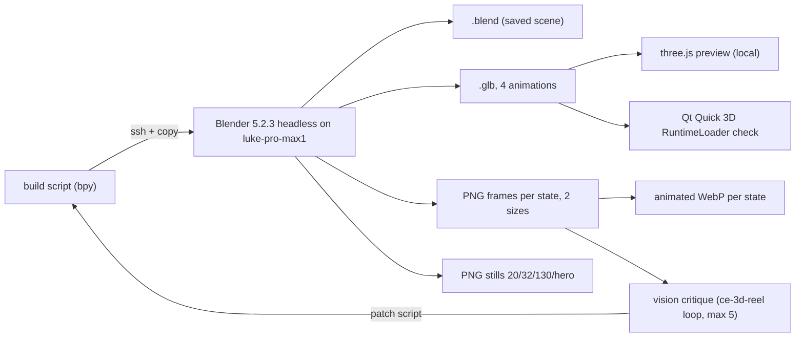

# Wisp Flame 3D Asset - Plan

## Goal Capsule

- **Objective:** Wisp has one finished 3D mark, a translucent flame with a bright heart in the guide-light colors, that reads as Wisp from a hero image down to a 20 px bar icon, with an idle loop and listening, thinking and speaking states ready for the web and the desktop to adopt.
- **Product authority:** this Product Contract. The silhouette was chosen from live sketches on 2026-11-01 (option C2).
- **Means:** a scripted Blender scene, rendered headless on the M1 Max Mac, exported to glTF for live 3D and to animated WebP and PNG for everything else (KTD1–KTD4).
- **Open blockers:** none. Blender has no Linux ARM64 build, so it runs on `luke-pro-max1` (Homebrew cask) over SSH.
- **Stop conditions:** stop and report if Blender cannot run headless on the Mac, if a state cannot be told apart from idle at 32 px after the critique loop's iteration cap, or if the glTF will not load in Qt Quick 3D or three.js.
- **Execution profile:** `code`, interactive owner available for the visual sign-off; everything else hands-off.
- **Who finishes:** `ce-work` builds and verifies, `lfg` reviews and opens the PR; the owner merges.
- **Not active scope:** wiring the asset into the lock screen, the desktop overlay, the bar or the site. Those are later work.

---

## Product Contract

### Summary

Build Wisp's 3D mark as one master asset: the C2 "flame with a heart", a translucent flame shell around a bright core, in the existing guide-light palette. It ships with a calm idle loop and three state variants (listening, thinking, speaking), in forms both the web and the local desktop can use later.

### Problem Frame

Wisp's identity today is a 2D guide light on the web (`site-3d/light/`), a decorative 2D orb on the lock screen, and an ember triangle for the cursor buddy. None is a single ownable mark, and none works as a fully rendered 3D object. The owner wants a real 3D Wisp that the web and the desktop can share.

### Key Decisions

- **Shape: C2, a translucent flame with a bright heart.** (session-settled: user-directed — chosen over a sphere orb, a vertical faceted diamond, a clean solid flame, a cut-gem flame and a clear crystal with a core, after two rounds of live sketches: it reads as light rather than a solid object.) Governs R1, R2.
- **The asset first; surfaces later.** (session-settled: user-directed — chosen over shipping it to the lock screen and overlay first, the web first, or both at once.) Governs R9.
- **Idle plus key states.** (session-settled: user-directed — chosen over idle only and over the full state set: idle, listening, thinking and speaking now; acting, error and needs-you later.) Governs R5–R8.
- **Guide-light palette unchanged:** cyan `#7dcfff` core, deep blue `#295f85` mid, on near-black `#0b0c11`. Governs R3.

### Requirements

**The mark**

- R1. Wisp is a vertical flame: a rounded base that tapers to a fine point, with a translucent shell.
- R2. A bright core sits inside the shell, below its middle, and is visible through it, so the mark reads as light rather than a solid.
- R3. Colors come from the guide-light palette: cyan core and rim, deep blue mid, designed for a near-black background.
- R4. The silhouette stays recognizable as the same flame at 20 px (bar), 32 px (cursor), about 130 px (lock-screen orb) and hero size on the web.

**Motion and states**

- R5. Idle: the tip sways gently like a candle, the heart breathes slowly, and a soft wisp trails from the tip. It loops seamlessly.
- R6. Listening: visibly more attentive than idle (for example a brighter heart and a steadier, upright tip), distinguishable from idle at 32 px.
- R7. Thinking: visibly busy without alarm (for example a faster inner flicker or a slow swirl in the heart), distinguishable from listening at 32 px.
- R8. Speaking: the heart pulses in a way that could follow speech; for this asset, a representative loop is enough.

**Deliverables**

- R9. One master source the owner can reopen and change (a Blender file kept in the wisp repo), from which every other form is produced.
- R10. A real-time 3D form that both a web 3D renderer and the desktop's 3D runtime can load.
- R11. Rendered loops for each state, with a transparent background, for surfaces where live 3D is too heavy.
- R12. Still images at the small sizes in R4, so the bar and cursor can use the mark without any 3D.

### Success Criteria

- Side by side at 20 px and 32 px, the owner can tell the four states apart and still sees the same flame.
- Each loop plays without a visible jump at the loop point.
- The real-time form loads in a three.js page and in a Qt Quick 3D scene on omarchy-max without errors.

### Scope Boundaries

- Not wiring the asset into the lock screen, the desktop overlay, the bar pill or the site.
- No acting, error or needs-you states yet.
- The ember cursor buddy stays as it is until surface work replaces it.
- No new palette and no other brand work.

### Dependencies and Assumptions

- Blender 5.2.3 runs on the M1 Max Mac (`luke-pro-max1`, Homebrew cask, Metal GPU) over SSH. blender.org ships no Linux ARM64 build and Arch Linux ARM has no package.
- The local skill `ce-3d-reel` (in luke-agents `_LUKE/`) supplies the headless Blender render, critique and fix loop.
- Qt Quick 3D 6.12 with its asset loader, and Qt Multimedia, are installed on omarchy-max.

**Product Contract preservation:** Product Contract unchanged except the Dependencies line, corrected to where Blender actually runs.

### Sources

- Live sketches (local only, not committed): `ce-brainstorm-visual/wisp-diamond` round one (sphere, diamond, flame, diamond wisp) and round two (C1, C2, D1, D2).
- Existing light identity: `site-3d/light/DESIGN.md` and `docs/plans/2026-10-31-1414-feat-wisp-light-orb-plan.md` (guide tokens, core, wispy tail, breathing glow).

---

## Planning Contract

### Key Technical Decisions

- KTD1. **The bpy build script is the source of truth; the `.blend` is a saved output of it.** The script rebuilds the scene from nothing, so changes are reviewable as text, and the committed `.blend` (R9) lets the owner open and tweak it in Blender. If the owner edits the `.blend` by hand, the script stops being authoritative and the README says so.
- KTD2. **Render on the Mac over SSH.** A small runner copies the script to `luke-pro-max1`, runs `Blender --background` there, and copies the outputs back. No Linux build exists, and the Mac's Metal GPU makes EEVEE practical.
- KTD3. **Motion as shape keys plus transforms, one glTF animation per state** (`idle`, `listening`, `thinking`, `speaking`). Each state is one NLA track of that name holding the per-object actions (shell shape keys, heart, tail spheres), exported with the glTF animation mode `NLA_TRACKS`. In the `.glb`, states differ only through transform and morph-weight channels (heart scale amplitude and rate, tip bend weight and rate, tail spacing), because glTF players do not animate material values. Emission-strength keys (a brighter heart, a speaking pulse) exist only in the Blender renders and so only in the loops. Every state loops over the same frame count so a player can cross-fade.
- KTD4. **Loops are animated WebP with alpha; stills are PNG.** Qt's `AnimatedImage` plays WebP with transparency (qt6-imageformats is installed) and Chromium does too, so one format serves both without a video pipeline. Two sizes per state: 64 px (bar and cursor at 2x) and 256 px (lock orb at 2x). Pillow is the only WebP encoder on omarchy-max (no `img2webp`/`cwebp`), and it writes animated RGBA WebP; encode lossy with alpha at a modest frame rate so the budgets in KTD6 hold. PNG frame sequences are intermediate and not committed.
- KTD5. **glTF materials approximate the look; renders carry the full look.** The shell is an alpha-blended emissive material with depth write off; the heart is an opaque emissive sphere with `KHR_materials_emissive_strength`, so players draw the heart first and blend the shell over it (a blended heart would break the see-through). The Fresnel rim exists only in the Blender renders (Layer Weight node), so live 3D is slightly flatter than the loops. Surfaces that need the exact look use the loops.
- KTD6. **Size budgets (no Git LFS in this repo):** `.glb` ≤ 1.5 MB, each 256 px WebP ≤ 400 KB, each 64 px WebP ≤ 120 KB, `.blend` ≤ 5 MB, the whole asset folder ≤ 10 MB. A test enforces them.
- KTD7. **Verification viewers stay out of the product.** The three.js preview page and the Qt check live with the asset, not in `site-3d/` or `shell-plugin/`, because surface wiring is out of scope. The preview imports the vendored three 0.170.0 plus its matching `GLTFLoader`, vendored next to the preview with provenance.

### High-Level Technical Design



### Output Structure

```text
assets/brand/wisp-flame/
  README.md                 what each file is, how to rebuild, provenance
  source/build_flame.py     bpy scene + states (source of truth)
  source/wisp-flame.blend   saved scene
  export/wisp-flame.glb
  export/loops/{idle,listening,thinking,speaking}-{64,256}.webp
  export/stills/wisp-flame-{20,32,130,512}.png
  preview/index.html        local three.js viewer (not shipped)
  preview/vendor/GLTFLoader.js (+ helpers, provenance)
  preview/qt-check.qml      Qt Quick 3D load check
scripts/brand/render_wisp_flame.sh   remote Blender runner + WebP assembly
tests/test_wisp_flame_asset.py
```

### Assumptions

- Homebrew's Blender cask installs without an admin password and runs headless over SSH (`/Applications/Blender.app/Contents/MacOS/Blender --background`).
- `img2webp` or Pillow can write animated WebP with alpha on this machine; the runner uses whichever exists.
- Qt Quick 3D's `RuntimeLoader` loads the glTF geometry and materials; whether it plays the animations is checked, not assumed (KTD4 covers the desktop either way).

---

## Implementation Units

### U1. Flame scene build script

**Goal:** a bpy script that builds the C2 flame scene from nothing and saves the `.blend`.
**Requirements:** R1, R2, R3, R9; KTD1, KTD3.
**Dependencies:** none.
**Files:** `assets/brand/wisp-flame/source/build_flame.py`, `assets/brand/wisp-flame/source/wisp-flame.blend`.
**Approach:**
1. Shell: the sketch's flame profile revolved in code into explicit vertices and faces (no Screw or other modifier, so the shape key and the glTF morph target survive export), smooth-shaded, translucent material with a Layer Weight rim in cyan over the deep-blue mid.
2. Heart: an emissive sphere below the shell's middle, visible through it.
3. Tail: three to five small emissive spheres above the tip that trail the bob.
4. Shape key `bend` for the tip; four NLA tracks (`idle`, `listening`, `thinking`, `speaking`) of equal length that loop, each holding that state's per-object actions (KTD3).
5. Camera, near-black world, EEVEE settings; render settings come from the runner's CLI, not the script.
**Execution note:** low-level `bpy.data` APIs, not `bpy.ops`, per the ce-3d-reel skill, so it runs headless.
**Patterns to follow:** `~/Documents/github/personal/luke-agents/_LUKE/ce-3d-reel/SKILL.md` (scene-script rules); the sketch at `/tmp/compound-engineering-1000/ce-brainstorm-visual/wisp-diamond/screens/002-flame-or-cut.html` (profile, proportions).
**Test scenarios:**
- Running the script in a fresh Blender exits 0 and saves a `.blend` containing objects for the shell, the heart and the tail.
- The `.blend` holds exactly four NLA tracks named for the states, all with the same frame range.
- The shell mesh has a `bend` shape key.
**Verification:** a mid-frame still of each state renders and passes the critique rubric (U2).

### U2. Remote runner and critique loop

**Goal:** one command renders everything on the Mac and brings it back.
**Requirements:** R4–R8, R11, R12; KTD2, KTD4.
**Dependencies:** U1.
**Files:** `scripts/brand/render_wisp_flame.sh`.
**Approach:**
1. Copy the build script to the Mac, run Blender headless to build the scene, save the `.blend`, export the `.glb` (animation mode `NLA_TRACKS`) and render, then copy outputs back. The runner is the only producer of everything under `export/`.
2. Render each state's loop as PNG frames at 64 and 256 px, plus stills at 20, 32, 130 and 512 px.
3. Assemble each frame set into an animated WebP with alpha.
4. Critique mid-loop stills of every state at 32 px and 256 px against a written rubric: same flame across states, states distinguishable, loop seam invisible, heart visible through the shell. Patch the script, never the frames, at most five rounds.
**Test scenarios:**
- Test expectation: none for the shell plumbing -- verified by running it end to end; the outputs are tested in U4.
**Verification:** the runner produces every file in the Output Structure's `export/` and exits 0.

### U3. glTF export and viewers

**Goal:** the `.glb` loads in three.js and Qt Quick 3D.
**Requirements:** R10; KTD3, KTD5, KTD7.
**Dependencies:** U1, U2.
**Files:** `assets/brand/wisp-flame/export/wisp-flame.glb`, `assets/brand/wisp-flame/preview/index.html`, `assets/brand/wisp-flame/preview/vendor/` (GLTFLoader 0.170.0 and its helper modules, with a provenance note), `assets/brand/wisp-flame/preview/qt-check.qml`.
**Approach:**
1. Check that the `.glb` the runner exported carries the morph target and the four animations.
2. The preview page imports `site-3d/vendor/three.module.js` and the vendored loader, shows the model, and switches states with four buttons. It shows a still image when WebGL is off.
3. The Qt check opens a short-lived window in the live Hyprland session (Quick 3D needs a real GPU backend; the offscreen platform cannot render it), loads the `.glb` with `RuntimeLoader`, prints its status and any error, and quits.
**Test scenarios:**
- The preview page, opened headless in Chromium with software GL, logs that the model loaded and lists four animation names.
- The Qt check, run in the live session, prints a successful `RuntimeLoader` status.
**Verification:** both checks pass on omarchy-max; the owner views the preview in Chromium.

### U4. Asset tests, budgets and README

**Goal:** the asset stays valid and small.
**Requirements:** R4, R9–R12; KTD6.
**Dependencies:** U2, U3.
**Files:** `tests/test_wisp_flame_asset.py`, `assets/brand/wisp-flame/README.md`.
**Approach:** parse the `.glb` header and JSON chunk (no extra dependencies), read WebP and PNG with Pillow, and check each budget in KTD6.
**Test scenarios:**
- The `.glb` is valid binary glTF 2.0 with exactly the animations `idle`, `listening`, `thinking` and `speaking`, at least one morph target, and each animation targeting more than one node (states were not merged).
- Each state has a 64 px and a 256 px WebP that is animated (more than one frame) and has an alpha channel.
- The stills exist at 20, 32, 130 and 512 px with alpha.
- Every file is within its KTD6 budget, and the folder total is at most 10 MB.
- The README names the build command, the source of truth (KTD1) and provenance for vendored files.
**Verification:** the new tests pass in the keyless suite.

### U5. Owner sign-off

**Goal:** the owner confirms the flame and its states read right.
**Requirements:** R4–R8 and the Success Criteria.
**Dependencies:** U3, U4.
**Files:** none committed.
**Approach:** open a local comparison page in Chromium: all four states side by side at 20, 32, 130 and 256 px, plus the live preview. Never publish it as an Artifact.
**Test expectation:** none -- a human visual sign-off.
**Verification:** the owner says it reads right, or names what to change, which loops back to U1.

---

## Verification Contract

- Keyless suite: `env -u OPENROUTER_API_KEY -u GROQ_API_KEY HOME=$(mktemp -d) PYTHONPATH=tests python3 -m unittest discover -s tests`. Known local failures `test_snap` WhatsNewCard__headline and `test_voice_polish` voice_usable are unrelated.
- `rs/` and `tests/fixtures/ipc_commands.jsonl` unchanged; `wisp/act.py`, `wisp/route.py`, `wisp/stage_route.py` untouched.
- The runner (U2), the preview check and the Qt check (U3) pass on omarchy-max with `luke-pro-max1` reachable.
- Visual review pages are local only.

## Definition of Done

- Every file under `export/` and `source/wisp-flame.blend` exists and is produced by the runner from the build script; the other Output Structure files exist.
- The new tests pass; the budgets hold.
- The owner signed off on the states at small sizes (U5).
- No leftover experimental renders, scratch scripts or unused exports in the diff.
