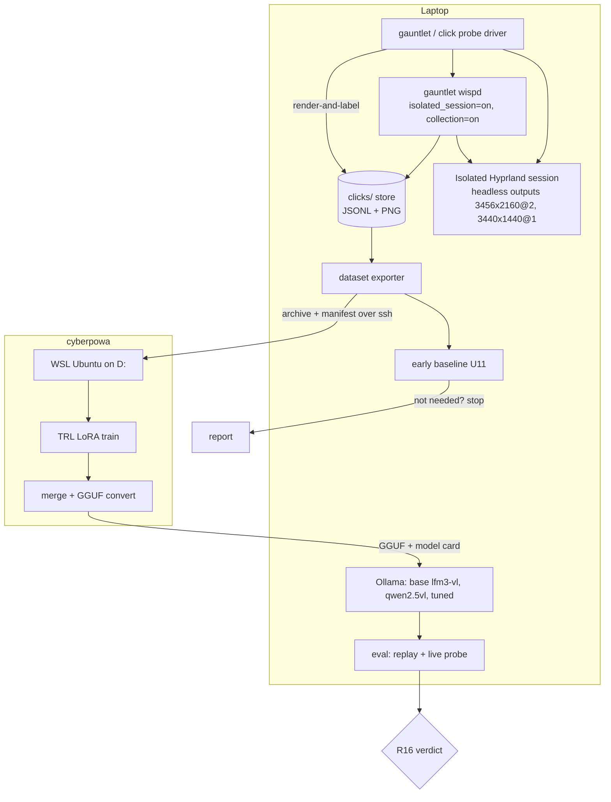
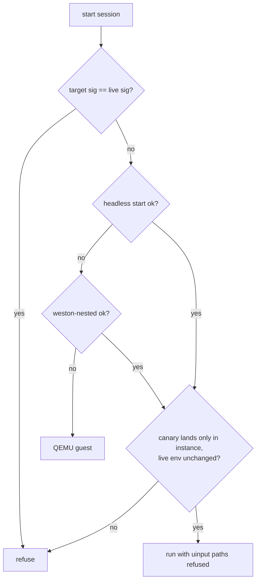

# Wisp Grounding Post-Training - Plan

## Goal Capsule

- **Objective:** a measured answer, on held-out clicks the model never trained on, to whether a fine-tuned local model clicks the right spot on the owner's own apps, themes and HiDPI layout well enough to become the owner's default grounding model. Switching the default is a follow-up.
- **Means:** collect labelled clicks in an isolated test session, fine-tune LFM3-VL-2B with a LoRA on the owner's Windows GPU box, and serve the result back to the laptop as a `[ground] vlm_brain` arm (KTD1, KTD7, KTD9).
- **Authority:** the owner's settled decisions in Key Decisions win over this plan. R-IDs win on behaviour; KTDs win on mechanism.
- **Stop conditions:** stop and report in any of these cases:
  - the isolated session cannot be made input-safe (R5);
  - the training box cannot fit the model even after lowering the image cap and batch size and falling back to LFM2.5-VL-1.6B (R10, R11);
  - the early baseline (U11) shows a base model already above the "not needed" bar;
  - the R16 gate says no-go.
- **Execution profile:** code units ship as wisp PRs with offline tests. U7, U11 and U12 are runbook-plus-script units that run on hardware. Live runs need the owner only for the approvals listed under Dependencies.
- **Who finishes:** agents implement and open PRs; the owner merges and gives the listed approvals.

---

## Product Contract

### Summary

The plan adds:
- an isolated, invisible Hyprland test session that the gauntlet and click probe can drive without touching the owner's desktop;
- labelled-click collection inside that session;
- a dataset exporter;
- a training runbook for the cyberpowa box;
- an eval harness.

The eval harness decides whether a fine-tuned LFM3-VL-2B beats both its base model and the current `qwen2.5vl:3b`. Dayflow screen captures feed a second phase only, as scrubbed text-position examples.

### Problem Frame

Wisp's clicks were badly off. PR #292 fixes the coordinate bug behind most of that, but the hybrid arm still depends on a small local vision model pointing at the right element. Generic models learn from web and mobile screenshots, not from Omarchy themes, Hyprland layouts, or a 3456x2160 scale-2 panel beside a 3440x1440 ultrawide.

None of wisp's existing data can teach a model to click better:
- wisp never stores the image a grounding model saw, or the point it answered;
- screenshots live in a 100-file ring;
- click steps carry a target name, with no coordinates or verified outcome;
- dayflow holds 57k frames but records no actions or targets.

Live testing also needs the owner's desktop. The gauntlet takes over the screen, and it sends key presses, scrolls and some clicks through `ydotool` (uinput), which reaches whatever session holds the physical seat. The owner is often on the laptop, so testing has to move into an isolated session first.

### Key Decisions

- **Click collection is in scope.** wisp records labelled clicks so test runs build a training set. Governs R1, R2, R3, R4. (session-settled: user-approved — chosen over training without new instrumentation: no existing wisp data carries click coordinates or outcomes)
- **Testing runs in an isolated Hyprland session on the laptop, not a full VM.** Governs R5, R6, R7. (session-settled: user-approved — chosen over a QEMU VM: lighter on Asahi, and it exercises the real Hyprland/Lua stack; the VM stays a fallback)
- **Dayflow data is copied only as a justified, scrubbed subset, in a second phase that follows phase 1's measured verdict.** Governs R17, R18. (session-settled: user-approved — chosen over copying the full 15 GB now: dayflow has no click labels, so it only helps as OCR-derived text targets)
- **Free C: on cyberpowa by moving the WSL distro to D: first. Uninstall Steam games only if still needed, from a list the owner confirms.** Governs R10. (session-settled: user-approved — chosen over uninstalling games first: the move is reversible and may be enough)
- **Personal use only. Tuned weights are never published or shipped to wisp users.** Governs R19.
- **Downloading the base model to the laptop is approved.** Governs R13.

### Requirements

**Click collection**
- R1. Each collected click records the image the grounding model is sent (clean, before the coordinate grid), the sent-image geometry, the target text and its known or verified rect, the output name and scale, and the label source. When a model was asked, the record also holds the model id, its raw answer and point, the mapped global point, and the backend used.
- R2. Collection runs only in isolated-session runs (gauntlet and click probe). It is a run-copy setting that agents and marked peers cannot switch on. The owner's live desktop is never collected in v1.
- R3. Stored records are private (0700 dirs, 0600 files), pass deny-list window redaction and text scrubbing, and are pruned by count and age.
- R4. Training labels come from known geometry, never from a model's own answer. Probe rows use the page's known target rect whether or not any model hit it. Gauntlet rows are used only when a post-click check confirms the element under the click matches the target, and their label is that element's rect.

**Isolated test session**
- R5. The gauntlet and click probe can run against a second, invisible Hyprland instance. Its input, screenshots and windows never reach the owner's live session. Any input path that could reach the live seat is refused, never silently used.
- R6. The isolated session presents two outputs that match the owner's layout: 3456x2160 at scale 2 and 3440x1440 at scale 1.
- R7. Starting and stopping the isolated session leaves the owner's systemd user environment, D-Bus session and running `wispd.service` unchanged.

**Dataset and training**
- R8. An exporter turns collected records into a fine-tuning dataset with:
  - a fixed prompt and a fixed coordinate format;
  - a held-out split by page family and session;
  - deduplication;
  - a manifest with a content hash and per-source counts.

  A training set under 2,000 examples, or a held-out set under 300, is reported as too small to train on.
- R9. Click-probe pages cover varied targets on both outputs, so training is not nine buttons memorised: text, icons, small controls, dense layouts, and light and dark themes.
- R10. The cyberpowa training environment (WSL Ubuntu, CUDA, Python stack, caches, checkpoints) lives on D:, and C: is left with working headroom.
- R11. A 20-step dry run measures peak VRAM before any full training run.
- R12. Every trained adapter ships with a model card naming the dataset hash, base model and revision, prompt version, coordinate format and image cap.

**Serving and evaluation**
- R13. The base LFM3-VL-2B, the incumbent `qwen2.5vl:3b` and the tuned model are all served on the laptop and selectable per run through `[ground] vlm_brain`.
- R14. Before any A/B, the served GGUF model's answers match the training-framework model's answers on a fixed sample (conversion parity).
- R15. One eval command scores any set of grounding models on the held-out clicks, per output and per text/icon kind:
  - hit rate (the point lies inside the target rect);
  - median pixel error;
  - p50 latency.
- R16. Go requires all of the following:
  - on at least 300 held-out probe clicks, the tuned model's hit rate is at least 10 points above base LFM3-VL-2B, at least 85%, and at least equal to `qwen2.5vl:3b`;
  - on the real-app held-out set (R20), its hit rate is at least equal to the better baseline;
  - its p50 latency is no more than 1.25x that of the faster baseline.

  The other verdicts:
  - **not needed:** any baseline scores above 90% on both held-out sets;
  - **insufficient data:** either set is below its minimum (R8, R20);
  - **no-go:** anything else.
- R20. A real-app held-out set of at least 100 targets, taken from the gauntlet sandbox apps (browser, file manager, terminal) in the isolated session, with rects from the app's accessibility tree on the private bus. Where no tree is available, rects are hand-labelled once and owner-reviewed. It is never used for training.

**Phase 2 (gated)**
- R17. Dayflow frames from an owner-approved allowlist of apps become text-position examples (OCR text boxes turned into "click X" pairs). Each frame is cropped to the app's window, ambiguous duplicate text is dropped, and secrets are scrubbed.
- R18. Only the filtered, cropped, scrubbed subset is copied to cyberpowa, after the owner reviews a random sample. It travels as an archive with a checksum manifest, and the staging copy is deleted after verification.

**Privacy and licence**
- R19. Training data, adapters and merged weights stay on the owner's machines; nothing is uploaded or published.

### Success Criteria

- The R16 verdict is decided on real numbers, whichever way it goes, and the report is committed under `docs/research/`.
- A full isolated gauntlet and click-probe run completes while the owner keeps using the laptop, with no stray input, window or notification on the live session.

### Scope Boundaries

- Training on personal facts, habits, routing or app procedures: those stay in skills and memory.
- Shipping tuned weights, or click collection, to wisp users.
- GRPO or reinforcement fine-tuning: a later step once SFT has a measured result.
- Changing the openrouter arm or the act model.
- **Collecting clicks from the owner's live desktop in v1.** Considered and not built: live screens show other windows' text that deny-list redaction does not cover. Revisit if isolated-session data proves too narrow.
- **A user-facing setting for click collection.** Considered and not built: nothing in v1 would use it.
- **An LFM2.5-VL-3B baseline.** Considered and not built: no gate needs it. Add it if the owner wants the comparison (see KTD7).
- **Validating isolated-session results on the real monitors.** Considered and not built here: the click-probe baseline on the real desktop (PR #290's U8) covers real-monitor quirks once the owner is available.

#### Deferred to Follow-Up Work

- Folding these results into the v1.0.0 gauntlet results doc (PR #290 plan, U8).
- Promoting a GO model to the hybrid default in `docs/dev-tasks/profiles/hybrid.toml` and wisp's shipped config.

---

## Planning Contract

### Key Technical Decisions

- KTD1. **v1 data comes only from isolated sessions.** Collected clicks come from the isolated Hyprland instance (probe pages and gauntlet sandbox apps), which holds nothing private. Governs R1-R4 with the Key Decision on click collection.
- KTD2. **A dedicated click store, not trace.jsonl.** A new module writes to `clicks/` under the run's data dir: one JSONL row per click plus one PNG per image. A context variable carries `_vlm_locate`'s sent image, geometry, raw point and model id to `ground_target`/`_grounded` and to `tools/system.py::_pointer`, joined on the trace turn id. trace.jsonl clips fields at 8 KB and rotates, so it cannot hold images.
- KTD3. **Store the clean image and the exact geometry.** `tools/system.py::_normalize_shot` bakes a red grid into the grounding shot. The store keeps the pre-grid, post-resize image plus the transform to the sent image. Training and serving share one resize function (KTD8), so the model is trained on exactly the geometry it is served.
- KTD4. **Labels come from known geometry.** A probe page knows every target's rect, so every probe screenshot is a labelled example with or without a model call. U5's render-and-label mode writes such rows directly, at no model cost. Gauntlet rows need the post-click check (`grounding.target_at_point` against the target text). They are labelled with that element's rect when it matches, and are otherwise kept for eval only as `unverified`.
- KTD5. **The isolated session is a second Hyprland with headless outputs, behind a smoke-test gate.**
  - **Launch environment:** `DISPLAY` and `WAYLAND_DISPLAY` unset, `HYPRLAND_NO_SD_VARS=1`, `HYPRLAND_NO_SD_NOTIFY=1`, a private `XDG_RUNTIME_DIR`, a private D-Bus via `dbus-run-session`, and a test-only Lua config with `xwayland` off.
  - **Outputs:** two headless outputs created through the instance socket.
  - **Never start from a tty:** that contends for DRM master.
  - **Fallbacks, in order, if smoke fails:** Hyprland nested in a headless weston (package install, owner OK), then a QEMU/KVM guest (`/dev/kvm` and `qemu-system-aarch64` are present).
  - Session-settled: see the Key Decision on testing.
- KTD6. **Instance-scoped input only, through a bundled virtual-pointer client.** The run-copy key `[dev] isolated_session` changes input handling:
  - every uinput path raises: `ydotool` clicks, keys, scroll, the typing fallback, and the `hyprcursor` backend's ydotool click;
  - the `cua` backend is excluded, because its daemon is bound to the live compositor;
  - pointer motion, buttons and scroll go through a small stdlib-only `zwlr_virtual_pointer_v1` client shipped in wisp, which speaks the Wayland wire protocol on the instance socket and needs no package install;
  - keys use `wtype`, which is installed.

  The driver also refuses to start when the target signature equals the live one, and runs U2's canary before any case.
- KTD7. **LFM3-VL-2B is the model to tune; base LFM3-VL-2B and `qwen2.5vl:3b` are the baselines.** LFM3-VL-2B reports ScreenSpot-v2 89.9-95.5, against 80.7 for LFM2.5-VL-3B. It has an official Ollama entry and a Liquid TRL SFT recipe, and fits 12 GB in bf16. (session-settled: user-approved — chosen over starting small and working up, as "3B first, fall back smaller". The 3B in that choice was LFM2.5-VL-3B; research then found the newer, smaller LFM3-VL-2B scoring higher, so the "largest that fits" intent now points at LFM3-VL-2B. **Conflict call-out:** if the owner wants LFM2.5-VL-3B trained or baselined anyway, add it to U11 and U7; nothing else changes.)
- KTD8. **One prompt, one coordinate format and one resize, owned by `wisp/groundfmt.py`.**
  - **Prompt and answer:** the tuned model gets a fixed instruction and answers `click(x, y)` with integers 0-1000 relative to the sent image.
  - **Images:** capped at 1280 px on the long side per output, unpadded, matching Liquid's LFM3-VL recipe.
  - **Shared code:** the exporter, the trainer and wisp's inference path import the same module, versioned by `prompt_version`.
  - **Inference:** for a brain marked as groundfmt, `_vlm_locate` uses this resize instead of its fixed 1024x768 / 1280x800 / 1366x768 letterbox. It decodes `click(x, y)` as 0-1000 and sets confidence 0.9 when the answer parses and lies inside the image, else 0, so `min_confidence` admits only well-formed answers.
  - **Baselines** keep their native prompt and parsing, so they are scored fairly.
- KTD9. **Serving is Ollama, with llama-server as the fallback.** wisp already has `kind = "ollama"` and `kind = "openai_compat"` brains.
  - **Base model:** `ollama pull lfm3-vl:2b-q8_0`. This needs Ollama v0.40.12 or newer; the laptop has 0.35.1, so U12 upgrades it first (owner OK).
  - **Tuned model:** imported with `ollama create` from the GGUF.
  - **Fallback:** if that import fails, the eval script starts a one-off `llama-server` process on a spare port, used as an `openai_compat` brain. It is never a systemd unit; the retired local-model units stay retired.
- KTD10. **The training stack follows Liquid's pinned LFM3-VL TRL notebook.**
  - **Packages:** torch 2.14.1 (cu128-or-newer build), trl 1.16.0, transformers 5.20.2 (resolve against the card's >=5.21.0 in the dry run), peft 0.21.2.
  - **Method:** bf16 LoRA r=16 on the language model only, with the vision tower frozen and sdpa attention.
  - **Not used:** 4-bit, and flash-attn (FA2 builds only from source on sm_120, and nvcc segfaults under WSL2 CUDA 12.8/12.9).
  - **mmproj:** with the vision tower frozen, the stock mmproj GGUF is reused.
  - **Model files:** the model repo and its `trust_remote_code` files are pinned to one commit hash, downloaded once, reviewed, then loaded from the local path with `HF_HUB_OFFLINE=1`. The models are public, so no Hugging Face token is used.
- KTD11. **Move the WSL distro, then decide on games.**
  1. `wsl --export Ubuntu` to a tar on D: as the rollback.
  2. `wsl --manage Ubuntu --move D:\wsl\Ubuntu` (WSL 2.6.3 supports it). A move keeps one registration, so nothing is unregistered.
  3. Check the moved distro boots and its files are intact. The export tar is then deleted or kept, as the owner chooses.
  4. Docker Desktop's 23 GB data disk can move the same way.
  5. Games are uninstalled only from a list the owner picks from the inventory; Battlefield 6 takes 162 GB on C:.
- KTD12. **The eval harness is the click probe, extended.** U5 adds varied pages and defines the held-out page families. U8 adds a dataset-replay mode to `scripts/posttrain/eval_grounding.py` that scores models on stored held-out images without driving a session, for a fast, cheap, deterministic A/B.
- KTD13. **No bake-off.** The U2 smoke test decides headless versus nested versus VM, rather than developing the alternatives. Whether `ollama create` works decides the serving route.

### High-Level Technical Design

Data and model loop:

Isolated-session start gate (KTD5, KTD6):

### Assumptions

- PRs #291 and #292 merge before U1 starts. U1-U5 build on their code: gauntlet mode, the click probe, and `[ground] vlm_brain`.
- Liquid's model-card numbers and the pinned notebook versions are as fetched on 2026-11-01. U11 and the U7 dry run are the first real checks.
- The headless outputs render through the AGX render node; there is no software renderer to fall back on.

---

## Implementation Units

| U-ID | Title | Key files | Depends on |
|---|---|---|---|
| U1 | Instance-scoped input and uinput refusal | `wisp/pointer.py`, `wisp/tools/system.py`, `wisp/vpointer.py` | - |
| U2 | Isolated session launcher, smoke test and canary | `scripts/isolated_session.py` | U1 |
| U3 | Gauntlet and probe run in the isolated session | `scripts/gauntlet.py`, `scripts/gauntlet/sandbox.py`, `scripts/click_probe.py` | U1, U2 |
| U4 | Click collection store | `wisp/clicklog.py`, `wisp/grounding.py` | U3 |
| U5 | Varied probe pages, render-and-label, held-out sets | `scripts/probe/`, `scripts/click_probe.py` | U3, U4 |
| U6 | Dataset exporter and prompt/format module | `wisp/groundfmt.py`, `scripts/posttrain/export_dataset.py` | U4, U5 |
| U12 | Laptop serving prep | runbook in `docs/posttrain/SERVING.md` | - |
| U11 | Early baseline | `scripts/posttrain/eval_grounding.py` (baseline mode) | U6, U12 |
| U7 | cyberpowa runbook and training scripts | `scripts/posttrain/cyberpowa/`, `scripts/posttrain/train_lora.py` | env steps: none; training: U6, U11 |
| U8 | Tuned-model serving, parity and verdict | `scripts/posttrain/eval_grounding.py`, `wisp/grounding.py` | U7, U11 |
| U9 | Phase 2: dayflow text-position examples | `scripts/posttrain/dayflow_pseudolabel.py` | U8 verdict |
| U10 | Results and docs | `docs/research/`, `docs/DEV_MODE.md` | U8 |

### U1. Instance-scoped input and uinput refusal

- **Goal:** with `[dev] isolated_session` on, every wisp input action reaches only the compositor named by the run's environment, and any uinput path raises.
- **Requirements:** R5 (KTD6).
- **Dependencies:** none (on top of PRs #291/#292).
- **Files:**
  - `wisp/vpointer.py` (new): a stdlib Wayland `zwlr_virtual_pointer_v1` client.
  - `wisp/pointer.py`: registry selection, plus a new virtual-pointer backend.
  - `wisp/tools/system.py`: `key`, `scroll`, `_pointer`.
  - `wisp/platform.py`: `type_text_cmd`.
  - `wisp/devrun.py`: `run_config`.
  - `wisp/ipc.py`: `SAFETY_CONFIG_KEYS`.
  - `wisp/config.py`.
  - Tests: `tests/test_vpointer.py` and `tests/test_isolated_input.py`, plus updates to `tests/test_pointer.py`.
- **Approach:**
  1. Add the run-copy key, list it in `SAFETY_CONFIG_KEYS` like the gauntlet keys, and give it no settings-schema entry.
  2. Write the virtual-pointer client. It binds the manager from the registry on `WAYLAND_DISPLAY`, then sends absolute motion against the output's extent, button press/release, axis and frame.
  3. In isolated mode the registry offers only this backend, so `auto` never resolves to `cua`, `hyprcursor` or `ydotool`.
  4. `key` uses `wtype` and `scroll` uses the client's axis events. Any ydotool fallback raises a typed refusal, which the act loop reports as a refused step.
- **Patterns to follow:** the gauntlet run-copy keys in `devrun.run_config`, the `TestIsolation` class in `tests/test_gauntlet_driver.py`, and the fake binaries in `tests/fakes`.
- **Test scenarios:**
  - The virtual-pointer client sends the expected wire messages (registry bind, create pointer, motion_absolute, button, frame) to a fake Wayland socket for a click at (100, 200) on a 1728x1080 extent.
  - Isolated mode with `backend = auto`: the virtual-pointer backend is chosen even when the `ydotool` and `hyprcursor` binaries exist and a live cua socket is present.
  - Isolated mode: `key ctrl+s` runs `wtype` with the run env's `WAYLAND_DISPLAY` and never spawns `ydotool`.
  - Isolated mode: `scroll down 3` emits axis events through the client, and no `ydotool` call is recorded.
  - Isolated mode with `wtype` missing: typing raises the refusal error, with no `ydotool type` fallback.
  - Normal mode is unchanged: `auto` still prefers `cua`, then `hyprcursor`, then `ydotool`.
  - A marked peer's config edit cannot set `isolated_session`.
- **Verification:** the full unittest suite passes, and the CLI help and settings goldens are unchanged.

### U2. Isolated session launcher, smoke test and canary

- **Goal:** one command starts, checks, reports and stops an invisible Hyprland instance shaped like the owner's two monitors.
- **Requirements:** R5, R6, R7 (KTD5).
- **Dependencies:** U1.
- **Files:**
  - `scripts/isolated_session.py` (`start`, `status`, `stop`, `smoke`, `canary`).
  - `scripts/isolated_session/hyprland.lua` (test-only config).
  - `docs/ISOLATED_SESSION.md`.
  - Test: `tests/test_isolated_session.py`.
- **Approach:**
  1. Build the launch environment per KTD5 and start Hyprland as a child process.
  2. Wait for its socket, then create the two headless outputs and set their modes and scales through Lua eval on the instance socket.
  3. Write an env file (signature, wayland display, runtime dir, bus address) for U3 to source.
  4. **`canary`:** open a marker window in the instance and click its centre through U1's virtual-pointer client. Assert the window saw the click, the live session's cursor position is unchanged, and no new client appeared on the live signature. `start` runs `canary` as its last step.
  5. **`smoke`:** run these checks:
     - headless start works;
     - both modes and scales are accepted;
     - `grim -o` on each output returns an image that is not all black;
     - `wtype` reaches only the instance;
     - a sandbox browser and file manager open on the private bus;
     - the live `systemctl --user show-environment` and D-Bus activation environment are byte-identical before and after;
     - a 30-minute soak passes.
  6. **`stop`:** kill the process group and remove the runtime dir.
  7. **Fallbacks:** a `--mode` flag for weston-nested and QEMU, added only if smoke fails.
- **Execution note:** smoke-first. The first live action of the whole plan is `smoke` in headless mode. Nothing in U3 runs live until it passes.
- **Patterns to follow:** `Deps` injection in `scripts/gauntlet.py`, and the env scrubbing in `scripts/gauntlet/sandbox.py`.
- **Test scenarios:**
  - `start` with the live signature in the environment builds a child env whose signature, `WAYLAND_DISPLAY` and runtime dir all differ from the live ones, and drops `DISPLAY`.
  - `start` refuses when the requested signature equals the live one.
  - `start` refuses when there is no live Wayland parent (run from a tty), so it never touches DRM.
  - `canary` fails when the fake live cursor position changes during the click.
  - `smoke` reports failure when the environment snapshot differs before and after (a fake systemctl returns a changed env).
  - `stop` leaves no runtime dir behind and is safe to call twice.
- **Verification:** offline tests pass. A live `smoke` on the laptop passes, or names the failing check and which fallback mode to try.

### U3. Gauntlet and probe run in the isolated session

- **Goal:** `--session isolated` makes `scripts/gauntlet.py` and `scripts/click_probe.py` drive only the isolated instance, while the owner's `wispd.service` keeps running.
- **Requirements:** R5, R7 (KTD6).
- **Dependencies:** U1, U2.
- **Files:**
  - `scripts/gauntlet.py`: `daemon_env`, the service slot, `Deps.screenshot`.
  - `scripts/gauntlet/sandbox.py`: drop `DISPLAY` from `ENV_KEEP`, and add `--ozone-platform=wayland` to the browser command.
  - `scripts/click_probe.py`.
  - Tests: updates to `tests/test_gauntlet_driver.py` and `tests/test_click_probe.py`.
- **Approach:**
  1. Read U2's env file and export it to the driver, the gauntlet daemon and the sandbox apps.
  2. Replace the owner's `DBUS_SESSION_BUS_ADDRESS` with the private one.
  3. In the run copy, force on `isolated_session` and `[cua] delivery = "background"`, so no evdev watch arms on the owner's keyboard.
  4. Skip the `wispd.service` stop/start: the private runtime dir gives a separate `wispd.sock`.
  5. Run U2's `canary` before the first case, and abort if it fails.
- **Patterns to follow:** extend the existing `TestIsolation` assertions.
- **Test scenarios:**
  - Isolated run: `daemon_env` carries the instance signature, wayland display, runtime dir and private bus, and has no `DISPLAY`.
  - Isolated run: `systemctl` is never called.
  - Isolated run: a failed canary stops the run before any case, with exit code 2.
  - Isolated run without the env file: refuses with a message naming `scripts/isolated_session.py start`.
  - Live run (no flag): behaviour is unchanged, including the service stop/restore.
  - The click probe in isolated mode opens its pages in the instance and reads hit titles from the instance's client list.
- **Verification:** offline tests pass. One live isolated probe run on one output records hits while the owner's session shows no new window, notification or cursor movement.

### U4. Click collection store

- **Goal:** in isolated runs, each grounded click writes one complete R1 record. U5 uses the same writer for model-free rows.
- **Requirements:** R1, R2, R3 (KTD2, KTD3).
- **Dependencies:** U3 (collection is forced on only when `isolated_session` is set).
- **Files:**
  - `wisp/clicklog.py` (new).
  - `wisp/grounding.py`: hooks in `_vlm_locate`, `ground_target` and `_grounded`.
  - `wisp/tools/system.py`: the `_pointer` outcome and backend, and a pre-grid image hand-off from `_normalize_shot`.
  - `wisp/stage_capture.py`, `wisp/devrun.py`, `wisp/ipc.py`, `wisp/config.py`.
  - Tests: `tests/test_clicklog.py`, plus an extension of `tests/test_click_harness.py`.
- **Approach:**
  1. **Context variable:** set by `_vlm_locate`, holding the sent image bytes, geometry, raw text, raw point and model id.
  2. **Grounding details:** `_grounded` adds the output, scale and global point.
  3. **Execution details:** `_pointer` adds the backend and the executed coordinates.
  4. **Gauntlet labels:** the KTD4 post-click check sets the gauntlet outcome and label rect.
  5. **Writing:** rows are written through `private.open_append`, and images as `clicks/<turn>-<n>.png`.
  6. **Scrubbing:** images pass `redact.apply`, and text fields pass `report.scrub_text`.
  7. **Retention:** follows the `[packs]` count-plus-age pattern.
  8. **Switch:** `[ground] log_clicks` is a run-copy key, default `"false"`, listed in `SAFETY_CONFIG_KEYS`, with no settings-schema entry. `run_config` sets it to `"true"` only when `isolated_session` is set.
  9. **Lane counts:** every run reports how many clicks reached the VLM lane versus the a11y or control lanes.
- **Execution note:** test-first, extending the click harness, which already drives real capture, normalisation and grounding on both monitors with an oracle provider.
- **Patterns to follow:** `tests/test_click_harness.py` (`Harness.patched`, `Oracle`), `packs._evict`, and `tests/test_private_data.py`.
- **Test scenarios:**
  - **eDP-1 at scale 2:** a harness click on the centre records a raw point that maps through the stored geometry to the global point the click used.
  - **DP-3:** a harness click records output `DP-3`, scale 1, and the sent-image size.
  - **No grid:** pixel samples on the grid lines of the stored image match the source capture, not the grid colour.
  - **Live gauntlet run copy (no `isolated_session`):** `log_clicks` stays false and no `clicks/` dir is created.
  - **Isolated run copy:** `log_clicks` is true, and the owner's config file is untouched.
  - **Redaction:** a deny-listed window in the capture is blacked out in the stored PNG.
  - **Scrubbing:** a target string with an API-key-shaped token is scrubbed in the row.
  - **Retention:** with `keep = 3`, a fourth click evicts the oldest row's image.
  - **a11y lane (no VLM call):** the row has `model = null` and `src = a11y`, and the lane counter increments.
  - **Post-click check:** element text matches gives `landed` with that element's rect, a mismatch gives `missed`, and no element gives `unverified`.
- **Verification:** offline tests pass, and the private-data tests check the file modes.

### U5. Varied probe pages, render-and-label, held-out sets

- **Goal:** the probe draws from generated pages broad enough to train on and test fairly. It can also produce labelled rows without calling any model.
- **Requirements:** R9, R4, R20 (KTD4, KTD12).
- **Dependencies:** U3, U4.
- **Files:**
  - `scripts/probe/`: page generator, templates, and the owner's light and dark themes.
  - `scripts/click_probe.py`: `--pages`, `--split`, `--render-only`.
  - `scripts/probe/realapp_heldout.py`.
  - Test: `tests/test_click_probe.py`.
- **Approach:**
  1. **Generator:** a seeded generator emits pages with known element rects: text buttons, icon-only buttons, small checkboxes, menus, dense toolbars, and long lists with repeated words. Each page carries a seed and a page-family id.
  2. **Held-out families:** unseen layouts and themes, fixed by name and never sampled for training.
  3. **`--render-only`:** opens each page on each output in the isolated session, screenshots it, and writes one U4 row per target with `label_source = probe_rect`. No model is called and nothing is clicked.
  4. **Probe rows:** each stores the target rect, so a hit means inside the rect.
  5. **Real-app held-out set (R20):** built once from sandbox apps in the isolated session. Rects come from the AT-SPI tree on the private bus where the app exposes one; otherwise targets are hand-labelled and listed for owner review. The set is frozen with a hash.
- **Patterns to follow:** the existing `TARGETS`/`targets.html` pin test.
- **Test scenarios:**
  - The same seed always yields the same page and rects.
  - Held-out and training families never share a family id.
  - A page with a repeated label ("Save" twice) marks both rects, and the instruction tells them apart by position or role.
  - An icon target's row carries `kind = icon`.
  - `--render-only` on a fake rig writes one row per target, makes no model call, and dispatches no click.
  - The real-app set loader refuses a set whose hash differs from the frozen one.
- **Verification:** offline tests pass. One live isolated render-only pass over every family on both outputs completes.

### U6. Dataset exporter and prompt/format module

- **Goal:** one command turns `clicks/` into a training set that the trainer reads and the eval replays.
- **Requirements:** R8, R4 (KTD8).
- **Dependencies:** U4, U5.
- **Files:**
  - `wisp/groundfmt.py`: prompt text, `prompt_version`, image resize, point encode/decode.
  - `scripts/posttrain/export_dataset.py`.
  - Tests: `tests/test_groundfmt.py`, `tests/test_export_dataset.py`.
- **Approach:**
  1. **Training rows:** `probe_rect` rows of any outcome, plus gauntlet `landed` rows. Each label is the rect centre, encoded per KTD8.
  2. **Output format:** chat-format JSONL in Liquid's `messages` shape (image path, instruction, answer).
  3. **Split and dedupe:** split by page family and session, and deduplicate near-identical images by perceptual hash.
  4. **Manifest:** counts per split, output, kind and source; prompt version; image cap; SHA-256 per file and for the whole set. Report "too small" below the R8 minimums.
  5. **Archive:** written as a tar after a secret scan of every instruction. Any hit refuses the export.
- **Patterns to follow:** the `wisp/report.py` scrub rules and the `gauntlet.Spend` JSONL style.
- **Test scenarios:**
  - **Round trip:** encode then decode points at the corners and centre of 3456x2160 and 3440x1440 sources; each lands within one source pixel at the cap's scale.
  - **Shared resize:** `groundfmt` resize output matches what `_vlm_locate` sends for a groundfmt brain.
  - **Probe miss:** a probe row where the model missed is still a training row, labelled with the rect centre.
  - **Gauntlet filter:** `missed` and `unverified` gauntlet rows never enter the train split.
  - **Split integrity:** rows from one page family never straddle train and held-out.
  - **Hashing:** the manifest hash changes when one image byte changes.
  - **Secret scan:** an instruction with a token-shaped string aborts the export, naming the row id.
  - **Minimums:** 1,500 train rows gives a "too small" report and a non-zero exit.
- **Verification:** offline tests pass. A live render-only export has both outputs and both splits populated.

### U12. Laptop serving prep

- **Goal:** the laptop can serve base LFM3-VL-2B next to `qwen2.5vl:3b`, and the existing hybrid arm still works.
- **Requirements:** R13 (KTD9).
- **Dependencies:** owner approval for the upgrade.
- **Files:** `docs/posttrain/SERVING.md`, `docs/dev-tasks/profiles/hybrid-lfm3.toml`.
- **Approach:**
  1. Upgrade Ollama to v0.40.12 or newer through `yay`, with owner OK (needs sudo).
  2. `ollama pull lfm3-vl:2b-q8_0`.
  3. Re-run the hybrid profile's click probe in the isolated session and compare it with the pre-upgrade numbers.
  4. Add the profile TOML for the base model.
- **Execution note:** this is environment work; prove it with the re-run probe, not unit tests.
- **Test expectation:** none (environment and a profile file). `tests/test_gauntlet_mode.py` still loads every profile under `docs/dev-tasks/profiles/`.
- **Verification:** both models answer through `[ground] vlm_brain`, and the hybrid probe shows no regression.

### U11. Early baseline

- **Goal:** score the base models on the held-out sets before any training work, and stop if training is not needed.
- **Requirements:** R15, R16 (the "not needed" and "insufficient data" verdicts), R20.
- **Dependencies:** U6, U12.
- **Files:**
  - `scripts/posttrain/eval_grounding.py`: replay mode and verdict logic.
  - Test: `tests/test_eval_grounding.py`.
- **Approach:**
  1. **Format probe:** ask base LFM3-VL-2B and `qwen2.5vl:3b` on 20 stored images in their native grounding formats, and keep the prompt that parses best for each.
  2. **Replay eval:** feed held-out probe images and the real-app set to each model. Score hit-in-rect, median error and p50 latency, per output and kind, measured with no other load on the machine.
  3. **Report:** print the baseline report. If the verdict is "not needed" or "insufficient data", stop before U7's training.
- **Test scenarios:**
  - A fake model that always answers the rect centre scores 100%; one that answers the image corner scores 0%.
  - An unparseable answer counts as a miss, not an error that drops the row.
  - 250 held-out probe clicks gives the verdict "insufficient data", never a go.
  - A baseline at 92% on both sets gives "not needed".
- **Verification:** offline tests pass, and a live baseline report is written.

### U7. cyberpowa runbook and training scripts

- **Goal:** a repeatable path on cyberpowa from a dataset archive to a merged, GGUF-converted model with a model card.
- **Requirements:** R10, R11, R12, R19 (KTD10, KTD11).
- **Dependencies:** environment steps 1-5 have none and can start at once. Training (step 6 onward) needs U6's archive and a U11 baseline that does not stop the run.
- **Files:**
  - `docs/posttrain/CYBERPOWA.md` (runbook).
  - `scripts/posttrain/cyberpowa/inventory.ps1`: read-only report of C: and D:.
  - `scripts/posttrain/cyberpowa/setup_env.sh`: in WSL, the venv, the pinned stack, `HF_HOME`, and the pinned model download.
  - `scripts/posttrain/train_lora.py`, `scripts/posttrain/merge_and_convert.sh`, `scripts/posttrain/model_card.py`.
  - Test: `tests/test_posttrain_scripts.py`.
- **Approach:**
  1. **Inventory:** read-only.
  2. **WSL move:** export, move and check per KTD11, optionally also moving Docker's data disk.
  3. **Games:** if C: still has under 20 GB free, the owner picks which to uninstall.
  4. **Environment:** check `torch.cuda.get_arch_list()` includes `sm_120`, and download and review the pinned model per KTD10.
  5. **Dry run:** 20 steps on a tiny synthetic archive, logging `max_memory_allocated`. If it exceeds 11 GB, lower the image cap or batch size, then fall back to LFM2.5-VL-1.6B. If that still fails, stop (Goal Capsule).
  6. **Train:** LoRA per KTD10, with checkpoints inside the moved distro.
  7. **Merge and convert:** merge the LoRA, convert the language model to GGUF Q8_0, and reuse the stock mmproj.
  8. **Model card:** dataset hash, base model and revision, prompt version, image cap, coordinate format, training args.
  9. **Copy back and clean up:** copy back over Tailscale ssh with a checksum, then delete the staging archive on cyberpowa after a verified train.
- **Execution note:** this is packaging and environment work. Prove it with the dry run and a one-epoch run on a tiny archive before the real one.
- **Test scenarios:**
  - `train_lora.py` refuses to run without CUDA, or when `sm_120` is missing from the arch list.
  - `train_lora.py` refuses to load a model path whose revision differs from the pinned one.
  - `model_card.py` refuses when the dataset manifest hash does not match the archive.
  - The model card carries the prompt version from `wisp/groundfmt.py`.
- **Verification:** the runbook steps complete. The dry-run VRAM is recorded. A tiny-archive run produces a GGUF and a model card. C: free space is reported before and after.

### U8. Tuned-model serving, parity and verdict

- **Goal:** serve the tuned model the way it was trained, prove the conversion, and print the R16 verdict.
- **Requirements:** R13, R14, R15, R16 (KTD8, KTD9, KTD12).
- **Dependencies:** U7, U11.
- **Files:**
  - `wisp/grounding.py`: the groundfmt brain path in `_vlm_locate`, per KTD8.
  - `scripts/posttrain/eval_grounding.py`: parity and verdict modes.
  - `docs/dev-tasks/profiles/hybrid-lfm3-tuned.toml`.
  - Tests: `tests/test_eval_grounding.py`, `tests/test_grounding.py`.
- **Approach:**
  1. **Import:** import the tuned GGUF with `ollama create`, or fall back to llama-server per KTD9.
  2. **Parity:** run 30 held-out images through the tuned model in transformers (on cyberpowa) and through the GGUF on the laptop. Points must agree within 2% of image width on at least 90% of images; otherwise stop and debug the conversion.
  3. **Replay eval:** replay the tuned model against U11's stored baseline numbers on the same held-out sets.
  4. **Live probe:** one live isolated probe run per model on the held-out families.
  5. **Verdict:** print the R16 verdict with its numbers and write `report.md`.
- **Test scenarios:**
  - **Groundfmt brain:** `_vlm_locate` sends the `groundfmt` resize (not the 1366x768 letterbox), decodes `click(500, 500)` as the image centre, and returns confidence 0.9.
  - **Groundfmt brain, bad answers:** a malformed answer, or a point outside 0-1000, returns confidence 0 and is refused.
  - **Non-groundfmt brain:** behaviour unchanged, still parsing `[POINT:x,y:label]`.
  - **Verdicts:** tuned +12 points, 86%, above `qwen2.5vl:3b`, real-app hit rate equal to the best baseline, latency 1.1x: go. The same with latency 1.4x: no-go, naming latency. The same but below `qwen2.5vl:3b` on probe clicks: no-go, naming the incumbent.
  - **Parity failure:** below the threshold, the tool refuses to A/B and names the failing images.
- **Verification:** offline tests pass. A live verdict report is written.

### U9. Phase 2: dayflow text-position examples

- **Goal:** add OCR-derived text targets from the owner's real apps, when the phase-1 verdict is go or insufficient data.
- **Requirements:** R17, R18, R19.
- **Dependencies:** a U8 verdict of "go" or "insufficient data".
- **Files:**
  - `scripts/posttrain/dayflow_pseudolabel.py`.
  - `docs/posttrain/DAYFLOW.md`.
  - Test: `tests/test_dayflow_pseudolabel.py`.
- **Approach:**
  1. **Frame selection:** read dayflow's SQLite frame index read-only. Keep frames whose app is on the owner-approved allowlist; terminals, mail, chat and password managers are excluded by default.
  2. **Cropping:** crop each frame to that app's window rect, where dayflow records one. Drop frames where it does not.
  3. **OCR:** tesseract (installed) on the crop.
  4. **Filtering:** drop strings that repeat within the crop, and boxes under a minimum size. Scrub token-shaped and email-shaped text, and drop the crop if any remains.
  5. **Output:** pairs in U6's format, tagged `source = dayflow`.
  6. **Owner review:** the owner reviews 50 random crops and the per-reason drop counts before anything is archived and copied.
  7. **Mix and compare:** mix at a capped ratio with probe data, then re-run U7 and U8 against the phase-1 model.
- **Test scenarios:**
  - A frame from an app not on the allowlist is skipped.
  - A frame with no recorded window rect is dropped.
  - A crop with an email address in its OCR text is dropped entirely.
  - Two identical "OK" strings in one crop yield no "OK" target.
  - Output rows share U6's prompt version and pass U6's secret scan.
- **Verification:** offline tests pass on synthetic frames. The live run reports frames kept and dropped per reason before any copy.

### U10. Results and docs

- **Goal:** the outcome, and how to reproduce it, are written down.
- **Requirements:** Success Criteria.
- **Dependencies:** U8.
- **Files:**
  - `docs/research/2026-11-grounding-posttrain-results.md`.
  - `docs/DEV_MODE.md` (isolated session and collection).
  - `docs/ISOLATED_SESSION.md`.
- **Approach:**
  - The results doc holds the U11 and R16 numbers, the model card, the manifest summary and the decision.
  - The docs cover starting the isolated session, collecting, exporting and running the eval.
- **Test expectation:** none (docs only). `tests/test_shipping_claims.py` still passes.
- **Verification:** tests that pin doc claims pass.

---

## Risks & Dependencies

| Risk | Mitigation |
|---|---|
| Headless Hyprland 0.56.2 will not start without a parent compositor. | U2's smoke gate, then the weston-nested and QEMU fallbacks (KTD5). |
| A uinput path is missed and input reaches the live session. | U1 makes those paths raise and excludes `cua`. U2's canary and environment diff stop the run before any case. |
| A second instance overwrites the live systemd or D-Bus environment. | `HYPRLAND_NO_SD_VARS`, a private bus, and U2's before/after diff. |
| The 12 GB VRAM is too small at a 1280 px cap. | The dry run (R11), then a lower cap or batch, then LFM2.5-VL-1.6B. |
| A merged-LoRA GGUF converts wrongly and looks like a bad fine-tune. | Parity check (R14) before any A/B. |
| The Ollama upgrade changes the existing hybrid arm. | U12 re-runs the hybrid probe and compares. |
| Generated pages are easier than real apps. | Real-app held-out set (R20) in the gate. Phase 2 adds real-app text targets. |
| The WSL move fails midway. | The export tar on D: is the rollback; nothing is unregistered. |
| Laptop CPU latency is seconds per click. | R16 compares against baseline latency, not an absolute bar. The image cap is the main lever. |
| Unreviewed remote code runs during training. | Model repo pinned to a commit, reviewed once, loaded offline (KTD10). |

**Dependencies needing the owner:**
- Merge PRs #291 and #292.
- Approve the Ollama upgrade (sudo).
- Approve installing weston, only if the headless start fails.
- Pick games to uninstall, only if needed after the WSL move.
- Review the real-app held-out labels, where they were hand-labelled.
- Phase 2 only: approve the dayflow allowlist and review the sample.

---

## Verification Contract

| Gate | Command or check | Applies to |
|---|---|---|
| Unit tests | `python -m unittest discover -s tests -v` | U1-U9, U11 |
| Private data | `tests/test_private_data.py`, `tests/test_log_hygiene.py` | U4, U6 |
| Isolated smoke | `scripts/isolated_session.py smoke` passes on the laptop | U2; gates every live run |
| Live isolated probe | one run per output with no live-session side effects | U3, U5 |
| Serving prep | both base models answer; the hybrid probe shows no regression | U12 |
| Baseline | `eval_grounding.py` baseline report; stop on "not needed" or "insufficient data" | U11, gates U7 training |
| Dry run | 20 steps on cyberpowa, peak VRAM under 11 GB | U7 |
| Parity | agreement between the transformers model and the GGUF, as in U8 step 2 | U8, before any A/B |
| Verdict | `eval_grounding.py` prints the R16 verdict | U8 |

**Spend:** runs on the openrouter arm bill the `orch` eval key and share the $10 gauntlet cap. Local models and render-only collection cost nothing.

---

## Definition of Done

- U1-U8, U10, U11 and U12 are merged by the owner, or stopped early with the U11 report committed, and the verdict is recorded in the results doc.
- U9 is done only if the verdict was go or insufficient data.
- A full isolated gauntlet and probe run has completed while the owner used the laptop, with no stray input, window or notification on the live session.
- The tuned adapter, GGUF and model card exist only on the owner's machines.
- The staging archives on cyberpowa are deleted. The WSL export tar is kept or removed as the owner chooses.
- No dead-end code from abandoned attempts remains. For example, fallback session modes stay out unless smoke needed them.

---

## Sources & Research

- **Code the plan builds on (PRs #292 and #291):**
  - `wisp/grounding.py`: `_vlm_locate`, `ground_target`, `_grounded`, `target_at_point`.
  - `wisp/tools/system.py`: `_normalize_shot`, `key`, `scroll`, `_pointer`.
  - `wisp/pointer.py`, `wisp/hypr.py`.
  - `scripts/gauntlet.py`, `scripts/click_probe.py`.
  - Today `_vlm_locate` letterboxes to fixed sizes and trusts only `[POINT:...]` answers.
- **Liquid:** model cards and recipes for `LiquidAI/LFM3-VL-2B`, `LiquidAI/LFM3-VL-2B-GGUF` and `LiquidAI/LFM2.5-VL-3B`; the Liquid cookbook notebook `finetuning/notebooks/lfm3_vl_sft_with_trl.ipynb`; liquid.ai/lfm-license; ollama.com/library/lfm3-vl.
- **Toolchain:** llama.cpp PRs #15347 and #19454; Ollama issue #13637; flash-attention #2361; the Unsloth RTX 50 guide.
- **Prior art on grounding data:**
  - SeeClick (arXiv 2401.10935): text targets are easy and icons are hard.
  - OS-Atlas (arXiv 2410.23218): web-only data transfers poorly to desktop.
  - UGround (arXiv 2410.05243): gains taper after about 100k screenshots.
- **Hyprland 0.56.2:** has `--config`, `--socket`, `hyprctl -i` and `output create headless`. There is no `HYPRLAND_HEADLESS_ONLY` in the binary. `wlrctl` is not installed or in the repos, and `wtype` is installed.
- **cyberpowa inventory, 2026-11-01:**
  - WSL 2.6.3.
  - The Ubuntu distro is registered under `C:\Users\...\AppData\Local\wsl`.
  - Docker's data disk is 23 GB on C:.
  - C: has 2.4 GB free and D: has 93 GB free.
  - Steam on C: holds about 520 GB, the largest being Battlefield 6 at 162 GB.
- **Laptop:** Ollama client 0.35.1; tesseract installed.
- **Prior research:** the owner's `~/Downloads/claude/wisp-lfm-posttrain-research.md` (data volumes, dayflow shape, cyberpowa hardware).
