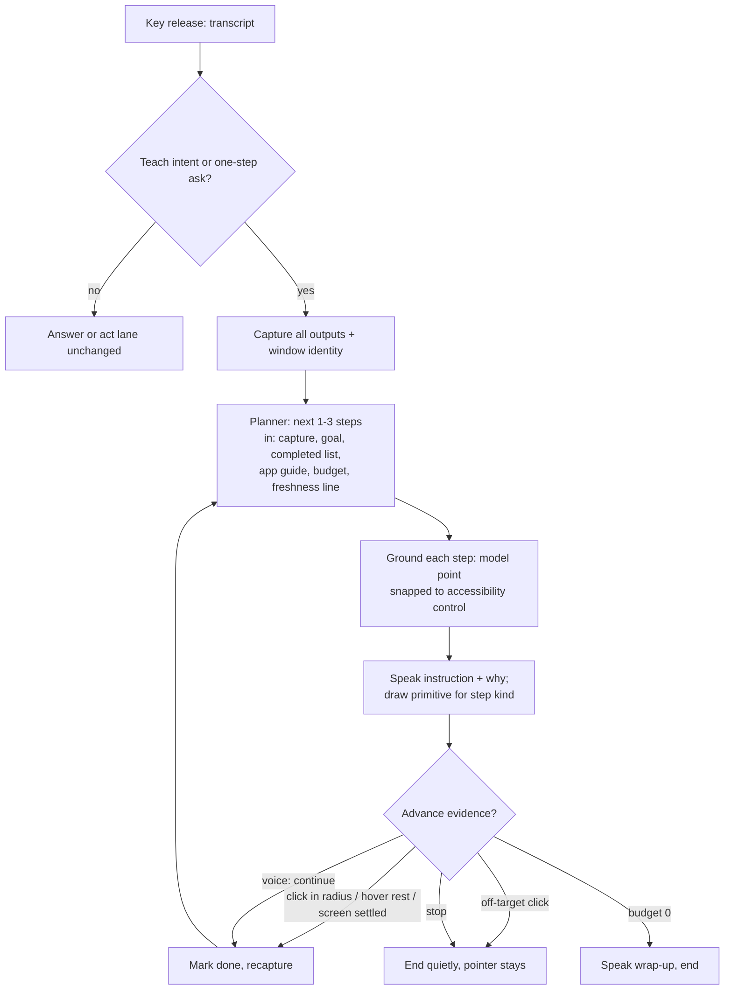
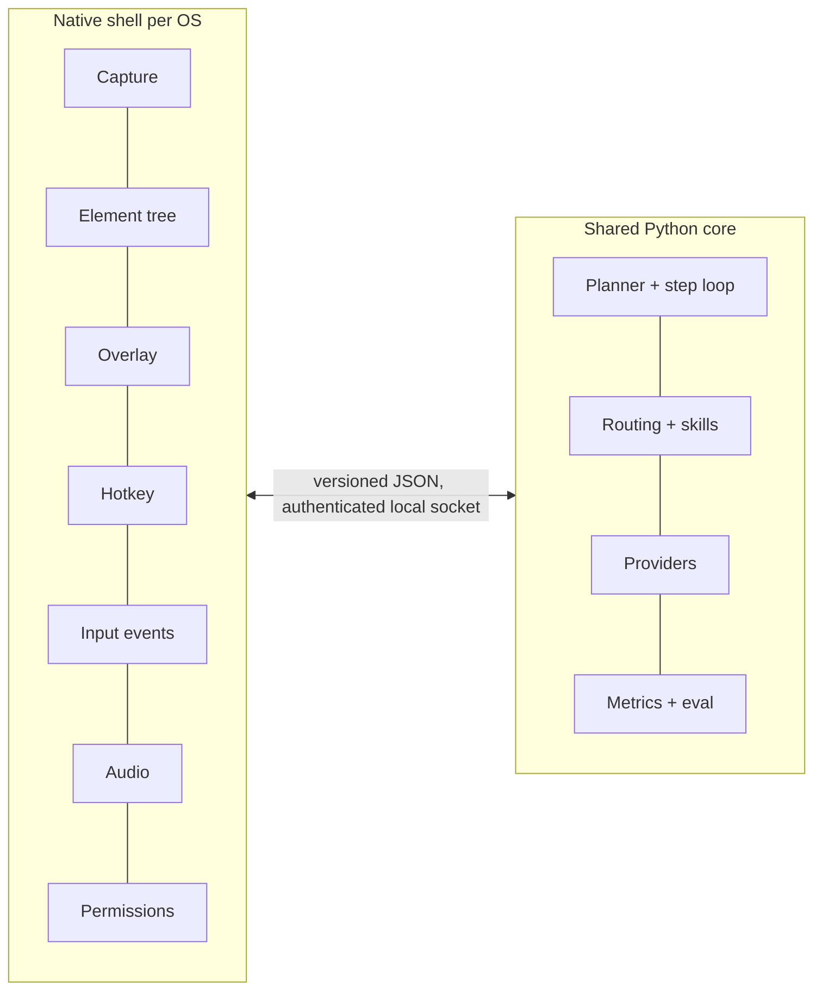

# Wisp Teaching and Pointing Assistant Parity Roadmap - Plan

## Goal Capsule

- **Objective:** A Linux (Omarchy/Hyprland) user can hold the hotkey, ask how to do something in any app, and be taught it one confirmed step at a time by voice and an on-screen pointer, with first-time-correct turns clearing the existing 60% eval gate; Windows and macOS versions follow on the same behavior.
- **Means:** Teaching becomes the default lane and pointing the default delivery (KTD1), driven by a stateless per-step loop that re-reads the live screen (KTD2), with model coordinates snapped to accessibility controls (KTD4). Phase 2 reuses the Python core behind per-OS adapters and thin native shells (KTD9).
- **Authority:** This plan builds on open PR #313 (teach-intent routing, a one-sentence "why" per step, a Hyprland-aware planner) and assumes it merges first. Where it conflicts with `ROADMAP.md`, the fixed decisions there win (OpenRouter-only models, Rust core frozen) until the owner changes them. Phase 2 is gated by the gate in `docs/research/2026-10-31-multi-os-prep.md`.
- **Execution profile:** Phase 1 (U1-U13) is Linux-only Python plus QML, one PR per unit, tests with no live model calls. Phase 2 (U14-U18) is gated and is planned in more detail when it opens.
- **Stop conditions:** Stop and report if a unit needs a live model call outside the capped smoke budget (KTD10), if point-only behavior regresses when the cua input module is absent, or if a unit would copy third-party code, prompts, or assets.
- **Who finishes:** Each unit's own PR; this plan's PR carries documentation only.

---

## Product Contract

### Summary

Wisp becomes a teaching and pointing desktop assistant at parity with the leading commercial one. It points and the human clicks, one step at a time, re-checks the real screen after every step, snaps each pointer to the real control, speaks within a couple of seconds of key release, and loads a small per-app guide when an app is active. The same behavior then ships on macOS and Windows.

### Problem Frame

Owner-labelled real turns show 18 of 77 correct (23%), and the repo's own `wispd eval` tally was 9 of 35 (26%) at the last roadmap update, against a 60% gate. The top gauntlet failure is "no element at model-chosen coordinates". Most incorrect labels are wrong clicks: Wisp tries to do the click itself from one coordinate guess. The commercial reference does the opposite. A teardown of its shipped builds and its public changelog show talk mode never clicks; it draws a ring, the human clicks, and a client-side loop recaptures and re-asks with a completed-steps list, treating the newest screenshot as the only truth.

Teaching also rarely starts. Before #313 a regex gated walkthroughs, so "how do I export this" produced a paragraph or an unrequested click. #313 fixes routing and adds a "why" per step, but still plans the whole walkthrough once from a single screenshot and advances on a window-title change, which web apps never produce. Latency, accessibility grounding, and app knowledge are the remaining gaps. Real clicks on Hyprland are also blocked: the cua Hyprland plugin's input module is pinned to Hyprland 0.56.2 and is discovery-only on 0.57.1, so the plan must work with pointing alone.

### Requirements

**Teaching loop (Linux)**

- R1. A teaching request starts a walkthrough that points and speaks; it never clicks for the user unless the user explicitly asked Wisp to do the task.
- R2. After every detected user action Wisp recaptures the live screen and re-plans the next one to three steps from that capture, a completed-steps list, and a remaining-turn budget; steps the user already did are dropped and the same opener is never pointed at twice.
- R3. Each step declares a kind drawn from a small Wisp vocabulary (click, hover, area, handle, motion, voice-confirm). A step whose completion Wisp cannot detect is never presented as a click; Wisp says what to do and waits for the user to say "continue".
- R4. A step advances only on evidence: a click inside the step's target radius, a hover rest, a settled-screen diff, or the user's voice. An off-target click ends the guide quietly with the pointer left in place.
- R5. A bare "how do I X" may return one point-and-say step, so quick asks stay quick; intents that today route to one-line answers keep doing so (the existing replay fixtures stay green).

**Pointing quality (Linux)**

- R6. Every pointer target is resolved in two layers: the model proposes a coordinate or label, and Wisp snaps it to the matching accessibility-tree control when one is found, else keeps the model's box. Every turn records which layer produced the point.
- R7. A grounding-model comparison is run offline on recorded screenshots, and any model change ships only if it beats the current provider on held-out cases at equal or lower cost.

**Speed and voice (Linux)**

- R8. Key release to first spoken audio is a first-class metric, recorded per turn, shown in the dev HUD, and held to a budget in `wisp/budgets.json`.
- R9. At key-down Wisp warms everything it can for the coming turn: speech-to-text connection, audio output device, planner connection, and the previous screenshot as a cacheable prefix.
- R10. Quick asks go to a fast model and teaching plans to a deeper one, both through OpenRouter, selected by config.

**App knowledge (Linux)**

- R11. When an app is active, a small guide for that app, keyed by window class and accessibility app name, is injected into the planner, capped in size, and absent when no guide matches.

**Interface polish**

- R12. Every new overlay or HUD element meets the repo's design bar in `DESIGN-v2.md`: theme tokens only, no emoji, custom-drawn marks, a distinct state for waiting, off-target and done, click-through and never focus-stealing, reduced-motion respected, and verified by capture on the primary display before it ships.

**Test and safety discipline**

- R13. No test makes a live model call; live smoke runs are explicit, listed, and capped (KTD10).
- R14. No third-party code, prompt text, or asset is copied. Behavior observed in other products is expressed in Wisp's own vocabulary and tests.

**Windows and macOS (Phase 2)**

- R15. Platform differences live behind adapter interfaces (capture, element tree, overlay, hotkey, input events, audio, permissions, window identity); the planner, step state machine, routing, skills, and metrics stay shared and unchanged.
- R16. A native shell on each OS provides those adapters and talks to the Python core over a local authenticated socket with one versioned JSON protocol.
- R17. macOS ships with a first-run permissions checklist (screen recording, microphone, accessibility, input monitoring) that shows live status, deep-links each pane, and survives a permission being revoked mid-session; Windows ships signed with DPI-correct overlays on every monitor.
- R18. Phase 2 starts only after the gate in KTD8 passes, and Linux behavior never regresses to serve it.

### Key Decisions

- **Point first, click opt-in.** Governs R1, R3, R4. (session-settled: user-directed — chosen over keeping the act loop as the default for "how do I" asks: the human-clicks model removes the wrong-click failure class and does not need the blocked cua input module.)
- **Linux first, Windows and macOS second.** Governs R15-R18. (session-settled: user-directed — chosen over starting cross-platform shells in parallel: the shared core is where quality lives, so it must work on one OS first.)
- **Notes and ideas only from the reference product.** Governs R14. (session-settled: user-directed — chosen over reusing its code or prompts: copying is prohibited.)

### Scope Boundaries

- Not a clone: no proprietary backend proxy, integration layer, job cards, or drawing-engine art.
- No change to the Rust core in `rs/` (frozen) or to `tests/fixtures/ipc_commands.jsonl`.
- No local model servers; models stay OpenRouter-only (a hosted speech provider is the existing exception, see Open Questions).

#### Deferred to Follow-Up Work

- Real synthetic clicks on Hyprland: rebuild the cua plugin with its input module (`CUA_INPUT=ON`) once upstream lifts the 0.56.2 pin; until then clicks stay guide-mode. The seam is kept by U3.
- A "do it for me" lane that adopts a plan-as-progress UI and a verified-claims rule beyond U3's minimum.
- Other Linux desktops (Sway, KDE, GNOME) beyond the adapter seam U14 creates.
- Phase 2 per-unit detail (U15-U18) is re-planned when the gate opens.

---

## Planning Contract

### Key Technical Decisions

- KTD1. **Teaching is a delivery policy, not a new lane.** The walkthrough lane in `wisp/walkthrough_run.py` stays the owner; guide-mode delivery (`wisp/pointer.py` `GuideBackend`, `wisp/delivery.py`) becomes its enforced backend, so a teaching turn cannot reach a click backend. Governs R1. (session-settled: user-directed — chosen over a separate tutor service.)
- KTD2. **The per-step prompt is stateless.** Each step's prompt is assembled fresh from: the new capture, the goal, the completed-steps list, the previous step's kind and outcome, a remaining-turn count, and a freshness line when the user acted during thinking. No conversation object is carried. Governs R2.
- KTD3. **Step kinds are Wisp's own vocabulary, emitted as JSON fields, not inline text tags.** The planner already returns JSON (`parse_steps`); a `kind` field with a validator and a tolerant fallback to `click` keeps parsing in one place and avoids a second grammar. The mapping to overlay primitives is fixed in U2 and drawn in U10. Governs R3.
- KTD4. **Model proposes, accessibility disposes.** Snap order is label match in the accessibility tree, then nearest control containing the model point, then the model's own box. The result carries `snap` in `ax | model | none`. AT-SPI is read directly behind an `ElementTree` adapter, because the cua `window_state` path in `wisp/grounding.py` `_a11y` depends on the plugin that is discovery-only on the current Hyprland. Governs R6.
- KTD5. **Advance on evidence, ranked.** Click inside radius (when observable) beats hover rest beats settled-screen diff beats voice confirm. Click observation on Hyprland is a spike inside U4 with a fixed fallback ladder; the plan does not assume a mechanism. Governs R4.
- KTD6. **Measurement before change.** The offline teaching harness (U1) lands first so every later unit reports a number, never an impression. Governs R7, R13.
- KTD7. **Skills are data, matched by window identity.** Reuse `wisp/skills.py` `match_app_skill_info` and the `docs/research/app-skill-format.md` whitelist; teaching content goes in a body section, not new frontmatter keys. Governs R11, R14.
- KTD8. **Phase 2 gate.** Start Phase 2 only when `wispd eval` passes its configured gate (60% over at least 50 labelled turns) and teaching first-time-correct on the U1 harness is at or above the same bar. This restates the existing gate rather than adding one. The Linux-only decision in `docs/plans/2026-10-25-2127-refactor-linux-only-plan.md` is amended by U14 to "one OS-neutral core plus per-OS adapters", not by restoring in-core OS branches. Governs R18.
- KTD9. **Shared Python core as a sidecar, thin native shells.** Swift on macOS, a .NET or Rust shell on Windows, one JSON event/command protocol over a local authenticated socket. A shell owns only what must be native. The shell language on Windows is deferred to U17's first spike. Governs R15, R16.
- KTD10. **Spend rules.** CI and unit tests use recorded fixtures and fakes in `tests/fakes/` only. Live smoke: at most one explicit run per unit that changes a model prompt or provider, text-only where possible, each capped at 25 cents and logged in the PR body; the grounding bake-off (U8) has its own 5-dollar total cap set before it starts. Governs R13.

### High-Level Technical Design

The teaching loop, one iteration. Nodes D through H repeat until the planner returns no step or the turn budget reaches zero.

Step kind to behavior, fixed by U2 and drawn by U10:

| Kind | Meaning | Drawn as | Advances on |
|---|---|---|---|
| click | One atomic click the app will show | ring with radius | click in radius |
| hover | Reveal something by hovering | dashed ring | pointer rest |
| area | A region matters, no single control | soft highlight region | settle or voice |
| handle | A thing to grab or drag from | small marker | settle or voice |
| motion | Direction of a drag or swipe | arrow or curve | settle or voice |
| voice-confirm | Not detectable (type text, slider value) | none, caption chip | "continue" |

Phase 2 shape:

### Risks and Dependencies

| Risk | Mitigation |
|---|---|
| Click observation on Wayland needs a privileged or compositor-specific path | U4 spike with a fixed ladder (compositor event hook, cursor-position poll plus settle, voice confirm); the fallback alone already beats title-change advance. |
| Accessibility trees are patchy under Wayland and for GPU-drawn apps | KTD4 fallback to the model box, `snap` logged, U7 reports the share per app so skill authors can see where it fails. |
| Per-step re-plan multiplies model calls and latency | Plan 1-3 steps ahead, reuse the prior capture as a cache prefix (U12), fast model for quick asks (R10), turn budget bounds cost. |
| Teaching hijacks quick answers | U6 ships behind `[teach] auto` and the existing answer fixtures stay pinned. |
| #313 changes under review | Units cite its surface (`teach_intent`, `Step.why`, `spoken`, `[teach] auto`); rebase once it merges. |
| Phase 2 contradicts the Linux-only purge | KTD8 and U14 amend it explicitly, and Phase 2 is gated. |
| Third-party material creeping in | R14, plus the existing skill provenance tests (`tests/test_skill_provenance.py`). |

### Sources

- `wisp/walkthrough_run.py`, `wisp/walkthrough.py`, `wisp/stage_route.py`, `wisp/pointer.py`, `wisp/delivery.py`, `wisp/grounding.py`, `wisp/skills.py`, `wisp/stt_stream.py`, `wisp/speech.py`, `wisp/tts_groq.py`, `wisp/budgets.json`, `wisp/platform.py`.
- `ROADMAP.md`, `docs/research/2026-11-02-gauntlet-reruns.md`, `docs/research/2026-10-31-multi-os-prep.md`, `docs/research/2026-10-25-clicky-verify.md`, `docs/research/app-skill-format.md`, `docs/plans/2026-10-25-0151-feat-heyclicky-gap-closure-plan.md`, `docs/plans/2026-10-28-2248-feat-app-skill-depth-plan.md`, `DESIGN-v2.md`, `docs/CUA.md`.

---

## Implementation Units

Phase 1 is Linux. U1 first; U2-U5 are the core loop; U6-U9 widen it; U10-U13 are surface and speed. Phase 2 starts at U14.

| U-ID | Title | Phase | Depends on |
|---|---|---|---|
| U1 | Offline teaching evaluation harness | 1 Linux | #313 |
| U2 | Step kinds and planner contract | 1 Linux | U1 |
| U3 | Point-only delivery for teaching, honest do-lane | 1 Linux | U2 |
| U4 | Advance on evidence | 1 Linux | U2 |
| U5 | Per-step re-plan loop | 1 Linux | U2, U4 |
| U6 | Widen routing to one-step answers | 1 Linux | U5 |
| U7 | Two-layer pointing with AT-SPI snap | 1 Linux | U1 |
| U8 | Grounding model bake-off | 1 Linux | U1, U7 |
| U9 | Per-app teaching guides | 1 Linux | U5, U7 |
| U10 | Step primitives in the overlay | 1 Linux | U2 |
| U11 | Key-release to first-voice metric | 1 Linux | none |
| U12 | Warm path, streamed speech, fast/deep split | 1 Linux | U11 |
| U13 | Voice provider evaluation | 1 Linux | U11 |
| U14 | Platform adapter interfaces and protocol | 2 Win/Mac prep | gate, U5, U7 |
| U15 | Sidecar packaging and authenticated IPC | 2 Win/Mac | U14 |
| U16 | macOS shell | 2 macOS | U15 |
| U17 | Windows shell | 2 Windows | U15 |
| U18 | Cross-OS conformance, skills, release | 2 Win/Mac | U16, U17 |

### U1. Offline teaching evaluation harness

- **Goal:** Make teaching quality measurable with no live model call, so every later unit reports first-time-correct and failure class.
- **Requirements:** R7, R13; KTD6.
- **Dependencies:** #313.
- **Files:** `wisp/gauntlet.py`, `scripts/gauntlet.py`, `tests/fixtures/teach/` (new: recorded screenshot, planner JSON reply, expected step kind and target per case), `tests/test_teach_replay.py` (new), `tests/test_gauntlet_cases.py`, `tests/fakes/rig.py`.
- **Approach:**
  - Add a teach case type to the gauntlet: goal, recorded capture, recorded planner reply, expected kind, expected target region.
  - Seed 12-15 cases across terminal, browser, LibreOffice, GIMP, file manager, and Omarchy settings, including the "no Activities overview" case from #313.
  - Report first-time-correct, wrong-target, wrong-kind, and no-element counts, matching the failure classes in `docs/research/2026-11-02-gauntlet-reruns.md`.
- **Patterns to follow:** `tests/fixtures/turns/*.json` replay fixtures; `tests/fakes/` fakes; `tests/test_gauntlet_driver.py`.
- **Test scenarios:**
  - A fixture whose planner reply names the right control scores correct and its region match is within the stated radius.
  - A reply pointing at a different control scores wrong-target, not correct.
  - A reply that omits a required kind scores wrong-kind.
  - The harness fails loudly when a fixture has no recorded reply, rather than calling a model.
  - Running the suite with the network blocked passes.
- **Verification:** `python -m unittest tests.test_teach_replay tests.test_gauntlet_cases -v` passes offline and prints a baseline score table that later units quote.

### U2. Step kinds and planner contract

- **Goal:** Give each step a kind and a completion rule, and teach the planner never to fake a click.
- **Requirements:** R3, R14; KTD3.
- **Dependencies:** U1.
- **Files:** `wisp/walkthrough.py`, `wisp/walkthrough_run.py`, new `wisp/step_kinds.py`, `tests/test_walkthrough_run.py`, `tests/test_step_kinds.py` (new), `docs/PIPELINE_STAGES.md`.
- **Approach:**
  - Add `kind` and `radius` to `Step`, persisted in pause, save, and replay dumps next to `why` (as #313 did for `why`).
  - `step_kinds.py` owns the vocabulary, the validator, the tolerant fallback to `click`, and the table in the High-Level Technical Design.
  - The planner prompt states the decision rule in Wisp's words: if the app will visibly react to the action, use a click or hover step; otherwise use area, handle, motion, or voice-confirm and ask the user to say "continue".
  - Unknown kind or missing radius degrades to a click with a default radius; the parser never raises.
- **Test scenarios:**
  - A reply with each of the six kinds parses to that kind.
  - An unknown kind falls back to click and is logged once.
  - A save-then-replay round trip preserves kind, radius, and why.
  - A text-entry step planned as `click` by the model is rewritten to `voice-confirm` when its label matches an input field.
- **Verification:** U1 harness wrong-kind count drops versus its baseline; unit suite green.

### U3. Point-only delivery for teaching, honest do-lane

- **Goal:** Make "never clicks while teaching" structural, and keep the do-it-for-me lane from claiming success it did not observe.
- **Requirements:** R1; KTD1.
- **Dependencies:** U2.
- **Files:** `wisp/walkthrough_run.py`, `wisp/pointer.py`, `wisp/delivery.py`, `wisp/realinput.py`, `wisp/act.py`, `docs/CUA.md`, `tests/test_pointer_precedence.py`, `tests/test_walkthrough_run.py`, `tests/fixtures/turns/act_guide_mode.json`.
- **Approach:**
  - The walkthrough lane resolves its pointer through the guide backend only; a registry lookup that would return a click backend raises in tests and downgrades in production.
  - Keys stay available through `realinput.py` for explicit do-it-for-me asks; clicks remain guide-mode until the input module exists. Record that seam in `docs/CUA.md` so enabling `CUA_INPUT=ON` later is a config change.
  - The act lane's closing line states only what a tool result or verify step confirmed; an unverified action is reported as attempted.
- **Test scenarios:**
  - A walkthrough turn with a click-capable backend registered never calls its click method.
  - With the cua input module absent the walkthrough still points, speaks, and advances.
  - An act turn whose click was refused ends with "attempted" wording, not "done".
  - The existing `act_guide_mode` fixture is unchanged.
- **Verification:** `python -m unittest tests.test_pointer_precedence tests.test_walkthrough_run -v` passes; a grep-style test asserts the walkthrough module imports no click backend directly.

### U4. Advance on evidence

- **Goal:** Advance a step only when something real happened, and end quietly when the user clicks elsewhere.
- **Requirements:** R4; KTD5.
- **Dependencies:** U2.
- **Files:** `wisp/walkthrough.py` (`diff_window_state`, `is_loading_state`), `wisp/walkthrough_run.py`, new `wisp/settle.py`, new `wisp/click_watch.py`, `tests/test_settle.py` (new), `tests/test_click_watch.py` (new), `tests/fakes/hypr.py`, `tests/fakes/wayland.py`.
- **Approach:**
  - `settle.py`: downsampled frame diff over the active window, "settled" when the diff stays under threshold for a fixed window; also used to wait out page loads. Poll-based, `grim` only.
  - `click_watch.py`: spike first, three rungs in order — a compositor event source for button presses, a cursor-position poll combined with settle, voice confirm. Ship the first observation rung that works unprivileged on current Hyprland, plus settle and voice confirm; delete the other observation rungs. The mechanism is an execution-time decision; the interface (`wait_click(target, radius, timeout)` returning clicked-in, clicked-out, or none) is fixed here.
  - Off-target click: say nothing, leave the pointer parked, end the walkthrough in a resumable paused state (reuse `save_paused`).
  - Hover steps advance on pointer rest for a short fixed interval.
- **Test scenarios:**
  - A frame sequence that changes then holds steady reports settled only after the hold window.
  - A continuously animating sequence times out as not-settled rather than advancing.
  - A click inside the radius returns clicked-in; one outside returns clicked-out and pauses the walkthrough without speech.
  - With no click source available the step falls to settle, then voice, and a step still completes.
  - A web-app step whose window title never changes advances on settle.
- **Verification:** Unit suite green; on a real session, a four-step browser walkthrough advances on each user click and ends silently on a stray click (noted in the PR with the rung used).

### U5. Per-step re-plan loop

- **Goal:** Replace plan-once-from-one-screenshot with plan-a-few-steps-then-recapture.
- **Requirements:** R2; KTD2.
- **Dependencies:** U2, U4.
- **Files:** `wisp/walkthrough_run.py`, `wisp/walkthrough.py`, `wisp/stage_capture.py`, `tests/test_walkthrough_run.py`, `tests/test_replan.py` (new), `tests/fixtures/teach/`.
- **Approach:**
  - `plan()` takes the capture, completed-steps list, previous step outcome, budget, and a freshness flag (set when the user acted while the previous plan was in flight).
  - The loop plans 1-3 steps, executes them, recaptures on each detected advance, and re-plans when the capture no longer matches the planned step's target or the plan is exhausted.
  - A step whose goal state is already true on the new capture is dropped; the prompt forbids re-pointing at the same opener or toggle and distinguishes revealing a menu from committing a choice.
  - The remaining-turn budget (configurable under `[teach]`, default a small number) forces a spoken wrap-up at zero.
- **Test scenarios:**
  - A recapture showing the user already finished the next step yields a plan that skips it.
  - The same opener is not planned twice in a row.
  - The budget reaching zero ends the walkthrough with a wrap-up line, not a further step.
  - The user acting during planning sets the freshness flag and the prompt carries it.
  - A planner failure keeps the walkthrough paused and resumable, not lost.
  - Prompt assembly is deterministic for a given input (snapshot test, no model call).
- **Verification:** U1 harness multi-step cases improve against the U1 baseline; `python -m unittest tests.test_replan tests.test_walkthrough_run -v` green.

### U6. Widen routing to one-step answers

- **Goal:** Let "how do I X" teach when it is a task and stay a one-line answer when it is a fact.
- **Requirements:** R5.
- **Dependencies:** U5.
- **Files:** `wisp/stage_route.py`, `wisp/walkthrough_run.py` (`teach_intent`), `tests/test_teach_intent.py`, `tests/test_route.py`, `tests/fixtures/turns/fast_path_answer.json`, `tests/fixtures/turns/ask.json`.
- **Approach:**
  - A bare "how do I X" routes to the planner with a one-step allowance: a single-step plan is spoken and pointed as the whole answer; a multi-step plan runs as a walkthrough.
  - The two replay fixtures that pin one-line answers ("how do I open a new tab") stay green by routing through the existing fast path first.
  - `[teach] auto = "false"` disables the widened routing as well as the #313 phrases.
- **Test scenarios:**
  - "how do I open a new tab" still takes the fast-path answer.
  - "how do I export this as a PDF" starts a walkthrough.
  - A planner returning one step is delivered as a point-and-say with no wait loop.
  - `[teach] auto = "false"` restores the pre-widening routing for every phrase.
  - "how do I know..." style non-procedures stay out of the lane (reuses the not-procedure guard).
- **Verification:** The full turn-fixture suite is unchanged; new cases added to U1's harness.

### U7. Two-layer pointing with AT-SPI snap

- **Goal:** Snap the model's point to the real control and log which layer won.
- **Requirements:** R6; KTD4.
- **Dependencies:** U1.
- **Files:** `wisp/grounding.py`, `wisp/walkthrough_run.py` (`snap_point`), new `wisp/elementtree.py`, `docs/LINUX.md`, `tests/test_snap.py`, `tests/test_elementtree.py` (new), `tests/test_ground_chain.py`, `tests/fakes/`.
- **Approach:**
  - `elementtree.py` defines the `ElementTree` interface (`at_point`, `find_by_label`, `rect`, `app_name`) and a Linux AT-SPI implementation; a fake serves tests. This is the first adapter that U14 formalizes.
  - Snap order follows KTD4; confidence and `snap` are written to the turn record and to the step dump.
  - Containers larger than a fraction of the screen are rejected as snap targets (extend `_is_container`).
  - Failure to reach AT-SPI is a quiet fall to the model box, never an error to the user.
  - The package has no runtime dependencies today, so the AT-SPI client (system GObject introspection bindings or direct D-Bus calls) is an optional system package, chosen in this unit and documented in `docs/LINUX.md`. The harness reports AT-SPI-unavailable separately from no-matching-control, so a missing client cannot hide inside the quiet fallback.
  - `snap_point` and `_is_container` already exist in `wisp/walkthrough_run.py` with a `ground=` hook; extend them rather than adding a parallel path, and reconcile with any existing snap fields.
- **Test scenarios:**
  - A model point 20 px from a labeled button snaps to the button's center and logs `ax`.
  - A point inside a large container with no labeled child keeps the model box and logs `model`.
  - A label with two matches picks the one nearest the model point.
  - AT-SPI unavailable returns the model box and logs `none`.
  - The turn record contains `snap` for every pointed step.
- **Verification:** U1 no-element failures drop on fixtures with recorded trees; per-app `snap` share is printed by the harness.

### U8. Grounding model bake-off

- **Goal:** Pick the pointing model by measured held-out accuracy and cost, not by habit.
- **Requirements:** R7, R13; KTD6, KTD10.
- **Dependencies:** U1, U7.
- **Files:** `wisp/grounding.py` (`pick_pointing_resolution`, `_vlm_locate`), `scripts/gauntlet.py`, new `scripts/grounding_bakeoff.py`, `docs/ACCURACY.md`, `tests/test_grounding.py`.
- **Approach:**
  - Replay recorded screenshots through candidate providers behind OpenRouter, comparing describe-then-point at aspect-matched resolution against direct coordinates, with and without accessibility labels in the prompt.
  - Hold out a fixed case set before looking at results; the run is capped by KTD10's bake-off budget and prints cost per case.
  - A winner replaces the default only through a config change plus a documented result in `docs/ACCURACY.md`.
- **Test scenarios:**
  - The scorer ranks a synthetic provider that is right 8 of 10 above one right 5 of 10.
  - The runner stops at the spend cap and reports the partial table.
  - The held-out split is deterministic from a seed and never overlaps the tuning set.
  - Coordinate conversion round-trips for letterboxed and portrait captures (extends existing resolution tests).
- **Verification:** Offline tests green; one capped run documented with per-model accuracy and cost.

### U9. Per-app teaching guides

- **Goal:** Give the planner short, correct app knowledge for whatever is in front of the user.
- **Requirements:** R11, R14; KTD7.
- **Dependencies:** U5, U7.
- **Files:** `wisp/skills.py`, `wisp/walkthrough_run.py` (`app_skill`), `wisp/skills_seed/apps/` (add guides), `docs/research/app-skill-format.md`, `tests/test_skills.py`, `tests/test_skill_provenance.py`, `tests/test_walkthrough_run.py`.
- **Approach:**
  - Add a "Teaching" body section to the format spec: where the common controls live, the usual first steps, and pitfalls on Linux. Frontmatter stays on the existing whitelist.
  - Seed guides where the repo has none: a terminal, Blender, and Omarchy settings, plus audit and shorten existing ones (browser, LibreOffice, GIMP, file manager).
  - Matching uses window class plus the accessibility app name from U7; injection is capped at a fixed token budget and the guide text is quoted as data in the prompt.
  - Provenance follows the existing clean-source rule: authored or MIT-adapted with `provenance` set.
- **Test scenarios:**
  - A focused window with class `kitty` injects the terminal guide and no other.
  - No match injects nothing and the prompt is unchanged.
  - A guide over the cap is truncated at a section boundary.
  - A guide with a disallowed frontmatter key fails the provenance test.
  - Guide text containing instruction-like content is delivered inside the data block and does not alter routing (existing injection tests extended).
- **Verification:** Skill suites green; U1 cases for newly covered apps improve against baseline.

### U10. Step primitives in the overlay

- **Goal:** Draw each step kind so a learner always knows what to do and what Wisp is waiting for.
- **Requirements:** R12, R3, R4.
- **Dependencies:** U2.
- **Files:** `shell-plugin/components/OverlayLayer.qml`, `shell-plugin/components/DrawLayer.qml`, `shell-plugin/components/StepRow.qml`, `shell-plugin/components/Chip.qml`, `shell-plugin/lib/cursor.js`, `shell-plugin/lib/companion.js`, `tests/fixtures/states/`, `tests/qml/`, `tests/test_qml_lib.py`, `tests/test_components.py`, `DESIGN-v2.md`.
- **Approach:**
  - Add state fields for kind, radius, step index and total, and wait reason to the state bus; golden state files cover waiting, off-target (cursor stays parked, no caption), voice-confirm, and done.
  - Primitives: ring, dashed hover ring, soft area region, handle marker, arrow or curve, and a "say continue" caption chip. All use theme tokens, hand-drawn marks from the existing ink layer, no emoji.
  - Overlays stay click-through and never take focus; motion honors reduced-motion; the chip and step counter stay within the 4.5:1 contrast bar on light and dark themes.
- **Test scenarios:**
  - Each state fixture renders its primitive in the QML lib tests with no console errors.
  - Reduced-motion removes the flight animation and ring pulse.
  - A voice-confirm state shows the chip and no ring.
  - An off-target end state leaves the pointer and clears the chip within one frame.
  - Two outputs at different scales place the ring correctly (scale 1 and 2).
- **Verification:** `python -m unittest test_qml_lib test_components -v` green; a `grim` capture of each primitive on a light and a dark theme attached to the PR and checked against `DESIGN-v2.md` before merge.

### U11. Key-release to first-voice metric

- **Goal:** Measure the number users feel, per turn, and hold it to a budget.
- **Requirements:** R8.
- **Dependencies:** none.
- **Files:** `wisp/budgets.json`, `wisp/trace.py`, `wisp/stage_speak.py`, `wisp/speech.py` (`_first_audio`), `wisp/devlog.py`, `shell-plugin/components/DevTab.qml`, `scripts/latency_baseline.py`, `tests/test_latency_budgets.py`.
- **Approach:**
  - Add a composite path, key release to first audible audio, built from the existing `stt`, `route`, first-token, and `tts_start` spans, and show per-stage timing in the dev tab.
  - Seed the budget from a baseline run of `scripts/latency_baseline.py` and set `p90_factor` from live traces rather than a guess.
- **Test scenarios:**
  - A replayed turn produces the composite span equal to the sum of its stages within tolerance.
  - A turn that never speaks records no composite and does not fail the gate.
  - Exceeding budget is reported by the budget test with the offending stage named.
  - The dev tab state fixture shows the composite and stage breakdown.
- **Verification:** `python -m unittest tests.test_latency_budgets -v` green; baseline table in the PR.

### U12. Warm path, streamed speech, fast/deep split

- **Goal:** Lower the composite from U11 by doing work at key-down and speaking the first sentence early.
- **Requirements:** R9, R10.
- **Dependencies:** U11.
- **Files:** `wisp/fastkey.py`, `wisp/stt_stream.py`, `wisp/tts_groq.py`, `wisp/stage_speak.py`, `wisp/brain.py`, `wisp/config.py`, `docs/CONFIG.md`, `tests/test_stt_stream.py`, `tests/test_speech.py`, `tests/test_pipeline.py`.
- **Approach:**
  - At key-down, open the speech-to-text connection, wake the audio output so the first syllable does not pay device spin-up, and touch the planner connection; discard cleanly on cancel (`stt_stream.discard`).
  - Keep the previous capture as a stable prefix for the planner so repeat turns pay for the new capture only.
  - Add `[brain] fast_model` and `[brain] teach_model` (OpenRouter ids); quick asks and the fast path use the first, plans use the second.
  - Sentences are handed to speech as soon as complete (extends the existing earlier-first-sentence work).
- **Test scenarios:**
  - Key-down starts the warm connection exactly once and key-up reuses it.
  - A cancelled press releases the warm resources and leaks no thread.
  - The fast model is selected for a one-line ask and the teaching model for a plan, from fixtures.
  - Warm failure degrades to the cold path with the same result.
  - The composite span in a replayed turn is not worse than the U11 baseline.
- **Verification:** Offline suites green; a capped live smoke (KTD10) records before and after composite p50 in the PR.

### U13. Voice provider evaluation

- **Goal:** Decide whether a Gemini speech path is worth adding, given the OpenRouter-only rule and the current hosted speech provider.
- **Requirements:** R8, R10; KTD6, KTD10.
- **Dependencies:** U11.
- **Files:** `wisp/stt_stream.py`, `wisp/tts_groq.py`, `wisp/speech.py`, `wisp/voicepick.py`, `docs/COSTS.md`, `docs/research/` (a dated note), `tests/test_stt_default.py`.
- **Approach:**
  - Write down, from provider documentation, what OpenRouter can serve for audio in and audio out today, then compare cost and first-audio latency against the current provider using U11's metric on recorded WAV fixtures.
  - The unit ends in a decision note. Adding a provider is a follow-up PR behind a flag only if the owner approves the answer to the Open Question below.
- **Test scenarios:**
  - Provider selection falls back to the current default when the new provider's key or capability is absent.
  - The metric harness runs against a fake provider and reports the same fields as for a real one.
  - No provider call happens in the default test run.
- **Verification:** The note exists with measured numbers or an explicit "not served" finding; no behavior change ships without approval.

### U14. Platform adapter interfaces and protocol

- **Goal:** Define the seam Phase 2 builds on, with Linux as its first conforming implementation.
- **Requirements:** R15, R18; KTD8, KTD9.
- **Dependencies:** the Phase 2 gate, U5, U7.
- **Files:** `wisp/platform.py`, `wisp/elementtree.py`, `wisp/hypr.py`, `wisp/ipc.py`, `docs/IPC_CONTRACT.md`, `docs/ARCHITECTURE.md`, `docs/MACOS.md`, `docs/WINDOWS.md`, `docs/plans/2026-10-25-2127-refactor-linux-only-plan.md` (amend note), `tests/test_platform.py`, `tests/fakes/`.
- **Approach:**
  - Interfaces: capture, element tree, overlay command stream, hotkey (press and release), input events (observe, inject), audio, permissions, window identity, installer and updater hooks.
  - A versioned JSON protocol for shell to core events and core to shell draw commands, pinned by a fixture file like `tests/fixtures/ipc_commands.jsonl`.
  - Linux adapters wrap today's code with no behavior change; a conformance test runs against both the Linux adapters and fakes.
- **Test scenarios:**
  - Each interface has a conformance test run against the Linux adapter and a fake.
  - The protocol fixture round-trips and a version mismatch is refused with a clear error.
  - Existing Linux suites pass unchanged.
- **Verification:** Full `python -m unittest discover -s tests` unchanged in outcome; protocol doc and fixture reviewed.

### U15. Sidecar packaging and authenticated IPC

- **Goal:** Run the Python core as a bundled sidecar whose socket verifies who connects on every OS.
- **Requirements:** R16.
- **Dependencies:** U14.
- **Files:** `wisp/ipc.py`, `wispd`, `scripts/release/`, `docs/IPC_CONTRACT.md`, `docs/RELEASING.md`, `tests/test_ipc_authz.py`, `tests/test_ipc_tcp.py`.
- **Approach:**
  - Peer identity per OS: `SO_PEERCRED` on Linux, `LOCAL_PEERPID` on macOS, named-pipe client identity on Windows; the existing `unattributed_peer` refusal lifts only where identity is verified.
  - Freeze the core into a single per-OS artifact with its dependency set pinned; the shell supervises it and restarts it on crash.
- **Test scenarios:**
  - A command from an unverified peer is refused before dispatch on each transport.
  - The shell's supervisor restarts a killed sidecar and replays no unsafe command.
  - Mutating commands still require the authorization the IPC read/mutate split defines.
- **Verification:** IPC suites green with per-OS peer-identity fakes; one real round trip on each OS recorded when the shells exist.

### U16. macOS shell

- **Goal:** A native Swift shell that provides every adapter on macOS and passes the conformance suite.
- **Requirements:** R15, R16, R17.
- **Dependencies:** U15.
- **Files:** `shells/macos/` (new, under the existing `shells/` tree), `docs/MACOS.md`, `scripts/release/`, `tests/test_platform.py`.
- **Approach:**
  - ScreenCaptureKit capture with the overlay excluded from the frame; AX element tree; non-activating full-screen panels per display; Carbon hotkey for press and a CGEventTap for release; CGEventTap for click observation; AVAudioEngine capture.
  - A first-run permissions checklist with live status and a deep link per pane, re-checked on a timer and on app activation, tolerating mid-session revocation.
  - Developer ID signing, hardened runtime, notarization, and an update channel with signed manifests; follow the existing verified-install pattern in `docs/plans/2026-10-29-2302-feat-verified-install-update-plan.md`.
- **Test scenarios:**
  - The conformance suite passes against the shell's adapters on a macOS runner.
  - Revoking screen recording mid-session produces a visible checklist state and a spoken explanation, not a crash.
  - Overlay windows are absent from a capture of the same display.
  - Multi-display coordinates match capture after a display is added.
- **Verification:** Notarized build installs and completes a four-step teaching walkthrough; permission states verified by capture. Requires an Apple developer account (see Open Questions).

### U17. Windows shell

- **Goal:** A native shell that provides every adapter on Windows with correct DPI and a trusted installer.
- **Requirements:** R15, R16, R17.
- **Dependencies:** U15.
- **Files:** `shells/windows/` (new), `docs/WINDOWS.md`, `scripts/release/`, `tests/test_platform.py`.
- **Approach:**
  - First spike chooses the shell language (.NET or Rust) on binary size, signing path, and UI Automation access; the choice is recorded in `docs/WINDOWS.md`.
  - Windows.Graphics.Capture capture with the overlay excluded from capture; UI Automation element tree; layered, topmost, no-activate click-through overlay per monitor at per-monitor DPI; a low-level keyboard hook for hold-to-talk and a mouse hook for click observation; WASAPI audio.
  - Injection via `SendInput` is out of scope for teaching; document the elevated-window limit for anything that later injects input.
  - Signed installer with signature verification before launch; x64 first, ARM64 only where the OS supports it.
- **Test scenarios:**
  - The conformance suite passes against the shell's adapters on a Windows runner.
  - A ring placed on a 150% scaled secondary monitor lands on the control within the click radius.
  - The overlay is absent from a Graphics.Capture frame.
  - An unsigned payload is refused by the installer.
- **Verification:** Signed build installs on a clean machine and completes a four-step teaching walkthrough.

### U18. Cross-OS conformance, skills, and release

- **Goal:** Keep three OSes honest with one eval, one skill format, and one release process.
- **Requirements:** R15, R17, R18.
- **Dependencies:** U16, U17.
- **Files:** `.github/workflows/`, `wisp/skills.py`, `docs/research/app-skill-format.md`, `wisp/skills_seed/apps/`, `scripts/gauntlet.py`, `docs/RELEASING.md`, `tests/test_skills.py`, `tests/test_gauntlet_cases.py`.
- **Approach:**
  - Add an `os:` frontmatter key to the skill whitelist (default all) and window-identity matching per OS (class, bundle id, executable name).
  - Run the U1 harness cases per OS with the same pass bar; release gates per OS.
  - CI jobs per OS run unit and conformance tests only, no live calls.
- **Test scenarios:**
  - A skill marked `os: macos` never matches on Linux or Windows.
  - Window identity resolves per OS fixture to the same skill.
  - The harness runs with per-OS recorded captures and reports per-OS first-time-correct.
- **Verification:** All three OS CI lanes green; per-OS eval table in the release notes.

---

## Verification Contract

| Check | Command or gate | Applies to |
|---|---|---|
| Python suite | `python -m unittest discover -s tests -v` | every unit |
| Targeted suites | the module lists in each unit's Verification | per unit |
| QML and component tests | `python -m unittest test_qml_lib test_components -v` (invocation as in `.github/workflows/test.yml`) | U10, U11 |
| Offline-only | tests pass with the network blocked; no test imports a live provider client | all |
| Teaching score | U1 harness first-time-correct, reported before and after each Phase 1 unit | U2-U9 |
| Labelled gate | `wispd eval` at the configured 60% over at least 50 labelled turns | KTD8, Phase 2 start |
| Latency | `tests/test_latency_budgets.py` plus the U11 composite | U11, U12 |
| Visual | `grim` capture on light and dark themes, checked against `DESIGN-v2.md` | U10 |
| Live smoke | listed in the PR body, within KTD10 caps | U8, U12, U13 |
| Copy | the repo's copy-lint test (`tests/copylint.py`) via the Python suite | any user-facing copy change |

## Definition of Done

- Global: all Phase 1 units merged with the suite green, the U1 harness reports first-time-correct at or above the gate, and a real teaching walkthrough of at least four steps completes on Hyprland with pointing alone.
- Global: abandoned experiments, spike scaffolding, and dead fallbacks (for example unused click-observation rungs that were tried and rejected) are removed from the diff.
- Global: no live-call test, no copied third-party material, no personal or machine-specific detail in code, docs, or fixtures.
- Per unit: each unit's Verification passes and its test scenarios exist as tests.
- Phase 2 done: U14-U18 verification passes on each OS and `wispd eval` per OS meets the same bar.

## Open Questions

### Resolve Before Phase 2

- Does the Phase 2 gate in `docs/research/2026-10-31-multi-os-prep.md` (50 labelled turns at 60%) stay as written, or should Phase 2 start once Phase 1 ships? This plan assumes it stays (KTD8).
- Is an Apple developer account available for notarization (U16)? Without it the macOS shell ships only as a build-from-source preview.

### Deferred to Implementation

- Which click-observation rung works unprivileged on current Hyprland (U4 spike).
- Whether OpenRouter can serve usable speech in and out, and whether a Gemini speech path is worth adding beside the current hosted speech provider (U13). The OpenRouter-only rule covers models; speech is served by an existing hosted provider today, and the owner should confirm that exception extends to a second one.
- Windows shell language (U17 spike).
- Concrete thresholds: settle window, hover-rest interval, default radius, default turn budget, guide token cap. Set from the U1 harness and live traces.
