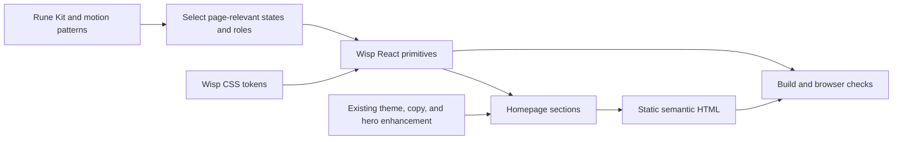

# Wisp Site Components and Motion - Plan

## Goal Capsule

- **Objective:** Visitors experience a Wisp landing page whose controls, visual states, and motion feel consistent and recognizable across screen sizes and color schemes.
- **Means:** Extend the existing React and CSS system with selected Rune Kit component and motion patterns while keeping Wisp's semantic, statically rendered page (KTD1-KTD4).
- **Authority:** Product Contract requirements govern behavior, Key Technical Decisions govern implementation, and units implement both.
- **Stop conditions:** Stop and report if the design requires replacing the page with Rune's experimental canvas runtime, adding external asset loads, or changing Wisp's product claims or privacy contract.
- **Execution profile:** Code. Verify the built page and browser behavior before opening an implementation PR; production publication remains separately authorized.
- **Who ships:** The implementation owner reviews and merges the PR; deployment follows the existing site publication process.

---

## Product Contract

### Summary

Apply the useful parts of Rune's UI work to Wisp's existing homepage: reusable component states, restrained hover and motion, and a coherent Wisp-specific visual system. Keep the React-rendered semantic page, existing hero, product copy, and lightweight delivery path.

### Problem Frame

The owner wants Wisp's website to use the same kind of deliberate page elements, button states, visual flair, animation, and hover behavior that Rune provides. Wisp already has React components and CSS tokens. Rune Kit is Rust-native, so its controls cannot be imported directly into the website.

### Requirements

**Components and visual system**

- R1. Use the existing `site-app` component system as the base and map only relevant Rune patterns to web controls, cards, badges, sections, and disclosures.
- R2. Keep Wisp colors, typography, and identity as the source of truth; do not apply Rune's OpenCode theme or Anomaly branding.
- R3. Give actionable controls clear rest, hover, pressed, focus-visible, and disabled states where those states apply; decorative cards do not become fake controls.
- R4. Keep one visually primary action in a viewport and keep secondary navigation and source links visually secondary.

**Motion and access**

- R5. Use restrained motion and glow on existing elements, respect `prefers-reduced-motion`, and never delay an action until an animation completes.
- R6. Preserve semantic HTML, keyboard navigation, visible focus, light and dark themes, and the existing no-JavaScript content and installation path.
- R7. Preserve the current Wisp flame and lazy hero renderer; do not add a second GPU effects pipeline.

**Trust and delivery**

- R8. Keep product claims, install behavior, trust copy, and visitor privacy behavior unchanged.
- R9. Keep all page assets same-origin, add no analytics or new runtime dependency, and preserve the existing first-paint JavaScript, hero JavaScript, and CSS budgets.

### Success Criteria

- The page's reusable controls share consistent Wisp-themed states in both light and dark modes.
- The hero and install sections retain a clear primary action, and decorative cards do not suggest interaction.
- At 320, 390, and desktop viewport widths, the page has no horizontal overflow or clipped controls.
- Keyboard and no-JavaScript use remain complete for page content, navigation, FAQ, and installation.
- Existing build, privacy, product-claim, hero-fallback, and asset-size gates continue to pass.
- A reviewer has inspected desktop and mobile screenshots in both color schemes and under reduced motion.

### Scope Boundaries

Non-goals:

- Replacing the React-rendered page with Rune's Rust runtime or experimental WebGPU canvas.
- Changing Wisp product copy, release claims, install flow, trust policy, pricing data, or site routes.
- Replacing the existing flame/ThreeUI hero or adding Rune FX and lighting runtimes to the homepage.
- Changing the desktop application UI, `/light/`, `/plain/`, `/install.py`, Worker domains, or production deployment.
- Importing Rune's Rust widgets directly into the React site; the page uses translated web patterns instead.

#### Deferred to Follow-Up Work

- A separate Rune Web target prototype if Wisp later needs a full-canvas interactive experience that cannot be served by semantic HTML.

---

## Planning Contract

### Key Technical Decisions

- KTD1. **Keep React DOM as the page renderer.** Rune Kit's components render through Rune's Rust UI runtime, and Rune's web target is an experimental single WebGPU canvas. Translate the relevant behavior into Wisp's React components instead. (session-settled: user-approved — chosen over replacing the homepage with Rune's canvas runtime: the current site needs semantic content and a working no-JavaScript path.)
- KTD2. **Extend Wisp's existing CSS tokens.** Keep `site-app/src/styles.css` as the source for colors, typography, radii, and motion; Rune's OpenCode theme belongs to another product and would replace Wisp's palette, fonts, and icons.
- KTD3. **Port a bounded Rune component set.** Map Rune's Rest, Hover, Pressed, Focus, and Disabled button states to Wisp's `Button`; map Card, Badge, Divider, and Accordion roles to `Item`, `Badge`, `Section`, and native `
`. Do not port menus, popovers, or dialogs, which the marketing page does not need.
- KTD4. **Keep motion in the existing web stack.** Use immediate hover and pressed feedback, restrained disclosure/reveal transitions, and the existing `Glow` as the site's only flare; do not add a spring runtime, a second animation loop, or another GPU effects path.

### High-Level Technical Design

The mapping is directional: Rune informs the state vocabulary and component behavior; Wisp owns the web implementation, theme, markup, and page content.

### Risks & Dependencies

- Rune's native widgets do not provide web DOM semantics when rendered through its experimental canvas target; KTD1 avoids making the page depend on that runtime.
- Applying desktop-app hover conventions to a marketing page could make passive content feel clickable; R3 limits hover treatment to real interactive targets.
- New colors or glow can reduce contrast in one theme; U3 requires visual inspection in both schemes and retains Wisp's existing focus-ring tokens.
- The public site depends on same-origin assets and bounded client bundles; R9 keeps the existing browser-request and size gates authoritative.

### Sources & Research

- [Rune public source at commit `f5def6d4f9259580cbbd6472498e4de6b4d754b6`](https://github.com/anomalyco/rune/tree/f5def6d4f9259580cbbd6472498e4de6b4d754b6): `crates/rune-kit/README.md` for controls, variants, and interaction states; `crates/rune-motion/README.md` for motion; `crates/rune-fx/README.md` and `crates/rune-light/README.md` for effects; `WEB.md` for the experimental canvas target.
- Wisp `PRODUCT.md` for the website's privacy boundary; `docs/HOSTING.md` for static rendering, same-origin assets, and publication; `site-app/src/styles.css` and `site-app/src/components/ui/` for current tokens and primitives.
- Wisp `tests/test_site_app.py`, `tests/test_site_workers.py`, and `tests/browser/home.mjs` define the existing page, build, privacy, responsiveness, and fallback contracts.

---

## Implementation Units

### U1. Wisp tokens and button states

- **Goal:** Give the existing button variants a consistent Wisp-themed state model driven by the current CSS tokens.
- **Requirements:** R2, R3, R4, R5, R9.
- **Dependencies:** None.
- **Files:** `site-app/src/styles.css`, `site-app/src/components/ui/button.tsx`, `tests/test_site_app.py`, `tests/browser/home.mjs`.
- **Approach:**
  - Reuse the existing Wisp palette, type, radius, and focus tokens; add only missing semantic state tokens.
  - `buttonVariants` already defines hover and disabled styling, and the page has a global focus-visible ring; add the missing pressed feedback without duplicating those states.
  - Keep the hero's “Install on Omarchy” CTA primary, the sticky navbar's “Install” link secondary, and the source link secondary; the install section's copy command is primary within that section.
- **Patterns to follow:** `site-app/src/styles.css`, `site-app/src/components/ui/button.tsx`, and the existing theme toggle in `site-app/src/client/main.ts`.
- **Test scenarios:**
  - In light and dark themes, render each used button variant with readable text and a visible focus ring.
  - With keyboard navigation, Tab to the primary install link and theme/copy controls; focus remains visible.
  - Before the client module enables the copy button, it remains disabled and does not report a copied command.
  - Hover or press on a button changes that button's state without changing a neighboring passive card.
- **Verification:** Browser inspection shows the same state hierarchy in both themes, and existing bundle budgets remain within R9.

### U2. Rune-inspired reusable page elements

- **Goal:** Apply the selected card, badge, section, and glow patterns through Wisp's existing page primitives.
- **Requirements:** R1-R8.
- **Dependencies:** U1.
- **Files:** `site-app/src/components/ui/badge.tsx`, `site-app/src/components/ui/item.tsx`, `site-app/src/components/ui/section.tsx`, `site-app/src/components/ui/glow.tsx`, `site-app/src/components/sections/sections.tsx`, `tests/browser/home.mjs`.
- **Approach:**
  - Follow KTD3's bounded mapping: card surfaces through `Item`, release emphasis through `Badge`, section breaks through `Section`, and disclosure through native `
`; do not add other Rune Kit controls.
  - Keep passive cards static, use hover only on links and controls, and retain the existing `Glow` placements rather than adding a glow to every surface.
  - Follow KTD4 for control transitions and reduced motion; keep the existing flame and hero rendering path.
- **Patterns to follow:** `site-app/src/components/sections/sections.tsx` for semantic sections, `site-app/src/components/ui/item.tsx` for feature content, and `site-app/src/client/hero.ts` for the existing hero boundary.
- **Test scenarios:**
  - Passive feature cards remain non-interactive while their citation links remain keyboard-accessible.
  - FAQ entries open with keyboard and pointer input, retaining native disclosure semantics.
  - The hero, trust, cost, and install sections retain their current copy, links, and CTA hierarchy.
  - Viewports at 320, 390, and 1440 pixels have no horizontal overflow or clipped controls.
- **Verification:** Review screenshots at desktop and mobile sizes in light and dark schemes; only the existing hero uses the GPU renderer.

### U3. Browser and bundle regression gates

- **Goal:** Prove the visual changes preserve accessibility, privacy, fallback behavior, and delivery budgets.
- **Requirements:** R5-R9.
- **Dependencies:** U1, U2.
- **Files:** `tests/test_site_app.py`, `tests/test_site_workers.py`, `tests/browser/home.mjs`.
- **Approach:**
  - Extend the existing tests for hover/focus/pressed states and light/dark screenshots instead of adding a second browser harness.
  - Keep no-JavaScript, reduced-motion, no-WebGL, module-failure, and renderer-failure cases in the current homepage suite.
  - Keep no-external-request, product-claim, and bundle-budget checks as hard gates.
- **Patterns to follow:** Existing homepage tests in `tests/test_site_app.py` and `tests/browser/home.mjs`; Worker assembly checks in `tests/test_site_workers.py`.
- **Test scenarios:**
  - With reduced motion enabled, entrance and interaction motion is removed or reduced while content and install remain available.
  - With JavaScript disabled or WebGL unavailable, the visitor still sees the page and the install command.
  - Chromium and WebKit report no page errors or cross-origin requests at mobile and desktop sizes.
  - First-paint JavaScript stays below 8 KB, the lazy hero chunk below 16 KB, and CSS below 64 KB.
- **Verification:** The existing website workflow passes its page, Worker, and browser checks, and the screenshot review covers both color schemes.

---

## Verification Contract

- `npm run build:site` produces the homepage, `/light/`, `/plain/`, and Worker asset bundle.
- `python3 -m unittest tests.test_site_app tests.test_site_workers -v` verifies homepage and Worker contracts.
- `python3 -m unittest tests.test_site -v` keeps the independent no-JavaScript `/plain/` path covered.
- Run `npm test` from `tests/browser` with `WISP_BROWSERS=chromium,webkit` against the local Worker; the suite checks the homepage and `/light/`.
- Inspect saved desktop and mobile screenshots in light and dark themes, including reduced motion.
- No production deployment is part of this plan.

## Definition of Done

- The homepage uses the selected Rune component and state ideas through Wisp-owned React/CSS primitives.
- Wisp palette, typography, product copy, semantic markup, and current hero remain intact.
- Hover, pressed, focus-visible, disabled, theme, reduced-motion, and fallback behavior have browser coverage.
- The page remains usable without JavaScript, loads no third-party assets, and stays within the existing bundle budgets.
- The site, Worker, and browser checks pass; reviewers inspect screenshots in light and dark themes.
- No Rune runtime dependency, uncredited reused material, abandoned experiment, or new production deployment remains in the change.