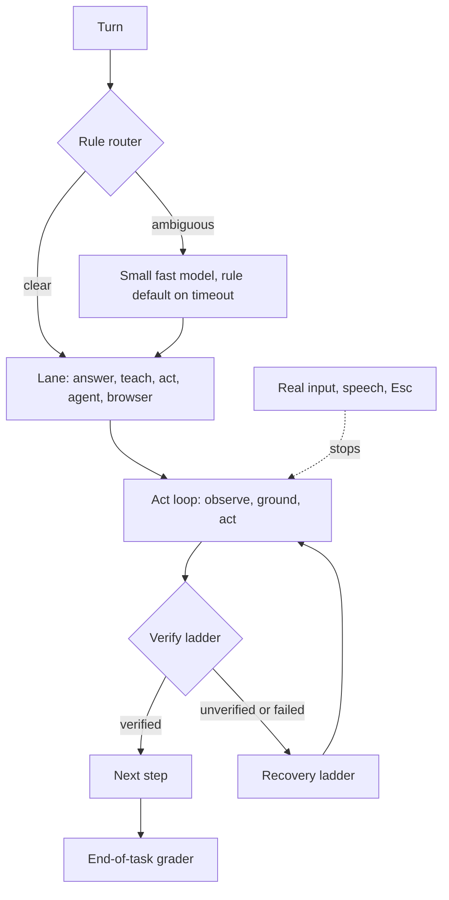

# Wisp v2 - Computer Use at Scale, Browser Lane, OpenRouter SDK, Notch UI - Plan

## Goal Capsule

- **Objective:** A Wisp user on Omarchy can ask for a multi-step job that spans desktop apps and the signed-in browser, and watch it get done reliably, quickly, and stoppable at any moment, at a quality bar users compare favorably with HeyClicky, Claude computer use, OpenAI/Codex computer use and Perplexity Computer, after installing with one line and connecting OpenRouter in a click.
- **Means:** Benchmark-driven grounding with verify-after-act (KTD1, KTD2), a rule-first model router (KTD3), the official OpenRouter SDK behind a "Connect OpenRouter" PKCE flow (KTD5, KTD6), a dedicated browser lane in its own tab group (KTD7), and a notch-home UI on the existing Quickshell shell plugin (KTD8).
- **Authority:** `ROADMAP.md` fixed decisions win until the owner changes them (OpenRouter-only, hosted default, Rust core frozen, no decision model on the routing path, Windows/macOS parked until the Omarchy v1 gate). This plan supersedes nothing; it extends `docs/plans/2026-11-04-1847-feat-wisp-teaching-assistant-parity-roadmap-plan.md` and the work orders in the owner's `wisp-heyclicky-work-orders-2026-11-07.md` (TLY-518..530). Owner decisions listed below block only the units that name them.
- **Execution profile:** One PR per unit, Linux only, Python plus QML. No unit makes a live model call except the capped, owner-run bake-off and live smoke runs (KTD10 of the parity plan still applies). Tests stay hermetic.
- **Stop conditions:** Stop and report if a unit needs a paid call outside the cap, if a change regresses the v1 gate tally, if the one-line install gains a hard dependency, or if a unit would copy third-party code, prompts or assets.
- **Who finishes:** Each unit's own PR. This plan's PR is documentation only.

---

## Product Contract

### Summary

Wisp v1 is a teaching and pointing companion with a secondary click lane that is not yet trustworthy (23% of owner-labelled turns correct, 60% gate). v2 makes the "do it for me" lane trustworthy and scalable: grounded clicks that verify themselves, a browser lane that works in the user's signed-in browser, fast and interruptible steps, first-class OpenRouter onboarding for end users, and a notch-style home that shows chats, agent cards, captions and file piles. Teaching and pointing stay the default for "how do I" asks; v2 adds a reliable drive lane behind them.

### Problem Frame

Evidence in the repo and on this machine:

- Owner labels: 18 of 77 turns correct (23%). Top failure is "no element at model-chosen coordinates" (`docs/research/2026-11-02-gauntlet-reruns.md`). `ROADMAP.md` records 35 labelled turns at 26% for the v1 gate.
- The grounding bake-off harness (`scripts/grounding_bakeoff.py`, `docs/ACCURACY.md` U8) is built and tested offline, but the live run has never happened, so no model is measured. The owner has since named candidates: `qwen/qwen3-vl-235b-a22b-instruct` (new default), `nvidia/nemotron-3.5-super-vl`, `google/gemma-4-31b-it`.
- Open PRs touch the same area: #334 (click rule: trust confident VLM targets on a11y-blind windows) and #335 (interrupt anywhere, TLY-520).
- The browser lane exists in the repo (`browser-extension/`, `docs/BROWSER_LANE.md`, `[browser] lane = "off"`), but on this machine it is not installed: the Chromium profile has no Wisp extension, port 47315 is not listening, and `~/.config/wisp/config.toml` has no `[browser]` section. BrowserOS (extension loaded unpacked, MCP on 9200, something on 9010) is the signed-in browser the owner actually uses.
- `pyproject.toml` has `dependencies = []`: Wisp is stdlib-only and installs with one line. Any SDK adoption must respect that.
- Comparison findings (fetched 2026-11-07, see Appendix): all four reference products loop screenshot, act, observe; none publish numeric per-step budgets; interruption and approval patterns are where HeyClicky is most concrete.

### Requirements

**Computer use**

- R1. Every drive step is bounded by a per-step speed budget (observe, decide, act, verify) recorded per turn and enforced in `wisp/budgets.json`; a breach is logged and escalates (retry once, then hand back).
- R2. Every mutating step is followed by a verification observation (settle diff, element state, or a11y/DOM readback) and the step's verdict is `verified`, `unverified` or `failed`; a model's own claim of success is never the verdict.
- R3. A failed or unverified step triggers a bounded recovery ladder (re-observe, re-ground with a different provider layer, keyboard alternative, ask the user) and never silently falls through to a different injection backend (preserving the `docs/ACCURACY.md` click contract).
- R4. Real mouse movement, speech or Esc stops a drive run in under 300 ms and leaves the desktop untouched afterwards (lands #335).
- R5. The click rule from #334 (confident VLM target accepted on a11y-blind windows) is merged with a measured held-out result, and the element-evidence rule stays the default elsewhere.
- R6. A grounding default is changed only after the live bake-off and a labelled real-turn check, with owner approval.

**Browser**

- R7. Browser work runs in the user's own signed-in browser in a dedicated tab group, with first-use and always-approve choices, file-upload approvals, a visible Stop, and never fills password, code or card fields.
- R8. Wisp detects which browser lane is available (Wisp extension, BrowserOS MCP, none) and states it in `wispd doctor`; none is ever required.

**OpenRouter**

- R9. All Wisp model calls go through one client module; when the `openrouter` SDK is present it is used, and a stdlib fallback keeps the install dependency-free.
- R10. "Connect OpenRouter" runs the OAuth PKCE flow, mints the user's key, and stores it in the platform secret store (Secret Service/keyring, omaseal when present); the key is never written to config, logs or the command line.
- R11. Optional US in-region routing (`us.openrouter.ai`) and a per-model availability check explain a missing model plainly instead of failing a turn.

**UI**

- R12. A notch-style home shows chats and agent cards, captions, a quick peek, and file piles, and offers an optional resizable window; it follows `DESIGN-v2.md`.
- R13. The one-line install, onboarding time and Quickshell dependency do not grow; any native UI toolkit is optional.

**Install and routing**

- R14. WordInk (local speech) and BrowserOS neo are detected and offered, never required.
- R15. Routing is rule-based first; a small fast model decides only on ambiguity; no decision model runs mid-job; a grader scores the finished task.

### Key Decisions

- The v1 gate (60% over 50 labelled turns) remains the release gate; v2 units are measured against it and never replace it.
- Teaching and pointing stay default for learning asks (session-settled upstream in the parity plan); v2 only improves the do-it lane.

### Scope Boundaries

- **Deferred for later:** Windows and macOS (parked until the Omarchy v1 gate); local-model click finder (TLY-451, TLY-485); multi-account connectors (WO-12); hosted trial proxy.
- **Outside this product's identity:** copying HeyClicky code, prompts or assets; training a model; a decision model in front of routing.

### Outstanding Questions

Owner decisions are listed at the end of the plan. Deferred implementation questions are named in the units.

---

## Planning Contract

### Key Technical Decisions

- KTD1. **Measure before switching grounding models.** Run the existing U8 harness live once (cap $0.80, owner-run, `openrouter/orchestral` key via the `orch` wrapper), adding `qwen/qwen3-vl-235b-a22b-instruct`, `nvidia/nemotron-3.5-super-vl` and `google/gemma-4-31b-it` to the candidate list; `qwen3-vl-235b` becomes the vision-brain default only if it wins the held-out set and a labelled real-turn check. Synthetic cases are a screen, not proof (`docs/ACCURACY.md`).
- KTD2. **Verify-after-act is a ladder, not a prompt.** Reuse the `[verify]` verdict ladder (`docs/CONFIG.md`) and extend it with settle-diff and element readback. Claude's docs warn the model "sometimes acts as if its actions succeeded", and OpenAI's `status: completed` means generated, not executed, so Wisp's runtime must decide the verdict.
- KTD3. **Rule-based router first.** The regex/fast-path layer stays in front; a small fast model (`nvidia/nemotron-3.5-lightning`) is called only when rules return "ambiguous", with a hard timeout and a rule default. No decision model mid-job (honors `ROADMAP.md`). An end-of-task grader (same small model, rubric from the task text and verify verdicts) feeds `wispd eval` as a suggestion, never as an owner label.
- KTD4. **Model roles.** Vision brain: `qwen/qwen3-vl-235b-a22b-instruct` pending KTD1. Agents (ACP/OpenCode): `particle-ai/particle-1` (already first in the ACP candidate list). Fast text/routing: small model per KTD3. All roles configurable under `[models]`-style keys and priced in `wisp/ledger.py`.
- KTD5. **SDK without a hard dependency.** `pyproject.toml` stays `dependencies = []`. The installer offers the `openrouter` SDK (Apache-2.0, Python 3.10+, sync/async/streaming, typed) into Wisp's own private venv or vendored directory; `wisp/llm.py` prefers it and falls back to the current stdlib HTTP path. Deferred: whether to vendor or venv (decide in U12 after measuring install time).
- KTD6. **PKCE through the loopback, headless fallback.** Auth URL `https://openrouter.ai/auth` with `code_challenge` (S256), `callback_url` on a loopback port; exchange at `POST https://openrouter.ai/api/v1/auth/keys` with `code`, `code_verifier`, `code_challenge_method`. Headless mode omits `callback_url` and shows a code (single-use, 10 minute expiry). Store via Secret Service first, omaseal when installed, never plaintext config. Key labelled "Wisp".
- KTD7. **Two browser lanes, one tool.** The `browser` tool keeps one interface and chooses a backend: the Wisp extension (Chromium, tab group, pairing code) or BrowserOS MCP (`http://127.0.0.1:9010/mcp` here; confirm port in U9). Chromium only: the extension requires `tabGroups`, which Firefox does not provide, so Firefox is out of scope for v2 (UNVERIFIED for future Firefox support). Opening Wisp's own extension is not required if BrowserOS is detected.
- KTD8. **Stay on Quickshell/QML for the notch.** See the rune section below. Resizable window is a second QML surface in the same plugin.
- KTD9. **Regional routing is an option, not a default.** `us.openrouter.ai` and `eu.openrouter.ai` are Business/Enterprise per OpenRouter's docs (read 2026-11-07, UNVERIFIED for individual accounts), so the setting is off by default and the availability check handles the error plainly; a model with no in-region endpoint errors rather than leaving the region.
- KTD10. **Interrupt is a first-class input.** The drive loop polls a stop flag fed by real-pointer motion, speech start and Esc between every sub-action, not only between steps.

### Agent loop comparison (summary)

| Aspect | Claude computer use | OpenAI/Codex computer use | Perplexity Computer | HeyClicky | Wisp v2 target |
|---|---|---|---|---|---|
| Loop | tool_use, tool_result, repeat until no calls; batch stops at first failure | ordered `actions` array until no `computer_call`; or code execution | async, isolated environment, parallel agents (details UNVERIFIED) | talk mode points only; agent lane clicks via native driver | observe, ground, act, verify, recover; teaching lane stays point-only |
| Observation | screenshot, `zoom`, cursor text | screenshot, `detail: original` | UNVERIFIED | screenshot plus tag; a11y collection removed | a11y/control first, VLM second, DOM in browser |
| Verify | prompt advice only | app-side check | UNVERIFIED | checks screen before next step (1.1.3) | runtime verdict ladder (KTD2) |
| Recovery | `is_error`, zoom, keyboard fallback | restart env, retry caps | UNVERIFIED | retry button, restart helper | bounded ladder (R3) |
| Safety | VM, allowlist, human confirm | isolated browser, confirm risk points | "check in" | Allow once/Always/Not now, 30 min block | existing T2 gates plus per-site approval |
| Interrupt | not documented in what was read | "support cancellation" | UNVERIFIED | mouse, speech, Esc; Stop button | KTD10, under 300 ms |

Sources are in the Appendix. Anything marked UNVERIFIED could not be confirmed from a primary page.

### High-Level Technical Design

### Browser lane status on this machine (read-only inspection, 2026-11-07)

- Repo: `browser-extension/` (manifest, `background.js`, `lib.js`, popup) with `docs/BROWSER_LANE.md`; Chromium MV3 with `tabs`, `tabGroups`, `scripting`; pairing code, snapshot-epoch refs, secret-field refusal, Stop in popup.
- Installed locally: no. Chromium's extension list holds 1Password, Omarchy defaults and the BrowserOS extension (loaded unpacked from `~/.local/share/browseros/extension`); no Wisp extension. Port 47315 is not listening, and `~/.config/wisp/config.toml` has no `[browser]` section, so the lane is off.
- BrowserOS neo: ports 9200 and 9010 are listening. The 9010 MCP endpoint named in the request was not probed beyond the listening socket (no MCP call made, nothing installed). Firefox: no profile on this machine.
- Gap: Wisp's `browser` tool speaks only to its own extension. Using BrowserOS means an MCP client path (`wisp/tools/mcpclient.py` exists) with its own tab group, which is U9.
- OpenCode (anomalyco/opencode): its README names no built-in browser tool; browser use would be a local or remote MCP server entry in `opencode.jsonc` (`type: local` or `remote`, Streamable HTTP). So Wisp's ACP agents can reach BrowserOS through MCP, but nothing browser-specific ships with OpenCode (browser MCP compatibility is UNVERIFIED).

### rune vs Quickshell/QML (verdict: do not adopt for the shell; no gain for the site)

- Facts (github.com/anomalyco/rune, read 2026-11-07): MIT, Rust, own GPU renderer, layout and springs, targets macOS, Windows, Linux and web; 3.7k stars; 91 open issues; no releases and the page calls it pre-release, pin a `dev` revision; does not accept pull requests. Text input, lists, images, transparency and layer-shell/overlay support are not stated, and no Python binding exists. Wayland support is not mentioned.
- Fit: Wisp's UI is a Quickshell plugin that gets layer-shell, theming and the Omarchy bar for free and is installed by the same one-line installer. A Rust GPU toolkit would add a Cargo toolchain or a prebuilt binary, a second IPC surface and an unproven overlay story, against R13. Its natural role is the future Windows/macOS shells, which are parked.
- Decision: keep Quickshell/QML for v2. Revisit rune only after the Omarchy v1 gate, as a candidate for the cross-OS shell (a spike gated by: tagged release, layer-shell or equivalent, text input, Wayland proof).
- wisp.observer: the site was rebuilt on launch-ui with a ThreeUI hero (#330). rune adds nothing there: it is not a web page framework, its web target is a different delivery path, and the site's constraint is a no-script fallback and small size. No change.

---

## Implementation Units

### Unit Index

| U-ID | Title | Priority | Size | Depends on |
|---|---|---|---|---|
| U1 | Live grounding bake-off and default decision | P0 | S | owner run |
| U2 | Land #334 click rule with held-out measurement | P0 | S | U1 data helpful |
| U3 | Land #335 interrupt anywhere, under 300 ms | P0 | M | none |
| U4 | Verify-after-act ladder | P0 | L | U2 |
| U5 | Per-step speed budgets | P1 | M | U4 |
| U6 | Recovery ladder | P1 | M | U4 |
| U7 | Rule router, ambiguity model, end-of-task grader | P1 | M | none |
| U8 | Model roles config and pricing | P1 | S | U1, U7 |
| U9 | Browser lane: BrowserOS MCP backend and detection | P1 | L | none |
| U10 | Browser approvals, uploads, tab group, signed-in profile | P1 | M | U9 |
| U11 | Single LLM client module | P0 | M | none |
| U12 | OpenRouter SDK as optional backend | P1 | M | U11 |
| U13 | Connect OpenRouter (PKCE) and key storage | P0 | M | U11 |
| U14 | US routing and model availability checks | P2 | M | U11, U13 |
| U15 | Notch home: chats and agent cards | P1 | L | U3 |
| U16 | Captions, quick peek, file piles | P2 | M | U15 |
| U17 | Resizable window | P2 | L | U15 |
| U18 | Onboarding and doctor: optional integrations | P1 | M | U9, U13 |
| U19 | Computer-use eval suite and benchmark gate | P0 | L | U4 |
| U20 | Rune and cross-OS shell spike (post v1 gate) | P3 | S | v1 gate |

### U1. Live grounding bake-off and default decision

- **Goal:** Replace the unmeasured default with a measured one.
- **Requirements:** R6.
- **Files:** `scripts/grounding_bakeoff.py`, `docs/ACCURACY.md`, `wisp/config.py`.
- **Approach:** Add the three owner-named candidates to the harness defaults and keep `gemini-2.5-flash` as the reference row (not open weight, labelled). Owner runs the documented live command under the orchestral key with the cap. Record the table, date and seed in `docs/ACCURACY.md`. Switching `[ground]`/vision defaults is a separate PR gated on owner approval and a labelled real-turn check.
- **Test scenarios:** Harness stays hermetic (network patched to fail); candidate list parses; oracle provider still scores 100% on every canvas; spend cap exit code 3 unchanged.
- **Verification:** Offline tests pass; table pasted with `n` per row.

### U2. Land #334 click rule with held-out measurement

- **Goal:** Settle when a confident VLM target is trusted.
- **Requirements:** R5.
- **Files:** `wisp/act.py`, `wisp/grounding.py`, `docs/ACCURACY.md`, `tests/`.
- **Approach:** Review #334 against the element-evidence contract; trust only when the window is a11y-blind and confidence plus aspect-matched VLM agree, with the refusal path intact otherwise. Rerun the gauntlet held-out set on the isolated session and record next to `docs/research/2026-11-02-gauntlet-reruns.md`.
- **Test scenarios:** Blind window plus confident target clicks; sighted window without element still `REFUSED`; low confidence refused; sensitive-surface T2 still prompts.
- **Verification:** `pytest` clean; held-out not worse than clean master (5/7 baseline).

### U3. Land #335 interrupt anywhere

- **Goal:** Any real input stops a drive run quickly.
- **Requirements:** R4; KTD10.
- **Files:** `wisp/act.py`, `wisp/realinput.py`, `wisp/stage_execute.py`.
- **Approach:** Merge #335, then add a stop-latency probe: stop flag checked between sub-actions, latency recorded per run, budget 300 ms in `wisp/budgets.json`.
- **Test scenarios:** Pointer motion mid-type stops; speech start stops; Esc stops; stop leaves no held keys or buttons; an own-injected motion does not self-trigger.
- **Verification:** Fake-input tests; one owner live check on the compositor.

### U4. Verify-after-act ladder

- **Goal:** The runtime, not the model, decides whether a step worked.
- **Requirements:** R2.
- **Files:** `wisp/verify.py`, `wisp/act.py`, `docs/CONFIG.md`.
- **Approach:** After each mutating step capture a settle diff and read back the target (a11y state, DOM value in browser). Emit `verified`, `unverified`, `failed` with the evidence kind. A turn reports done only if its final steps are verified or the user confirmed.
- **Test scenarios:** Click that changes nothing is `unverified`; typed text read back; model claims success but diff is empty gives `failed`; DOM readback in browser; verification timeout.
- **Verification:** Replay fixtures green; verdicts appear in `wispd dev turns`.

### U5. Per-step speed budgets

- **Goal:** Each step has a measurable time budget.
- **Requirements:** R1.
- **Files:** `wisp/budgets.json`, `wisp/devreport.py`, `docs/CONFIG.md`.
- **Approach:** Set observe, decide, act, verify budgets (starting numbers chosen from the first live data, not guessed here); breach logs and triggers one retry then hand-back. Show in the Dev tab.
- **Test scenarios:** Budget breach recorded; breach does not loop; budgets overridable in config.
- **Verification:** Dev tab tally includes per-step time.

### U6. Recovery ladder

- **Goal:** Failed steps recover without escalating blindly.
- **Requirements:** R3.
- **Files:** `wisp/act.py`, `wisp/grounding.py`.
- **Approach:** Ladder: re-observe, re-ground with the next provider in the chain, keyboard alternative, ask the user. Max rungs per step and per run; never switch injection backend automatically.
- **Test scenarios:** Ladder order; rung cap; ask-user rung speaks once; no backend switch.
- **Verification:** Gauntlet cases that previously ended in false completion now end in a truthful outcome.

### U7. Rule router, ambiguity model, grader

- **Goal:** Cheap, predictable routing and a task-level score.
- **Requirements:** R15; KTD3.
- **Files:** `wisp/route.py`, `wisp/stage_route.py`, `wisp/devjudge.py`.
- **Approach:** Rules return `clear(lane)` or `ambiguous`; ambiguous calls the small model once with a 1.5 s timeout and falls back to the rule default; no mid-job routing calls. Grader runs once at task end and writes a suggestion to the turn record.
- **Test scenarios:** Clear rules never call a model; timeout falls back; grader output never counts as an owner label; retired Jev tripwire still fails on stray calls.
- **Verification:** 36+7 replay fixtures unchanged.

### U8. Model roles config and pricing

- **Goal:** Roles are explicit and priced.
- **Requirements:** R15; KTD4.
- **Files:** `wisp/config.py`, `wisp/ledger.py`, `docs/CONFIG.md`, `docs/COSTS.md`.
- **Approach:** Keys for vision, agent, fast; prices for the new IDs; defaults unchanged until U1 and owner approval.
- **Test scenarios:** Unknown model has an unpriced warning; role override works.
- **Verification:** `wispd doctor` shows the three roles.

### U9. Browser lane: BrowserOS MCP backend and detection

- **Goal:** The browser tool works through whichever lane exists.
- **Requirements:** R7, R8; KTD7.
- **Files:** `wisp/tools/browser.py`, `wisp/tools/mcpclient.py`, `docs/BROWSER_LANE.md`, `wisp/health.py`.
- **Approach:** Add a backend interface with `extension` and `mcp` implementations; detect BrowserOS by probing the configured loopback MCP URL (config key, not hard-coded; confirm 9010 vs 9200 in the first step), then the extension, else report none. The agent works in its own tab group where the backend supports it.
- **Test scenarios:** Fake MCP server; none available gives a setup message; snapshot-epoch rule preserved on both backends; kill switch refuses both; non-http URLs refused.
- **Verification:** `wispd doctor` browser line; owner live check against BrowserOS neo.

### U10. Browser approvals, uploads, tab group, profile

- **Goal:** Safe signed-in browsing.
- **Requirements:** R7.
- **Files:** `wisp/tools/browser.py`, `wisp/policy.py`, `browser-extension/`.
- **Approach:** Per-site Allow once / Always / Not now (with a 30 minute block on Not now); file upload needs an approval naming the file; password, code and card fields never filled; own tab group per task, closed on completion; profile follows the existing Personal/Work detection.
- **Test scenarios:** Upload refused without approval; always-approve persists per site; secret fields listed as never filled on both backends; tab group closed at task end.
- **Verification:** Hermetic tests plus one live check.

### U11. Single LLM client module

- **Goal:** One seam for every model call.
- **Requirements:** R9.
- **Files:** `wisp/brain.py`, `wisp/recall.py`, `wisp/devjudge.py`, `wisp/context.py`, new `wisp/llm.py`.
- **Approach:** Move the scattered urllib calls behind `llm.chat/stream/embed` preserving attribution headers, ledger accounting and error classes. Pure refactor.
- **Test scenarios:** Behavior-preserving across replay fixtures; errors map to the existing error kinds (`key_missing`, `brain_down`).
- **Verification:** Test suite green with no network.

### U12. OpenRouter SDK as optional backend

- **Goal:** Use the official SDK when present.
- **Requirements:** R9; KTD5.
- **Files:** `wisp/llm.py`, installer scripts, `docs/INSTALL.md`.
- **Approach:** Backend selected at import; installer offers the SDK in a private environment and reports install time; fallback is the stdlib path. Provider options (`zdr`, `sort`, `data_collection`) map to the SDK `provider` argument.
- **Test scenarios:** SDK absent falls back; SDK present is used; same results on a recorded fixture.
- **Verification:** One-line install time before and after recorded; install still succeeds offline from the SDK's side.

### U13. Connect OpenRouter (PKCE) and key storage

- **Goal:** One click mints the user's own key.
- **Requirements:** R10; KTD6.
- **Files:** `wisp/onboard.py`, new `wisp/oauth_openrouter.py`, `wisp/secrets.py` (store seam), `docs/PRIVACY.md`.
- **Approach:** Generate verifier and S256 challenge and a state value; open the browser to the auth URL with a loopback callback; exchange the code; store in Secret Service/keyring, omaseal when present; fall back to headless code entry. Never print or log the key. Add `wispd keys disconnect`.
- **Test scenarios:** Challenge matches verifier; state mismatch refused; denied callback handled; expired or reused code gives a plain message; key absent from config, argv and logs.
- **Verification:** Fake OAuth server tests; owner live connect on a throwaway key.

### U14. US routing and model availability checks

- **Goal:** Optional in-region routing with plain errors.
- **Requirements:** R11; KTD9.
- **Files:** `wisp/llm.py`, `wisp/health.py`, `wisp/settings_schema.py`.
- **Approach:** `[openrouter] region = ""|"us"|"eu"` switches the base URL; availability check uses `GET /api/v1/models` (endpoints and providers filters) and a regional probe; the exact per-model endpoint path comes from each model's `links.details` (not guessed). A missing in-region model gives a spoken explanation and a fallback offer.
- **Test scenarios:** Region switches URL only; regional error mapped; no network in tests.
- **Verification:** Doctor shows region and per-role availability.

### U15. Notch home: chats and agent cards

- **Goal:** A HeyClicky-class home surface.
- **Requirements:** R12.
- **Files:** `shell-plugin/Panel.qml`, `shell-plugin/components/AgentsTab.qml`, `AgentRow.qml`, `Bubble.qml`, `shell-plugin/lib/`.
- **Approach:** Notch-anchored surface listing recent chats and agent cards (short name, state, Stop, arrow-key flip), reusing the existing Panel tabs; verified by capture on the primary display per `DESIGN-v2.md`.
- **Test scenarios:** Cards reflect agent state; Stop works; reduced motion respected; focus never stolen.
- **Verification:** Capture evidence in the PR.

### U16. Captions, quick peek, file piles

- **Goal:** Answers fold to captions; files stack in piles.
- **Requirements:** R12.
- **Files:** `shell-plugin/components/Answer.qml`, new `FilePile.qml`, `shell-plugin/lib/companion.js`.
- **Approach:** Folding the panel moves the remainder of an answer to bottom captions (`voice.captions`); quick peek on hover; dropped files form a pile attached to the chat as document context (`[docs]`).
- **Test scenarios:** Fold and unfold; captions toggle; pile limits and sensitive-path refusal.
- **Verification:** Capture evidence.

### U17. Resizable window

- **Goal:** Optional window with sidebar of chats and agents.
- **Requirements:** R12.
- **Files:** `shell-plugin/` (new window component), settings schema.
- **Approach:** Second QML surface, off by default, following system light/dark.
- **Test scenarios:** Resize persists; closing leaves the notch intact.
- **Verification:** Capture evidence.

### U18. Onboarding and doctor: optional integrations

- **Goal:** One line installs; integrations are offered, never required.
- **Requirements:** R13, R14.
- **Files:** `wisp/onboard.py`, `wisp/health.py`, `docs/INSTALL.md`.
- **Approach:** Detect WordInk (local speech), BrowserOS neo and the Wisp extension; show each as available, offered or absent; onboarding ends in under the current step count.
- **Test scenarios:** Each detection absent still onboards; offers are skippable; doctor lists them.
- **Verification:** Clean-box onboarding receipt.

### U19. Computer-use eval suite and benchmark gate

- **Goal:** Make "reliable at scale" a number.
- **Requirements:** R1, R2, R6.
- **Files:** `wisp/gauntlet.py`, `scripts/gauntlet/`, `docs/research/`.
- **Approach:** Extend gauntlet cases to multi-step, cross-app and browser tasks; report success, verified rate, steps, time per step and cost per task; publish a table per release. Judge output is not an owner label.
- **Test scenarios:** Case battery runs on the isolated session; skips carry reasons; results reproducible by seed.
- **Verification:** Table committed with date and model IDs.

### U20. Rune and cross-OS shell spike

- **Goal:** Decide on a cross-OS UI toolkit with evidence, after the gate.
- **Requirements:** R13.
- **Files:** `docs/research/` only.
- **Approach:** Time-boxed spike gated by rune's tagged release, layer-shell-class overlay support, text input and Wayland proof.
- **Test scenarios:** Not applicable (research note).
- **Verification:** Note committed.

---

## What makes Wisp beat HeyClicky

1. **Honest verification.** HeyClicky's own changelog admits its agent is not good at controlling the computer yet. A runtime verdict ladder plus a published benchmark table (U4, U19) is something a user can check.
2. **Bring your own key, visible cost.** "Connect OpenRouter" (U13) with per-role models and `wispd spend` honesty, no plans or referrals.
3. **Open and inspectable.** Local audit log, dev tab, per-turn stage timing, MIT code; nothing leaves the machine except model calls.
4. **Signed-in browser of your choice.** BrowserOS neo or the Wisp extension, in a tab group, with per-site approvals (U9, U10).
5. **Teaching plus doing.** The tutor loop stays default for "how do I", and the drive lane is only reached with a verified loop.
6. **Linux-first fit.** Hyprland and Omarchy awareness, Quickshell notch, no Electron.
7. **Choice of models.** Vision brain, agents and fast router are swappable on a measured basis.

HeyClicky currently leads on polish, voice robustness, packaging and a Mac-first reach; the plan closes the first two (U15-U17, WO-8) and defers the rest.

## Verification Contract

| Gate | Command or evidence | Applies to |
|---|---|---|
| Unit tests | `uv run pytest` (hermetic, no network) | all units |
| Docs lint | repo docs-lint config check | docs changes |
| Replay fixtures | existing 36 act and 7 answer fixtures stay green | U7, U11 |
| Gauntlet | isolated session held-out set, results next to `docs/research/2026-11-02-gauntlet-reruns.md` | U2, U6, U19 |
| Bake-off | `python scripts/grounding_bakeoff.py --live --cap 0.80 ...` (owner) | U1 |
| UI capture | primary-display capture per `DESIGN-v2.md` | U15-U17 |
| v1 gate | `wispd eval`: 60% over 50 labelled turns since 2026-11-03 | release |

## Definition of Done

- Each unit's tests and verification pass; no live model call in the test suite.
- v1 gate tally does not regress; U19 table published.
- One-line install still has no hard dependency; time recorded (U12).
- No key in config, argv, logs or captures (U13).
- Abandoned experiments and dead code from any unit are removed from the diff.
- Owner decisions below are resolved before the units that name them merge.

## Owner decisions

1. **Default vision model:** switch to `qwen3-vl-235b-a22b` only after U1 and a labelled check; approve the live bake-off spend (cap $0.80, orchestral key).
2. **SDK packaging (U12):** private venv or vendored copy, and whether the SDK becomes a default or stays optional.
3. **Secret store (U13):** Secret Service plus omaseal-when-present, or omaseal only.
4. **US routing (U14):** it is Business/Enterprise per OpenRouter docs; keep as an off-by-default advanced option or drop for now.
5. **Browser lane:** make BrowserOS MCP the primary backend on this machine, or install the Wisp extension (U9); confirm 9010 versus 9200.
6. **rune:** confirm the verdict (stay on Quickshell; revisit after the v1 gate).
7. **Router small model:** approve `nvidia/nemotron-3.5-lightning` for ambiguity and grading (price and ID unverified here).
8. **Resizable window (U17):** in v2 or defer behind the notch work.

## Appendix

Sources fetched 2026-11-07 (subagent research, secondary where noted):

- Claude computer use: https://platform.claude.com/docs/en/agents-and-tools/tool-use/computer-use-tool (page truncated; interruption not confirmed)
- OpenAI: https://developers.openai.com/api/docs/guides/tools-computer-use (Codex app details from third-party only, UNVERIFIED)
- Perplexity Computer: https://www.perplexity.ai/hub/blog/introducing-perplexity-computer (marketing; loop details UNVERIFIED)
- HeyClicky: https://www.heyclicky.com/changelog; local notes `wisp-vs-clicky.md` and `wisp-heyclicky-work-orders-2026-11-07.md`
- rune: https://github.com/anomalyco/rune; opencode: https://github.com/anomalyco/opencode and https://opencode.ai/docs/mcp-servers
- OpenRouter: https://pypi.org/project/openrouter/ (v1.3.139), https://openrouter.ai/docs/guides/overview/auth/oauth, https://openrouter.ai/docs/guides/routing/provider-selection, https://openrouter.ai/docs/guides/features/in-region-routing
