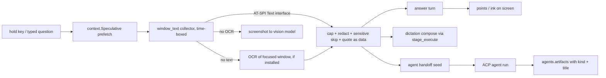

# Wisp rescope - the Linux voice companion for any window, any user - Plan

## Goal Capsule

- **Objective:** A person who installs Wisp on their own Hyprland desktop can hold a key, ask about anything in the window they are looking at, and get a spoken, on-screen answer that points at what matters, plus dictation and background agents that understand that window. Setup needs only an OpenRouter key and a microphone, and the repository holds no personal information about its maintainer beyond the copyright holder in `LICENSE`.
- **Means:** close the gaps against HeyClicky on the companion (answer, point, dictate, agents) first, make defaults generic, and move autonomous clicking last (KTD1, KTD2, KTD3, KD4).
- **Authority:** this plan's Product Contract, then its Key Technical Decisions, then `ROADMAP.md` (which U1 rewrites). Where it disagrees with `docs/plans/2026-11-07-1500-feat-wisp-v2-computer-use-plan.md`, this plan wins on priority and scope; that plan's unit designs stay valid where reused here.
- **Stop conditions:** stop and ask before a paid live model run beyond a test fixture, any change to an installed daemon or user config, rewriting git history, or deleting a maintainer-only feature that has no generic replacement in this plan.
- **Execution profile:** units land as separate PRs in Unit Index order; hermetic tests only (no live model calls, network or audio) except the owner-run steps in the Verification Contract.

## Product Contract

### Summary

Wisp becomes the Linux counterpart of a cursor-side voice companion: it sees the focused window, answers anything about it, points and draws on the real screen, writes dictation that fits what is on screen, and runs background agents whose results come back as files. Clicking for the user stays available but moves to the end of the roadmap. The repository is scrubbed of maintainer-specific identity, machines, paths and defaults.

### Problem Frame

Wisp already ships most of the companion surface (cursor buddy with state words, hold-to-talk and typed questions, spoken answers with captions, rings, arrows, highlights and scribbles on screen, walkthroughs, background agents over ACP, dictation). Recent planning drifted toward the maintainer's own environment: a browser lane for one browser product, a personal key store, local model servers, region routing, and defaults that name the maintainer's tools, dashboards, browser profiles and machines. Shipped code even seeds every user's memory with the maintainer's identity. A new user gets a product tuned for someone else, and the repository exposes personal information.

The reference competitor (HeyClicky, macOS and Windows, no Linux) shows the target experience: one general companion that helps in any app. Wisp's answer turns today see a window's title, a screenshot and open documents, but not the window's own text; dictation sees only the window title.

### Requirements

**Companion**

- R1. A turn can answer a question about the focused window in any app using the window's own text when the app exposes it, then OCR of the window, then the screenshot through the vision model.
- R2. Dictation in compose mode uses the focused window's text, so "reply to this email" or "turn this into a prompt" drafts against what is on screen and inserts it into the focused field.
- R3. A failed turn, dictation or agent run shows its error with a Retry action that repeats the same request, for errors where repeating can help.
- R4. Background agents can be proposed in a daily "suggested for you" feed with Yes, Adjust and No; Adjust edits the proposal in one line before it runs.
- R5. Agent results are listed as typed artifacts (draft, report, table, other) that the user can open or copy from the agents view.
- R6. A spoken handoff while looking at a window ("keep going on this in the background") starts a background agent seeded with that window's context.

**Install, defaults and privacy**

- R7. On a Hyprland desktop, a new user can install and use Wisp with an OpenRouter key and a microphone: speech-to-text defaults to a local model that onboarding downloads. Every other integration (cloud speech providers, other key stores, activity journals, local model servers, browser lanes, region routing) is optional, detected and skippable.
- R8. OpenRouter is the model engine. The default region stays global; the US region remains an opt-in setting.
- R9. The working tree contains no maintainer personal information (names in prose, hostnames, home paths, emails, personal repositories or key names), except the copyright holder in `LICENSE`, and CI fails if it is reintroduced. Git history is out of scope unless the owner decides otherwise (Outstanding Questions).

**Roadmap and reliability**

- R10. `ROADMAP.md` states this direction and priority order and stays the single roadmap.
- R11. Reliability is measured on generic answer-and-point tasks on common apps and public sites that anyone with an OpenRouter key can run on Hyprland.
- R12. Autonomous clicking work (grounding, click rules, verify-after-act, recovery) is sequenced after R1-R11.

### Key Decisions

- KD1. **Companion over integrations.** The core is the agent that uses the focused window and answers anything; maintainer integrations become optional add-ons. Governs R1, R2, R7. (session-settled: user-directed - chosen over a roadmap centered on the maintainer's browser lane, key store and local model servers: Wisp must work for people on their own OS)
- KD2. **Linux only.** No macOS or Windows work in this roadmap; the core targets Hyprland desktops (Omarchy or not), other Linux desktops are stretch goal S3. Governs R7, R10, R11. (session-settled: user-directed - chosen over macOS/Windows support: Wisp is the Linux answer to HeyClicky)
- KD3. **OpenRouter is the engine.** Governs R7, R8. (session-settled: user-directed - chosen over treating OpenRouter as one optional backend: it is the product's engine)
- KD4. **Clicking last.** Governs R12. (session-settled: user-directed - chosen over click-first: pointing, answering, presence, dictation and agents come first)
- KD5. **No personal information in the repository.** Governs R9. (session-settled: user-directed - chosen over keeping maintainer notes, paths, hostnames and identity in docs and code: Wisp is a public, general-user product)

### Scope Boundaries

- In: the units below, `ROADMAP.md`, generic defaults, the scrub and its CI guard.
- Out: macOS and Windows (KD2); new local model servers; changing the Rust core (frozen per `ROADMAP.md`); a desktop-keyring key store (keys stay in the environment or the 0600 `.env` file onboarding writes).
- Optional add-ons, kept as they are: the browser lane (v2 plan U9, U10); US routing (shipped in #340 and #346; the `region_denied` error is PR #347). The OpenRouter SDK (v2 U12) is an optional transport to the same engine; the standard-library HTTP path stays the default.

### Deferred to Follow-Up Work

- Clicking reliability: v2 plan U1 (grounding bake-off), U2 (click rule), U4 (verify-after-act), U5 (speed budgets), U6 (recovery), sequenced by U13.
- Notch home, captions and quick peek, resizable window (v2 U15-U17) follow the core units.

### Success Criteria

- On a clean Hyprland home with only an OpenRouter key and a microphone, Wisp answers a question about an open web page and an open PDF using the window's text (accessibility text, the existing PDF reader, or OCR), and about a terminal using its text where the terminal exposes it, otherwise its screenshot.
- The personal-info guard passes in CI and fails on a planted test string.
- The generic gauntlet publishes an answer-and-point score table that anyone with an OpenRouter key can reproduce on Hyprland.

### Outstanding Questions

- Q1 (owner, deferred): should git history be rewritten to remove personal information from earlier commits? It needs a force-push and breaks existing clones and PR references, so it is outside this plan unless the owner asks.

### Sources

- HeyClicky official videos (youtube.com/@heyclicky), reviewed 2026-11-08 by frames and transcripts: cursor-side companion with state labels, hold-to-talk plus typing, on-screen rings and callouts, step-by-step diagram cards, screen-aware dictation in mail and terminals, background agents with a daily suggestion feed (Yes/Adjust/No) and artifact results, error tiles with Retry.
- `ROADMAP.md` (Shipped list), `docs/LINUX.md`, `docs/research/2026-10-31-multi-os-prep.md`.

## Planning Contract

### Key Technical Decisions

- KTD1. **Window text, then OCR, then pixels.** The current AT-SPI element reader (`wisp/elementtree.py`) collects control labels for grounding, not body text, so the collector adds a bounded read of the AT-SPI Text interface for document, text, terminal and paragraph roles, with its own node and time caps; `wisp/blank.py` (`window_text`) is the precedent for reading a window's text. When it yields nothing useful, OCR the focused-window crop (`tesseract` when installed; onboarding offers it), then fall back to the screenshot for the vision model. PDFs keep the existing document reader (`wisp/docread.py`). Implements KD1.
- KTD2. **One collector, prefetched, treated as untrusted.** A single collector (new `wisp/window_text.py`) feeds answers (R1), dictation (R2) and agent handoff (R6). It starts in `context.Speculative` at key press with a time budget (text read 300 ms, OCR 700 ms) so a turn never waits past it; a late result is dropped as source `none`. Its text is wrapped as quoted reference data in prompts and agent seeds, never as instructions, and never written to stderr logs. Sensitive-window and selection-redaction rules apply once, here.
- KTD3. **Generic defaults; maintainer features become config.** Anything describing one person's setup becomes a config value with an empty default, a detected optional bridge, or is removed. Implements KD5 and R7.
- KTD4. **Region default is already global.** `wisp/config.py` ships `region = "global"` and `wisp/region.py` treats unknown values as global; U4 only adds a regression test. Any wording about the US `region_denied` error waits for PR #347 to merge. Implements R8.
- KTD5. **The denylist lives outside the repository.** Hashing names in a public test is reversible by guessing, so the guard reads denied tokens from a CI secret (and from a local file outside the repo for pre-push runs) and scans tracked text files for them; with no list configured it skips with a notice. It prints file and line, never the token. `LICENSE` is exempt. Implements R9.
- KTD6. **Artifacts extend the existing listing.** `agents.artifacts()` and the `task_artifacts` IPC already list an agent's output files with containment checks and an `openable` flag; U11 adds a kind and title (from file type or an optional manifest the agent writes) and Open and Copy actions, without a second index. Implements R5.
- KTD7. **The suggestion feed uses local window history.** `wisp/suggest.py` mines the `[sense]` activity window, which is off by default; the feed's opt-in turns on `[sense]` window-delta history (local only) and says so, while third-party journal bridges stay optional. Implements R4.

### High-Level Technical Design

Directional only.

### Assumptions

- Browsers expose page text over AT-SPI only when their accessibility support is on; where it is off, OCR or the screenshot carries the answer.
- A local whisper model downloaded during onboarding is fast enough for push-to-talk on typical laptops; Groq stays the faster optional provider.
- Other Linux desktops are a stretch goal (S3); core units add no new direct Hyprland calls outside `wisp/platform.py` and `wisp/hypr.py`.

### Sequencing

U1 (roadmap) and U2 (code scrub plus the guard tool) first, then U3 (docs scrub; guard required in CI), so every later PR passes the guard. U4 (generic defaults) next. U5 (collector) unlocks U6 (answers), U7 (dictation) and U10 (handoff). U8 (Retry), U9 (feed) and U11 (artifacts) are independent of U5. U12 (generic eval) starts once U6 lands. U13 (clicking) is last.

## Implementation Units

### Unit Index

| U-ID | Title | Files touched | Depends on |
|---|---|---|---|
| U1 | Rewrite `ROADMAP.md` | `ROADMAP.md`, `docs/ROADMAP.md` | none |
| U2 | Code scrub and the guard tool | `wisp/memory.py`, `wisp/skills_seed/`, `wisp/cli/settings.py`, `wisp/skills.py`, `wisp/tui.py`, `wispd`, `wisp/config.py`, `wisp/context.py`, `scripts/brand/render_wisp_flame.sh`, `scripts/personal_info_scan.py`, `tests/` | none |
| U3 | Docs scrub; guard required in CI | `docs/`, `tests/test_personal_info.py`, `.github/workflows/test.yml` | U2 |
| U4 | Generic stock-install defaults and onboarding | `wisp/config.py`, `wisp/onboard.py`, `wisp/omarchy_tutor.py`, `docs/INSTALL.md`, `tests/test_onboard.py` | U2 |
| U5 | Window-text collector | `wisp/window_text.py`, `wisp/context.py`, `tests/test_window_text.py` | U2 |
| U6 | Answer anything about the focused window | `wisp/stage_capture.py`, `wisp/context.py`, `tests/test_window_answer.py` | U5 |
| U7 | Screen-aware dictation | `wisp/dictate.py`, `wisp/stage_execute.py`, `tests/test_dictate.py` | U5 |
| U8 | Error tiles with Retry | `shell-plugin/components/Bubble.qml`, `wisp/ipc.py`, `wispd`, `tests/test_retry.py` | none |
| U9 | Daily suggested-agents feed with Adjust | `wisp/suggest.py`, `wisp/suggest_policy.py`, `wisp/routines.py`, `wisp/onboard.py`, `shell-plugin/components/`, `tests/test_suggest.py` | none |
| U10 | Voice handoff to a background agent | `wisp/agents.py`, `wisp/acp*.py`, `tests/test_agent_handoff.py` | U5 |
| U11 | Typed agent artifacts | `wisp/agents.py`, `wisp/ipc.py`, `shell-plugin/components/AgentsTab.qml`, `shell-plugin/components/RunCard.qml`, `tests/test_artifacts.py` | none |
| U12 | Generic eval: answer-and-point gauntlet | `docs/dev-tasks/gauntlet.jsonl`, `scripts/gauntlet.py`, `wisp/gauntlet.py`, `tests/test_gauntlet_*.py`, `docs/research/` | U6 |
| U13 | Clicking reliability (v2 U1, U2, U4-U6) | per v2 plan | U1-U12 |

### U1. Rewrite `ROADMAP.md`

- **Goal:** the single roadmap states the companion-first direction, Linux and Hyprland scope, OpenRouter as engine, clicking last, and this plan's order.
- **Requirements:** R10; KD1-KD5.
- **Files:** `ROADMAP.md`; `docs/ROADMAP.md` keeps pointing to it.
- **Approach:** replace "Product target", the plan-of-record line and owner-specific config notes; list stretch goals S1-S5; keep the Shipped history, with machine names replaced by roles.
- **Test expectation:** `tests/test_docs_lint.py` stays green.
- **Verification:** docs lint; a local guard run (U2 tool) reports nothing for `ROADMAP.md`.

### U2. Code scrub and the guard tool

- **Goal:** shipped code and tests carry no maintainer identity, machines, paths or personal defaults, and a scan tool exists.
- **Requirements:** R9, R7; KD5, KTD3, KTD5.
- **Files:** `wisp/memory.py` (constitution facts and personal repository path), `wisp/skills_seed/` (personal and maintainer-tool seeds), `wisp/cli/settings.py` and `wisp/skills.py` (default skill import path), `wisp/tui.py`, `wispd` (sync call), `wisp/config.py` (speech vocabulary prompt, web aliases), `wisp/context.py` (fixed browser profile names), `scripts/brand/render_wisp_flame.sh` (default host), `scripts/personal_info_scan.py` (new), test fixtures and goldens that name the maintainer.
- **Approach:**
  - Memory: delete the hard-coded facts; constitution sync reads an optional `[memory] constitution` file path (default none) and is a no-op when unset.
  - Seeds: delete personal seeds; install tool-bridge seeds only when their tool is detected.
  - Skill import: `wispd sync` takes a directory argument or `[skills] import_dir`; no default path.
  - Config: a generic speech vocabulary plus user-extendable `[stt] vocabulary`; empty web aliases; profile detection without fixed profile names.
  - Script: host from `WISP_FLAME_HOST` or a required flag.
  - Scan tool: reads denied tokens from `WISP_PERSONAL_DENYLIST` (newline list) or a file path in `WISP_PERSONAL_DENYLIST_FILE`, scans tracked text files case-insensitively, exempts `LICENSE`, prints file:line only, exits 0 with a notice when no list is set.
  - Tests: neutral names, `example.com` emails, generic hostnames; regenerate goldens.
- **Test scenarios:** constitution sync with no path set changes nothing and reports "not configured"; with a temp file it writes the managed block; `wispd sync` without a directory or config exits with a usage hint; seed install skips a bridge whose tool is absent; the scan tool fails on a planted token in a temp tree, passes without it, skips `LICENSE` and binary files, and never prints the token.
- **Verification:** full unit suite; a local scan with the owner's list reports nothing in the code tree.

### U3. Docs scrub; guard required in CI

- **Goal:** docs carry no personal information, and CI enforces it.
- **Requirements:** R9; KTD5.
- **Files:** every tracked doc the scan flags (plans, research, ops and archive notes); `tests/test_personal_info.py` (runs the scan tool; skips without a list); `.github/workflows/test.yml` (passes the repository secret to the unit job's environment).
- **Approach:** replace machine names with roles ("a maintainer laptop", "a GPU workstation"), home paths with generic `~/...` forms, personal repositories and key names with neutral descriptions. The owner adds the denylist as a repository secret; forks without it skip.
- **Test scenarios:** the test skips with a notice when no list is configured; with a planted list entry in a temp tree it fails with file:line.
- **Verification:** CI passes with the secret set; a planted-string local run fails.

### U4. Generic stock-install defaults and onboarding

- **Goal:** a new user on Hyprland needs only an OpenRouter key and a microphone.
- **Requirements:** R7, R8; KTD3, KTD4.
- **Files:** `wisp/config.py`, `wisp/onboard.py`, `wisp/omarchy_tutor.py`, `docs/INSTALL.md`, `tests/test_onboard.py`.
- **Approach:** keys resolve from the environment and the 0600 `.env` file onboarding writes; other stores stay optional. Speech-to-text defaults to local: onboarding runs the existing whisper fetch step itself, and offers a Groq key as the faster option. Onboarding offers `tesseract` for OCR. Activity-journal mining stays off. Omarchy package hints appear only when Omarchy is detected. Add a regression test that the region default is `global`.
- **Test scenarios:** onboarding with only an OpenRouter key and local speech completes and records the whisper step; without Omarchy no Omarchy hint appears; default config has region `global`, journal mining off and STT provider local.
- **Verification:** unit suite; `wispd doctor` on a clean throwaway home shows no maintainer-specific failures.

### U5. Window-text collector

- **Goal:** one time-boxed place that returns the focused window's readable text, safely.
- **Requirements:** R1, R2, R6; KTD1, KTD2.
- **Files:** `wisp/window_text.py` (new), `wisp/context.py` (prefetch in `Speculative`), `tests/test_window_text.py`.
- **Approach:** read AT-SPI Text-interface content for text-bearing roles in the focused window within node and time caps; drop hidden and duplicate text; cap characters; apply sensitive-window and selection-redaction rules; when empty and within budget, OCR the focused-window crop if `tesseract` is installed; return text, its source (`atspi`, `ocr`, `none`) and elapsed time; a result past its budget is `none`.
- **Execution note:** test-first on fixture trees and images; no live desktop in tests.
- **Test scenarios:** a fixture tree with a document role yields capped, de-duplicated text with source `atspi`; a tree with only buttons yields no AT-SPI text; an empty tree plus a fixture image and a fake OCR yields `ocr`; a sensitive window yields `none`; a missing OCR binary yields `none` without error; a slow fake read past its budget yields `none`; the prefetched result is reused within its TTL.
- **Verification:** unit tests; hermetic.

### U6. Answer anything about the focused window

- **Goal:** answer turns include the window's text, so questions about any app use what it shows.
- **Requirements:** R1; KTD1, KTD2.
- **Files:** `wisp/stage_capture.py` (`context_stage`), `wisp/context.py` (`snapshot`), `tests/test_window_answer.py`.
- **Approach:** add the prefetched text as a bounded, quoted reference block after the focused-window and document blocks; keep the screenshot for vision models; PDFs continue through `wisp/docread.py`.
- **Test scenarios:** a turn with window text includes the quoted block in the model request; source `none` omits it; the block truncates at the cap; text containing instructions is wrapped as quoted data; `tests/test_log_hygiene.py` passes with sentinel words in the window text.
- **Verification:** unit and replay fixtures.

### U7. Screen-aware dictation

- **Goal:** compose-mode dictation drafts against what the focused window shows.
- **Requirements:** R2; KTD2.
- **Files:** `wisp/dictate.py` (`run`, `_system`, `rewrite`), `wisp/stage_execute.py` (passes the turn's prefetched result), `tests/test_dictate.py`.
- **Approach:** thread the turn's prefetched collector result from `stage_execute` into `dictate.run` and the compose rewrite prompt as quoted reference material; never read the window inline on the dictation path; plain dictation is unchanged; insertion and the terminal newline guard are unchanged.
- **Test scenarios:** compose mode with window text includes it in the rewrite request; plain mode does not; a missing prefetched result behaves as source `none`; the terminal guard still blocks a trailing newline.
- **Verification:** unit tests.

### U8. Error tiles with Retry

- **Goal:** failures that repeating can fix offer one-tap Retry.
- **Requirements:** R3.
- **Files:** `shell-plugin/components/Bubble.qml`, `wisp/ipc.py`, `wispd` (a `retry_failed` verb, distinct from dictation's existing `retry` re-insert), `tests/test_retry.py`, QML tests in `tests/`.
- **Approach:** keep the last failed request per surface (turn, dictation, agent) in memory only; offer Retry for transient codes (for example `brain_down`, `stt_down`, `timeout`, `tool_failed`), not for `cancelled`, `busy` or `key_missing`, where the bubble keeps its fix hint; clear the stored request on success or cancel.
- **Test scenarios:** a failed turn exposes Retry and replays the same transcript; `cancelled`, `busy` and `key_missing` show no Retry; an agent failure retry restarts that run; the stored request is not written to disk (private-data tests stay green); the QML button appears only for retryable errors.
- **Verification:** unit and QML jobs.

### U9. Daily suggested-agents feed with Adjust

- **Goal:** proactive, approvable agent proposals that work on a stock install after opt-in.
- **Requirements:** R4; KTD7.
- **Files:** `wisp/suggest.py`, `wisp/suggest_policy.py`, `wisp/routines.py`, `wisp/onboard.py` (opt-in step), `shell-plugin/components/` (feed card), `tests/test_suggest.py`.
- **Approach:** the opt-in (onboarding or settings) turns on local `[sense]` window-delta history and the daily feed together and says what is collected; once per day build up to three proposals from that history; Yes runs an agent, Adjust edits the text in one line then runs, No uses the existing "never" persistence; third-party journal bridges stay optional inputs.
- **Test scenarios:** with only window-delta history, a day with candidates yields at most three proposals; opted out yields nothing and collects nothing; No suppresses repeats; Adjust replaces the text before running.
- **Verification:** unit and QML jobs.

### U10. Voice handoff to a background agent

- **Goal:** "keep going on this in the background" starts an agent seeded with the window.
- **Requirements:** R6; KTD2.
- **Files:** `wisp/agents.py`, `wisp/acp*.py`, router fast path, `tests/test_agent_handoff.py`.
- **Approach:** a handoff phrase routes to an agent start whose first message carries the quoted window text and title; existing ACP policy and spoken asks apply.
- **Test scenarios:** the phrase starts an agent with the quoted window text in its seed; source `none` seeds only the title; the permission gate still applies.
- **Verification:** unit tests with the ACP fake.

### U11. Typed agent artifacts

- **Goal:** agent results are typed files the user can open and copy.
- **Requirements:** R5; KTD6.
- **Files:** `wisp/agents.py` (`artifacts`), `wisp/ipc.py` (`task_artifacts`), `shell-plugin/components/AgentsTab.qml`, `shell-plugin/components/RunCard.qml`, `tests/test_artifacts.py`.
- **Approach:** add `kind` and `title` to each listed file (from type, or an optional manifest the agent writes in its out dir); keep the existing containment and executable filters; add Open and Copy actions.
- **Test scenarios:** a markdown report is listed as kind `report` with its first heading as title; a manifest overrides kind and title; a path outside the out dir is still rejected; a deleted file shows as missing without breaking the view.
- **Verification:** unit and QML jobs.

### U12. Generic eval: answer-and-point gauntlet

- **Goal:** reliability numbers anyone with an OpenRouter key can reproduce on Hyprland.
- **Requirements:** R11.
- **Files:** `docs/dev-tasks/gauntlet.jsonl`, `scripts/gauntlet.py`, `wisp/gauntlet.py`, `tests/test_gauntlet_*.py`, a results doc in `docs/research/`.
- **Approach:** add answer-and-point cases on public pages, PDFs and terminals with deterministic checks (answer contains, point lands within a region); replace the key-wrapper precondition with an environment-key check; default to the OpenRouter arm only (the local-model arm stays optional); default to the isolated session and never stop a running daemon.
- **Test scenarios:** the new case kinds parse and score from recorded replies; the driver starts with only an environment key; the default profile set is the OpenRouter arm; it refuses to stop a running service.
- **Verification:** hermetic suite; the live table is an owner-run, capped step.

### U13. Clicking reliability

- **Goal:** autonomous clicking catches up after the companion is complete.
- **Requirements:** R12; KD4.
- **Files and approach:** as designed in `docs/plans/2026-11-07-1500-feat-wisp-v2-computer-use-plan.md` U1, U2, U4, U5, U6, re-planned when U1-U12 have landed.

## Stretch Goals

- S1. **Live step-by-step diagrams.** A notebook card beside the answer that builds a small diagram (boxes, arrows, labels) step by step from a model-emitted tag, drawn in the existing draw layer.
- S2. **Interview-based agent setup.** A short spoken interview that proposes named recurring agents, feeding the U9 feed.
- S3. **Other Linux desktops.** Sway and other wlroots compositors (layer-shell), then GNOME and KDE through portal screenshots and AT-SPI, then X11, all behind `wisp/platform.py`, with the talk key bound by each desktop's mechanism; R11 extends to them.
- S4. **Multi-monitor awareness.** Answers and pointing scoped to the monitor holding the focused window.
- S5. **"Getting ready" warm state.** A visible pre-listening state while prefetch runs.

## Verification Contract

| Gate | Command or evidence | Applies to |
|---|---|---|
| Compile | `python -m py_compile wispd wisp/*.py wisp/tools/*.py tests/*.py` | all |
| Unit | `python -m unittest discover -s tests -v` | all |
| QML | the CI `qml` job | U8, U9, U11 |
| Docs lint | `tests/test_docs_lint.py` | U1, U3, U4 |
| Personal info | `tests/test_personal_info.py` with the denylist secret | all, from U3 |
| Live gauntlet | owner-run, capped, isolated session | U12 |

## Definition of Done

- Every unit's tests pass; no live model calls, network or audio in the suite.
- The personal-info guard passes in CI and catches a planted token.
- `ROADMAP.md` matches this plan's order.
- A clean Hyprland throwaway home onboards with only an OpenRouter key and a microphone.
- Abandoned experiments and dead code from any unit are removed from its diff.
