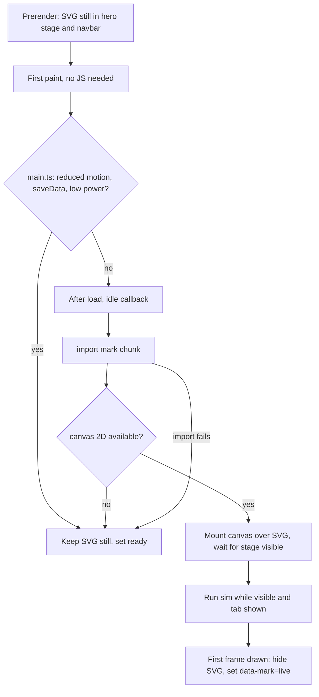

# Wisp Site Mark Hero - Plan

## Goal Capsule

- **Objective:** A visitor to wisp.observer sees a calm page with one small living light, the Wisp mark, as its only moment of motion, in a palette that never changes between sections or themes.
- **Means:** A Canvas 2D comet mark lazy-loaded over a server-rendered SVG still, replacing the flame and the ribbon shader, with a three-color token set as the only palette source (KTD1-KTD4).
- **Authority:** Product Contract requirements govern behavior, Key Technical Decisions govern mechanism, units implement both. Session-settled decisions are labeled and not reopened.
- **Stop conditions:** Stop and report if the mark script cannot stay under the gzip budget without a runtime dependency, if body text cannot reach 4.5:1 on both neutrals, or if the change would alter product claims, install flow, `/plain/`, `/light/` or `/install.py`.
- **Execution profile:** Code. Verify with the site unit tests and the Chromium and WebKit browser suite; do not deploy.
- **Who ships:** The implementation owner reviews and merges the PR. Master pushes that touch `site-app/` deploy through the existing `website` workflow, so merging is the publish act.

---

## Product Contract

### Summary

The homepage hero is rebuilt around a new minimal Wisp mark: a soft dot with one curved, tapered tail that drifts and leans toward the pointer. The mark replaces the flame and the WebGL ribbon field. The whole page uses three colors, two neutrals plus one pop accent, in both light and dark.

### Problem Frame

The owner rejected the current flame ("doesn't work") and, after two prototype rounds, rejected a shader-heavy fairy as overdoing it. The remaining direction is a minimal mark with a hint of the fairy (a small living light with a trail), one lightweight animation, lazy-loaded, on a page with a fixed palette. The current site spends its motion budget on a decorative WebGL background and a multi-color ember, amber and blue palette, so the identity mark is not the thing a visitor remembers.

### Key Decisions

- **Minimal page, one animated element.** The mark is the single pop of motion. (session-settled: user-directed — chosen over a full three.js scene page: owner chose "both minimal, and add the pop, and keep it lean".) Governs R1, R9.
- **Exactly three colors.** Two neutrals plus one accent, fixed. (session-settled: user-directed — chosen over the current multi-color ember/amber palette: owner asked for "three colors, 2 normal with one pop" and a fixed scheme.) Governs R4, R5, R6.
- **Replace the flame.** (session-settled: user-directed — chosen over keeping the flame: owner said "the current flame doesn't work".) Governs R2, R10.
- **Minimalist mark, only a hint of the fairy.** A small living light with a trail. (session-settled: user-directed — chosen over the round-1 WebGL fairy and wings style: owner said "maybe we are overdoing it. Do minimalist".) Governs R2, R3.
- **Lazy-load the animation.** (session-settled: user-directed — chosen over eager WebGL on first paint: owner said "lazy load yes".) Governs R7.

### Requirements

**Mark and motion**

- R1. The hero's only animated element is the Wisp mark; no other element on the page loops or runs a canvas, shader or video.
- R2. The mark is the A Comet from the round-2 prototype (soft dot, one curved tapered tail, slow drift), and it replaces the flame in the hero, the navbar logo and the browser favicon.
- R3. The hero mark leans toward the pointer on hover and otherwise drifts on its own; it needs no click or tap and never moves outside its stage.
- R7. The animation starts only after first paint, only while its stage is on screen, and stops while the tab is hidden. It never delays or blocks the install action.
- R8. Reduced motion, data saver, low-power devices, no JavaScript, no canvas and a failed script all show a designed still of the same mark, with no layout shift against the animated state.

**Palette and legibility**

- R4. The homepage uses exactly three colors: ink `#15110E`, paper `#F2ECE0` and pop `#FF5B1F`. Tints are blends of the neutrals only; no other hue appears.
- R5. Light theme is paper ground with ink text; dark theme is ink ground with paper text. The pop is the same in both and appears only as a fill or graphic, never as text color.
- R6. Body text meets 4.5:1 and large text 3:1 against its ground in both themes, and the primary action is identifiable at 3:1 or by its label.

**Page and delivery**

- R9. Everything else on the page stays as is: copy, claims, install flow, trust links, cost card, FAQ, theme toggle, and the static prerender with no client React.
- R10. The mark script is under about 3 KB gzipped, adds no runtime dependency, and the first-paint JavaScript and CSS budgets in `tests/test_site_app.py` still hold.
- R11. No third-party load, no inline script bodies, and every asset stays same-origin under the existing CSP.

### Success Criteria

- A reviewer looking at desktop and mobile screenshots in both themes and under reduced motion sees one accent color, one moving thing, and readable text.
- The page builds and every existing site and browser test passes after the updates in this plan.
- The lazy mark chunk is measurably smaller than the removed ribbon chunk and the removal leaves no shader code, ThreeUI attribution, or flame image in the homepage output.

### Scope Boundaries

Non-goals:

- Changing copy, release claims, install behavior, pricing data, routes, `/install.py`, `/plain/` or `/light/`.
- A WebGL, three.js or video hero, or a second animated element.
- Motion on scroll, parallax, cursor-following trails across the whole page, or a click interaction.
- A dependency-free canvas helper library; the engine is a single module of this repo.
- Considered and not built: a pause button for the animation. Reduced motion already stops it and nothing flashes, so a control adds surface without closing a gap. A flashing or autoplay-with-sound finding would change that.

#### Deferred to Follow-Up Work

- Making the mark the desktop app icon, the bar glyph and the README hero. Those ship from `assets/brand/wisp-flame/` and are covered by `tests/test_app_icon.py` and `tests/test_wisp_flame_asset.py`; a product-wide identity change needs its own plan.
- Recoloring `/light/` and `/plain/` to the three-color palette. They keep their own palettes and the flame image for now.
- A small cursor-buddy demo strip using a 30 px animated mark (the round-2 buddy cell). The static 30 px glyph in the navbar is in scope.
- An apple-touch-icon PNG of the new mark; it needs raster export tooling this plan does not assume. The current PNG stays until then.

---

## Planning Contract

### Assumptions

These are agent recommendations, not owner-settled, and the PR description must surface them.

- A1. The mark is A Comet. It is the most fairy-like option that stays minimal; the fallback is D Ring and dot if the comet reads as a smear at small sizes in review.
- A2. The pop is ember `#FF5B1F`, on ink `#15110E` and paper `#F2ECE0`. Cyan `#19D9F0` (1.46:1 on paper) and lime `#B8F21A` (1.13:1 on paper) are worse still on the light theme.
- A3. The ribbon shader is removed rather than kept as a background. The mark carries the hero, and keeping any WebGL breaks the one-motion rule (R1).
- A4. Tints and alpha blends of ink and paper count as the same two neutrals; a glow or border derived from them does not add a color.
- A5. The pinned dark hero and navbar (`data-stage="dark"`) are dropped so the whole page follows the theme toggle, since the ribbon needed a dark stage and the mark does not.
- A6. Removing the ribbon removes the ThreeUI notice from `credits.txt` and `THIRD_PARTY_NOTICES.md`; the launch-ui notice stays.
- A7. The site has no linter. "Lint and test green" means the existing unit, build and browser commands listed under Verification Contract.

### Key Technical Decisions

- KTD1. **Canvas 2D engine, not WebGL.** One module of roughly 1-1.5 KB gzipped: fixed 60 Hz drift simulation, a position history for the tail, per-frame draw of a tapered stroke plus glow and dot. Ported from the round-2 `core.js` and `marks.js` for the comet only; B, C and D are dropped. (session-settled: user-directed — chosen over a three.js scene: owner wants minimal and lean.) Governs R1, R10.
- KTD2. **Server-rendered inline SVG still is the source of truth for first paint.** The prerender emits the comet as inline SVG in the hero stage and in the navbar. The canvas mounts over it after load and the SVG is hidden only after the canvas draws its first frame. This gives the no-JS, no-canvas, reduced-motion and data-saver states for free and avoids layout shift. Governs R7, R8.
- KTD3. **Lazy gate reuses the existing decision logic.** `site-app/src/client/main.ts` keeps its idle-callback-after-load, reduced-motion, `saveData`, `hardwareConcurrency`, `deviceMemory` and failure handling, now guarded by an `IntersectionObserver` on the stage and `visibilitychange`. The mark module is a dynamic `import()` so it ships as its own chunk. Governs R7, R8.
- KTD4. **Palette lives in three CSS custom properties.** `site-app/src/styles.css` defines `--ink`, `--paper` and `--pop` once, maps them to the existing semantic tokens (`--background`, `--foreground`, `--primary`, and so on) per theme, and derives card, muted and border with `color-mix` of the neutrals. Components keep their token names, so most markup needs no change. The canvas reads the same properties via `getComputedStyle` at mount and on theme change. (session-settled: user-directed — chosen over keeping oklch multi-color tokens: palette must be three colors and fixed.) Governs R4, R5.
- KTD5. **The pop is never a text color.** Ember on paper is 2.64:1, below both 4.5:1 and 3:1, so on the light theme the pop is a fill or graphic only. The primary button is a flat pop fill with an ink label (6.05:1 in both themes) and a visible ink or paper outline so its edge also clears 3:1 on paper. Links and eyebrows use the foreground color with underline or weight. Governs R5, R6.
- KTD6. **Two glyph geometries.** The hero comet has the full curved tail. The navbar and favicon glyph has a shorter, straighter tail so it holds up at 28-32 px, as the prototype review found. Both are hand-authored SVG paths in the repo, no raster tooling. Governs R2.
- KTD7. **Theme change recolors the live canvas.** `main.ts` already owns the toggle and the `prefers-color-scheme` listener; after either it calls the mark's recolor, so the canvas never shows the other theme's neutrals. Governs R5.
- KTD8. **Rename the stage and data attributes.** `#hero-bg` and `data-hero="webgl|static"` become a stage id and `data-mark="still|live"`, with `data-ready` kept as the "decision made" signal that tests and screenshots wait on. Governs R8.

### High-Level Technical Design

Directional guidance: the engine keeps one position history array and redraws the whole stage each frame. Pointer input moves an anchor target, and an exponential ease pulls the anchor toward it, as in the prototype. Colors are read once and on recolor.

### Implementation Units

### U1. Three-color token set

- **Goal:** One palette source, two neutrals plus pop, mapped to the existing semantic tokens in both themes.
- **Requirements:** R4, R5, R6; KTD4, KTD5.
- **Dependencies:** none.
- **Files:** `site-app/src/styles.css`, `site-app/src/components/ui/button.tsx`, `site-app/src/components/ui/glow.tsx`, `site-app/src/components/ui/badge.tsx`, `site-app/src/components/ui/section.tsx`, `site-app/src/components/ui/item.tsx`, `tests/test_site_app.py`
- **Approach:**
  1. Replace the oklch token blocks with `--ink`, `--paper`, `--pop` and per-theme mappings; keep `data-theme` and the `prefers-color-scheme` structure and `theme-init.js` unchanged.
  2. Derive card, muted, border, muted-foreground and shadow from `color-mix` of the neutrals; drop `--flame` and `--brand-foreground`.
  3. Make the default button a flat pop fill with the ink label and a foreground-color outline; remove the gradient. The `glow` button variant becomes a neutral outline.
  4. Remove the `Glow` decoration or reduce it to a neutral tint; eyebrows, step numbers, shield icons, links and the "reach." accent text switch from pop to foreground (KTD5).
  5. Drop the `data-stage="dark"` pinning (A5) and the `.hero-frame`, halftone and `.flame-mark` rules.
- **Patterns to follow:** existing `@theme inline` alias block and `@custom-variant dark` in `site-app/src/styles.css`.
- **Test scenarios:**
  - Covers R4. Parsing `styles.css`: the three hex values appear and no other hex or `oklch(` color literal is declared outside the token block.
  - Covers R6. Contrast computed from the token hexes: paper on ink and ink on paper at least 4.5:1; muted-foreground over background at least 4.5:1 in both themes; ink label on pop at least 4.5:1.
  - Covers R5. No rule uses `--pop` or `--primary` as a `color:` or `text-` utility on text elements (grep the rendered class list for `text-primary` and `text-brand`).
- **Verification:** built CSS contains only the three palette values; both themes render legible in screenshots.

### U2. Static mark, hero stage and favicon

- **Goal:** The hero, navbar logo and favicon show the new mark as an SVG with the same geometry the canvas will draw.
- **Requirements:** R2, R8, R9; KTD2, KTD6, KTD8.
- **Dependencies:** U1.
- **Files:** `site-app/src/components/sections/sections.tsx`, `site-app/src/components/ui/mark.tsx` (new), `site-app/public/favicon.svg` (new), `site-app/index.html`, `site-app/src/styles.css`, `tests/test_site_app.py`
- **Approach:**
  1. Add a `Mark` component that renders the inline SVG comet (hero geometry) and a `size="small"` variant (short, straighter tail) used by the navbar `Logo`; both use `currentColor`-free fills from `--pop`.
  2. In `Hero`, replace the `#hero-bg` ribbon div and the `#flame` picture with one stage element holding the SVG still, sized so the live canvas fits the same box (no shift); keep the headline, copy, CTAs and badge text exactly as they are, and remove the gradient on the accent word.
  3. Add `favicon.svg` (small geometry, pop on transparent) and point the `rel="icon"` link at it; leave the existing apple-touch-icon until the follow-up (Scope Boundaries).
  4. Keep the stage `aria-hidden` with a text alternative on the heading context, since the mark is decorative.
- **Patterns to follow:** `Logo` and `Hero` in `site-app/src/components/sections/sections.tsx`; build-time static rendering through `site-app/src/page.tsx`.
- **Test scenarios:**
  - Covers R2. Built `index.html` contains the stage with an inline `<svg>` and no `idle-256.webp`, `wisp-flame-512.png` or `<picture>`; `rel="icon"` points at `/favicon.svg`; the navbar logo has no ``.
  - Covers R8. The stage SVG is present with no JavaScript run (static check on the HTML) and the first `<h2` boundary test for JOB and the install CTA still passes.
  - Covers R9. Existing claim, install, link and no-external-host tests pass unchanged.
- **Verification:** screenshot at 390 px and 1440 px shows the still in both themes with the headline unchanged.

### U3. Comet engine and lazy gate

- **Goal:** The still comes alive: drift, tail, pointer lean, lazy, visibility-gated, recolorable.
- **Requirements:** R1, R3, R7, R8, R10; KTD1, KTD3, KTD7, KTD8.
- **Dependencies:** U2.
- **Files:** `site-app/src/client/mark.ts` (new), `site-app/src/client/main.ts`, `site-app/src/styles.css`, `tests/test_site_app.py`
- **Approach:**
  1. Port the round-2 sim and the comet draw into `mark.ts` as a single exported `mountMark(stage, { onLost })` returning a stop function plus a `recolor()`; no `window` globals and no other mark variants.
  2. Cap device pixel ratio at 2, clamp pointer lean to the stage, stop the loop when the stage leaves view or the tab is hidden, and resume on return; a fixed-step sim keeps drift speed independent of frame rate.
  3. If `getContext("2d")` returns null, or mounting throws, leave the SVG in place and set `data-mark="still"`.
  4. In `main.ts`, replace the ribbon import with `import("./mark")`, keep the idle-callback gate, reduced-motion change listener, `saveData`, core-count and memory checks, and call `recolor()` after the theme toggle and on `prefers-color-scheme` change.
  5. Hide the SVG and set `data-mark="live"` only after the first canvas frame.
- **Execution note:** Verify first-frame behavior and reduced-motion in a real browser early; canvas timing is the part unit tests cannot prove.
- **Technical design:** the per-frame cost is one tapered stroke of up to ~60 segments, one radial gradient and one dot; keep allocation out of the frame loop.
- **Patterns to follow:** the removed `site-app/src/client/hero.ts` for the context-loss and failure wiring shape; `site-app/src/client/main.ts` for the gate.
- **Test scenarios:**
  - Covers R10. The `mark-*.js` chunk gzips to under 3072 bytes; first-paint JS stays under 8 KiB raw; CSS under 64 KiB; no `react` in any JS.
  - Covers R7. `main.ts` source still contains `prefers-reduced-motion: reduce`, `saveData`, `hardwareConcurrency`, `requestIdleCallback` and `import("./mark")`.
  - Covers R11. No JS chunk references an external URL; the page has no inline script bodies.
  - Edge: stage never intersects the viewport, so the sim never runs (browser suite, stage scrolled out of view).
  - Error path: `import("./mark")` blocked by routing leaves the SVG still visible with `data-mark="still"` and no page errors.
- **Verification:** in Chromium the stage reaches `data-mark="live"`, a canvas exists, the pointer moves the comet's anchor, and no console errors appear.

### U4. Remove the ribbon, flame hero and ThreeUI notice

- **Goal:** Nothing of the old hero ships, and the build report names the new chunk.
- **Requirements:** R1, R2, R10, R11; A3, A6.
- **Dependencies:** U3.
- **Files:** `site-app/src/client/hero.ts` (delete), `site-app/build.mjs`, `site-app/public/credits.txt`, `site-app/licenses/THREEUI-LICENSE.txt` (delete), `THIRD_PARTY_NOTICES.md`, `tests/test_site_app.py`, `tests/test_site_workers.py`
- **Approach:**
  1. Delete `hero.ts` and the ThreeUI license file; remove the ThreeUI entry from `credits.txt` and `THIRD_PARTY_NOTICES.md`, keeping the launch-ui notice.
  2. In `build.mjs`, classify chunks by the `mark-` prefix and report "lazy mark JS".
  3. Leave `scripts/site/build_3d.py` shipping the flame assets: `/plain/` still uses them and `tests/test_site_3d.py` asserts them.
  4. Update `test_site_workers.py` to expect a `mark-*.js` chunk and the new favicon, and to stop requiring `hero-*.js`.
- **Patterns to follow:** current chunk accounting in `site-app/build.mjs`.
- **Test scenarios:**
  - Covers R1. Published output has exactly one `mark-*.js` and no `hero-*.js`; no `webgl`, `getExtension` or shader source string in any chunk.
  - Covers R11. `credits.txt` still carries the launch-ui copyright line; no ThreeUI or Meng To text remains on the page or in the notices.
  - Integration: the full Workers bundle builds and `/plain/`, `/light/` and `/install.py` outputs are byte-identical to before (existing `test_site_workers` assertions).
- **Verification:** `build:site` log reports first-paint JS, lazy mark JS and CSS sizes, with lazy mark JS smaller than the old 5.0 KB hero chunk.

### U5. Browser suite, screenshots and PR provenance

- **Goal:** The Playwright homepage suite proves the new states, and the PR says what was assumed.
- **Requirements:** R3, R6, R7, R8; Success Criteria.
- **Dependencies:** U4.
- **Files:** `tests/browser/home.mjs`
- **Approach:**
  1. Replace the `#hero-bg` and `#flame` assertions with the stage and `data-mark` states; the CTA test now expects a flat pop fill instead of a `linear-gradient`.
  2. Replace the five fallback modes (reduced, no-js, no-webgl, module-failed, render-failed) with reduced, no-js, no-canvas (null 2D context), module-failed and data-saver; each asserts the SVG still is visible, no canvas exists, no external request and no page error.
  3. Add a recolor check: toggle the theme and assert the live canvas pixel at its center stays the pop color and its corner pixel matches the new background.
  4. Keep the horizontal-overflow checks at 320, 390 and 1440, and the copy, FAQ and clipboard checks as they are.
  5. Capture desktop and mobile screenshots in both themes plus reduced motion for the PR, and list assumptions A1-A7 and the deferred items in the PR body.
- **Test scenarios:**
  - Happy path: desktop Chromium reaches `data-mark="live"` with one canvas.
  - Covers R3. Moving the pointer across the stage changes the canvas pixels between two screenshots.
  - Covers R8. Each of the five fallback modes shows the still at the same bounding box as the live stage.
  - Covers R6. Computed text color against computed background in both themes meets 4.5:1 for body text and the primary button label.
  - Edge: viewport 320x740 has no horizontal scroll.
- **Verification:** browser suite passes on Chromium and WebKit through the CI lane; screenshots reviewed in both themes.

---

## Verification Contract

| Gate | Command | Applies to |
|---|---|---|
| Page rules | `python3 -m unittest tests.test_site -v` | plain page unchanged |
| Homepage, light preview, Workers | `python3 -m unittest tests.test_site_app tests.test_site_3d tests.test_site_workers -v` | U1-U4 |
| Shipping claims | `python3 -m unittest tests.test_shipping_claims -v` | R9 |
| Build | `npm ci --ignore-scripts` then `npm run build:site` | U1-U4, bundle sizes |
| Browser | in `tests/browser`: `npm ci`, then `npm test` against `wrangler dev` as `pages.yml` runs it | U5 |

There is no site linter; none is invented here (A7). The `website` workflow in `.github/workflows/pages.yml` runs these gates on the PR and deploys only from master.

## Definition of Done

- All gates above pass locally and in the PR's `website` workflow.
- The homepage output contains the three palette colors and no other color literal, and body text meets 4.5:1 in both themes.
- The mark script is under about 3 KB gzipped with no new runtime dependency.
- No `hero.ts`, ThreeUI notice, flame image reference, or ribbon shader code remains in the homepage output; `/plain/`, `/light/` and `/install.py` are unchanged.
- Abandoned prototype code (for example the B, C and D marks) is not left in the diff.
- The PR description surfaces A1-A7 and the deferred follow-ups, and does not deploy.

---

## Risks and Dependencies

- **Merging deploys.** `.github/workflows/pages.yml` publishes on master pushes touching `site-app/`, and #333 (auto-deploy) is already merged. Review the PR as a release.
- **Pop on paper is low contrast** (2.64:1). Mitigated by KTD5; the engineering risk is accidental text use, which the U1 test guards.
- **Small-size legibility of the comet.** The tail may smear at 28-32 px; KTD6 uses a shorter glyph and A1 keeps D Ring and dot as the fallback.
- **Pinned WebKit.** Local WebKit may not match the CI-pinned build, so the WebKit lane is only authoritative in CI.
- **Notice removal.** Dropping the ThreeUI notice is correct only once no ThreeUI-derived code ships; U4's chunk scan verifies that.

## Sources

- `site-app/build.mjs`, `site-app/vite.config.mjs`, `site-app/src/client/main.ts`, `site-app/src/client/hero.ts`, `site-app/src/styles.css`, `site-app/src/components/sections/sections.tsx`
- `tests/test_site_app.py`, `tests/test_site_workers.py`, `tests/browser/home.mjs`, `.github/workflows/pages.yml`
- PR #330 (homepage rebuild, merged) and #332 (interaction polish, merged); `docs/plans/2026-11-07-0144-feat-wisp-rune-site-design-plan.md` (its requirement to preserve the flame and the lazy hero renderer is superseded by the owner's later direction here)
- Owner prototypes, outside the repo: round 1 `~/Downloads/claude/wisp-mark/` (rejected), round 2 `~/Downloads/claude/wisp-mark/v2/` (`core.js`, `marks.js`, `shots/`)
