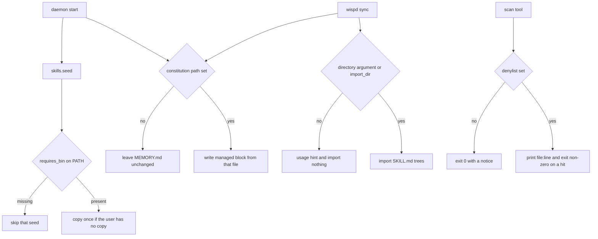

# Wisp identity seed and personal-info scan - Plan

## Goal Capsule

- **Objective:** A person who installs Wisp on their own Hyprland desktop gets a companion that does not already know the maintainer's name, home, repos, or machine, and a scan exists so that kind of identity can be caught in a temp tree without printing the secret.
- **Means:** Make constitution sync and skill import opt-in, stop bundling personal seeds, and add the denylist scan from the origin unit (KTD1, KTD2, KTD3, KTD4).
- **Authority:** This plan's Product Contract, then its Key Technical Decisions, then the origin unit U2 in `docs/plans/2026-11-08-1607-feat-wisp-linux-companion-rescope-plan.md`, then `ROADMAP.md` area 2.
- **Stop conditions:** Stop before a paid live model run, any change to an installed daemon or a live user config, rewriting git history, or deleting a skill the user already has on disk.
- **Execution profile:** One PR. Hermetic tests only. Test the new memory and seed cases before changing those functions.
- **Who ships:** The implementation owner reviews and merges. This plan does not implement the code.

## Product Contract

### Summary

This is origin unit U2, the next unfinished code slice after companion core.
It covers opt-in constitution sync, opt-in skill import, removal of personal seeds, a short shipped speech prompt, and the personal-info scan tool.
Product Contract narrowed from origin R7 and R9 to that slice.
Origin R7's local-speech and onboarding clauses stay on origin U4.
Companion core (`docs/plans/2026-11-08-1749-feat-wisp-companion-core-plan.md`, merged in #349) absorbed origin U5 and U6 and left the other units to other areas.
This plan does not change window text, the typed composer, ink, walkthroughs, or the app-skill count.

### Problem Frame

Daemon start calls `skills.seed()`, which copies every bundled seed that has a `SKILL.md` and no `requires_bin`.
That includes `wisp/skills_seed/luke-agents/SKILL.md`, `wisp/skills_seed/omarchy-bridge/SKILL.md`, and `wisp/skills_seed/design-md/SKILL.md`, which name a private checkout and one machine's paths.
`wispd` `run_daemon` calls `memory.sync_constitution()` with no argument on every start, and `wispd sync` calls it the same way.
With no argument the function still defaults to a private checkout and, when that checkout exists, writes `_CONSTITUTION_FACTS` into `MEMORY.md`.
`memory.snapshot()` injects that file into brain calls.
#360 scrubbed hostnames from tracked prose and did not add the scan tool or remove those facts.
A first trace missed the `wispd` call. The call is `dlog(_memory.sync_constitution())` after `skills.seed()`.

### Requirements

- R1. Daemon start on an empty skills directory does not install a bundled skill that names the maintainer's home, repos, or machine.
- R2. `wispd sync` with no constitution path and no import directory leaves `MEMORY.md` unchanged, imports nothing, and reports that it is not configured.
- R3. A configured constitution path writes that file's facts into the managed memory block, and a passed or configured import directory imports `*/SKILL.md` trees from it.
- R4. The scan tool fails on a planted denied token in a temp tree, passes when the token is absent, skips `LICENSE` and binary files, prints file and line only, never prints the token, and exits 0 with a notice when no list is set. A missing denylist file is a failure, not a clean scan.
- R5. The shipped default speech prompt is a short generic product list inside the existing vocab cap. A user's own prompt replaces it.

### Key Decisions

- **Identity leaves the bundled install.** Governs R1. (see origin: `docs/plans/2026-11-08-1607-feat-wisp-linux-companion-rescope-plan.md` KD5, KTD3)
- **Sync is opt-in.** Governs R2, R3. (see origin U2: no default constitution path and no default skill-import path)
- **The shipped prompt is generic.** Governs R5. (see origin U2 and A7)
- **The denylist stays outside the repository.** Governs R4. (see origin KTD5)

### Actors

- A1. A new Hyprland user whose skills directory and memory file start empty.
- A2. A person who points constitution and skill import at their own directories.

### Key Flows

- F1. **Clean start.** A1 starts the daemon. Seed copies bundled skills whose tool is present. No personal checkout skill is copied.
- F2. **Sync with nothing configured.** A1 runs `wispd sync`. Memory is unchanged and no skills are imported.
- F3. **Opt-in sync.** A2 sets a constitution file and an import directory, then runs sync. The managed block and the imported skills come from those paths.

### Acceptance Examples

- AE1. **Covers R1.** Given an empty skills directory and a `PATH` with no personal tools, when seed runs, then `luke-agents`, `omarchy-bridge`, and `design-md` are absent and the generic `omarchy` skill is absent until `omarchy` is on `PATH`.
- AE2. **Covers R2.** Given no constitution path, when sync runs, then `MEMORY.md` is byte-for-byte unchanged and the result says it is not configured.
- AE3. **Covers R4.** Given a temp tree with one planted token and `LICENSE` containing the same token, when the scan runs, then it exits non-zero, prints the planted file and line, and the token string is absent from stdout and stderr.

### Success Criteria

- A fresh skills directory after seed contains no bundled skill whose body names a private checkout under the maintainer's home.
- A fresh memory file after an unconfigured sync has no managed constitution block.
- The planted-token scan matches AE3, and a path or error that contains the planted token still does not print it.

### Scope Boundaries

- In: origin U2's code identity work and the scan tool with hermetic tests.
- Out: companion-core behavior shipped in #349; origin U3 docs scrub and CI secret wiring; origin U4 local speech and onboarding; origin U7 through U13; the site, Chrome extension, and teaching-assistant phase 2; rewriting git history (origin Q1, still deferred).

### Deferred to Follow-Up Work

- Origin U3. Docs scrub, and CI passing the denylist in as a repository secret. The test added here skips with a notice when no list is set, which is what forks without the secret need.
- Origin U4. Stock install whose speech default is local, plus the whisper and tesseract onboarding steps.
- Origin U7. Screen-aware dictation, the next user-visible companion slice after this one. The window-text collector already exists.
- Origin U8 through U13. Retry, the suggestion feed, voice handoff, typed artifacts, the generic gauntlet, and clicking. They stay in the origin plan.

### Outstanding Questions

- Q1 (deferred, non-blocking): if an owner's denylist contains the public GitHub login, a scan of the code tree will flag publisher URLs in `wisp/update.py`, `wisp/brain.py`, and `wisp/whatsnew.py`. This unit does not rewrite those URLs. U3 can decide an exemption. The hermetic planted-token test does not need that decision.

### Sources

- Origin plan U2 and KTD5: `docs/plans/2026-11-08-1607-feat-wisp-linux-companion-rescope-plan.md`.
- `ROADMAP.md` area 2 names that same plan for hygiene and defaults. Area 1 is the completed companion-core plan.
- Code: `wisp/memory.py` (`sync_constitution`, `_CONSTITUTION_FACTS`), `wisp/cli/settings.py` (`sync`), `wisp/skills.py` (`seed`), `wisp/skills_seed/luke-agents/SKILL.md`, `wisp/skills_seed/omarchy-bridge/SKILL.md`, `wisp/skills_seed/dayflow-bridge/SKILL.md`, `wisp/tui.py` skills line, `wisp/config.py` `[stt] prompt`, `wisp/vocab.py` (the prompt is capped at a short term list).
- Tests to keep green: `tests/test_memory.py`, `tests/test_omarchy_skills.py` (the `omarchy` seed installs only when the binary is present), `tests/test_tools.py` (`WebConfigTemplateTest` requires `[web]` to stay `mail` and `calendar`, and `[stt]` to keep `prompt`).
- `docs/solutions/` has one Blender learning and nothing about memory, seeds, or secret scans.
- External research was skipped. The scan's shape is already fixed by origin KTD5, and the repo already has the seed and memory functions to change.
- Slack context was not gathered.

## Planning Contract

### Key Technical Decisions

- KTD1. **Constitution sync has no home default.** An empty or missing `[memory] constitution` reports not configured and does not read a checkout or write a block. Daemon start and `wispd sync` share that rule. A set path is a file whose own lines become the block, bounded so it fits the existing memory budget. The managed markers do not name a personal repo. Implements R2, R3. (see origin U2)
- KTD2. **Skill import has no home default.** The positional argument of `wispd sync` stays a constitution-path override, which is what the command means today. Skill import uses only `[skills] import_dir`. With that key unset, sync imports nothing and says so. It does not turn the positional path into a skill directory. Implements R2, R3. (see origin U2)
- KTD3. **Personal seeds are not bundled.** Remove `wisp/skills_seed/luke-agents/`, `wisp/skills_seed/omarchy-bridge/`, and `wisp/skills_seed/design-md/`. Those three name a private checkout and have no external binary, so a `requires_bin` gate would not keep them off an Omarchy machine. `dayflow-bridge` installs only when the `dayflow` binary is on `PATH`. The generic `omarchy` seed stays. Implements R1. (see origin U2)
- KTD4. **The scan reads tokens from the environment.** `WISP_PERSONAL_DENYLIST` (newline list) or `WISP_PERSONAL_DENYLIST_FILE`. It scans tracked text case-insensitively, exempts `LICENSE`, skips binaries, prints `file:line` only, and exits 0 with a notice when no list is set. Implements R4. (see origin KTD5)

### High-Level Technical Design

### Assumptions

- A1. This slice is origin U2, ahead of screen-aware dictation (origin U7) and ahead of the local-speech default (origin U4). Evidence: `skills.seed()` still copies the personal seeds on daemon start, and `sync_constitution` still writes maintainer facts. Companion core left this unit outside its scope. The calling brief left the exact slice open and asked for the highest-leverage unfinished unit.
- A2. Shipped `[web] mail` and `[web] calendar`, and the spoken service aliases in `wisp/tools/desktop.py`, stay. `tests/test_tools.py` requires those two web keys. Origin "empty web aliases" is read as maintainer-specific URLs, and the shipped values are public product URLs.
- A3. Publisher URLs that name the public GitHub repository stay. See Q1.
- A4. An existing managed block in `MEMORY.md`, and skills already copied into the user skills directory, are left in place. The origin scenario for an unset constitution is that sync changes nothing. Seed never overwrites a skill the user already has, so a cleanup pass could delete an edit. Revisit if a clean install still answers as the maintainer after this unit.
- A5. `scripts/brand/render_wisp_flame.sh` already takes a host flag and a placeholder default. This unit does not edit it.
- A6. Personal versus Work profile detection in `wisp/tools/desktop.py` reads the focused window title and stays. `tests/test_tools.py` covers it. This unit does not rewrite it.
- A7. The shipped `[stt] prompt` becomes a short generic product list inside the cap in `wisp/vocab.py`. The same key remains how a user extends it. The speech provider stays `openai` until origin U4.
- A8. The first trace missed `wispd`'s call to `sync_constitution`. The plan now follows that call site. A full explainer artifact was not written.

### Sequencing

U1 first, so daemon start and `wispd sync` share the opt-in rule.
U2 next, so daemon start matches R1.
U3 after U1, because both edit the shipped config template in `wisp/config.py`.
U4 last, so the scan covers the tree those units leave behind.
One pull request contains all four units.

### System-Wide Impact

- `memory.snapshot()` keeps injecting `MEMORY.md`. After this unit, an unconfigured sync no longer adds the managed block. A block already on disk still injects, per A4.
- Daemon start still calls `skills.seed()`. The change is which seeds copy.
- Brain prompts, walkthroughs, and window text are unchanged.
- CI does not receive a denylist until origin U3. The new test skips when the list is unset.

### Risks

- A denylist that contains the public GitHub login will fail a full-tree scan until Q1 is decided. The unit's proof is the temp-tree test, not a claim that an unknown owner list is clean.
- Shortening the shipped speech prompt can change recognition of names that were only in that default string. Users who need those names set `[stt] prompt` in their own config. The dynamic vocab cap already drops a long prompt.

## Implementation Units

### U1. Opt-in constitution and skill import

- **Goal:** Unconfigured sync leaves memory and skills alone. Configured paths are the only source.
- **Requirements:** R2, R3. KTD1, KTD2.
- **Dependencies:** none.
- **Files:** `wisp/memory.py`, `wisp/cli/settings.py`, `wisp/config.py`, `wispd`, `tests/test_memory.py`, `tests/golden/cli_help/sync.txt`.
- **Approach:**
  - Add empty `[memory] constitution` and `[skills] import_dir` to the shipped config template.
  - `sync_constitution` writes a managed block only when given a path that exists. With no path, it reports not configured and does not create or edit `MEMORY.md`, and it does not dedupe the rest of the file.
  - The block's markers are generic (`## constitution` and `## /constitution`). Its body is a bounded excerpt of that file, not the hard-coded fact list. A configured sync replaces that region, and it treats an existing `## luke-agents` … `## /luke-agents` pair as the same region so the old heading does not stay beside the new one. Every other memory line stays. Over the existing memory budget, the call fails and does not write.
  - Daemon start calls `sync_constitution` with `[memory] constitution` when that key is set, and with no path when it is empty. Launch does not read a home checkout and does not write a block unless that key names an existing file.
  - `wispd sync` uses the positional argument only as a constitution-path override. It imports skills only from `[skills] import_dir`, and it drops the hard-coded private checkout. Update the sync help golden to match.
  - Keep the existing add, replace, and remove memory behavior.
- **Execution note:** Add the new memory cases first, next to the existing tests, and keep those existing tests passing while sync changes.
- **Patterns to follow:** `tests/test_memory.py` already patches `MEMORY_FILE` onto a temp directory. Mirror that. Config keys live in the shipped template string in `wisp/config.py`.
- **Test scenarios:**
  - With no constitution path and an existing memory file, sync returns a not-configured result and the file bytes are unchanged.
  - With no constitution path and no memory file, sync does not create one.
  - With a temp constitution file, sync writes a managed block whose bullets come from that file, under generic markers, and a second sync does not duplicate them.
  - A file that already has a `## luke-agents` block is rewritten so that heading is gone and one generic block remains.
  - A memory file that already has an unrelated bullet keeps that bullet after a configured sync.
  - A missing constitution path returns a failure that names the path and does not write a block.
  - Sync with `import_dir` unset does not copy skills and says import is not configured.
  - Sync with `import_dir` pointing at a temp directory of one `SKILL.md` tree imports that tree.
  - A positional path overrides the constitution file and is not treated as a skill directory.
  - The sync help text no longer names a private checkout or a default location.
  - The shipped template still parses with `prompt` under `[stt]` and `[web]` equal to mail and calendar.
  - The daemon start call does not pass a hard-coded home path into constitution sync.
- **Verification:** The memory tests cover each scenario above, and the existing memory round-trips still pass.

### U2. Stop bundling personal seeds

- **Goal:** Daemon start no longer installs the personal checkout skill or the one-machine Omarchy map.
- **Requirements:** R1. KTD3.
- **Dependencies:** none.
- **Files:** `wisp/skills.py`, `wisp/skills_seed/luke-agents/`, `wisp/skills_seed/omarchy-bridge/`, `wisp/skills_seed/design-md/`, `wisp/skills_seed/dayflow-bridge/SKILL.md`, `wisp/tui.py`, `tests/test_omarchy_skills.py`.
- **Approach:**
  - Delete the `luke-agents`, `omarchy-bridge`, and `design-md` seed directories.
  - Set `dayflow-bridge` so seed skips it unless `dayflow` is on `PATH`.
  - Leave `seed()`'s rule of copying only when the user has no copy.
  - Replace the TUI skills line that names luke-agents with a count of installed skills.
- **Execution note:** Keep the existing omarchy seed tests. That skill still installs only when `omarchy` is on `PATH`, and its body stays under the length and manual-text checks.
- **Patterns to follow:** `requires_bin` in `wisp/skills_seed/omarchy/SKILL.md` and the `Seed` tests in `tests/test_omarchy_skills.py`.
- **Test scenarios:**
  - Seed with an empty `PATH` does not create `luke-agents`, `omarchy-bridge`, `design-md`, `dayflow-bridge`, or `omarchy` in the skills directory.
  - Seed with `dayflow` on `PATH` copies `dayflow-bridge`.
  - Seed with `omarchy` on `PATH` still copies the generic `omarchy` skill and still skips it when the binary is absent.
  - A skill the user already has is not overwritten.
  - The deleted seed directories are absent from the tree.
- **Verification:** The seed tests cover each scenario, and the existing omarchy seed tests pass.

### U3. Generic shipped speech prompt

- **Goal:** The default speech prompt is a short product list a new user can extend.
- **Requirements:** R5. See A7.
- **Dependencies:** U1, because both touch `wisp/config.py`.
- **Files:** `wisp/config.py`, `tests/test_tools.py`.
- **Approach:**
  - Replace the shipped `[stt] prompt` with a short comma-separated list of product terms that fits the cap in `wisp/vocab.py`.
  - Do not change `[stt] provider`, `[web]`, or the spoken service aliases.
- **Patterns to follow:** `wisp/vocab.py` already treats a long prompt as something the recognizer will echo. `WebConfigTemplateTest` in `tests/test_tools.py` is the regression for the template shape.
- **Test scenarios:**
  - The shipped prompt is present under `[stt]` and splits to at most the vocab term cap.
  - `[web]` is still exactly mail and calendar.
  - A user config that sets its own `[stt] prompt` is the prompt vocab uses.
- **Verification:** The template test and one prompt-length assertion pass.

### U4. Personal-info scan tool

- **Goal:** A local scan can fail on a planted token without ever printing it.
- **Requirements:** R4. KTD4.
- **Dependencies:** U1, U2, U3, so the tree it would scan no longer has the bundled identity those units remove. The tool's own tests use a temp tree and do not depend on that cleanup.
- **Files:** `scripts/personal_info_scan.py`, `tests/test_personal_info.py`.
- **Approach:**
  - Read the denylist from `WISP_PERSONAL_DENYLIST` or the file in `WISP_PERSONAL_DENYLIST_FILE`.
  - Scan text files by walking the root argument. Tests pass a temp directory, so the walk does not depend on `git ls-files`.
  - Exempt `LICENSE`. Skip binaries. Match case-insensitively.
  - On a hit, print the path relative to the scan root and the line, then exit non-zero. Redact any denied token that still appears in a printed path or error. Do not print the token.
  - With no list, print a skip notice and exit 0. A set file path that cannot be read exits non-zero and does not claim the tree is clean. That error is redacted the same way. When both variables are set, the file is the list.
- **Execution note:** Write the temp-tree tests first. Use a planted fake token that is not a real name. Do not put a denylist in the repository.
- **Patterns to follow:** Other `tests/test_*.py` modules use `unittest` and `tempfile`. The origin U2 scenario list is the case list below.
- **Test scenarios:**
  - A temp tree with the planted token in one text file fails, and stdout plus stderr do not contain the token.
  - The same tree without the token exits 0.
  - The token inside `LICENSE` does not fail the scan.
  - A binary file containing the token does not fail the scan.
  - With neither env var set, the test sees a skip notice and exit 0.
  - A list file path that does not exist fails without printing file contents.
  - A temp directory whose name contains the planted token, and a missing denylist path that also contains it, still leave the token out of stdout and stderr.
- **Verification:** `tests/test_personal_info.py` covers each scenario. CI without the secret stays green because the test skips when no list is set.

## Verification Contract

| Gate | What proves it | Applies to |
|---|---|---|
| Memory and sync | `tests/test_memory.py` covers AE2 and the U1 scenarios, and the older memory round-trips still pass | U1 |
| Seeds | `tests/test_omarchy_skills.py` covers AE1 and the U2 scenarios, and the existing omarchy seed checks still pass | U2 |
| Config template | `tests/test_tools.py` `WebConfigTemplateTest` plus the U3 prompt-length assertion | U1, U3 |
| Scan | `tests/test_personal_info.py` covers AE3 and the U4 scenarios, including the skip when no list is set | U4 |
| Suite | The repo's existing unit discovery stays green, with no live model call, network, or audio | all |
| Owner scan | An owner may run the scan against the code tree with a list that does not contain the public GitHub login. A failure caused by that login is Q1, not a failed unit test | U4, optional |

## Definition of Done

- U1 through U4 meet their verification rows.
- `wisp/memory.py` no longer contains the hard-coded constitution facts, a default path to a private checkout, or `luke-agents` as the managed-block name. The sync help text does not name that repo or a default checkout.
- The `luke-agents`, `omarchy-bridge`, and `design-md` seed directories are gone.
- The scan never prints a denied token, including when a printed path or error contains one.
- Abandoned experiments and dead code from any unit are removed from the diff.
- Companion-core files for window text, the typed composer, ink, and walkthroughs are untouched.
- Units U3, U4, and U7 in `docs/plans/2026-11-08-1607-feat-wisp-linux-companion-rescope-plan.md` remain unstarted in this diff.
- This plan's U1 through U4 may all land here.

## Review

Remaining persona reviews skipped for speed; no known P0/P1 open.
