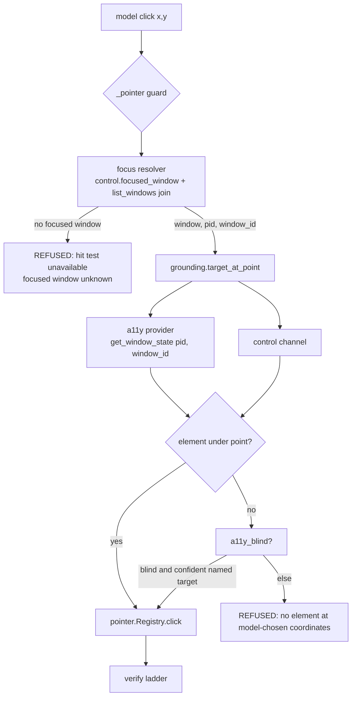
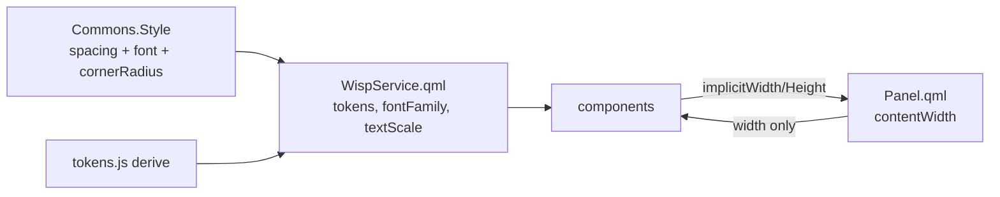

# Wisp Click Reliability and Surface Rebuild - Plan

## Goal Capsule

- **Objective:** When the owner asks Wisp to click something on screen, the click lands where Wisp is pointing. When the owner looks at any Wisp surface, spacing, text size and widths follow one rhythm, so nothing clips and nothing reads as a different app.
- **Means:** Resolve the focused window from the compositor instead of the driver payload (KTD1), then rebuild the QML surfaces on the shell's spacing and type tokens with one width model (KTD3, KTD4).
- **Authority:** This plan supersedes `docs/plans/2026-10-31-1754-feat-wisp-ui-overhaul-plan.md` for the QML surfaces; that plan's PR 1 shipped and its remaining units never started. Requirements win on behaviour, Key Technical Decisions win on mechanism.
- **Stop conditions:** Stop and report if a unit needs a cua-driver upgrade, if a change moves the accuracy gate, if a unit would need a live paid model call to verify, or if the snapshot baseline is still red from a cause unrelated to the unit.
- **Execution profile:** Three phases, one PR per unit, Linux only, Python plus QML. Tests stay hermetic; the one live check is the owner-session click in U3.
- **Who finishes:** Each unit's own PR. The two defect fixes already landed on this branch and are recorded under "Landed already".

---

## Product Contract

### Summary

Two defects make Wisp unreliable in ways the owner hits daily. Its click guard refuses the click whenever it cannot name the focused window, which on the installed driver is always, so a correct aim silently does nothing. And its surfaces were built on three competing spacing scales, so measured gaps run 7 to 19 px with no rhythm. This plan fixes the first and rebuilds the second.

### Problem Frame

The click failure is measured, not theorised. In `~/.local/share/wisp/trace.jsonl`, 53 of 127 click and move attempts return `REFUSED (no element at model-chosen coordinates)`; the run of 2026-11-13 00:25 aimed at `$57.14` correctly three times and clicked none of them. `wisp/grounding.py` `_focused_window()` demands a boolean `focused`/`is_focused`/`active` key and an integer `pid` on every window from cua-driver's `list_windows`. The installed driver (0.33.1) sends neither: focus flags are absent, `z_index` is null, and Chromium windows come back with `pid: null`. So `_focused_window()` returns None, `target_at_point()` returns None for every point, `a11y_blind()` returns False, and `wisp/tools/system.py` `_pointer()` refuses. Meanwhile `wisp/control.py` `focused_window()` and `wisp/elementtree.py` both resolve the focused window correctly from Hyprland — verified live this session, binding Chromium at frame `(17, 44, 1423, 1061)`. The guard is asking the wrong source.

The surface problem is also measured. `shell-plugin/lib/metrics.js` carries two spacing blocks: the legacy `M.spacing` (3/4/6/8/10/12/18) with 206 call sites, and a 4 px `scale.space` block added by the stalled overhaul with zero. `WispService.textScale` is computed and consumed by nothing, so `omarchy display text size` does not scale Wisp. Ten components hardcode `width: 340` under a Panel that already binds a width, leaving 112 px of dead card. Six group cards in `SettingsTab.qml` bind `root.tk.surface`, a token `lib/tokens.js` never emits, so they paint white on black and at 1.13:1 in light themes. Rendered gaps across four screens measure 7, 8, 9, 10, 12, 13, 14, 16, 17, 18, 19 px.

Two smaller defects were found while diagnosing and are already fixed on this branch (see "Landed already"): the level sampler starved silence detection because ALSA ignored its 200 Hz request, and a turn the owner stopped could not be labelled at all.

### Requirements

**Click reliability**

- R1. A model-chosen click on a live owner session lands when the compositor reports a focused window, and the guard still refuses when no window can be named.
- R2. The guard's evidence comes from one focus resolver, so the a11y hit test, the blind-window rule and the control channel cannot disagree about which window is focused.
- R3. A click refused because the driver payload cannot name a focus is reported as an environment condition, distinct from a click refused because no element is under the point.
- R4. A click the guard allows is verified by the existing verify ladder before the run claims it succeeded.

**Surface rebuild**

- R5. Every QML surface takes spacing from one scale, and that scale honours the system text size.
- R6. One type scale governs every surface: body at 14 px or more, secondary at 12 px or more, nothing under 12 px except non-text glyph labels.
- R7. Every colour a QML file references exists in the derived token map; a missing token fails a test rather than painting white.
- R8. Every surface sizes from its host. No component pins its own content width.
- R9. Interactive controls are at least 32 px in the Panel and 28 px on the overlay and bar.
- R10. A surface never clips content at the Panel width, at either viewport, or at text scale 1.25.
- R11. Panel content fills its card: the left gutter, the card inset and the content edge agree.

**Preserved behaviour**

- R12. The bar pill's 8-second rating window keeps its current rule: a stopped turn never opens it.
- R13. The answer card offers its thumbs on every terminal turn, and a stopped turn's verdict is stored as `cut-short` without moving the accuracy gate.
- R14. A capture stops on silence after speech, so a lost key release cannot run to the 60-second cap.

### Success Criteria

- On an owner session in drive mode, a asked-for click on a named on-screen element returns `CLICKED`, and the same run with no focused window returns a refusal that names the environment rather than the coordinates.
- The rendered gap set across the four audited screens collapses to multiples of the chosen scale step.
- `scripts/ui/snap.py check` compares against a baseline that was green before the rebuild, so any diff is attributable to the rebuild.
- No QML file references a colour token absent from the derived map.

### Key Decisions

- **Both defects in one plan, two tracks.** (session-settled: user-directed — chosen over the click fix alone and over the surface work alone: the owner asked for both.) Governs R1, R5.
- **The QML surfaces are rebuilt, not re-spaced.** (session-settled: user-directed — chosen over finishing the stalled overhaul's spacing patch: patching 206 call sites would keep the second scale and the pinned-old-blocks test alive.) Governs R5, R6, R8.
- **Focus comes from the compositor, not the driver payload.** cua-driver returns no focus flag and a null `z_index`; `control.focused_window()` already resolves the real focused window. Governs R1, R2.

### Scope Boundaries

**Deferred to Follow-Up Work**

- The standalone settings window and its category sidebar from the superseded overhaul plan.
- The TUI and CLI output passes from that plan.
- Moving the four wide management views (`HealthView`, `SpendView`, `AuditView`, `BindsView`) into the Panel. They render only in `shells/debug` today and stay there.
- Retuning grounding models. The click guard is the blocker; model selection is measured separately by the bake-off.

**Outside this plan**

- The browser lane, the Rust core `rs/`, the website, and the Windows and macOS companions.
- Any cua-driver change or upgrade.
- A second GUI toolkit or a Wisp-designed palette.

**Considered and not built**

- Inferring focus from `z_index`. The driver returns null for every window, so the rule would never fire. Evidence that would change this: a driver release returning a non-null `z_index` or a focus field.
- Relaxing the click guard itself. The refusal is correct behaviour when no element is known to be under the point; the defect is that the guard cannot see the element it should.
- Deleting the snapshot harness. It is red on the current branch (10 of 1057) and churns, but it has caught real text drift. U6 keeps a small structural set and adds numeric layout assertions.

### Open Questions

**Deferred to implementation (non-blocking)**

- How the offscreen snapshot harness supplies a spacing scale, since it has no `Commons.Style` (U6 decides; the fixture service stands in today).
- Whether the panel's card padding should come from `Style.spacing.popupPadding` (14) or `panelPadding` (18). U5 measures both against the Omarchy popups beside it.

---

## Planning Contract

### Key Technical Decisions

- KTD1. **Focus resolves through `control.focused_window()`, joined to cua's window id.** The resolver returns class, title, address, pid and bounds from `hyprctl activewindow`; `list_windows` supplies the `window_id` that `get_window_state` needs. One helper owns the join and returns `(window, pid, window_id)` or None, and `_focused_window`, `_control` and `elementtree` all read it. The join must fail closed: a compositor window absent from `list_windows` yields None, never a guess.
- KTD2. **A refusal names its cause.** When the join fails because the driver cannot name a focus, the result reads as an unavailable hit test, not as "no element at model-chosen coordinates". This keeps the trace honest and stops the next investigation repeating this one.
- KTD3. **The shell's spacing tokens win, and Wisp's own block is deleted.** `Style.spacing.*` already honours `[spacing] scale` and the font scale, which gives R5 its text-size support for free. The legacy `M.spacing` and the unused `scale.space` both go, and the test that pins the old blocks goes with them.
- KTD4. **One width model: the host sets width, the component never does.** Components expose content through their implicit size; `Panel.qml` alone decides the column width. This removes the ten `width: 340` and four `width: 560` pins.
- KTD5. **A token-completeness test closes the `tk.surface` class.** Extract every `tk.<name>` and `tokens.<name>` reference from the QML and assert each appears in `Object.keys(Tokens.derive(...))`. Six lines of `SettingsTab.qml` are the visible defect; the class returns without the test.
- KTD6. **Layout asserts geometry, goldens keep the few screens that caught real bugs.** Pixel goldens cannot survive a rebuild with a reviewable diff. U6 adds numeric assertions (gutter alignment, scale multiples, type floors, no clipping at the Panel width) and keeps a named handful of structural renders with regenerated goldens reviewed as images.

### High-Level Technical Design

The click path after KTD1. Today the guard's evidence and the hit test consult different sources, which is why they disagree.

The surface build after KTD3 and KTD4. Tokens flow one way, and width flows down from the host.

### Assumptions

- The offscreen harness can render at a chosen spacing scale. If it cannot, U6 asserts geometry at scale 1 and the text-scale coverage moves to the QtTest files.
- cua-driver 0.33.1 stays installed for the life of this plan. The join in KTD1 keys on fields this version sends.

---

## Implementation Units

### U1. Fixtures that reproduce the click defect

**Goal:** Make the failing click reproducible in the hermetic suite before changing production code.

**Requirements:** R1, R2.

**Dependencies:** none.

**Files:** `tests/test_click_provenance.py`, `tests/test_ground_chain.py`, `tests/fixtures/cua/` (new captured payloads), `tests/fakes/cua.py`.

**Approach:**
- Replace the invented `{"focused": True}` fixtures with captured `list_windows` payloads that carry no focus flag, a null `z_index`, and a `pid: null` Chromium window.
- Add a fixture `hyprctl activewindow` reply and a matching `clients` entry, so the join has both sides.
- Add a test asserting `_focused_window` finds nothing against the captured payload, and a test asserting `target_at_point` therefore returns None.
- Record the captured payloads verbatim; do not hand-write field shapes.

**Execution note:** Land this as a test-only commit that fails against current `grounding.py`. It is the reproduction, not the fix.

**Patterns to follow:** `tests/fakes/elementtree.py` fixture loading; `tests/fakes/cua.py` script keys.

**Test scenarios:**
- A captured payload with no focus flag and a null `z_index` yields no focused window from `_focused_window`.
- With `activewindow` provided and the same window present in the payload, the join from U2 is expected to find it; until then the test asserts the current None.
- A payload where `activewindow` names a window absent from `list_windows` yields None rather than a guess.

**Verification:** The new tests fail on the pre-fix tree and pass after U2.

### U2. One focus resolver, joined to the driver's window id

**Goal:** Give the click guard a real answer for which window is focused.

**Requirements:** R1, R2, R3.

**Dependencies:** U1.

**Files:** `wisp/grounding.py`, `wisp/control.py`, `wisp/tools/system.py`, `tests/test_click_provenance.py`.

**Approach:**
- Add one resolver that reads `control.focused_window()`, then matches its pid and title against `cua.list_windows` to obtain the `window_id`.
- Point `_focused_window`, `_control` and `a11y_blind` at that resolver; delete the flag-and-pid scan.
- Return a distinct, named condition when the resolver fails because the payload cannot name a window, and carry it into the `_pointer` refusal text (KTD2).
- Keep `elementtree` reading Hyprland directly; the resolver and the tree must agree on the focused frame, and a test asserts it.

**Patterns to follow:** `control.focused_window()`; `grounding._focused_window` call sites.

**Test scenarios:**
- Against the U1 fixture, the resolver returns the same pid and window id that `get_window_state` accepts.
- With no focused window, a model-coordinate click refuses with the environment wording, not the coordinates wording.
- With a focused window and an element under the point, the click is allowed and `Registry.click` is called.
- With a focused window and no element under the point on a non-blind tree, the click still refuses with the coordinates wording.
- A compositor window absent from `list_windows` produces a named failure, not an exception.
- `elementtree.focused_frame()` and the resolver's bounds agree within the tree's frame tolerance.

**Verification:** The U1 reproduction turns green, and the 28 existing provenance tests still pass.

### U3. Verify a landed click on the owner session

**Goal:** Prove the fix in the environment where it failed, and stop the run claiming an unverified click.

**Requirements:** R1, R4.

**Dependencies:** U2.

**Files:** `wisp/act.py`, `tests/test_act_verify.py`, `docs/research/2026-11-13-click-guard.md` (new evidence record).

**Approach:**
- Confirm the verify ladder runs after a guard-allowed click on the live session, and that a click whose effect cannot be observed is reported as attempted rather than done.
- Record one owner-session run in the evidence document: the goal, the aim, the result, and the post-click frame.
- Do not add a second verification mechanism; the ladder exists.

**Execution note:** This is the one unit with a live check. It runs on the owner's session in drive mode with the guard active — not in an isolated or gauntlet session, where the guard is skipped by design and would report clean whether or not the fix works.

**Test scenarios:**
- A guard-allowed click with an observable effect closes with a done claim carrying the verification verdict.
- A guard-allowed click with no observable effect closes with an attempted claim.
- A guard-refused click never reaches the verifier.

**Verification:** The evidence document carries one owner-session `CLICKED` with a verify verdict, and the refusal-count metric drops in the trace for that session.

### U4. One spacing and type scale

**Goal:** Delete the competing scales and route every surface through the shell tokens.

**Requirements:** R5, R6.

**Dependencies:** none.

**Files:** `shell-plugin/lib/metrics.js`, `shell-plugin/components/*.qml`, `shell-plugin/Panel.qml`, `shell-plugin/BarWidget.qml`, `tests/qml/lib/tst_metrics.qml`, `tests/qml/harness/FixtureService.qml`.

**Approach:**
- Remove `M.spacing` and the unused `scale.space`/`scale.font`/`textScale` block; keep one accessor that reads `Style.spacing.*` and falls back to the same numeric steps in the harness.
- Migrate the 206 `M.spacing` call sites and 166 `M.font` call sites to the surviving scale, one component group per commit so a regression bisects.
- Delete the test that pins the old blocks.
- Keep body at 14 and secondary at 12; the harness must render the same steps as the shell.

**Execution note:** Characterize first — capture the current renders, migrate, then review the diff as images.

**Patterns to follow:** `Style.spacing.*` and `Style.font.*` in `/usr/share/omarchy/shell/Commons/Style.qml`.

**Test scenarios:**
- No QML file references `M.spacing` or `M.font`.
- Every resolved spacing step is a multiple of the scale's base unit.
- Body text resolves to at least 14 px and secondary to at least 12 px at every supported text scale.
- A larger system text size grows Wisp's text and leaves control heights unchanged.

**Verification:** The lint finds no legacy name, and the migrated screens render at both viewports in both themes.

### U5. Surface geometry: widths, gutters, tokens

**Goal:** Make every surface fill its host and reference only real tokens.

**Requirements:** R7, R8, R9, R11.

**Dependencies:** U4.

**Files:** `shell-plugin/Panel.qml`, `shell-plugin/components/*.qml`, `shell-plugin/lib/tokens.js`, `tests/test_components.py`, `tests/qml/lib/tst_tokens.qml`.

**Approach:**
- Replace the ten `width: 340` and four `width: 560` pins with implicit sizing; the Panel keeps sole ownership of column width.
- Give `SettingsTab` its card background from a token that exists, and add `surface` to the token map if the design wants a distinct card fill from `raised`.
- Align the Panel gutter, card inset and content edge.
- Add the token-completeness test (KTD5).
- Raise controls under 32 px in the Panel and under 28 px on the overlay and bar.

**Test scenarios:**
- Every `tk.<name>` referenced in QML exists in the derived token keys.
- `SettingsTab` renders a card background whose contrast against canvas is at least 1.2:1 in both themes.
- A tab placed in the Panel spans the inner card width, with equal left and right gutters.
- Panel tab chips meet 32 px and overlay controls meet 28 px.
- No component file sets a literal `width` on its root.

**Verification:** Token test green, snapshots at both viewports show aligned gutters and no white cards.

### U6. Layout assertions replace the pixel baseline

**Goal:** Make layout regressions catchable without a golden image for every state.

**Requirements:** R10.

**Dependencies:** U4, U5.

**Files:** `scripts/ui/snap.py`, `tests/qml/harness/Snap.qml`, `tests/qml/lib/tst_layout.qml` (new), `tests/qml/snapshots/`.

**Approach:**
- Establish a green baseline first: the current branch is red at 10 of 1057 from causes unrelated to this plan, so fix or re-baseline those before asserting anything.
- Add numeric assertions: gutter equality, spacing-multiple compliance, type floors, and no overflow at the Panel width and text scale 1.25.
- Keep a named structural render set that has caught real drift, with regenerated goldens reviewed as images.
- Drop the per-state goldens that only restate the reducer.

**Execution note:** The baseline repair is its own commit, before any assertion work, so a later failure is unambiguously the rebuild's.

**Test scenarios:**
- A component given a width narrower than its content reports an overflow failure.
- A tab rendered at text scale 1.25 stays inside its host and below the clip threshold.
- The retained structural renders match their regenerated goldens.
- The suite reports zero diffs on an unchanged tree at both viewports and both themes.

**Verification:** `scripts/ui/snap.py check` is green on an unchanged tree, and a deliberately widened card fails the layout assertion.

---

## Verification Contract

| Gate | Command or evidence | Applies to |
|---|---|---|
| Click guard behaviour | `python -m unittest tests.test_click_provenance tests.test_ground_chain` | U1, U2 |
| Act verification | `python -m unittest tests.test_act_verify` | U3 |
| Component static rules | `python -m unittest tests.test_components` | U4, U5 |
| QML tokens and metrics | QtTest under `tests/qml/lib/` | U4, U5 |
| Layout assertions | `python scripts/ui/snap.py check` at 1728x1080 scale 2 and 3440x1440 scale 1, both themes | U6 |
| Live click check | One owner-session drive-mode run recorded in `docs/research/2026-11-13-click-guard.md` | U3 |

No gate calls a paid model. The gauntlet and isolated sessions are not valid gates for U1 to U3: both skip the click guard by design.

---

## Definition of Done

- Global: R1 to R14 hold, every gate above passes, and the snapshot baseline is green before and after the rebuild.
- Per unit: each unit's Verification is met and its Test scenarios exist as tests.
- Cleanup: no dead scale block, no pinned width, and no superseded golden remains in the diff.

---

## Landed already

These were found while diagnosing the defects above and are fixed on this branch, ahead of the plan.

- **Silence detection never fired.** `platform.sampler_cmd` asked arecord for 200 Hz; ALSA rejects anything under 2000 and silently scaled 200 to 200000, so the sampler read a 1000× stream, the level pinned near 1.0, and `endpoint.SilenceEndpoint` could never see 2.5 s of quiet. The command now asks for 8000 Hz raw, the window is 800 bytes (100 ms), and a live probe measures a 0.030 median level with endpointing firing at 3.7 s after speech. Addresses R14.
- **A stopped turn could not be labelled.** `label_last` refused every `CANCELLED` or `ERROR` line, so the owner's verdict on an interrupted run was thrown away. It now stores the labels as `cut-short`: kept and shown, never counted by the accuracy gate. The bar pill keeps its strict rule; the answer card gets its own. Addresses R12, R13.
